

::: {.complement}
Aucun corrigé officiel : **toutes les solutions de cette page sont rédigées par Claude**. Les énoncés sont des extraits du scan du sujet [sujet-2019], sans annotation. À relire avec un œil critique ; signaler toute erreur.

**Notations.** Le sujet suit les notations du TD : $g(t)$ filtre de mise en forme (cours : $h(t)$), $n(t)$ bruit (cours : $z_l(t)$), $R_A(n) = \E[A_k A_{k+n}]$ (cours : $R_A[m] = \E[A_n A^*_{n-m}]$, même valeur pour des symboles réels stationnaires).

**Correspondances.** Les questions 1, 2, 3 et 6 sont les questions 1, 3, 5 et 6 du [partiel 2015-2016](2015-2016-partiel.qmd#sec-ann1516-gen) ; les questions 4 et 5 sont les questions 7 et 9 du [partiel 2018-2019](2018-2019-partiel.qmd#sec-ann1819-gen) ; les questions 9 à 11 reprennent les questions 15 à 17 du [partiel 2017-2018](2017-2018-partiel.qmd#sec-ann1718-cours) avec une BPSK ; les questions 7 à 9 suivent l'exercice 2 du TD ([cyclostationnarité et DSP](../cours/03-dsp-signaux-codes-en-ligne.qmd#exr-td-bennett)). L'exercice 2 (16-QAM) relève du chapitre 6 du cours, pas encore rédigé.
:::

## Généralités sur les communications numériques {#sec-ann1920-gen}

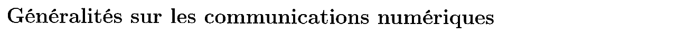{fig-alt="Titre de la première partie : Généralités sur les communications numériques."}

Chapitres du cours : [Introduction](../cours/01-introduction.qmd#sec-definitions-telecom), [Bruit blanc gaussien](../cours/03-dsp-signaux-codes-en-ligne.qmd#sec-bruit-blanc).

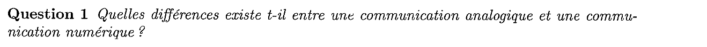{fig-alt="Question 1 : quelles différences existe-t-il entre une communication analogique et une communication numérique ?"}

:::: {.complement}
::: {.solution}
Même question que la [question 1 de 2015-2016](2015-2016-partiel.qmd#sec-ann1516-gen). En bref : en numérique, le message est échantillonné, quantifié et transmis comme une suite de symboles d'un alphabet fini ; le récepteur **décide** quel symbole a été émis, ce qui permet de retrouver le message exactement tant que le bruit ne franchit pas les seuils, de régénérer le signal, de coder contre les erreurs, de chiffrer et de compresser. En analogique, toute perturbation s'ajoute définitivement au message.
:::
::::

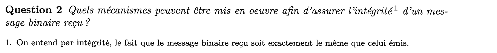{fig-alt="Question 2 : quels mécanismes peuvent être mis en œuvre afin d'assurer l'intégrité d'un message binaire reçu ? Note 1 : on entend par intégrité le fait que le message binaire reçu soit exactement le même que celui émis."}

:::: {.complement}
::: {.solution}
Même question que la [question 3 de 2015-2016](2015-2016-partiel.qmd#sec-ann1516-gen) : récepteur optimal (filtre adapté, critère de Nyquist, égalisation), $E_b/N_0$ suffisant, étiquetage de Gray ; codage de canal (détection par CRC, correction par codes correcteurs, entrelacement) ; retransmission des trames fausses (ARQ).
:::
::::

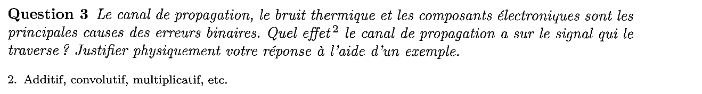{fig-alt="Question 3 : le canal de propagation, le bruit thermique et les composants électroniques sont les principales causes des erreurs binaires. Quel effet (additif, convolutif, multiplicatif, etc., note 2) le canal a-t-il sur le signal ? Justifier physiquement à l'aide d'un exemple."}

:::: {.complement}
::: {.solution}
Même question que la [question 5 de 2015-2016](2015-2016-partiel.qmd#sec-ann1516-gen) : effet **convolutif** (filtre $h_c(t)$ ; trajets multiples en radio mobile, qui créent de l'interférence entre symboles), qui se réduit à un effet **multiplicatif** (atténuation) et à un retard pour un canal sans distorsion (question 4) ; le bruit thermique est, lui, additif.
:::
::::

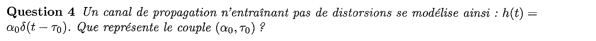{fig-alt="Question 4 : un canal sans distorsion se modélise par h(t) = α0 δ(t − τ0). Que représente le couple (α0, τ0) ?"}

:::: {.complement}
::: {.solution}
Même question que la [question 7 de 2018-2019](2018-2019-partiel.qmd#sec-ann1819-gen) : $\alpha_0$ est le gain (l'atténuation) du canal, $\tau_0$ le retard de propagation ; le signal reçu $\alpha_0\, s(t - \tau_0)$ est une copie non déformée du signal émis ($|H(f)|$ constant, phase linéaire).
:::
::::

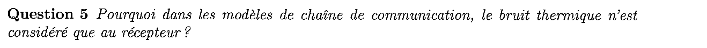{fig-alt="Question 5 : pourquoi, dans les modèles de chaîne de communication, le bruit thermique n'est-il considéré qu'au récepteur ?"}

:::: {.complement}
::: {.solution}
Même question que la [question 9 de 2018-2019](2018-2019-partiel.qmd#sec-ann1819-gen) : le signal arrive très atténué au récepteur, alors que le bruit thermique des premiers étages garde la même puissance ; c'est là que le rapport signal sur bruit est le plus faible. Le bruit de l'émetteur, négligeable devant le signal émis, est atténué avec lui.
:::
::::

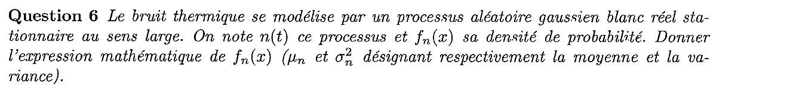{fig-alt="Question 6 : le bruit thermique se modélise par un processus aléatoire gaussien blanc réel stationnaire au sens large n(t), de densité de probabilité fn(x). Donner l'expression de fn(x), μn et σn² désignant la moyenne et la variance."}

:::: {.complement}
::: {.solution}
Même question que la [question 6 de 2015-2016](2015-2016-partiel.qmd#sec-ann1516-gen) :
$$f_n(x) = \frac{1}{\sqrt{2\pi\sigma_n^2}}\, \exp\!\left(-\frac{(x - \mu_n)^2}{2\sigma_n^2}\right), \quad \mu_n = 0 \text{ pour le bruit thermique.}$$
:::
::::

## Exercice 1 : modulation BPSK {#sec-ann1920-ex1}

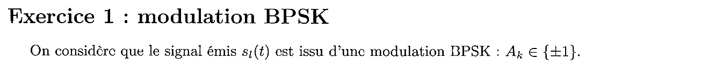{fig-alt="Exercice 1 : modulation BPSK ; le signal émis sl(t) est issu d'une modulation BPSK, Ak dans {±1}."}

Chapitres du cours : [Processus cyclostationnaires](../cours/03-dsp-signaux-codes-en-ligne.qmd#sec-cyclostationnarite), [Formule de Bennett](../cours/03-dsp-signaux-codes-en-ligne.qmd#sec-formule-bennett), [DSP avec une porte](../cours/03-dsp-signaux-codes-en-ligne.qmd#sec-dsp-porte).

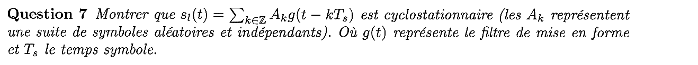{fig-alt="Question 7 : montrer que sl(t) = somme sur k de Ak g(t − kTs) est cyclostationnaire (Ak suite de symboles aléatoires et indépendants, g filtre de mise en forme, Ts temps symbole)."}

:::: {.complement}
::: {.solution}
Hypothèse : les $A_k$ sont indépendants et **identiquement distribués** (même loi pour tous les $k$), donc la suite est stationnaire : $\E(A_k) = m_A$ et $\E(A_k A_m) = R_A[m - k]$ ne dépendent pas de l'origine. Il faut montrer que la moyenne et l'autocorrélation de $s_l$ sont périodiques de période $\Ts$ ([définition](../cours/03-dsp-signaux-codes-en-ligne.qmd#def-cyclostationnarite)).

**Moyenne.** $m_{s_l}(t) = \E[s_l(t)] = m_A \sum_k g(t - k\Ts)$. Avec $k' = k - 1$ :
$$m_{s_l}(t + \Ts) = m_A \sum_k g\big(t - (k - 1)\Ts\big) = m_A \sum_{k'} g(t - k'\Ts) = m_{s_l}(t).$$

**Autocorrélation** (convention du cours, symboles réels) :
$$R_{s_l}(t, \tau) = \E[s_l(t)\, s_l(t - \tau)] = \sum_k \sum_m R_A[m - k]\; g(t - k\Ts)\; g(t - \tau - m\Ts).$$
En remplaçant $t$ par $t + \Ts$ et en posant $k' = k - 1$, $m' = m - 1$ (la différence $m' - k' = m - k$ ne change pas), on retrouve la même double somme : $R_{s_l}(t + \Ts, \tau) = R_{s_l}(t, \tau)$.

$s_l$ est donc **cyclostationnaire** de période $\Ts$ (et non stationnaire : $R_{s_l}(t, \tau)$ dépend de la position de $t$ dans le symbole). C'est la démonstration de l'exercice 2 du TD ([exercice](../cours/03-dsp-signaux-codes-en-ligne.qmd#exr-td-bennett), q. 3 et 6).
:::
::::

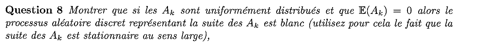{fig-alt="Question 8 : montrer que si les Ak sont uniformément distribués et E(Ak) = 0, alors le processus discret des Ak est blanc (utiliser le fait que la suite des Ak est stationnaire au sens large)."}

:::: {.complement}
::: {.solution}
$A_k \in \{-1, 1\}$ équiprobables : $\E(A_k) = 0$, $\E(A_k^2) = 1$. Par indépendance :
$$R_A[n] = \E(A_k A_{k+n}) = \begin{cases} \E(A_k^2) = 1 & n = 0 \\ \E(A_k)\,\E(A_{k+n}) = 0 & n \neq 0 \end{cases} = \delta[n].$$
La suite étant SSL, sa DSP est la TF à temps discret de $R_A$ : $\sum_n R_A[n]\, e^{-j2\pi fn\Ts} = 1$, **constante** sur toutes les fréquences : le processus discret est **blanc**.
:::
::::

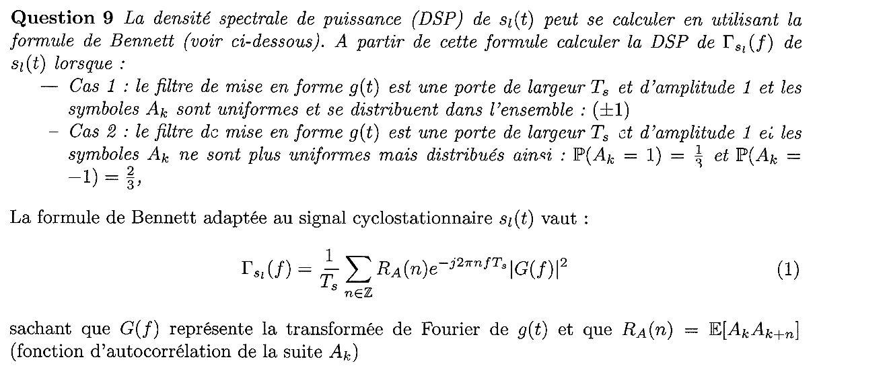{fig-alt="Question 9 : à partir de la formule de Bennett, calculer la DSP de sl(t) lorsque, cas 1, g est une porte de largeur Ts et d'amplitude 1 et les Ak sont uniformes dans {±1} ; cas 2, même porte mais P(Ak = 1) = 1/3 et P(Ak = −1) = 2/3. Formule (1) : Γ(f) = (1/Ts) somme sur n de RA(n) e^{−j2πnfTs} |G(f)|², avec RA(n) = E[Ak Ak+n]."}

:::: {.complement}
::: {.solution}
Porte sur $[0, \Ts]$ : $|G(f)|^2 = \Ts^2\sinc^2(f\Ts)$, avec $\sinc(x) = \frac{\sin \pi x}{\pi x}$.

**Cas 1.** $R_A = \delta$ (question 8), la somme vaut 1 :
$$\boxed{\Gamma_{s_l}(f) = \Ts\,\sinc^2(f\Ts)}$$
(c'est la [2-PAM du TD](../cours/03-dsp-signaux-codes-en-ligne.qmd#exr-td-dsp-2pam)).

**Cas 2.** $m_A = \frac13 - \frac23 = -\frac13$, $\E(A_k^2) = 1$, $\sigma_A^2 = 1 - \frac19 = \frac89$. Par indépendance, $R_A[n] = \sigma_A^2\,\delta[n] + m_A^2 = \frac89\,\delta[n] + \frac19$. Avec la formule sommatoire de Poisson, $\sum_n e^{-j2\pi fn\Ts} = \frac{1}{\Ts}\sum_k \delta(f - \frac{k}{\Ts})$ :
$$\Gamma_{s_l}(f) = \frac{|G(f)|^2}{\Ts}\left[\frac89 + \frac{1}{9\Ts}\sum_k \delta\!\left(f - \frac{k}{\Ts}\right)\right].$$
$|G(k/\Ts)|^2 = 0$ pour $k \neq 0$ et $\Ts^2$ pour $k = 0$ : seule la raie en $0$ subsiste.
$$\boxed{\Gamma_{s_l}(f) = \frac89\,\Ts\,\sinc^2(f\Ts) + \frac19\,\delta(f)}$$
Contrôle : puissance $\frac89 + \frac19 = 1 = \E(A_k^2)$ ✓. Les symboles non équiprobables ne sont plus centrés : une partie de la puissance ($m_A^2 = \frac19$) passe dans une raie à la fréquence nulle (composante continue), sans transporter d'information. Même mécanisme que pour l'[OOK](../cours/03-dsp-signaux-codes-en-ligne.qmd#exr-td-dsp-ook).
:::
::::

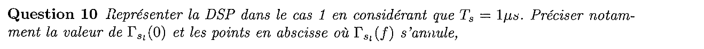{fig-alt="Question 10 : représenter la DSP dans le cas 1 pour Ts = 1 µs ; préciser Γ(0) et les points où Γ(f) s'annule."}

:::: {.complement}
::: {.solution}
$\Gamma_{s_l}(0) = \Ts = 10^{-6}$ (V²/Hz, soit W/Hz sur 1 Ω) ; zéros en $f = \frac{k}{\Ts} = k$ MHz, $k \neq 0$ ; lobe principal sur $[-1, 1]$ MHz, lobes secondaires en $1/f^2$. Voir la [figure du cours](../cours/03-dsp-signaux-codes-en-ligne.qmd#fig-dsp-porte) (même allure, $\sigma_A^2 = 1$) et la [question 16 de 2017-2018](2017-2018-partiel.qmd#sec-ann1718-cours) (même calcul avec $\sigma_A^2 = 5$).
:::
::::

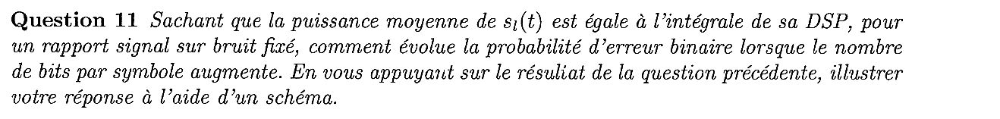{fig-alt="Question 11 : la puissance moyenne de sl(t) est l'intégrale de sa DSP ; pour un rapport signal sur bruit fixé, comment évolue la probabilité d'erreur binaire lorsque le nombre de bits par symbole augmente ? S'appuyer sur la question précédente et illustrer par un schéma."}

:::: {.complement}
::: {.solution}
**Appui sur la question 10.** La DSP vaut $\sigma_A^2\,\Ts\sinc^2(f\Ts)$ : sa forme (donc la bande) ne dépend que de $\Ts$ et de $g$, et son aire, la puissance, vaut $P = \sigma_A^2$ (pour $\int|G|^2 = \Ts$). Si la puissance d'émission et $\Ts$ sont fixés quel que soit $n_b$, la variance des symboles $\sigma_A^2$ est **fixée**.

**Conséquence.** Pour une $M$-PAM $\{\pm d, \pm 3d, \dots\}$, $\sigma_A^2 = d^2\frac{M^2 - 1}{3}$, donc $d = \sqrt{\frac{3\sigma_A^2}{M^2 - 1}}$ diminue quand $M = 2^{n_b}$ augmente : la distance entre chaque symbole et le seuil voisin vaut $1$, $0{,}45$, $0{,}22$ pour $n_b = 1, 2, 3$ et $\sigma_A^2 = 1$ (@fig-ann19-pam-puissance-constante). À bruit fixé, $P_b \simeq 2\frac{M - 1}{M\log_2 M}Q(d/\sigma)$ ([cours](../cours/04-transmission-presence-bruit.qmd#eq-pb-mpam)) **augmente** avec $n_b$. Même raisonnement qu'à la [question 17 de 2017-2018](2017-2018-partiel.qmd#sec-ann1718-cours).

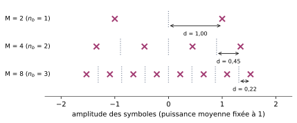{#fig-ann19-pam-puissance-constante}
:::
::::

## Exercice 2 : interception et décodage d'un SMS {#sec-ann1920-ex2}

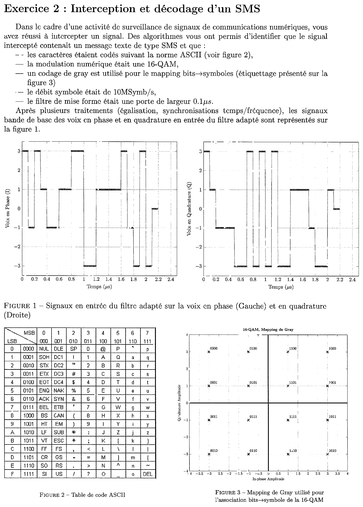{fig-alt="Exercice 2 : un signal intercepté contient un SMS ; caractères codés en ASCII (figure 2, table ASCII, colonnes MSB sur 3 bits, lignes LSB sur 4 bits) ; modulation 16-QAM ; codage de Gray (figure 3 : étiquettes des 16 points d'abscisses et d'ordonnées ±1, ±3) ; débit symbole 10 Msymboles/s ; filtre de mise en forme : porte de 0,1 µs. Figure 1 : signaux en entrée du filtre adapté sur les voies en phase et en quadrature, en marches d'escalier de niveaux ±1, ±3 entre 0 et 2,2 µs."}

Ce sujet relève du chapitre 6 du cours (modulations QAM), pas encore rédigé dans Bristol. Chapitre lié : [Association bits → symboles](../cours/02-communication-sans-bruit.qmd#sec-association-bits-symboles).

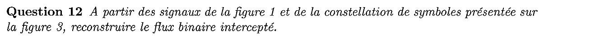{fig-alt="Question 12 : à partir des signaux de la figure 1 et de la constellation de la figure 3, reconstruire le flux binaire intercepté."}

:::: {.complement}
::: {.solution}
**Méthode.** Débit $10$ Msymboles/s : un symbole dure $\Ts = 0{,}1\ \mu$s, et la porte de $0{,}1\ \mu$s donne un palier constant par symbole. On lit, pour chaque intervalle $[0{,}1\,k\,;\,0{,}1\,(k+1)]\ \mu$s, le niveau de la voie I (abscisse) et celui de la voie Q (ordonnée), puis l'étiquette du point $(I, Q)$ sur la figure 3.

**Structure de l'étiquetage.** Sur la figure 3, les deux premiers bits ne dépendent que de I ($-3 \to 00$, $-1 \to 01$, $1 \to 11$, $3 \to 10$) et les deux derniers que de Q ($3 \to 00$, $1 \to 01$, $-1 \to 11$, $-3 \to 10$) : deux 4-PAM de Gray. Cela facilite la lecture.

**Lecture.** 21 symboles de $0$ à $2{,}1\ \mu$s ; sur $[2{,}1\,;\,2{,}2]\ \mu$s, les deux voies valent $0$, valeur absente de la constellation : fin de la transmission, ignorée.

| $k$ | $t$ (µs) | I | Q | bits |
|---|---|---|---|---|
| 0 | 0,0–0,1 | 3 | 3 | 1000 |
| 1 | 0,1–0,2 | −1 | 1 | 0101 |
| 2 | 0,2–0,3 | 3 | −1 | 1011 |
| 3 | 0,3–0,4 | 1 | −1 | 1111 |
| 4 | 0,4–0,5 | −1 | −1 | 0111 |
| 5 | 0,5–0,6 | −1 | −3 | 0110 |
| 6 | 0,6–0,7 | 1 | −3 | 1110 |
| 7 | 0,7–0,8 | 1 | 3 | 1100 |
| 8 | 0,8–0,9 | 3 | −3 | 1010 |
| 9 | 0,9–1,0 | 3 | 3 | 1000 |
| 10 | 1,0–1,1 | −3 | −3 | 0010 |
| 11 | 1,1–1,2 | −3 | 3 | 0000 |
| 12 | 1,2–1,3 | 1 | −3 | 1110 |
| 13 | 1,3–1,4 | 1 | −3 | 1110 |
| 14 | 1,4–1,5 | 1 | 1 | 1101 |
| 15 | 1,5–1,6 | 1 | 1 | 1101 |
| 16 | 1,6–1,7 | 3 | 1 | 1001 |
| 17 | 1,7–1,8 | −1 | −1 | 0111 |
| 18 | 1,8–1,9 | −3 | −3 | 0010 |
| 19 | 1,9–2,0 | 3 | −3 | 1010 |
| 20 | 2,0–2,1 | −3 | 1 | 0001 |

Flux binaire (84 bits) :

`100001011011111101110110111011001010100000100000111011101101110110010111001010100001`
:::
::::

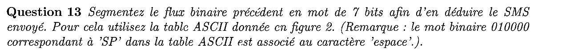{fig-alt="Question 13 : segmenter le flux binaire en mots de 7 bits pour en déduire le SMS envoyé, avec la table ASCII de la figure 2. Remarque : le mot binaire 010000 correspondant à SP dans la table ASCII est associé au caractère espace."}

::: {.a-verifier #av-ann1920-mot-sp}
**Source** [sujet-2019, p. 2, q. 13] : « le mot binaire 010000 correspondant à 'SP' dans la table ASCII est associé au caractère 'espace' ».

**Problème** : les mots sont de 7 bits ; « 010000 » n'en compte que 6. Dans la table de la figure 2, SP est dans la colonne 010 (MSB) et la ligne 0000 (LSB), soit le mot de 7 bits $0100000$ (0x20).

**Proposition** : lire « 0100000 ».
:::

:::: {.complement}
::: {.solution}
Le flux de 84 bits donne exactement 12 mots de 7 bits. Chaque mot se lit avec la table : les 3 premiers bits donnent la colonne (MSB), les 4 derniers la ligne (LSB).

| Mot | MSB | LSB | Caractère |
|---|---|---|---|
| 1000010 | 100 (4) | 0010 (2) | B |
| 1101111 | 110 (6) | 1111 (F) | o |
| 1101110 | 110 (6) | 1110 (E) | n |
| 1101110 | 110 (6) | 1110 (E) | n |
| 1100101 | 110 (6) | 0101 (5) | e |
| 0100000 | 010 (2) | 0000 (0) | SP (espace) |
| 1000001 | 100 (4) | 0001 (1) | A |
| 1101110 | 110 (6) | 1110 (E) | n |
| 1101110 | 110 (6) | 1110 (E) | n |
| 1100101 | 110 (6) | 0101 (5) | e |
| 1100101 | 110 (6) | 0101 (5) | e |
| 0100001 | 010 (2) | 0001 (1) | ! |

$$\boxed{\text{SMS : « Bonne Annee! »}}$$
(l'ASCII n'a pas de lettres accentuées). Le message est cohérent avec le préambule du sujet (« je vous souhaite une excellente année 2020 »), ce qui valide la lecture des chronogrammes ; une seule erreur de lecture d'un niveau aurait changé un caractère. Décodage refait par programme à partir des niveaux lus ✓.
:::
::::
