

::: {.complement}
Énoncé découpé question par question [td] ; sous chaque question : la correction officielle du TD [td-correction] (texte normal, blocs *Solution*), puis les solutions, explications et contrôles ajoutés par Claude (*Complément*) pour ce que la correction ne traite pas. Il n'y a pas de notes d'Armand pour ce TD. Les solutions sont reprises des chapitres du cours (jusqu'au 31 octobre 2026, les exercices du TD y étaient corrigés) ; elles sont écrites avec les **notations du cours**, différentes de celles du TD (table des notations de la [fiche matière](../index.qmd)).

**Attention** : la correction suit **une autre version de l'énoncé** ; pour les exercices 2 à 5, la numérotation et le nombre des questions diffèrent. Les numéros utilisés ici sont ceux de l'**énoncé** ; la correspondance est indiquée exercice par exercice.

Cours associé : [Principes de communication en l'absence de bruit](../cours/02-communication-sans-bruit.qmd#sec-modelisation-signaux) (exercice 1), [DSP des signaux codés en ligne](../cours/03-dsp-signaux-codes-en-ligne.qmd#sec-exercices-td-dsp) (exercice 2 ; exercice 5, q. 10-11) et [Transmission en présence de bruit](../cours/04-transmission-presence-bruit.qmd#sec-exercices-td-bruit) (exercices 3 et 4 ; exercice 5, q. 12-13).
:::

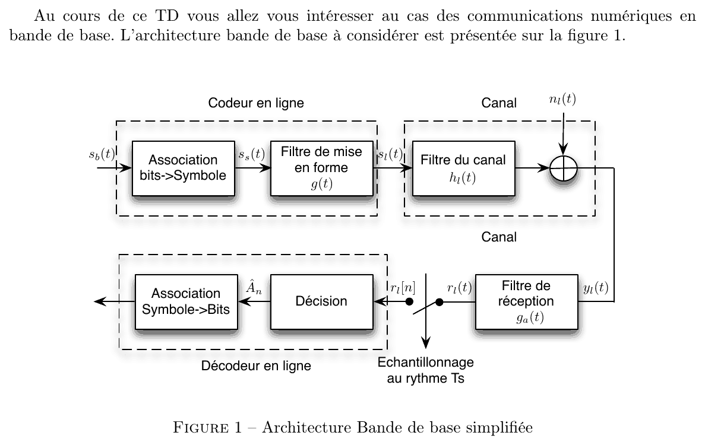{fig-alt="Introduction du TD : communications numériques en bande de base. Figure 1, architecture bande de base simplifiée : codeur en ligne (association bits->symbole, sb(t) donne ss(t), puis filtre de mise en forme g(t) donnant sl(t)), canal (filtre du canal hl(t), puis ajout du bruit nl(t)), filtre de réception ga(t) donnant yl(t) puis rl(t), échantillonnage au rythme Ts donnant rl[n], décodeur en ligne (décision donnant Ân, puis association symbole->bits)."}

## Exercice 1 : modulateur/démodulateur numérique 8-PAM {#sec-td01-ex1}

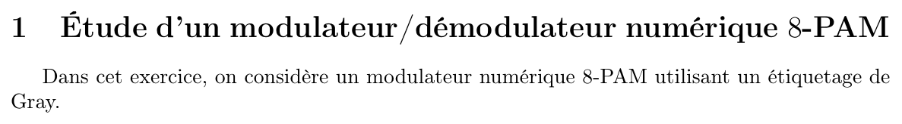{fig-alt="Exercice 1 : étude d'un modulateur/démodulateur numérique 8-PAM. On considère un modulateur numérique 8-PAM utilisant un étiquetage de Gray."}

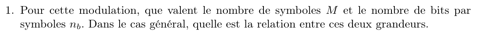{fig-alt="Q1 : pour cette modulation, que valent le nombre de symboles M et le nombre de bits par symbole nb ? Dans le cas général, quelle est la relation entre ces deux grandeurs ?"}

::: {.solution}
Correction du TD [td-correction, p. 1]. De façon générale, pour une $M$-PAM, $M$-QAM, $M$-PSK, $M$ représente le nombre de symboles. Le nombre de bits par symbole est alors donné par la relation

$$
n_b = \log_2(M) ;
$$

en effet, le nombre de symboles pouvant être indexés par des étiquettes différentes de $n_b$ bits est $M = 2^{n_b}$. Dans le cas d'une 8-PAM, il y a donc 8 symboles et $n_b = 3$ bits par symbole.
:::

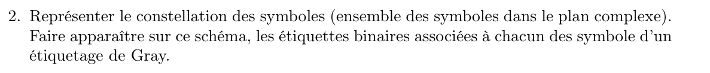{fig-alt="Q2 : représenter la constellation des symboles (ensemble des symboles dans le plan complexe) ; faire apparaître les étiquettes binaires associées à chacun des symboles d'un étiquetage de Gray."}

::: {.solution}
Correction du TD [td-correction, p. 2]. Pour une 8-PAM, les symboles possibles sont $\{\pm 1, \pm 3, \pm 5, \pm 7\}$. Constellation avec étiquetage de Gray (figure 2 de la correction, « 1 changement binaire » entre voisins ; reprise ici en tableau) :

| Symbole | $-7$ | $-5$ | $-3$ | $-1$ | $1$ | $3$ | $5$ | $7$ |
|---|---|---|---|---|---|---|---|---|
| Étiquette | 000 | 001 | 011 | 010 | 110 | 111 | 101 | 100 |

Cette modulation ne contient que des symboles réels (dans $\mathbb{R}$). Certaines modulations numériques possèdent des symboles complexes (dans $\mathbb{C}$), par exemple les $M$-PSK, $M$-QAM, ou plus généralement les modulations $M$-APSK.

L'étiquetage de Gray est garanti par le fait que deux étiquettes attribuées à des symboles voisins ne diffèrent que par au plus 1 bit. L'étiquetage proposé n'est pas le seul étiquetage de Gray ; en effet, toute permutation des étiquettes va fonctionner.

Supposons maintenant que ces symboles sont transmis dans un canal à bruit blanc additif gaussien. Parmi tous les étiquetages possibles, les étiquetages de Gray permettent de minimiser la probabilité d'erreur binaire à probabilité d'erreur symbole donnée. En effet, les erreurs au niveau des symboles les plus probables (celles entre voisins immédiats) n'engendreront par construction qu'une seule erreur binaire.
:::

::: {.a-verifier #av-td-gray-permutation}
**Source** [td-correction, p. 2] : « L'étiquetage proposé n'est pas les seul étiquetage de Gray, en effet, toute permutation des étiquettes va fonctionner. »

**Problème** : une permutation quelconque des huit étiquettes entre les symboles ne conserve pas la propriété de Gray. Par exemple, en échangeant les étiquettes de $-7$ et de $-1$, les symboles voisins $-7$ et $-5$ portent $010$ et $001$, qui diffèrent de 2 bits. Les transformations qui conservent un étiquetage de Gray sont, par exemple, la permutation des **positions** des bits dans toutes les étiquettes, l'inversion d'un même bit dans toutes les étiquettes, ou le retournement de l'ordre des symboles.

**Proposition** : lire « toute permutation des positions des bits (appliquée à toutes les étiquettes) donne encore un étiquetage de Gray ».
:::

::: {.complement}
C'est l'étiquetage obtenu par la construction de Gray en miroir du cours ([chapitre 4](../cours/04-transmission-presence-bruit.qmd#tbl-gray-miroir)) ; pour la 4-PAM, voir la [constellation du chapitre 2](../cours/02-communication-sans-bruit.qmd#exm-4pam-gray).
:::

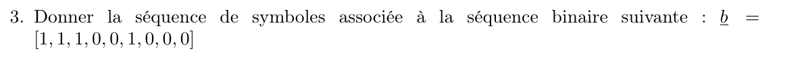{fig-alt="Q3 : donner la séquence de symboles associée à la séquence binaire b = [1, 1, 1, 0, 0, 1, 0, 0, 0]."}

::: {.solution}
Correction du TD [td-correction, p. 2]. L'association bits/symboles est réalisée en groupant les bits de $\underline{b}$ 3 par 3 et en utilisant l'étiquetage de la question 2 : $[1, 1, 1]$ donne $s_0 = 3$, $[0, 0, 1]$ donne $s_1 = -5$ et $[0, 0, 0]$ donne $s_2 = -7$, d'où

$$
\underline{s} = [3, -5, -7] .
$$
:::

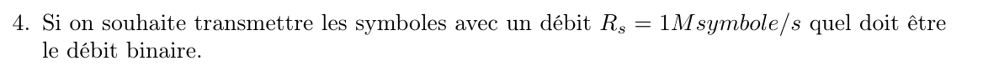{fig-alt="Q4 : si on souhaite transmettre les symboles avec un débit Rs = 1 Msymbole/s, quel doit être le débit binaire ?"}

::: {.solution}
Correction du TD [td-correction, p. 2-3]. $\Ts$ est le temps écoulé entre les transmissions de deux symboles successifs. Par définition, l'association bits/symbole doit avoir réuni $n_b$ bits pour constituer un symbole ; comme l'illustre la figure 3 de la correction (bits $b_k$ et symboles $s_n$ sur un axe des temps gradué en $\Tb$), on a alors $\Ts = n_b \Tb$. Or $\Tb = D_b^{-1}$ et $\Ts = D_s^{-1}$ ; on en déduit $D_b = n_b D_s$, soit dans notre cas $D_b = 3\ \mathrm{Mbit/s}$.
:::

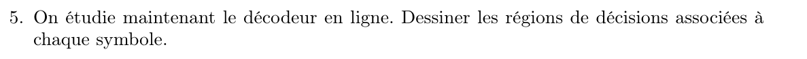{fig-alt="Q5 : on étudie maintenant le décodeur en ligne. Dessiner les régions de décision associées à chaque symbole."}

::: {.complement}
La correction du TD reprend la question sans y répondre [td-correction, p. 3]. Solution de Claude : pour des symboles équiprobables, les seuils de décision sont au milieu de deux symboles voisins ([seuil optimal, chapitre 4](../cours/04-transmission-presence-bruit.qmd#sec-seuil-optimal)), soit $-6$, $-4$, $-2$, $0$, $2$, $4$, $6$. Les régions de décision sont les intervalles

| Région | $]-\infty, -6[$ | $]-6, -4[$ | $]-4, -2[$ | $]-2, 0[$ | $]0, 2[$ | $]2, 4[$ | $]4, 6[$ | $]6, +\infty[$ |
|---|---|---|---|---|---|---|---|---|
| Symbole décidé | $-7$ | $-5$ | $-3$ | $-1$ | $1$ | $3$ | $5$ | $7$ |

(un échantillon tombant exactement sur un seuil est attribué arbitrairement à l'une des deux régions voisines).
:::

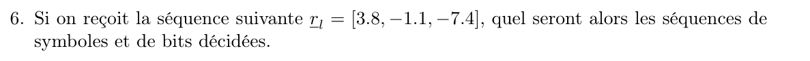{fig-alt="Q6 : si on reçoit la séquence rl = [3.8, −1.1, −7.4], quelles seront les séquences de symboles et de bits décidées ?"}

::: {.complement}
Solution de Claude (sans corrigé, [td-correction, p. 3]) : $3{,}8 \in\ ]2, 4[$ donne $3$ ; $-1{,}1 \in\ ]-2, 0[$ donne $-1$ ; $-7{,}4 < -6$ donne $-7$. Symboles décidés : $\hat{\underline{a}} = [3, -1, -7]$ ; avec l'étiquetage de la question 2 ($3 \to 111$, $-1 \to 010$, $-7 \to 000$), bits décidés : $\hat{\underline{b}} = [1, 1, 1, 0, 1, 0, 0, 0, 0]$. Même méthode que l'[exercice de décision du chapitre 2](../cours/02-communication-sans-bruit.qmd#exr-seuils-decision).
:::

## Exercice 2 : cyclostationnarité et DSP {#sec-td01-ex2}

Les exercices suivants viennent du TD « Transmissions en bande de base » [td] ; ils sont écrits avec les notations du cours (le TD note $g(t)$ le filtre de mise en forme, $s_s(t)$ le signal des symboles et $R_s$ le débit symbole ; voir la table des notations de la fiche matière).

::: {.complement}
**Convention d'autocorrélation.** L'énoncé du TD définit $R_A[k] = \E(A_n A^*_{n+k})$ et $R_{s_l}(t, \tau) = \E(s_l(t)\, s_l^*(t + \tau))$ [td, p. 2] ; sa correction [td-correction, p. 5 et 8], le support [poly, p. 83] et les notes [notes, f. 5 r°] utilisent $\E(s_l(t)\, s_l^*(t - \tau))$ et $R_A[k] = \E(A_n A^*_{n-k})$. Le cours suit partout cette seconde convention (décision d'Armand, 2026-10-07), y compris dans l'exercice ci-dessous. Avec la convention de l'énoncé, la formule de Bennett s'écrirait avec $e^{+j2\pi f m\Ts}$ (ou $R_A^*[m]$) : la DSP obtenue est la même, et pour des symboles réels $R_A$ est pair.
:::

::: {#exr-td-bennett}
## Cyclostationnarité et DSP [td, p. 2, ex. 2, q. 1-9]

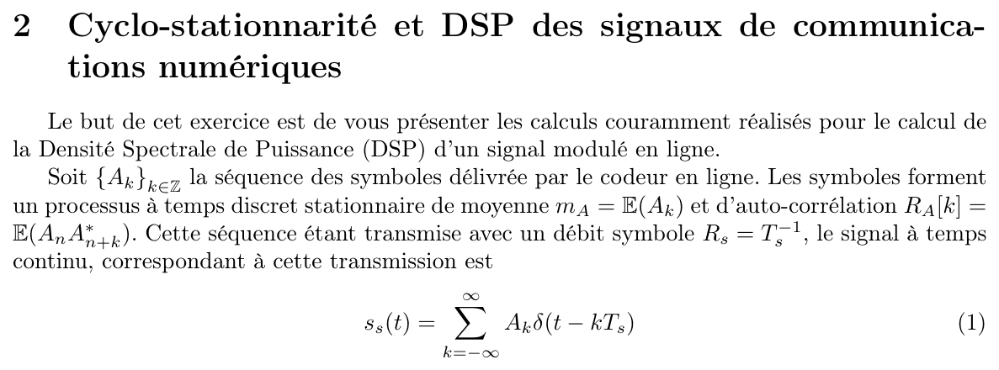{fig-alt="Exercice 2 : cyclostationnarité et DSP des signaux de communications numériques. But : présenter les calculs couramment réalisés pour la densité spectrale de puissance (DSP) d'un signal modulé en ligne. {Ak} est la séquence des symboles délivrée par le codeur en ligne, processus à temps discret stationnaire de moyenne mA = E(Ak) et d'autocorrélation RA[k] = E(An A*n+k). Transmise avec un débit symbole Rs = 1/Ts, elle correspond au signal à temps continu ss(t) = somme sur k de Ak δ(t − kTs) (équation 1)."}

*Notations du cours* : Soit $\{A_k\}_{k \in \mathbb{Z}}$ la séquence des symboles délivrée par le codeur en ligne. Les symboles forment un processus à temps discret stationnaire de moyenne $m_A = \E(A_k)$ et d'autocorrélation $R_A[k]$. Cette séquence est transmise avec un débit symbole $D_s = 1/\Ts$ ; le signal à temps continu correspondant est $s_a(t) = \sum_{k=-\infty}^{+\infty} A_k\, \delta(t - k\Ts)$.
:::

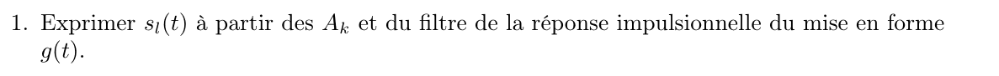{fig-alt="Q1 : exprimer sl(t) à partir des Ak et de la réponse impulsionnelle g(t) du filtre de mise en forme."}

*Notations du cours* : Exprimer $s_l(t)$ à partir des $A_k$ et de la réponse impulsionnelle $h(t)$ du filtre de mise en forme.

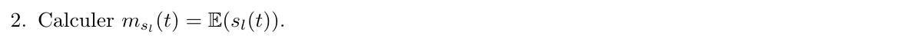{fig-alt="Q2 : calculer msl(t) = E(sl(t))."}

*Notations du cours* : Calculer $m_{s_l}(t) = \E(s_l(t))$.

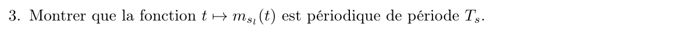{fig-alt="Q3 : montrer que la fonction t ↦ msl(t) est périodique de période Ts."}

*Notations du cours* : Montrer que la fonction $t \mapsto m_{s_l}(t)$ est périodique de période $\Ts$.

::: {.solution}
Correction du TD [td-correction, p. 4-7] : questions 1 à 3, 5 à 7 et 9, voir la démonstration du [théorème de Bennett](../cours/03-dsp-signaux-codes-en-ligne.qmd#thm-bennett) (chapitre 3) ($s_l(t) = \sum_k A_k\, h(t - k\Ts)$ ; $\bar{R}_{s_l}$ est l'autocorrélation moyennée $\tilde{R}_{s_l}$ du [chapitre 3](../cours/03-dsp-signaux-codes-en-ligne.qmd#eq-autocorrelation-moyennee)).
:::

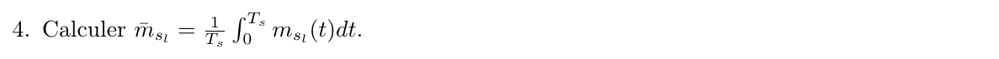{fig-alt="Q4 : calculer la moyenne m̄sl = (1/Ts) ∫ de 0 à Ts de msl(t) dt."}

*Notations du cours* : Calculer $\bar{m}_{s_l} = \frac{1}{\Ts} \int_0^{\Ts} m_{s_l}(t)\, \mathrm{d}t$.

::: {.solution}
Question 4 :

$$
\bar{m}_{s_l} = \frac{1}{\Ts} \int_0^{\Ts} m_{s_l}(t)\, \mathrm{d}t = \frac{m_A}{\Ts} \sum_{k} \int_{-k\Ts}^{-(k-1)\Ts} h(t)\, \mathrm{d}t = \frac{m_A}{\Ts} \int_{-\infty}^{+\infty} h(t)\, \mathrm{d}t
$$

(changement de variable $t \leftarrow t - k\Ts$, puis relation de Chasles).
:::

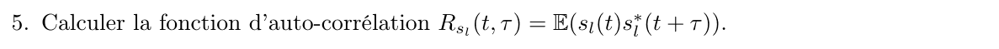{fig-alt="Q5 : calculer la fonction d'autocorrélation Rsl(t, τ) = E(sl(t) sl*(t + τ))."}

*Notations du cours* : Calculer la fonction d'autocorrélation $R_{s_l}(t, \tau)$.

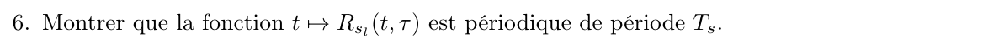{fig-alt="Q6 : montrer que la fonction t ↦ Rsl(t, τ) est périodique de période Ts."}

*Notations du cours* : Montrer que la fonction $t \mapsto R_{s_l}(t, \tau)$ est périodique de période $\Ts$.

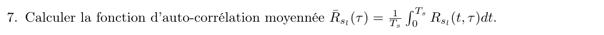{fig-alt="Q7 : calculer la fonction d'autocorrélation moyennée R̄sl(τ) = (1/Ts) ∫ de 0 à Ts de Rsl(t, τ) dt."}

*Notations du cours* : Calculer la fonction d'autocorrélation moyennée $\bar{R}_{s_l}(\tau) = \frac{1}{\Ts} \int_0^{\Ts} R_{s_l}(t, \tau)\, \mathrm{d}t$.

::: {.complement}
Questions 5 à 7 : voir la correction sous la question 3 (démonstration de la formule de Bennett, chapitre 3).
:::

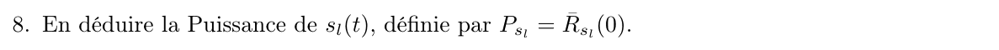{fig-alt="Q8 : en déduire la puissance de sl(t), définie par Psl = R̄sl(0)."}

*Notations du cours* : En déduire la puissance de $s_l(t)$, définie par $P_{s_l} = \bar{R}_{s_l}(0)$.

::: {.complement}
Question 8 (sans corrigé) : $P_{s_l} = \bar{R}_{s_l}(0) = \frac{1}{\Ts} \sum_d R_A[d]\, R_h(-d\Ts)$ ; pour des symboles iid centrés, $P_{s_l} = \sigma_A^2 E_h / \Ts$ (voir le complément qui suit le [corollaire de la formule de Bennett](../cours/03-dsp-signaux-codes-en-ligne.qmd#cor-bennett-iid), chapitre 3).
:::

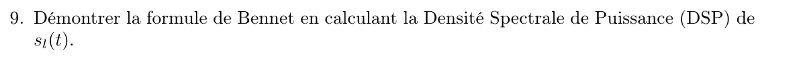{fig-alt="Q9 : démontrer la formule de Bennett en calculant la densité spectrale de puissance (DSP) de sl(t)."}

*Notations du cours* : Démontrer la formule de Bennett en calculant la DSP de $s_l(t)$.

::: {.complement}
Question 9 : voir la correction sous la question 3.
:::

::: {#exr-td-dsp-2pam}
## DSP d'une 2-PAM [td, p. 2, ex. 2, q. 10]

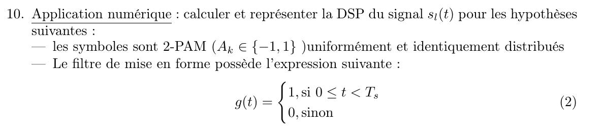{fig-alt="Q10, application numérique : calculer et représenter la DSP de sl(t) lorsque les symboles sont 2-PAM (Ak dans {−1, 1}) uniformément et identiquement distribués, et que le filtre de mise en forme vaut g(t) = 1 si 0 ≤ t < Ts, 0 sinon (équation 2)."}

*Notations du cours* : Calculer et représenter la DSP du signal $s_l(t)$ pour les hypothèses suivantes :

- les symboles sont 2-PAM ($A_k \in \{-1, 1\}$), uniformément et identiquement distribués ;
- le filtre de mise en forme vaut $h(t) = 1$ si $0 \leq t < \Ts$, 0 sinon.
:::

::: {.solution}
Correction du TD [td-correction, p. 7-8]. $\E(A_k) = 1 \times 0{,}5 + (-1) \times 0{,}5 = 0$ ; $R_A[k] = \E(|A_n|^2) = 1$ si $k = 0$ et $R_A[k] = \E(A_n)\,\E(A^*_{n-k}) = 0$ sinon. Donc $\sum_d R_A[d]\, e^{-j2\pi f d\Ts} = 1$ et $\Gamma_{s_l}(f) = \frac{|H(f)|^2}{\Ts}$. Avec $H(f) = e^{-j\pi f\Ts}\, \Ts \sinc(f\Ts)$ (bloc `av-phase-tf-porte-td`) :

$$
\Gamma_{s_l}(f) = \Ts \sinc^2(\Ts f) .
$$

La correction trace cette DSP en marquant la **bande passante** sur le lobe principal $[-1/\Ts, 1/\Ts]$ [td-correction, p. 9] (@fig-dsp-2pam-ook, en haut).
:::

::: {#exr-td-dsp-ook}
## DSP d'une 2-OOK [td, p. 2, ex. 2, q. 11]

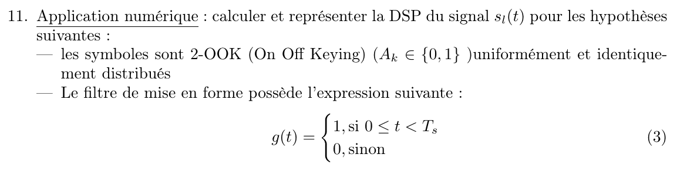{fig-alt="Q11, application numérique : calculer et représenter la DSP de sl(t) lorsque les symboles sont 2-OOK (On Off Keying, Ak dans {0, 1}) uniformément et identiquement distribués, avec le même filtre g(t) = 1 si 0 ≤ t < Ts, 0 sinon (équation 3)."}

*Notations du cours* : Même question pour des symboles 2-OOK (*On Off Keying*, $A_k \in \{0, 1\}$), uniformément et identiquement distribués, avec le même filtre de mise en forme.
:::

::: {.complement}
Solution (la correction du TD n'en donne pas) :

- $m_A = \frac{1}{2}$ ; $R_A[0] = \E(|A_n|^2) = \frac{1}{2}$ ; pour $d \neq 0$, $R_A[d] = \E(A_n)\,\E(A^*_{n-d}) = \frac{1}{4}$ (symboles indépendants) ;
- donc $\sum_d R_A[d]\, e^{-j2\pi f d\Ts} = \frac{1}{4} + \frac{1}{4} \sum_d e^{-j2\pi f d\Ts} = \frac{1}{4} + \frac{1}{4\Ts} \sum_k \delta\!\left(f - \frac{k}{\Ts}\right)$, par la formule sommatoire de Poisson ;
- avec $|H(f)|^2 = \Ts^2 \sinc^2(f\Ts)$, qui s'annule en $f = k/\Ts$ pour $k \neq 0$ :

$$
\Gamma_{s_l}(f) = \frac{\Ts}{4} \sinc^2(f\Ts) + \frac{1}{4}\, \delta(f) .
$$

Interprétation : $A_k = \frac{1}{2} + B_k$ avec $B_k \in \{-\frac{1}{2}, \frac{1}{2}\}$ centré. La partie centrée donne une DSP continue, celle d'une 2-PAM de variance $\frac{1}{4}$ ; la moyenne $m_A = \frac{1}{2}$ donne une composante continue, la raie $\frac{1}{4}\,\delta(f)$ (puissance $m_A^2 = \frac{1}{4}$). Puissance totale : $\frac{1}{4} + \frac{1}{4} = \frac{1}{2} = \E(|A_k|^2)$. À puissance égale, la moitié de la puissance de l'OOK est dépensée dans la raie à $f = 0$, qui ne transporte pas d'information (comparer avec la constellation antipodale du chapitre 2).
:::

![DSP de la 2-PAM $\{-1, 1\}$ (en haut) et de la 2-OOK $\{0, 1\}$ (en bas), avec un filtre de mise en forme en porte d'amplitude 1 sur $[0, \Ts[$. La flèche représente la raie $\frac{1}{4}\,\delta(f)$, de poids $\frac{1}{4}$ (sa hauteur n'est pas à l'échelle). Exercices du TD [td, p. 2, ex. 2, q. 10-11] ; 2-PAM d'après la correction du TD [td-correction, p. 9], redessinée ; 2-OOK : reconstruite (complément, aucune source ne la donne). Axes normalisés ($f\Ts$, $\Gamma_{s_l}/\Ts$), échelle linéaire.](../figures/03-dsp-2pam-ook.svg){#fig-dsp-2pam-ook}

## Exercice 3 : critère de Nyquist et filtrage adapté {#sec-td01-ex3}

Les exercices suivants viennent du TD « Transmissions en bande de base » [td] ; ils sont écrits avec les notations du cours lorsque c'est possible (le TD note $g(t)$ le filtre de mise en forme, $g_a(t)$ le filtre de réception, $v(t)$ le filtre global, $n_l(t)$ le bruit et $r_l[n]$ l'échantillon reçu ; voir la table des notations de la fiche matière). L'énoncé et la correction ne suivent pas la même version du TD : les numéros de questions sont ceux de l'**énoncé**, la correspondance avec la correction est indiquée.

::: {#exr-td-filtre-adapte}
## Critère de Nyquist et filtrage adapté [td, p. 3, ex. 3]

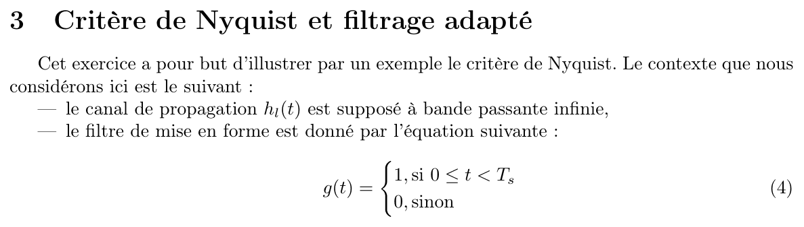{fig-alt="Exercice 3 : critère de Nyquist et filtrage adapté. But : illustrer le critère de Nyquist par un exemple. Contexte : le canal de propagation hl(t) est supposé à bande passante infinie ; le filtre de mise en forme vaut g(t) = 1 si 0 ≤ t < Ts, 0 sinon (équation 4)."}

*Notations du cours* : Le canal de propagation est supposé à bande passante infinie ($h_c(t) = \delta(t)$), et le filtre de mise en forme est la porte $h(t) = 1$ si $0 \leq t < \Ts$, 0 sinon.
:::

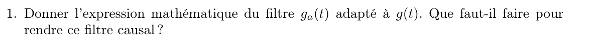{fig-alt="Q1 : donner l'expression mathématique du filtre ga(t) adapté à g(t). Que faut-il faire pour rendre ce filtre causal ?"}

*Notations du cours* : Donner l'expression mathématique du filtre $h_a(t)$ adapté à $h(t)$. Que faut-il faire pour rendre ce filtre causal ?

::: {.solution}
Correction du TD [td-correction, p. 9-11] (questions 1 et 2).

1. Le filtre adapté est le filtre de réception qui maximise le rapport signal à bruit aux instants des décisions : $h_a(t) = \lambda h^*(-t)$, avec $\lambda \in \mathbb{C}^*$ ; $\lambda$ ne change pas les performances du récepteur, et un choix courant est $\lambda = 1$. Filtre adapté **causal** : $h_{a,c}(t) = h^*(D - t)$, avec un retard $D \geq \Ts$ ; si $h$ avait un support de durée $\Delta$, il faudrait choisir $D \geq \Delta$.
:::

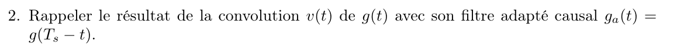{fig-alt="Q2 : rappeler le résultat de la convolution v(t) de g(t) avec son filtre adapté causal ga(t) = g(Ts − t)."}

*Notations du cours* : Rappeler le résultat de la convolution $g(t)$ de $h(t)$ avec son filtre adapté causal $h_a(t) = h(\Ts - t)$.

::: {.solution}
2. $g(t) = \int h(u)\, h^*(D - t + u)\, \mathrm{d}u = \int_{t - D}^{t - D + \Ts} h(u)\, \mathrm{d}u$, d'où
   $$
   g(t) =
   \begin{cases}
   t - D + \Ts & \text{si } t \in [D - \Ts, D], \\
   -t + D + \Ts & \text{si } t \in [D, D + \Ts], \\
   0 & \text{sinon :}
   \end{cases}
   $$
   un triangle de sommet $\Ts$ en $t = D$ ([figure du chapitre 4](../cours/04-transmission-presence-bruit.qmd#fig-filtre-adapte-porte)).
:::

::: {.complement}
Dans la correction, le filtre adapté causal est noté $g_c(t)$ ; il est noté ici $h_{a,c}(t)$, pour ne pas le confondre avec le filtre du canal $h_c(t)$ du cours. L'énoncé prend $D = \Ts$ (question 2).
:::

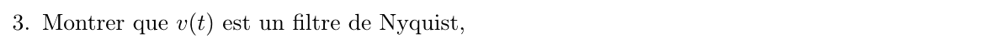{fig-alt="Q3 : montrer que v(t) est un filtre de Nyquist."}

*Notations du cours* : Montrer que $g(t)$ est un filtre de Nyquist.

::: {.complement}
Solutions des questions 3 et 4 (la correction n'en donne pas) :

3. Aux instants $D + k\Ts$, $g(D + k\Ts) = \Ts$ si $k = 0$ et $0$ si $k \neq 0$ (le triangle s'annule à $D \pm \Ts$ et au-delà) : $g$ vérifie le critère de Nyquist ([version temporelle](../cours/02-communication-sans-bruit.qmd#thm-nyquist-temporel)) pour des instants d'échantillonnage $D + n\Ts$, avec $g_0 = \Ts = E_h$.
:::

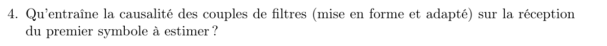{fig-alt="Q4 : qu'entraîne la causalité des couples de filtres (mise en forme et adapté) sur la réception du premier symbole à estimer ?"}

*Notations du cours* : Qu'entraîne la causalité des couples de filtres (mise en forme et adapté) sur la réception du premier symbole à estimer ?

::: {.complement}
4. Le symbole $A_0$, émis à partir de $t = 0$, n'est disponible au maximum de $g$ qu'à l'instant $t = D \geq \Ts$ : la réception du premier symbole est **retardée** de $D$, et l'échantillonneur doit être calé sur les instants $D + n\Ts$. Un échantillonnage aux instants $n\Ts$ avec $D = \Ts$ donnerait en $t = 0$ un échantillon sans symbole ($A_0$ y contribue par $g(0) = 0$), puis chaque symbole avec une période de retard.

La correction contient aussi une question de tracé des signaux $s_l(t)$, $r_l(t)$ et $r_l[n]$ (question 4 de la correction), absente de l'énoncé et sans corrigé ; elle n'est pas reprise.
:::

## Exercice 4 : probabilité d'erreur et récepteur optimal {#sec-td01-ex4}

::: {#exr-td-probabilite-erreur}
## Probabilité d'erreur et récepteur optimal [td, p. 3, ex. 4]

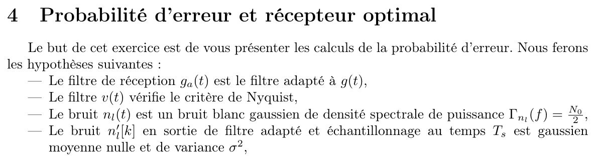{fig-alt="Exercice 4 : probabilité d'erreur et récepteur optimal. But : présenter les calculs de la probabilité d'erreur. Hypothèses : le filtre de réception ga(t) est le filtre adapté à g(t) ; le filtre v(t) vérifie le critère de Nyquist ; le bruit nl(t) est blanc gaussien de DSP Γnl(f) = N0/2 ; le bruit n'l[k] en sortie de filtre adapté et d'échantillonnage au temps Ts est gaussien, de moyenne nulle et de variance σ²."}

*Notations du cours* : Hypothèses : le filtre de réception $h_a(t)$ est le filtre adapté à $h(t)$ ; le filtre global $g(t)$ vérifie le critère de Nyquist ; le bruit $z_l(t)$ est blanc, gaussien, de DSP $\Gamma_{z_l}(f) = \frac{N_0}{2}$ ; le bruit $z'_l[k]$ en sortie de filtre adapté et d'échantillonnage au rythme $\Ts$ est gaussien, de moyenne nulle et de variance $\sigma^2$. La correction précise l'association $B_n = 0 \Rightarrow A_n = -1$, $B_n = 1 \Rightarrow A_n = 1$ [td-correction, p. 11].
:::

::: {.complement}
Notations : l'énoncé note $\gamma = \frac{g_0^2}{\sigma^2}$ le rapport de la question 2 ; il est noté ici $\rho$, pour ne pas le confondre avec le seuil de décision $\gamma$ du cours. Correspondance des questions avec la correction [td-correction, p. 11-14] : q. 1 et 2 identiques ; q. 5 et 6 traitées dans les questions 3 et 4 de la correction ; q. 7 = question 5 de la correction ; q. 3 et 4 sans corrigé.
:::

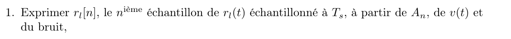{fig-alt="Q1 : exprimer rl[n], le n-ième échantillon de rl(t) échantillonné à Ts, à partir de An, de v(t) et du bruit."}

*Notations du cours* : Exprimer $r_n$, le $n$-ième échantillon de $r_l(t)$ échantillonné à $\Ts$, à partir de $A_n$, de $g(t)$ et du bruit.

::: {.solution}
Correction du TD [td-correction, p. 11-14].

**1.** $r_l(t) = \sum_k A_k\, g(t - k\Ts)$ (plus le bruit filtré), d'où $r_n = \sum_k A_k\, g((n - k)\Ts) + z'_l[n] = A_n\, g(0) + z'_l[n]$ par le critère de Nyquist.
:::

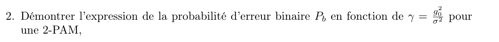{fig-alt="Q2 : démontrer l'expression de la probabilité d'erreur binaire Pb en fonction de γ = g0²/σ² pour une 2-PAM."}

*Notations du cours* : Démontrer l'expression de la probabilité d'erreur binaire $P_b$ en fonction de $\rho = \frac{g_0^2}{\sigma^2}$ pour une 2-PAM.

::: {.solution}
**2.** Par la formule des probabilités totales, $P_{b,n} = P(\hat{B}_n = 0 \mid B_n = 1)\, P(B_n = 1) + P(\hat{B}_n = 1 \mid B_n = 0)\, P(B_n = 0)$. La décision $\hat{B}_n = 1$ est prise si et seulement si $r_n \geq 0$ ; avec des bits équiprobables,

$$
P_{b,n} = 0{,}5\, P(r_n < 0 \mid A_n = 1) + 0{,}5\, P(r_n \geq 0 \mid A_n = -1) .
$$

Pour le premier terme,

$$
P(r_n < 0 \mid A_n = 1) = \int_{-\infty}^{0} \frac{1}{\sqrt{2\pi\sigma^2}}\, e^{-\frac{(r - g(0))^2}{2\sigma^2}}\, \mathrm{d}r = \int_{g(0)/\sigma}^{+\infty} \frac{1}{\sqrt{2\pi}}\, e^{-\frac{r^2}{2}}\, \mathrm{d}r = Q\!\left(\sqrt{\frac{g(0)^2}{\sigma^2}}\right)
$$

(densité corrigée, voir `av-densite-conditionnelle-td`), et de même $P(r_n \geq 0 \mid A_n = -1) = Q\!\left(\sqrt{g(0)^2/\sigma^2}\right)$. L'expression ne dépend pas de $n$ :

$$
P_b = Q\!\left(\sqrt{\frac{g_0^2}{\sigma^2}}\right) = Q(\sqrt{\rho}) .
$$
:::

::: {.a-verifier .tranche #av-densite-conditionnelle-td}
**Source** [td-correction, p. 12] : « $P(r_l[n] < 0 \mid A_n = 1) = \int_{-\infty}^{0} \frac{1}{\sqrt{2\pi\sigma^2}}\, e^{-\frac{(r + v(0))^2}{2\sigma^2}}\, \mathrm{d}r$ ».

**Problème** : sachant $A_n = 1$, $r_l[n] = v(0) + n'_l[n] \sim \mathcal{N}(v(0), \sigma^2)$ : l'exposant est $-(r - v(0))^2/(2\sigma^2)$. Avec le signe $+$, le changement de variable donnerait la borne $-v(0)/\sigma$ et le résultat $1 - Q(v(0)/\sigma)$, alors que la correction écrit ensuite la borne $v(0)/\sigma$ et le résultat $Q(\cdot)$, qui sont justes. Le second terme ($A_n = -1$, exposant $(r + v(0))^2$) est correct.

**Proposition** : $e^{-\frac{(r - v(0))^2}{2\sigma^2}}$ au premier terme (écrit ainsi dans la solution).

**Décision** : correction retenue (Armand a laissé le choix à Claude, 2026-10-07).
:::

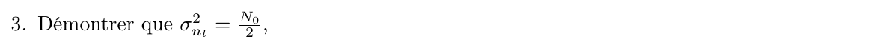{fig-alt="Q3 : démontrer que σ²nl = N0/2."}

*Notations du cours* : Démontrer que $\sigma_{z_l}^2 = \frac{N_0}{2}$.

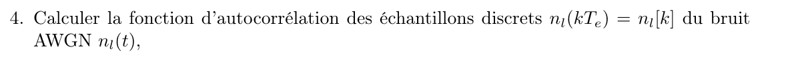{fig-alt="Q4 : calculer la fonction d'autocorrélation des échantillons discrets nl(kTe) = nl[k] du bruit AWGN nl(t)."}

*Notations du cours* : Calculer la fonction d'autocorrélation des échantillons discrets $z_l(kT_e) = z_l[k]$ du bruit blanc gaussien $z_l(t)$.

::: {.complement}
Solutions des questions 3 et 4 (aucune source ne les donne), sous réserve du bloc ci-dessous.

**4.** $R_{z_l}[k] = \E(z_l[n]\, z_l^*[n - k]) = R_{z_l}(kT_e) = \frac{N_0}{2}\, \delta(kT_e)$ : les échantillons d'un bruit blanc sont **décorrélés** ($R_{z_l}[k] = 0$ pour $k \neq 0$), mais leur variance $R_{z_l}[0]$ est infinie en théorie, comme la puissance du bruit blanc. En pratique, le bruit est d'abord limité à la bande $[-f_e/2, f_e/2]$ (filtre anti-repliement idéal) : $R_{z_l}(\tau) = \frac{N_0}{2} f_e \sinc(f_e \tau)$, qui s'annule aux instants $kT_e$, $k \neq 0$, d'où $R_{z_l}[k] = \frac{N_0 f_e}{2}\, \delta_k$.

**3.** Avec cette limitation de bande, $\sigma_{z_l}^2 = R_{z_l}[0] = \frac{N_0 f_e}{2} = \frac{N_0}{2 T_e}$ ; on trouve $\frac{N_0}{2}$ pour $f_e = 1$ (fréquences normalisées par la fréquence d'échantillonnage).
:::

::: {.a-verifier .tranche #av-variance-bruit-discret-td}
**Source** [td, p. 3, ex. 4, q. 3] : « Démontrer que $\sigma_{n_l}^2 = \frac{N_0}{2}$ » (question sans corrigé).

**Problème** : un bruit blanc de DSP $\frac{N_0}{2}$ a une puissance infinie ; ses échantillons n'ont une variance finie que si le bruit est limité en bande avant l'échantillonnage. Pour un bruit limité à $[-f_e/2, f_e/2]$, la variance vaut $\frac{N_0 f_e}{2}$ et non $\frac{N_0}{2}$, sauf si $f_e = 1$ (ou $T_e = 1$). L'énoncé ne précise ni la limitation de bande ni la normalisation ; la question est peut-être liée à l'autre version du TD (la correction n'a pas cette question).

**Proposition** : interpréter la question avec un bruit limité à $[-f_e/2, f_e/2]$ et des fréquences normalisées ($T_e = 1$), et écrire en général $\sigma_{n_l}^2 = \frac{N_0}{2T_e}$ (solution du complément ci-dessus).

**Décision** : interprétation retenue : bruit limité à $[-f_e/2, f_e/2]$, $\sigma_{n_l}^2 = \frac{N_0}{2T_e}$, égal à $\frac{N_0}{2}$ pour $T_e = 1$ (Armand a laissé le choix à Claude, 2026-10-07).
:::

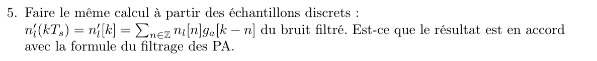{fig-alt="Q5 : faire le même calcul à partir des échantillons discrets du bruit filtré n'l(kTs) = n'l[k] = somme sur n de nl[n] ga[k − n]. Le résultat est-il en accord avec la formule du filtrage des processus aléatoires ?"}

*Notations du cours* : Faire le même calcul à partir des échantillons discrets du bruit filtré, $z'_l(k\Ts) = z'_l[k] = \sum_{n} z_l[n]\, h_a[k - n]$. Le résultat est-il en accord avec la formule du filtrage des processus aléatoires ?

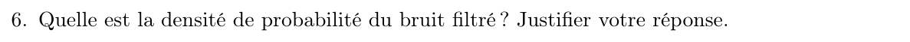{fig-alt="Q6 : quelle est la densité de probabilité du bruit filtré ? Justifier."}

*Notations du cours* : Quelle est la densité de probabilité du bruit filtré ? Justifier.

::: {.solution}
**5 et 6** (questions 3 et 4 de la correction). Le bruit en sortie de filtre adapté est $z'_l(t) = \int z_l(u)\, h_a(t - u)\, \mathrm{d}u$. Sa DSP est $\Gamma_{z'_l}(f) = |H_a(f)|^2\, \Gamma_{z_l}(f) = \frac{N_0}{2} |H_a(f)|^2$ (DSP corrigée, voir `av-dsp-bruit-filtre-td`), d'où

$$
R_{z'_l}(\tau) = \frac{N_0}{2}\, R_{h_a}(\tau),
\qquad R_{h_a}(\tau) = \int h_a(u)\, h_a^*(u - \tau)\, \mathrm{d}u = g(\tau)
$$

puisque $h_a(t) = h^*(-t)$. Pour les échantillons au rythme $\Ts$ :

$$
R_{z'_l}[k] = \E\!\left(z'_l[n]\, z'^*_l[n - k]\right) = R_{z'_l}(k\Ts) = \frac{N_0}{2}\, g(k\Ts) = \frac{N_0}{2}\, g(0)\, \delta_k .
$$

Le bruit en sortie de filtre adapté (demi-Nyquist) et d'échantillonneur est donc stationnaire, décorrélé, de variance $\frac{N_0}{2} g(0)$ : les hypothèses de l'énoncé sont bonnes avec $\sigma^2 = \frac{N_0}{2} g(0)$. Il est gaussien, car $z_l(t)$ est gaussien et le filtrage est linéaire, et centré, car $z_l(t)$ l'est : $\E(z'_l[k]) = 0$.
:::

::: {.a-verifier .tranche #av-dsp-bruit-filtre-td}
**Source** [td-correction, p. 13] : « $\Gamma_{n'_l}(f) = |G_a(f)|^2\, \Gamma_{n'_l}(f) = \frac{N_0}{2} |G_a(f)|^2$ ».

**Problème** : la DSP de sortie (bruit filtré $n'_l$) est le produit de $|G_a|^2$ par la DSP d'**entrée**, celle du bruit blanc $n_l$ ; telle quelle, l'égalité définit $\Gamma_{n'_l}$ en fonction d'elle-même. La valeur finale $\frac{N_0}{2}|G_a(f)|^2$ est juste.

**Proposition** : $\Gamma_{n'_l}(f) = |G_a(f)|^2\, \Gamma_{n_l}(f) = \frac{N_0}{2} |G_a(f)|^2$.

**Décision** : correction retenue (Armand a laissé le choix à Claude, 2026-10-07).
:::

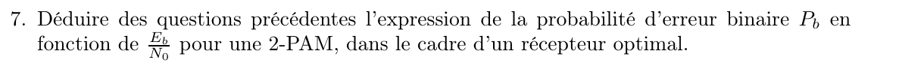{fig-alt="Q7 : déduire des questions précédentes l'expression de la probabilité d'erreur binaire Pb en fonction de Eb/N0 pour une 2-PAM, dans le cadre d'un récepteur optimal."}

*Notations du cours* : Déduire des questions précédentes l'expression de $P_b$ en fonction de $\frac{E_b}{N_0}$ pour une 2-PAM, dans le cadre d'un récepteur optimal.

::: {.solution}
**7** (question 5 de la correction). $E_b = P\Tb$, avec $P = \int \Gamma_{s_l}(f)\, \mathrm{d}f = \frac{1}{\Ts}\int |H(f)|^2\, \mathrm{d}f = \frac{1}{\Ts}\int G(f)\, \mathrm{d}f = \frac{g(0)}{\Ts}$ (DSP de la 2-PAM du chapitre 3). Avec $N_0 = \frac{2\sigma^2}{g(0)}$ et $\Ts = \Tb$ pour une modulation binaire :

$$
\frac{E_b}{N_0} = \frac{g(0)^2\, \Tb}{2\sigma^2\, \Ts} = \frac{g(0)^2}{2\sigma^2},
\qquad\text{d'où}\qquad
P_b = Q\!\left(\sqrt{\frac{2E_b}{N_0}}\right) .
$$
:::

## Exercice 5 : étude pratique {#sec-td01-ex5}

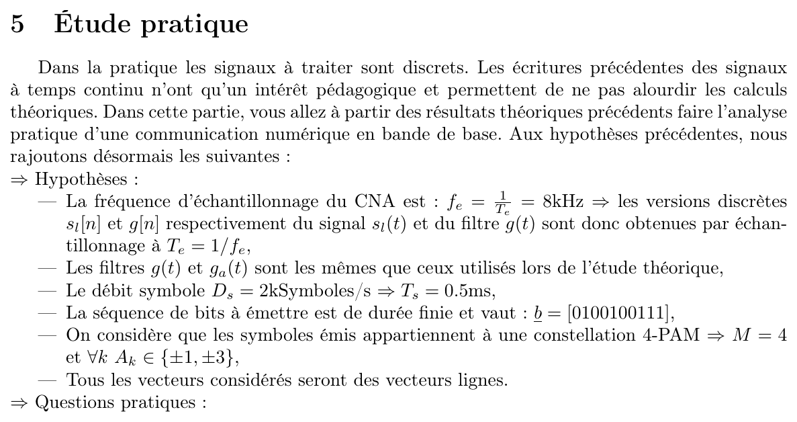{fig-alt="Exercice 5 : étude pratique. En pratique les signaux à traiter sont discrets ; analyse pratique d'une communication numérique en bande de base à partir des résultats théoriques précédents. Hypothèses ajoutées : fréquence d'échantillonnage du CNA fe = 1/Te = 8 kHz, les versions discrètes sl[n] et g[n] de sl(t) et g(t) sont obtenues par échantillonnage à Te ; filtres g(t) et ga(t) identiques à ceux de l'étude théorique ; débit symbole Ds = 2 ksymboles/s, donc Ts = 0,5 ms ; séquence de bits à émettre de durée finie b = [0100100111] ; constellation 4-PAM, M = 4 et Ak dans {±1, ±3} ; tous les vecteurs sont des vecteurs lignes. Suivent les questions pratiques."}

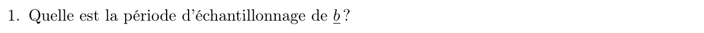{fig-alt="Q1 : quelle est la période d'échantillonnage de b ?"}

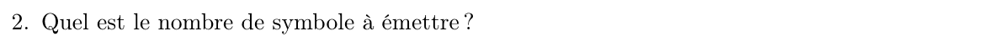{fig-alt="Q2 : quel est le nombre de symboles à émettre ?"}

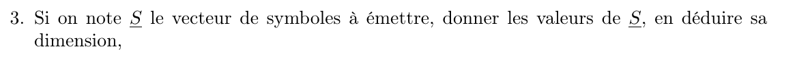{fig-alt="Q3 : si on note S le vecteur de symboles à émettre, donner les valeurs de S et en déduire sa dimension."}

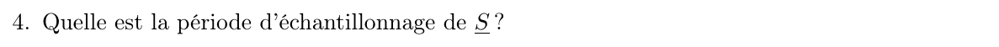{fig-alt="Q4 : quelle est la période d'échantillonnage de S ?"}

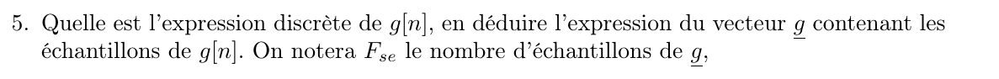{fig-alt="Q5 : quelle est l'expression discrète de g[n] ? En déduire l'expression du vecteur g contenant les échantillons de g[n] ; on notera Fse le nombre d'échantillons de g."}

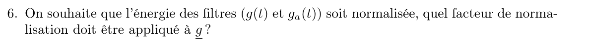{fig-alt="Q6 : on souhaite que l'énergie des filtres g(t) et ga(t) soit normalisée ; quel facteur de normalisation doit être appliqué à g ?"}

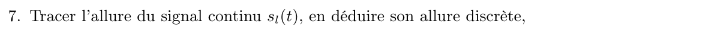{fig-alt="Q7 : tracer l'allure du signal continu sl(t), en déduire son allure discrète."}

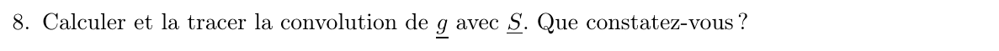{fig-alt="Q8 : calculer et tracer la convolution de g avec S. Que constatez-vous ?"}

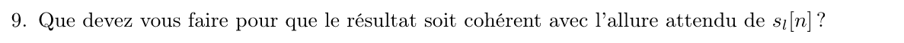{fig-alt="Q9 : que devez-vous faire pour que le résultat soit cohérent avec l'allure attendue de sl[n] ?"}

::: {.complement}
Questions 1 à 9 **non traitées pour l'instant** : la correction du TD reproduit l'énoncé de l'étude pratique sans y répondre [td-correction, p. 14-15], et le cours ne les traite pas.
:::

::: {#exr-td-largeur-bande}
## Étude pratique : DSP et largeur de bande [td, p. 4, ex. 5, q. 10-11]

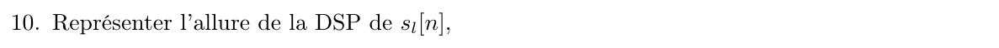{fig-alt="Q10 : représenter l'allure de la DSP de sl[n]."}

*Notations du cours* : Hypothèses de l'étude pratique : fréquence d'échantillonnage $f_e = 1/T_e = 8\ \mathrm{kHz}$ ; filtre de mise en forme en porte de durée $\Ts$ (celui de l'exercice précédent), échantillonné à $T_e$ et normalisé en énergie [td, p. 4, q. 6] ; débit symbole $D_s = 2\ \mathrm{ksymboles/s}$, donc $\Ts = 0{,}5\ \mathrm{ms}$ ; symboles 4-PAM, $A_k \in \{\pm 1, \pm 3\}$.

Représenter l'allure de la DSP de $s_l[n]$.
:::

::: {.complement}
Solution (aucune source ne la donne) :

- Le filtre échantillonné compte $\Ts f_e = 4$ échantillons égaux. Pour des symboles 4-PAM équiprobables et indépendants, $m_A = 0$ et $\sigma_A^2 = \frac{1}{4}(1 + 9 + 9 + 1) = 5$ : par la [DSP pour des symboles iid centrés](../cours/03-dsp-signaux-codes-en-ligne.qmd#eq-dsp-iid-centres) (chapitre 3), la DSP a l'allure de $|H(f)|^2$, c'est-à-dire, sur $[-f_e/2, f_e/2] = [-4, 4]\ \mathrm{kHz}$, celle d'un $\sinc^2(f\Ts)$ (exactement $\left|\frac{\sin(\pi f \Ts)}{\sin(\pi f T_e)}\right|^2$ pour le filtre échantillonné), **périodisée** de période $f_e = 8\ \mathrm{kHz}$ puisque $s_l[n]$ est à temps discret.
:::

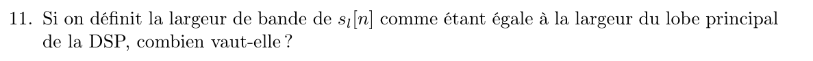{fig-alt="Q11 : si on définit la largeur de bande de sl[n] comme la largeur du lobe principal de la DSP, combien vaut-elle ?"}

*Notations du cours* : Si l'on définit la largeur de bande de $s_l[n]$ comme la largeur du lobe principal de la DSP, combien vaut-elle ?

::: {.complement}
- Elle s'annule aux multiples de $1/\Ts = 2\ \mathrm{kHz}$ (sauf aux multiples de $f_e$) : le lobe principal occupe $[-2, 2]\ \mathrm{kHz}$. Sa largeur est donc $2/\Ts = 4\ \mathrm{kHz}$ ; avec la convention $[-B, B]$ du cours, $B = 1/\Ts = 2\ \mathrm{kHz}$ ([chapitre 3](../cours/03-dsp-signaux-codes-en-ligne.qmd#eq-dsp-porte)).
:::

::: {#exr-td-constellation-bruitee}
## Étude pratique : bruit et fiabilité [td, p. 4, ex. 5, q. 12-13]

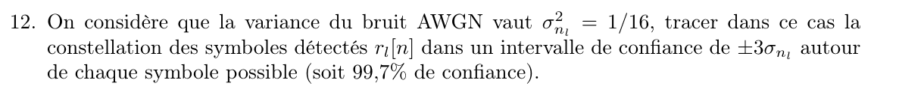{fig-alt="Q12 : la variance du bruit AWGN vaut σ²nl = 1/16 ; tracer la constellation des symboles détectés rl[n] dans un intervalle de confiance de ±3σnl autour de chaque symbole possible (99,7 % de confiance)."}

*Notations du cours* : Hypothèses de l'étude pratique (questions 10-11, @exr-td-largeur-bande) : 4-PAM, $A_k \in \{\pm 1, \pm 3\}$, filtres de mise en forme et de réception en porte, normalisés en énergie.

On considère que la variance du bruit vaut $\sigma_{z_l}^2 = 1/16$ ; tracer dans ce cas la constellation des symboles détectés $r_n$ dans un intervalle de confiance de $\pm 3\sigma$ autour de chaque symbole possible (soit 99,7 % de confiance).
:::

::: {.complement}
Solution (aucune source ne la donne), en interprétant $\sigma^2 = 1/16$ comme la variance du bruit sur les échantillons détectés (filtres normalisés en énergie, donc $g_0 = 1$ et $r_n = A_n + Z'_n$) :

12. $\sigma = \frac{1}{4}$ : les échantillons reçus se trouvent, avec 99,7 % de confiance, dans les intervalles $[A - 0{,}75,\ A + 0{,}75]$ autour de chaque symbole $A \in \{-3, -1, 1, 3\}$ (@fig-constellation-bruitee). Ces intervalles sont **disjoints** et ne contiennent aucun seuil optimal ($-2$, $0$, $2$).
:::

![Échantillons reçus $r_n$ d'une 4-PAM avec un bruit d'écart-type $\sigma = 1/4$ (400 tirages, ordonnée sans signification), intervalles $\pm 3\sigma$ (rectangles) autour des symboles (croix). Exercice du TD [td, p. 4, ex. 5, q. 12]. Reconstruite (aucune source ne donne de solution) : échantillons simulés (graine 4) ; seuils optimaux $-2$, $0$, $2$ ajoutés en pointillés gris.](../figures/04-constellation-bruitee.svg){#fig-constellation-bruitee}

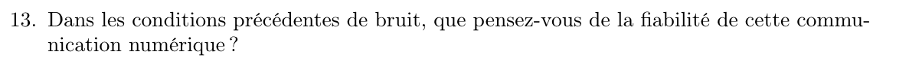{fig-alt="Q13 : dans les conditions de bruit précédentes, que pensez-vous de la fiabilité de cette communication numérique ?"}

*Notations du cours* : Dans les conditions de bruit précédentes, que pensez-vous de la fiabilité de cette communication numérique ?

::: {.complement}
13. Chaque symbole est à la distance $g_0 = 1 = 4\sigma$ du seuil le plus proche : par la [probabilité d'erreur symbole de la M-PAM](../cours/04-transmission-presence-bruit.qmd#eq-ps-mpam) (chapitre 4), $P_s = 2 \cdot \frac{3}{4}\, Q(4) \approx 4{,}8 \cdot 10^{-5}$, et avec un étiquetage de Gray $P_b \approx P_s/2 \approx 2{,}4 \cdot 10^{-5}$ ([chapitre 4](../cours/04-transmission-presence-bruit.qmd#eq-pb-mpam)). La communication est donc fiable : pour les 5 symboles de la séquence de l'étude pratique, la probabilité d'au moins une erreur est d'environ $2{,}4 \cdot 10^{-4}$.
:::
