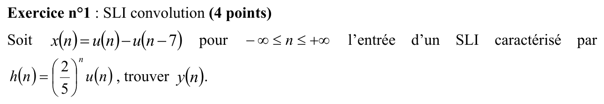
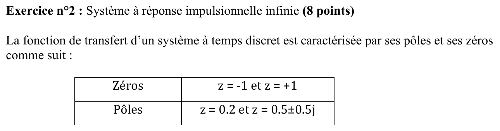
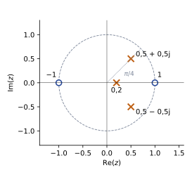
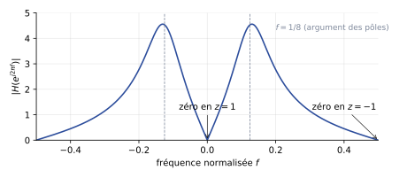
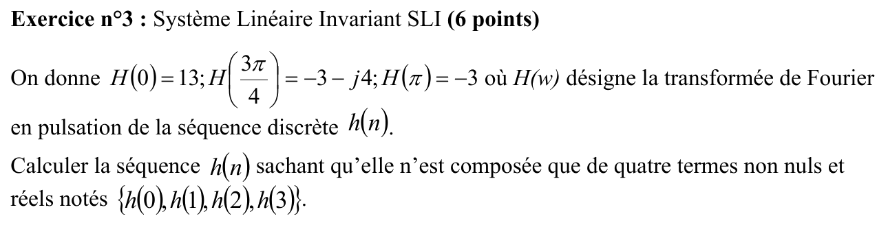
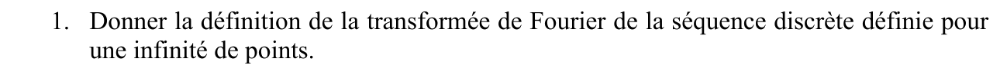
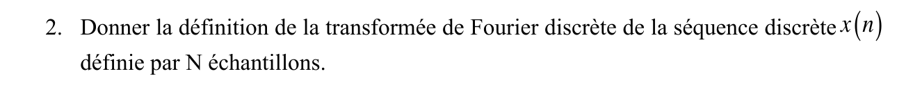



::: {.complement}
Aucun corrigé officiel : **toutes les solutions de cette page sont rédigées par Claude**. Les énoncés sont des extraits en image du recueil de TD, annexe « annales examens », où ce sujet est intitulé « SUJET 2013 » (année 2013-2014, 2^e^ session) [sujet-2014-03, p. 12-13]. À relire avec un œil critique ; signaler toute erreur.
:::

Rappels fournis avec le sujet : $\delta(n-k) \overset{z}{\longleftrightarrow} z^{-k}$ et $a^n u(n) \overset{z}{\longleftrightarrow} \dfrac{1}{1 - a z^{-1}}$ avec $|a| < 1$.

## Exercice 1 : SLI, convolution (4 points) {#sec-ann13-ex1}

{fig-alt="Exercice 1 : x(n) = u(n) − u(n − 7) est l'entrée d'un SLI de réponse impulsionnelle h(n) = (2/5)^n u(n) ; trouver y(n)."}

Chapitre du cours : [Convolution discrète](../cours/02-systemes-discrets-convolution.qmd#sec-convolution-discrete)

:::: {.complement}
::: {.solution}
**Méthode.** $x(n) = 1$ pour $0 \leq n \leq 6$ et $0$ ailleurs (7 échantillons), donc
$$y(n) = \sum_{k=0}^{6} h(n-k) = \sum_{k=0}^{6} \left(\tfrac25\right)^{n-k} u(n-k).$$
On pose $m = n - k$ et on utilise la somme géométrique $\sum_{m=M_1}^{M_2} a^m = \dfrac{a^{M_1} - a^{M_2+1}}{1-a}$, avec $\frac{1}{1 - 2/5} = \frac53$.

- $n < 0$ : aucun terme, $y(n) = 0$.
- $0 \leq n \leq 6$ (recouvrement partiel, $m$ de $0$ à $n$) : $y(n) = \dfrac53\left[1 - \left(\tfrac25\right)^{n+1}\right]$.
- $n \geq 7$ (recouvrement total, $m$ de $n-6$ à $n$) : $y(n) = \dfrac53\left[\left(\tfrac25\right)^{n-6} - \left(\tfrac25\right)^{n+1}\right] = \dfrac53\left[1 - \left(\tfrac25\right)^{7}\right]\left(\tfrac25\right)^{n-6}$.

Forme compacte (linéarité et invariance : $x = u(n) - u(n-7)$, la sortie est la différence de deux réponses indicielles) :
$$\boxed{y(n) = \frac53\left[1 - \left(\tfrac25\right)^{n+1}\right] u(n) - \frac53\left[1 - \left(\tfrac25\right)^{n-6}\right] u(n-7)}$$

Contrôle : $y(0) = h(0) = 1$, $y(1) = 1 + 0{,}4 = 1{,}4$ ; maximum $y(6) \approx 1{,}664$ puis décroissance géométrique ($y(7) \approx 0{,}666$) ; $\sum_n y(n) = \left(\sum x\right)\left(\sum h\right) = 7 \times \frac53 = \frac{35}{3}$ ✓ (vérifié numériquement).
:::
::::

## Exercice 2 : système à réponse impulsionnelle infinie (8 points) {#sec-ann13-ex2}

{fig-alt="Exercice 2 : fonction de transfert d'un système discret définie par ses zéros z = −1 et z = +1 et ses pôles z = 0,2 et z = 0,5 ± 0,5j."}

Chapitre du cours : [Pôles et zéros](../cours/04-implementation-equations-differences.qmd#sec-poles-zeros)

::: {.a-verifier #av-ann13-gain-h}
**Source** [sujet-2014-03, p. 12] : « La fonction de transfert d'un système à temps discret est caractérisée par ses pôles et ses zéros », puis « c) Donner H(z) ».

**Problème** : pôles et zéros ne fixent $H(z)$ qu'à un facteur multiplicatif $K$ près ; le gain n'est pas donné.

**Proposition** : garder $K$ littéral (le module est tracé pour $K = 1$) ; la nature du filtre et la stabilité n'en dépendent pas.
:::

{fig-alt="Exercice 2, a) : dessiner le diagramme des pôles et des zéros."}

:::: {.complement}
::: {.solution}
Zéros (cercles) sur le cercle unité en $z = \pm 1$ ; pôles (croix) en $0{,}2$ et $0{,}5 \pm 0{,}5j = \frac{\sqrt2}{2}\, e^{\pm j\pi/4}$.

{#fig-ann13-poles-zeros}
:::
::::

{fig-alt="Exercice 2, b) : le filtre est-il stable ?"}

::: {.complement}
**Oui**, s'il est causal (réalisé par une équation aux différences récursive) : modules des pôles $0{,}2$ et $\sqrt{0{,}5^2 + 0{,}5^2} = \frac{\sqrt2}{2} \approx 0{,}707$, tous **inférieurs à 1**. La zone de convergence $|z| > 0{,}707$ contient alors le cercle unité ([stabilité et transformée en $z$](../cours/04-implementation-equations-differences.qmd#sec-stabilite-transformee-z)). Les zéros, même sur le cercle, ne jouent aucun rôle.
:::

{fig-alt="Exercice 2, c) : donner H(z)."}

::: {.complement}
$(z - 0{,}5 - 0{,}5j)(z - 0{,}5 + 0{,}5j) = (z - 0{,}5)^2 + 0{,}25 = z^2 - z + 0{,}5$, puis $(z - 0{,}2)(z^2 - z + 0{,}5) = z^3 - 1{,}2 z^2 + 0{,}7 z - 0{,}1$. Donc
$$\boxed{H(z) = K\,\frac{(z-1)(z+1)}{(z - 0{,}2)(z^2 - z + 0{,}5)} = K\,\frac{z^{-1} - z^{-3}}{1 - 1{,}2 z^{-1} + 0{,}7 z^{-2} - 0{,}1 z^{-3}}}$$
(on divise haut et bas par $z^3$). Deux zéros pour trois pôles : le numérateur commence par $z^{-1}$, soit un retard d'un échantillon ($h(0) = 0$).
:::

{fig-alt="Exercice 2, d) : donner l'équation aux différences."}

::: {.complement}
$Y(z)\left(1 - 1{,}2 z^{-1} + 0{,}7 z^{-2} - 0{,}1 z^{-3}\right) = K\left(z^{-1} - z^{-3}\right) X(z)$, et $z^{-k}$ correspond à un retard de $k$ ([forme générale](../cours/04-implementation-equations-differences.qmd#sec-forme-generale-equation-differences)) :
$$\boxed{y(n) = 1{,}2\, y(n-1) - 0{,}7\, y(n-2) + 0{,}1\, y(n-3) + K\left[x(n-1) - x(n-3)\right]}$$
Contrôle par la récurrence ($K = 1$, entrée $\delta(n)$) : $h(0) = 0$, $h(1) = 1$, $h(2) = 1{,}2$, $h(3) = 1{,}2 \times 1{,}2 - 0{,}7 - 1 = -0{,}26$ ; identique au calcul numérique de $H(z)$.
:::

{fig-alt="Exercice 2, e) : tracer le module de la réponse en fréquence."}

:::: {.complement}
::: {.solution}
On évalue $H$ sur le cercle unité, $z = e^{j2\pi f}$ : $|H(f)| = |K|\, \dfrac{|z - 1|\,|z + 1|}{|z - 0{,}2|\,|z - p|\,|z - \bar p|}$ (produit des distances aux zéros sur produit des distances aux pôles).

- $f = 0$ ($z = 1$) et $f = \frac12$ ($z = -1$) : un zéro est atteint, **$|H| = 0$**.
- Près de $f = \frac18$ (argument $\frac{\pi}{4}$ des pôles $p, \bar p$) : la distance au pôle est minimale, **$|H| \approx 4{,}53\,|K|$** en $f = \frac18$ (maximum $4{,}56\,|K|$ en $f \approx 0{,}131$).
- Valeurs intermédiaires ($K = 1$) : $|H| \approx 2{,}17$ en $f = \frac1{16}$, $1{,}75$ en $f = \frac14$.
- $|H(-f)| = |H(f)|$ : coefficients réels.

C'est un **passe-bande** centré vers $f \approx 0{,}13$ (soit $0{,}13\, f_e$).

{#fig-ann13-module}
:::
::::

## Exercice 3 : système linéaire invariant (6 points) {#sec-ann13-ex3}

{fig-alt="Exercice 3 : on donne H(0) = 13, H(3π/4) = −3 − 4j et H(π) = −3, transformée de Fourier en pulsation de h(n) ; calculer les quatre termes réels h(0), h(1), h(2), h(3)."}

Chapitre du cours : [Transformée de Fourier de la séquence discrète](../cours/03-tfd-interpretation-frequentielle.qmd#sec-tfsd)

::: {.a-verifier #av-ann13-pulsation-3pi4}
**Source** [sujet-2014-03, p. 13] : « $H\left(\frac{3\pi}{4}\right) = -3 - j4$ ».

**Problème** : avec $\frac{3\pi}{4}$, la solution existe mais est irrationnelle (voir ci-dessous). Avec $\frac{\pi}{2}$, les trois pulsations $0$, $\frac{\pi}{2}$, $\pi$ sont celles de la TFD sur 4 points, et l'on trouve des entiers : $h = \{1,\ 6,\ 4,\ 2\}$. Coquille probable.

**Proposition** : corrigé fait avec l'énoncé tel quel, puis variante avec $H\left(\frac{\pi}{2}\right) = -3 - j4$.
:::

:::: {.complement}
::: {.solution}
**Méthode.** $H(\omega) = h(0) + h(1)\, e^{-j\omega} + h(2)\, e^{-j2\omega} + h(3)\, e^{-j3\omega}$ : chaque valeur donne une équation linéaire (deux pour une valeur complexe).

1. $H(0) = h(0) + h(1) + h(2) + h(3) = 13$ et $H(\pi) = h(0) - h(1) + h(2) - h(3) = -3$, d'où $h(0) + h(2) = 5$ et $h(1) + h(3) = 8$.
2. En $\omega = \frac{3\pi}{4}$ : $e^{-j3\pi/4} = -\frac{\sqrt2}{2}(1 + j)$, $e^{-j3\pi/2} = j$, $e^{-j9\pi/4} = \frac{\sqrt2}{2}(1 - j)$.
   - Partie imaginaire : $h(2) - \frac{\sqrt2}{2}\left[h(1) + h(3)\right] = -4$, soit $h(2) = 4\sqrt2 - 4$, puis $h(0) = 9 - 4\sqrt2$.
   - Partie réelle : $h(0) - \frac{\sqrt2}{2}\left[h(1) - h(3)\right] = -3$, soit $h(1) - h(3) = \sqrt2\,(12 - 4\sqrt2) = 12\sqrt2 - 8$.

$$\boxed{h(0) = 9 - 4\sqrt2 \approx 3{,}343,\quad h(1) = 6\sqrt2 \approx 8{,}485,\quad h(2) = 4\sqrt2 - 4 \approx 1{,}657,\quad h(3) = 8 - 6\sqrt2 \approx -0{,}485}$$

Contrôle numérique : ces valeurs redonnent $H(0) = 13$, $H\left(\frac{3\pi}{4}\right) = -3 - 4j$ et $H(\pi) = -3$.

**Variante** ($H\left(\frac{\pi}{2}\right) = -3 - j4$, voir le bloc *À vérifier*). $H\left(\frac{\pi}{2}\right) = \left[h(0) - h(2)\right] + j\left[h(3) - h(1)\right]$, d'où $h(0) - h(2) = -3$ et $h(3) - h(1) = -4$ : $\{h(0), h(1), h(2), h(3)\} = \{1,\ 6,\ 4,\ 2\}$. C'est la TFD inverse sur 4 points de $\{13,\ -3-4j,\ -3,\ -3+4j\}$ (la valeur en $\frac{3\pi}{2}$ est la conjuguée de celle en $\frac{\pi}{2}$, car $h$ est réelle).
:::
::::

## Exercice 4 : question de cours (2 points) {#sec-ann13-ex4}

{fig-alt="Exercice 4 : question de cours (2 points)."}

Chapitre du cours : [Transformée de Fourier discrète](../cours/03-tfd-interpretation-frequentielle.qmd#sec-tfd)

{fig-alt="Exercice 4, q. 1 : donner la définition de la transformée de Fourier de la séquence discrète définie pour une infinité de points."}

::: {.complement}
Transformée de Fourier de la séquence discrète ([TFSD](../cours/03-tfd-interpretation-frequentielle.qmd#eq-tfsd)), continue et périodique en fréquence :
$$X(f) = \sum_{n=-\infty}^{+\infty} x(n)\, e^{-j2\pi f n T_e} \quad \text{(période } f_e\text{)}, \qquad \text{soit } X(\omega) = \sum_{n=-\infty}^{+\infty} x(n)\, e^{-j\omega n} \text{ en pulsation normalisée (période } 2\pi\text{)}.$$
:::

{fig-alt="Exercice 4, q. 2 : donner la définition de la transformée de Fourier discrète de la séquence x(n) définie par N échantillons."}

::: {.complement}
[TFD](../cours/03-tfd-interpretation-frequentielle.qmd#eq-tfd) sur $N$ points (valeurs de la TFSD en $f = k f_e / N$) :
$$X(k) = \sum_{n=0}^{N-1} x(n)\, e^{-j2\pi \frac{kn}{N}}, \quad k = 0, \dots, N-1, \qquad \text{inverse : } x(n) = \frac1N \sum_{k=0}^{N-1} X(k)\, e^{j2\pi \frac{kn}{N}}.$$
:::
