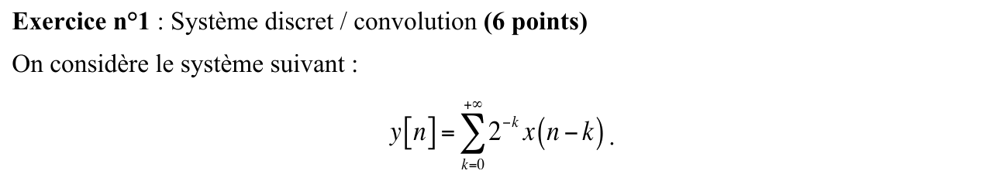
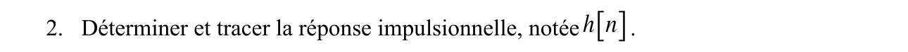
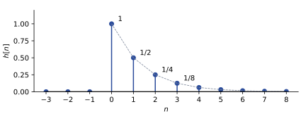
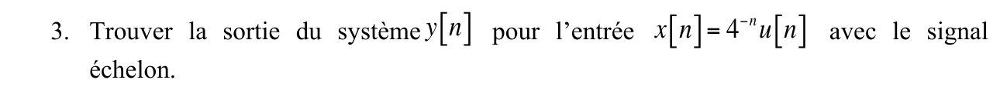
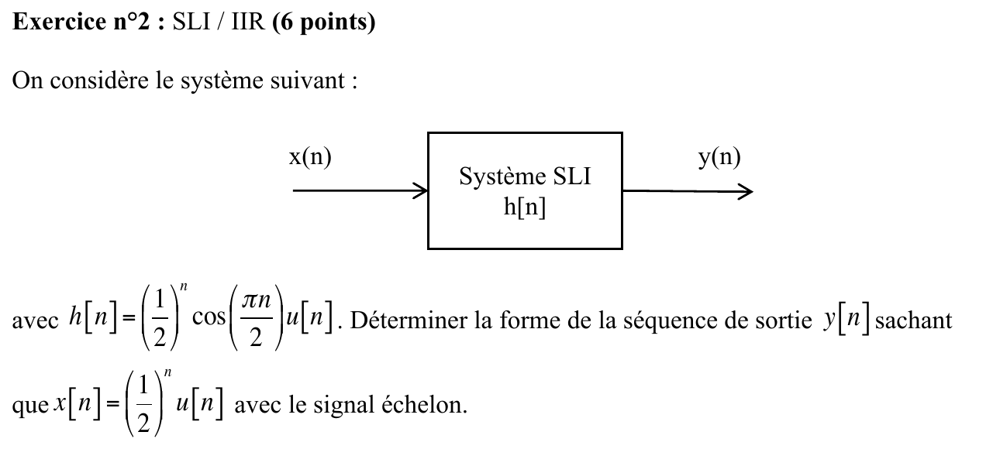
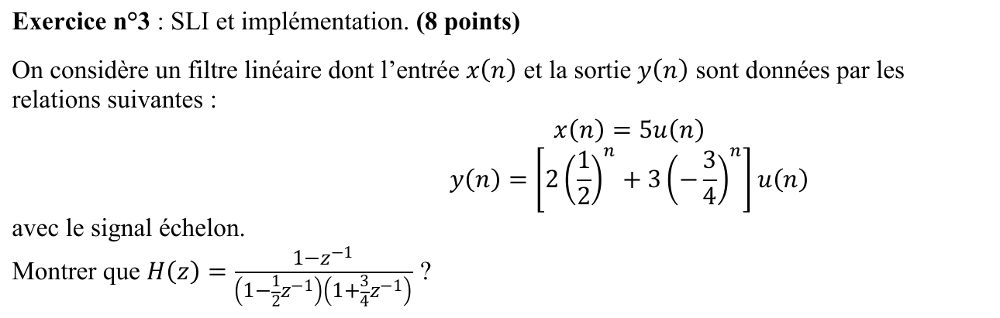
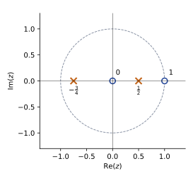



::: {.complement}
Aucun corrigé officiel : **toutes les solutions de cette page sont rédigées par Claude**. Le sujet existe en deux versions au contenu identique : le scan du sujet distribué [sujet-2014, p. 1-2] et sa reproduction dans l'annexe du recueil de TD, intitulée « SUJET 2014 » [sujet-2014-recueil, p. 14-15]. Les images viennent du recueil, plus net. Seules différences : la mise en page et des annotations manuscrites sur le scan (questions de l'exercice 3 renumérotées de 2 à 6, « Montrer que $H(z)$ » marqué 1), qui ne font pas partie de l'énoncé.
:::

Rappels fournis avec le sujet : échelon $u[n] = 0$ pour $n < 0$, $u[n] = 1$ pour $n \geq 0$ ; $\delta(n-k) \overset{z}{\longleftrightarrow} z^{-k}$ et $a^n u(n) \overset{z}{\longleftrightarrow} \dfrac{1}{1 - a z^{-1}}$ avec $|a| < 1$.

## Exercice 1 : système discret, convolution (6 points) {#sec-ann14-ex1}

{fig-alt="Exercice 1 : système défini par y[n] = somme pour k de 0 à l'infini de 2^(−k) x(n − k)."}

Chapitre du cours : [Système linéaire invariant](../cours/02-systemes-discrets-convolution.qmd#sec-sli-discret)

{fig-alt="Exercice 1, q. 1 : le système est-il linéaire invariant ? causal ?"}

::: {.complement}
- **Linéaire** : pour $x = a x_1 + b x_2$, la somme se sépare en $a\, y_1[n] + b\, y_2[n]$ ([linéarité](../cours/02-systemes-discrets-convolution.qmd#sec-linearite)).
- **Invariant** : l'entrée $x[n - n_0]$ donne $\sum_{k \geq 0} 2^{-k} x(n - n_0 - k) = y[n - n_0]$ ; les coefficients $2^{-k}$ ne dépendent pas de $n$ ([invariance](../cours/02-systemes-discrets-convolution.qmd#sec-invariance)). C'est donc un **SLI** : la relation est une convolution $y = h * x$ avec $h[k] = 2^{-k}$ pour $k \geq 0$.
- **Causal** : $k \geq 0$, donc $y[n]$ n'utilise que $x[n], x[n-1], \dots$ (présent et passé) ([causalité](../cours/02-systemes-discrets-convolution.qmd#sec-causalite)).
:::

{fig-alt="Exercice 1, q. 2 : déterminer et tracer la réponse impulsionnelle h[n]."}

:::: {.complement}
::: {.solution}
Avec $x = \delta$, seul le terme $k = n$ subsiste :
$$\boxed{h[n] = 2^{-n}\, u[n] = \left(\tfrac12\right)^n u[n]}$$
soit $1, \frac12, \frac14, \frac18, \dots$ pour $n = 0, 1, 2, 3, \dots$ Le système est de plus stable : $\sum_n |h[n]| = \frac{1}{1 - 1/2} = 2$.

{#fig-ann14-reponse-impulsionnelle}
:::
::::

{fig-alt="Exercice 1, q. 3 : trouver la sortie y[n] pour l'entrée x[n] = 4^(−n) u[n]."}

::: {.complement}
**Convolution directe.** Pour $n \geq 0$ ($y[n] = 0$ sinon), les termes non nuls sont $0 \leq k \leq n$ :
$$y[n] = \sum_{k=0}^{n} 2^{-k}\, 4^{-(n-k)} = 4^{-n} \sum_{k=0}^{n} 2^{k} = 4^{-n}\left(2^{n+1} - 1\right).$$
$$\boxed{y[n] = \left[2\left(\tfrac12\right)^n - \left(\tfrac14\right)^n\right] u[n]}$$
**Par la transformée en $z$** (rappels) : $Y(z) = \dfrac{1}{\left(1 - \frac12 z^{-1}\right)\left(1 - \frac14 z^{-1}\right)} = \dfrac{2}{1 - \frac12 z^{-1}} - \dfrac{1}{1 - \frac14 z^{-1}}$, même résultat ([éléments simples](../cours/04-implementation-equations-differences.qmd#sec-generalisation-elements-simples)).

Contrôle : $y[0] = h[0]\, x[0] = 1$ ; $y[1] = h[0]\, x[1] + h[1]\, x[0] = \frac14 + \frac12 = \frac34$, et la formule donne $1 - \frac14 = \frac34$ ✓.
:::

## Exercice 2 : SLI, filtre RII (6 points) {#sec-ann14-ex2}

{fig-alt="Exercice 2 : SLI de réponse impulsionnelle h[n] = (1/2)^n cos(πn/2) u[n] ; déterminer la forme de la sortie y[n] pour l'entrée x[n] = (1/2)^n u[n]."}

Chapitre du cours : [Convolution discrète](../cours/02-systemes-discrets-convolution.qmd#sec-convolution-discrete)

:::: {.complement}
::: {.solution}
**Convolution directe** (la plus rapide ici). Pour $n \geq 0$, les facteurs $\left(\frac12\right)^k$ et $\left(\frac12\right)^{n-k}$ se regroupent :
$$y[n] = \sum_{k=0}^{n} \left(\tfrac12\right)^k \cos\left(\tfrac{\pi k}{2}\right) \left(\tfrac12\right)^{n-k} = \left(\tfrac12\right)^n \sum_{k=0}^{n} \cos\left(\tfrac{\pi k}{2}\right).$$
La suite $\cos\left(\frac{\pi k}{2}\right)$ vaut $1, 0, -1, 0, 1, \dots$ (période 4), donc ses sommes partielles valent $1, 1, 0, 0, 1, 1, 0, 0, \dots$, soit $\frac12\left[1 + \cos\left(\frac{\pi n}{2}\right) + \sin\left(\frac{\pi n}{2}\right)\right]$ :
$$\boxed{y[n] = \frac12 \left(\tfrac12\right)^n \left[1 + \cos\left(\tfrac{\pi n}{2}\right) + \sin\left(\tfrac{\pi n}{2}\right)\right] u[n]}$$
Autrement dit $y[n] = \left(\frac12\right)^n$ si $n \equiv 0$ ou $1 \pmod 4$, et $0$ si $n \equiv 2$ ou $3 \pmod 4$.

**Par la transformée en $z$.** Avec $\cos\left(\frac{\pi n}{2}\right) = \frac12\left(j^n + (-j)^n\right)$ et le rappel $a^n u(n) \leftrightarrow \frac{1}{1 - a z^{-1}}$ :
$$H(z) = \frac12\left[\frac{1}{1 - \frac{j}{2} z^{-1}} + \frac{1}{1 + \frac{j}{2} z^{-1}}\right] = \frac{1}{1 + \frac14 z^{-2}}, \qquad Y(z) = \frac{1}{\left(1 - \frac12 z^{-1}\right)\left(1 + \frac14 z^{-2}\right)}.$$
Pôles $\frac12$ et $\pm \frac{j}{2}$ ; les éléments simples donnent $Y(z) = \dfrac{1/2}{1 - \frac12 z^{-1}} + \dfrac{\frac12 + \frac14 z^{-1}}{1 + \frac14 z^{-2}}$, dont l'inverse est la même expression (le terme $\frac14 z^{-1}$ produit le sinus). La sortie est la somme d'un mode $\left(\frac12\right)^n$ (pôle de l'entrée) et d'un mode oscillant $\left(\frac12\right)^n \cos / \sin\left(\frac{\pi n}{2}\right)$ (pôles du système).

Contrôle : $y[0] = 1$, $y[1] = h[0]\, x[1] + h[1]\, x[0] = \frac12 + 0$ ✓, $y[2] = \frac14 + 0 - \frac14 = 0$ ✓ (vérifié numériquement sur 30 termes).
:::
::::

## Exercice 3 : SLI et implémentation (8 points) {#sec-ann14-ex3}

{fig-alt="Exercice 3 : filtre linéaire d'entrée x(n) = 5u(n) et de sortie y(n) = [2(1/2)^n + 3(−3/4)^n] u(n) ; montrer que H(z) = (1 − z^−1) / ((1 − z^−1/2)(1 + 3z^−1/4))."}

Chapitre du cours : [Exemple complet d'un filtre RII](../cours/04-implementation-equations-differences.qmd#sec-exemple-complet-rii) (mêmes pôles $\frac12$ et $-\frac34$)

::: {.complement}
**Démonstration.** On calcule $H(z) = Y(z)/X(z)$ avec le rappel ($|z| > 1$) :
$$X(z) = \frac{5}{1 - z^{-1}}, \qquad Y(z) = \frac{2}{1 - \frac12 z^{-1}} + \frac{3}{1 + \frac34 z^{-1}} = \frac{2 + \frac32 z^{-1} + 3 - \frac32 z^{-1}}{\left(1 - \frac12 z^{-1}\right)\left(1 + \frac34 z^{-1}\right)} = \frac{5}{\left(1 - \frac12 z^{-1}\right)\left(1 + \frac34 z^{-1}\right)}.$$
$$H(z) = \frac{Y(z)}{X(z)} = \frac{1 - z^{-1}}{\left(1 - \frac12 z^{-1}\right)\left(1 + \frac34 z^{-1}\right)}$$
C'est l'expression demandée ✓.
Contrôle : $y(0) = 2 + 3 = 5 = h(0)\, x(0)$ avec $h(0) = 1$.
:::

{fig-alt="Exercice 3, q. 1 : tracer la représentation en pôles/zéros."}

:::: {.complement}
::: {.solution}
En puissances positives : $H(z) = \dfrac{z\,(z - 1)}{\left(z - \frac12\right)\left(z + \frac34\right)}$. **Zéros** $z = 0$ et $z = 1$ ; **pôles** $z = \frac12$ et $z = -\frac34$. Le zéro en $z = 1$ ($f = 0$) annule le gain continu : il « absorbe » le pôle $z = 1$ de l'échelon d'entrée, d'où l'absence de terme constant dans $y(n)$.

{#fig-ann14-poles-zeros}
:::
::::

{fig-alt="Exercice 3, q. 2 : déterminer la réponse impulsionnelle h(n)."}

::: {.complement}
Éléments simples ([méthode du cours](../cours/04-implementation-equations-differences.qmd#sec-generalisation-elements-simples)) : $H(z) = \dfrac{A}{1 - \frac12 z^{-1}} + \dfrac{B}{1 + \frac34 z^{-1}}$ avec
$A = \left.\dfrac{1 - z^{-1}}{1 + \frac34 z^{-1}}\right|_{z^{-1} = 2} = \dfrac{-1}{5/2} = -\dfrac25$ et $B = \left.\dfrac{1 - z^{-1}}{1 - \frac12 z^{-1}}\right|_{z^{-1} = -4/3} = \dfrac{7/3}{5/3} = \dfrac75$.
$$\boxed{h(n) = \left[-\frac25 \left(\tfrac12\right)^n + \frac75 \left(-\tfrac34\right)^n\right] u(n)}$$
Contrôle : $h(0) = -\frac25 + \frac75 = 1$ ✓ ; $h(1) = -\frac15 - \frac{21}{20} = -\frac54$, comme la récurrence de la question 3 ($h(1) = -\frac14 \times 1 + 0 - 1$) ✓.
:::

{fig-alt="Exercice 3, q. 3 : écrire l'équation aux différences."}

::: {.complement}
Dénominateur développé : $\left(1 - \frac12 z^{-1}\right)\left(1 + \frac34 z^{-1}\right) = 1 + \frac14 z^{-1} - \frac38 z^{-2}$. De $Y(z)\left(1 + \frac14 z^{-1} - \frac38 z^{-2}\right) = X(z)\left(1 - z^{-1}\right)$ :
$$\boxed{y(n) = -\frac14\, y(n-1) + \frac38\, y(n-2) + x(n) - x(n-1)}$$
Contrôle : avec $x(n) = 5u(n)$, la récurrence redonne exactement le $y(n)$ de l'énoncé (vérifié numériquement).
:::

{fig-alt="Exercice 3, q. 4 : le système est-il stable au sens entrée bornée / sortie bornée ? Pourquoi ?"}

::: {.complement}
**Oui.** Le système est causal (question 5) et ses pôles $\frac12$ et $-\frac34$ sont de module $< 1$ ([stabilité et transformée en $z$](../cours/04-implementation-equations-differences.qmd#sec-stabilite-transformee-z)). Directement : $\sum_n |h(n)| \leq \frac25 \cdot \frac{1}{1 - 1/2} + \frac75 \cdot \frac{1}{1 - 3/4} = \frac45 + \frac{28}{5} = 6{,}4 < \infty$.
:::

{fig-alt="Exercice 3, q. 5 : le système est-il causal ? Pourquoi ?"}

::: {.complement}
**Oui.** $h(n) = 0$ pour $n < 0$ (facteur $u(n)$) : la zone de convergence retenue est l'extérieur du plus grand pôle, $|z| > \frac34$. De façon équivalente, l'équation aux différences calcule $y(n)$ à partir de $x(n)$, $x(n-1)$ et des sorties passées seulement ([causalité](../cours/02-systemes-discrets-convolution.qmd#sec-causalite)). Ce choix est imposé par l'énoncé : une entrée causale ($5u(n)$) produit une sortie causale.
:::
