

::: {.complement}
Aucun corrigé officiel : **toutes les solutions de cette page sont rédigées par Claude**. Les énoncés sont des extraits du scan du sujet [sujet-2015] ; les annotations manuscrites d'un étudiant (encre bleue, crayon) ont été effacées des images. À relire avec un œil critique ; signaler toute erreur.

L'exercice 1 (convolution de $\{3, -2, 4\}$ et $\{4, 2, -1\}$) est repris à l'identique à l'examen de 2^e^ session du 8 mars 2018 (recueil de TD, p. 19 du PDF).
:::

Rappels fournis avec le sujet : échelon $u[n]$ ; $\delta(n-k) \overset{z}{\longleftrightarrow} z^{-k}$ et $a^n u(n) \overset{z}{\longleftrightarrow} \dfrac{1}{1 - a z^{-1}}$ avec $|a| < 1$.

## Exercice 1 : système discret / convolution (3 points) {#sec-ann15-ex1}

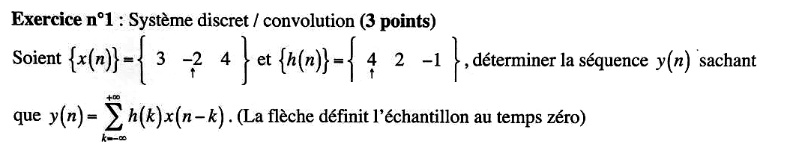{fig-alt="Exercice 1 : x(n) = {3, -2, 4} avec la flèche (n = 0) sous -2, h(n) = {4, 2, -1} avec la flèche sous 4 ; déterminer y(n) = somme sur k de h(k) x(n - k)."}

Chapitre du cours : [Convolution discrète](../cours/02-systemes-discrets-convolution.qmd#sec-convolution-discrete)

:::: {.complement}
::: {.solution}
**Lecture des séquences.** La flèche marque $n = 0$ : $x(-1) = 3$, $x(0) = -2$, $x(1) = 4$ et $h(0) = 4$, $h(1) = 2$, $h(2) = -1$. Le support de $y$ va de $-1 + 0 = -1$ à $1 + 2 = 3$.

**Calcul** (tableau des produits, $y(n) = \sum_k h(k)\, x(n-k)$) :

| $n$ | $-1$ | $0$ | $1$ | $2$ | $3$ |
|---|---|---|---|---|---|
| $h(0)\,x(n)$ | 12 | $-8$ | 16 | 0 | 0 |
| $h(1)\,x(n-1)$ | 0 | 6 | $-4$ | 8 | 0 |
| $h(2)\,x(n-2)$ | 0 | 0 | $-3$ | 2 | $-4$ |
| $y(n)$ | **12** | **$-2$** | **9** | **10** | **$-4$** |

$$y(n) = \{12,\ \underset{\uparrow}{-2},\ 9,\ 10,\ -4\}$$

Contrôle : $\sum y = 25 = \left(\sum x\right)\left(\sum h\right) = 5 \times 5$ ✓.
:::
::::

## Exercice 2 : échantillonnage et ambiguïté (3 points) {#sec-ann15-ex2}

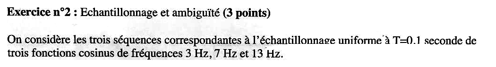{fig-alt="Exercice 2 : trois cosinus de fréquences 3 Hz, 7 Hz et 13 Hz échantillonnés uniformément à T = 0,1 s."}

Chapitre du cours : [Interprétation fréquentielle de l'échantillonnage](../cours/01-echantillonnage-signal-discret.qmd#sec-interpretation-frequentielle-echantillonnage)

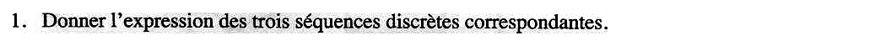{fig-alt="Exercice 2, q. 1 : donner l'expression des trois séquences discrètes correspondantes."}

:::: {.complement}
::: {.solution}
$x_i(n) = \cos(2\pi f_i\, nT)$ avec $T = 0{,}1$ s (phase nulle, l'énoncé n'en donne pas) :
$$x_1(n) = \cos(0{,}6\pi n), \qquad x_2(n) = \cos(1{,}4\pi n), \qquad x_3(n) = \cos(2{,}6\pi n)$$
:::
::::

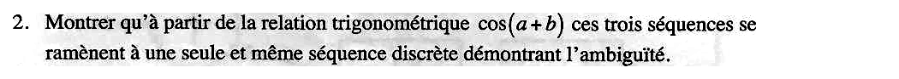{fig-alt="Exercice 2, q. 2 : montrer avec cos(a + b) que les trois séquences se ramènent à une seule séquence discrète (ambiguïté)."}

:::: {.complement}
::: {.solution}
Avec $\cos(a \pm b) = \cos a \cos b \mp \sin a \sin b$, $\cos(2\pi n) = 1$ et $\sin(2\pi n) = 0$ pour $n$ entier :

- $x_2(n) = \cos(2\pi n - 0{,}6\pi n) = \cos(2\pi n)\cos(0{,}6\pi n) + \sin(2\pi n)\sin(0{,}6\pi n) = \cos(0{,}6\pi n)$ ;
- $x_3(n) = \cos(2\pi n + 0{,}6\pi n) = \cos(2\pi n)\cos(0{,}6\pi n) - \sin(2\pi n)\sin(0{,}6\pi n) = \cos(0{,}6\pi n)$.

$$x_1(n) = x_2(n) = x_3(n) = \cos(0{,}6\pi n)$$

Les trois cosinus donnent **la même séquence** : à $f_e = 10$ Hz, $7 = 10 - 3$ et $13 = 10 + 3$ se replient sur $3$ Hz ($f_e < 2 \times 7$ et $f_e < 2 \times 13$). Contrôle numérique sur $n = 0, \dots, 19$ : séquences identiques.
:::
::::

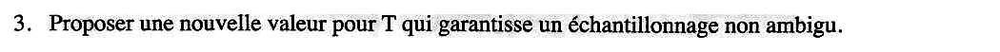{fig-alt="Exercice 2, q. 3 : proposer une nouvelle valeur de T qui garantisse un échantillonnage non ambigu."}

:::: {.complement}
::: {.solution}
Il faut respecter le [théorème de Shannon](../cours/01-echantillonnage-signal-discret.qmd#sec-shannon) pour la plus haute fréquence, 13 Hz : $f_e > 26$ Hz, soit $T < 1/26 \approx 38{,}5$ ms. Par exemple **$T = 0{,}02$ s** ($f_e = 50$ Hz) : fréquences normalisées $0{,}06$, $0{,}14$ et $0{,}26$, toutes distinctes et inférieures à $\frac12$.
:::
::::

## Exercice 3 : filtre RIF et propriété de phase (5 points) {#sec-ann15-ex3}

{fig-alt="Exercice 3 : filtre RIF et propriété de phase (5 points)."}

Chapitre du cours : [Filtre à phase linéaire](../cours/05-representation-en-phase.qmd#sec-phase-lineaire)

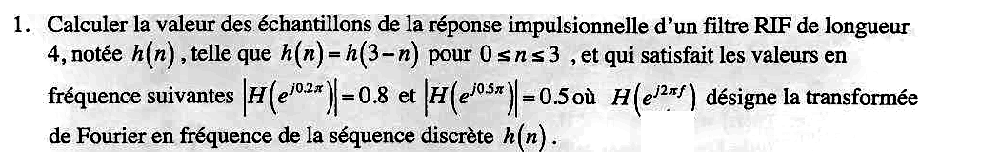{fig-alt="Exercice 3, q. 1 : RIF de longueur 4, h(n) = h(3 - n) pour 0 ≤ n ≤ 3, avec |H(e^{j0,2π})| = 0,8 et |H(e^{j0,5π})| = 0,5 ; calculer les échantillons de h(n)."}

::: {.a-verifier #av-ann15-rif-deux-solutions}
**Source** [sujet-2015, p. 1] : « filtre RIF de longueur 4, notée $h(n)$, telle que $h(n) = h(3-n)$ […] $|H(e^{j0.2\pi})| = 0.8$ et $|H(e^{j0.5\pi})| = 0.5$ ».

**Problème** : seuls les **modules** sont imposés. L'amplitude réelle $A$ (voir la solution) peut valoir $\pm 0{,}8$ et $\pm 0{,}5$ : il existe deux filtres différents (au signe global près), $(a, b) \approx (0{,}0414 ;\ 0{,}3950)$ et $(a, b) \approx (0{,}4784 ;\ 0{,}1249)$, qui vérifient tous deux l'énoncé.

**Proposition** : retenir la solution où $A$ est positive aux deux fréquences (gain qui décroît régulièrement, filtre passe-bas), et signaler l'autre.
:::

:::: {.complement}
::: {.solution}
**Forme de $h$.** $h(n) = h(3-n)$ impose $h = \{a,\ b,\ b,\ a\}$ pour $n = 0, \dots, 3$. En regroupant les termes symétriques autour du centre $n = \frac32$ :
$$H(e^{j\omega}) = a + b e^{-j\omega} + b e^{-2j\omega} + a e^{-3j\omega} = e^{-j\frac{3\omega}{2}} \underbrace{\left[2a\cos\tfrac{3\omega}{2} + 2b\cos\tfrac{\omega}{2}\right]}_{A(\omega)\ \text{réelle}}$$
d'où $|H| = |A(\omega)|$. L'énoncé donne $H$ en $e^{j\omega}$ avec $\omega = 2\pi f$ : $\omega = 0{,}2\pi$ ($f = 0{,}1$) et $\omega = 0{,}5\pi$ ($f = 0{,}25$).

**Système.** Avec $A(0{,}2\pi) = 0{,}8$ et $A(0{,}5\pi) = 0{,}5$ :
$$\begin{cases} 2\cos(0{,}3\pi)\, a + 2\cos(0{,}1\pi)\, b = 0{,}8 \\ 2\cos(0{,}75\pi)\, a + 2\cos(0{,}25\pi)\, b = 0{,}5 \end{cases} \iff \begin{cases} 1{,}1756\, a + 1{,}9021\, b = 0{,}8 \\ \sqrt2\,(b - a) = 0{,}5 \end{cases}$$
La seconde équation donne $b = a + \frac{\sqrt2}{4}$ ; en reportant : $a = \dfrac{0{,}8 - \frac{\sqrt2}{2}\cos(0{,}1\pi)}{2\cos(0{,}3\pi) + 2\cos(0{,}1\pi)}$.

$$\boxed{h(0) = h(3) = a \approx 0{,}0414, \qquad h(1) = h(2) = b \approx 0{,}3950}$$

Contrôle : $|H|$ recalculé vaut $0{,}8000$ et $0{,}5000$ aux deux pulsations ✓. L'autre choix de signe ($A(0{,}5\pi) = -0{,}5$) donne $a \approx 0{,}4784$, $b \approx 0{,}1249$ (voir le bloc *À vérifier*).
:::
::::

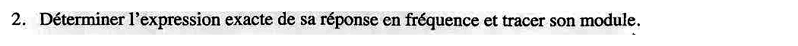{fig-alt="Exercice 3, q. 2 : déterminer l'expression exacte de la réponse en fréquence et tracer son module."}

:::: {.complement}
::: {.solution}
En fréquence normalisée ($\omega = 2\pi f$) :
$$H(e^{j2\pi f}) = e^{-j3\pi f}\left[2a\cos(3\pi f) + 2b\cos(\pi f)\right] \approx e^{-j3\pi f}\left[0{,}0829\cos(3\pi f) + 0{,}7900\cos(\pi f)\right]$$

Valeurs clés : $|H| = 2a + 2b \approx 0{,}873$ en $f = 0$, $0{,}8$ en $f = 0{,}1$, $0{,}5$ en $f = 0{,}25$, et $0$ en $f = \frac12$ (car $A(\pi) = 2a\cos\frac{3\pi}{2} + 2b\cos\frac{\pi}{2} = 0$). C'est un **passe-bas**.

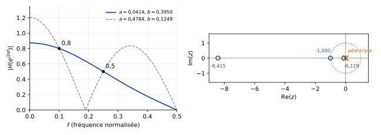{#fig-ann15-rif-phase}
:::
::::

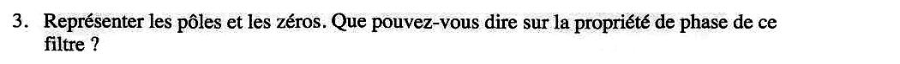{fig-alt="Exercice 3, q. 3 : représenter les pôles et les zéros ; que dire de la propriété de phase du filtre ?"}

:::: {.complement}
::: {.solution}
$H(z) = a + b z^{-1} + b z^{-2} + a z^{-3} = \dfrac{a z^3 + b z^2 + b z + a}{z^3}$.

- **Pôles** : triple en $z = 0$ (RIF causal, toujours stable).
- **Zéros** : $z = -1$ est racine ($-a + b - b + a = 0$), et $a z^3 + b z^2 + b z + a = (z + 1)\left(a z^2 + (b - a) z + a\right)$. Le trinôme a deux racines réelles de produit $1$ : $z \approx -0{,}119$ et $z \approx -8{,}415$ (inverses l'une de l'autre).

Les zéros vont par **paires $\{z_l,\ 1/z_l\}$** (et $-1$ est son propre inverse) : c'est la signature d'un [RIF à phase linéaire](../cours/05-representation-en-phase.qmd#sec-phase-lineaire). Ici $\arg H = -3\pi f$ (puisque $A(f) \geq 0$ sur $[0, \frac12]$) : **phase linéaire**, retard de groupe constant de $\frac32$ échantillon. Le zéro $-8{,}415$, hors du cercle unité, montre que le filtre n'est **pas à minimum de phase**.

(Avec l'autre solution, les zéros sont $-1$ et $e^{\pm j\,1{,}19}$, sur le cercle unité : même conclusion.)
:::
::::

## Exercice 4 : RII et propriété de phase (6 points) {#sec-ann15-ex4}

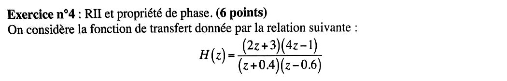{fig-alt="Exercice 4 : H(z) = (2z + 3)(4z - 1) / ((z + 0,4)(z - 0,6))."}

Chapitre du cours : [Filtres à minimum de phase](../cours/05-representation-en-phase.qmd#sec-minimum-phase)

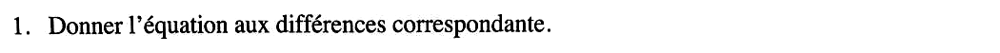{fig-alt="Exercice 4, q. 1 : donner l'équation aux différences correspondante."}

:::: {.complement}
::: {.solution}
On développe et on divise par $z^2$ :
$$H(z) = \frac{8z^2 + 10z - 3}{z^2 - 0{,}2z - 0{,}24} = \frac{8 + 10z^{-1} - 3z^{-2}}{1 - 0{,}2z^{-1} - 0{,}24z^{-2}} = \frac{Y(z)}{X(z)}$$
D'où, en supposant le système causal ([forme générale](../cours/04-implementation-equations-differences.qmd#sec-forme-generale-equation-differences)) :
$$y(n) = 0{,}2\, y(n-1) + 0{,}24\, y(n-2) + 8\, x(n) + 10\, x(n-1) - 3\, x(n-2)$$
Contrôle : $h(0) = 8 = \lim_{z \to \infty} H(z)$ ✓.
:::
::::

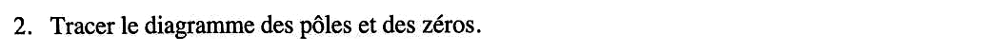{fig-alt="Exercice 4, q. 2 : tracer le diagramme des pôles et des zéros."}

:::: {.complement}
::: {.solution}
- **Zéros** : $2z + 3 = 0 \Rightarrow z = -\frac32$ ; $4z - 1 = 0 \Rightarrow z = \frac14$.
- **Pôles** : $z = -0{,}4$ et $z = 0{,}6$, dans le cercle unité : le système causal est **stable**.

Voir @fig-ann15-min-phase (à gauche).
:::
::::

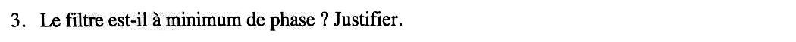{fig-alt="Exercice 4, q. 3 : le filtre est-il à minimum de phase ? Justifier."}

:::: {.complement}
::: {.solution}
**Non.** Un filtre causal et stable est à minimum de phase si ses pôles **et ses zéros** sont dans le cercle unité. Le zéro $z = -\frac32$ est à l'extérieur ($|{-\frac32}| > 1$).
:::
::::

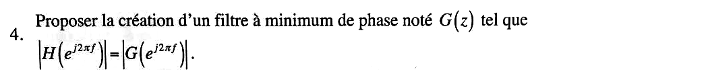{fig-alt="Exercice 4, q. 4 : proposer un filtre à minimum de phase G(z) tel que |H(e^{j2πf})| = |G(e^{j2πf})|."}

:::: {.complement}
::: {.solution}
On remplace le zéro $-\frac32$ par son inverse $-\frac23$ en conservant le module sur le cercle unité ([égalité des modules](../cours/05-representation-en-phase.qmd#sec-egalite-modules)) : le facteur $2z + 3$ devient $3z + 2$.
$$\boxed{G(z) = \frac{(3z + 2)(4z - 1)}{(z + 0{,}4)(z - 0{,}6)}}$$

Justification : en $z = e^{j\omega}$, $|2e^{j\omega} + 3| = |e^{j\omega}|\,|2 + 3e^{-j\omega}| = |3e^{-j\omega} + 2| = |3e^{j\omega} + 2|$ (module d'un conjugué). Les deux modules valent $\sqrt{13 + 12\cos\omega}$.

Ainsi $H(z) = G(z)\, H_{pt}(z)$ avec $H_{pt}(z) = \dfrac{2z + 3}{3z + 2}$, passe-tout stable (pôle $-\frac23$). Contrôle : $|H| = |G|$ vérifié numériquement sur $[0, \pi]$ ; en $z = 1$, $H(1) = G(1) = \frac{15}{0{,}56} \approx 26{,}8$.
:::
::::

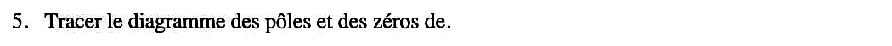{fig-alt="Exercice 4, q. 5 : tracer le diagramme des pôles et des zéros de (complément manquant dans l'énoncé)."}

::: {.a-verifier #av-ann15-ex4-q5-objet}
**Source** [sujet-2015, p. 2] : « 5. Tracer le diagramme des pôles et des zéros de. »

**Problème** : la phrase s'arrête sans dire de quel filtre (un étudiant a complété « $G(z)$ » à la main sur le scan).

**Proposition** : « de $G(z)$ », d'après l'enchaînement des questions 4 à 6.
:::

:::: {.complement}
::: {.solution}
$G(z)$ : **zéros** $-\frac23$ et $\frac14$, **pôles** $-0{,}4$ et $0{,}6$ (inchangés). Tout est dans le cercle unité : minimum de phase.

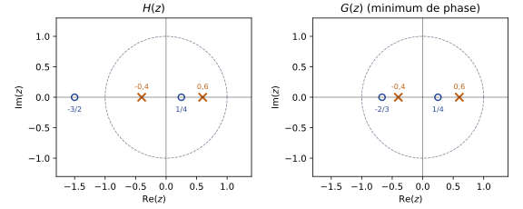{#fig-ann15-min-phase}
:::
::::

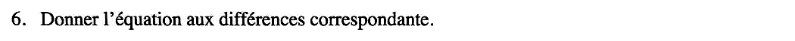{fig-alt="Exercice 4, q. 6 : donner l'équation aux différences correspondante (de G)."}

:::: {.complement}
::: {.solution}
$(3z + 2)(4z - 1) = 12z^2 + 5z - 2$, donc
$$G(z) = \frac{12 + 5z^{-1} - 2z^{-2}}{1 - 0{,}2z^{-1} - 0{,}24z^{-2}}$$
$$y(n) = 0{,}2\, y(n-1) + 0{,}24\, y(n-2) + 12\, x(n) + 5\, x(n-1) - 2\, x(n-2)$$
Même partie récursive que $H$ (mêmes pôles) ; seuls les coefficients de l'entrée changent.
:::
::::

## Exercice 5 : cascade (3 points) {#sec-ann15-ex5}

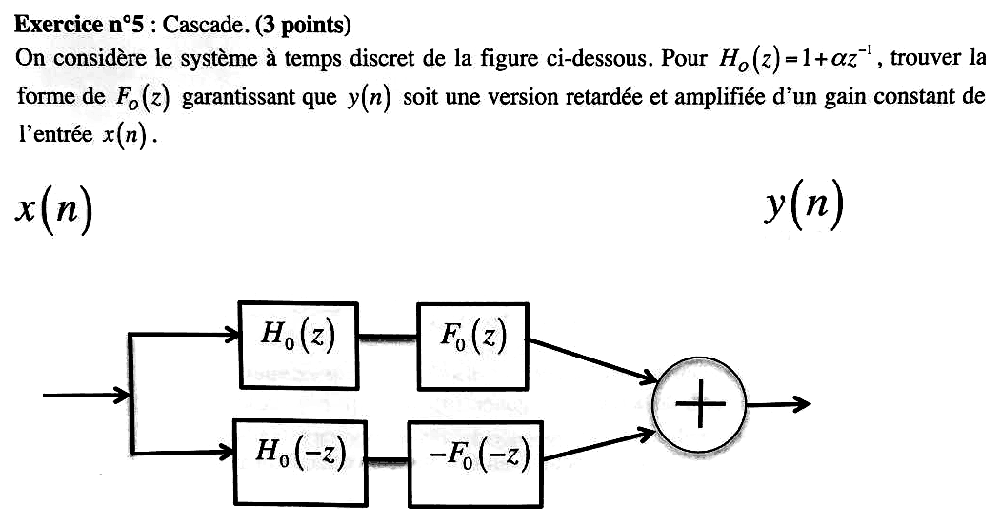{fig-alt="Exercice 5 : deux branches en parallèle, H0(z) puis F0(z), et H0(-z) puis -F0(-z), sommées ; pour H0(z) = 1 + α z^{-1}, trouver F0(z) pour que y(n) soit une version retardée et amplifiée de x(n)."}

Chapitre du cours : [Association de systèmes discrets](../cours/02-systemes-discrets-convolution.qmd#sec-association-systemes)

:::: {.complement}
::: {.solution}
**Fonction de transfert globale.** Cascade = produit, parallèle = somme :
$$T(z) = \frac{Y(z)}{X(z)} = H_0(z)F_0(z) - H_0(-z)F_0(-z) = P(z) - P(-z), \quad P(z) = H_0(z)F_0(z)$$
$P(z) - P(-z)$ ne garde que les puissances **impaires** de $z^{-1}$ de $P$ (multipliées par 2). On veut $T(z) = c\, z^{-k}$ : il faut que $P$ n'ait **qu'un seul terme impair**.

**Choix le plus simple : $F_0(z) = H_0(z) = 1 + \alpha z^{-1}$.**
$$T(z) = (1 + \alpha z^{-1})^2 - (1 - \alpha z^{-1})^2 = 4\alpha\, z^{-1} \quad\Longrightarrow\quad y(n) = 4\alpha\, x(n-1)$$
Retard d'un échantillon, gain $4\alpha$ (il faut $\alpha \neq 0$).

**Forme générale d'ordre 1.** Avec $F_0(z) = c_0 + c_1 z^{-1}$ : $T(z) = 2(c_1 + \alpha c_0)\, z^{-1}$ (vérifié par calcul symbolique). Tout $F_0$ du premier ordre convient pourvu que $c_1 \neq -\alpha c_0$, c'est-à-dire $F_0 \neq c_0 H_0(-z)$ (qui annulerait la sortie).
:::
::::
