

::: {.complement}
Aucun corrigé officiel : **toutes les solutions de cette page sont rédigées par Claude**. Le sujet existe en deux versions au contenu identique : le scan [sujet-2016, p. 1-2] et sa reproduction dans l'annexe du recueil de TD (« SUJET 2016 ») [td, p. 16-18]. Les images de l'énoncé sont extraites du recueil, plus net. À relire avec un œil critique ; signaler toute erreur.

L'exercice 4 (« Filtre RII et cascade ») est **tombé à l'identique en 2016-2017, 2017-2018 et 2022-2023** ; la question de cours sur la TFD revient aussi en 2022-2023 et 2025-2026.
:::

Rappels fournis avec le sujet : échelon $u[n]$ ; $\delta(n-k) \overset{z}{\longleftrightarrow} z^{-k}$ ; $a^n u(n) \overset{z}{\longleftrightarrow} \dfrac{1}{1 - a z^{-1}}$ avec $|a| < 1$ ; $\displaystyle\sum_{n=N_1}^{N_2} \alpha^n = \frac{\alpha^{N_1} - \alpha^{N_2+1}}{1 - \alpha}$.

## Exercice 1 : échantillonnage (2 points) {#sec-ann16-ex1}

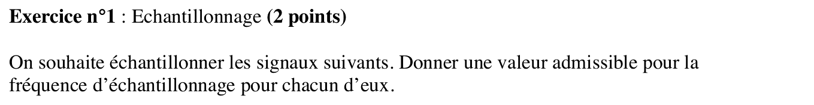{fig-alt="Exercice 1 : donner une fréquence d'échantillonnage admissible pour chacun des signaux suivants."}

Chapitre du cours : [Théorème de Shannon-Nyquist](../cours/01-echantillonnage-signal-discret.qmd#sec-shannon)

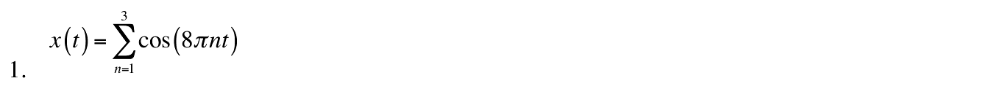{fig-alt="Exercice 1, q. 1 : x(t) = somme pour n de 1 à 3 de cos(8πnt)."}

:::: {.complement}
::: {.solution}
$x(t) = \cos(8\pi t) + \cos(16\pi t) + \cos(24\pi t)$ : fréquences $4$, $8$ et $12$ Hz. Shannon impose $f_e > 2 f_{\max} = 24$ Hz. Valeur admissible : **$f_e = 30$ Hz** (toute valeur strictement supérieure à 24 Hz ; à 24 Hz pile, la raie à 12 Hz tombe sur la fréquence de Nyquist et sa phase n'est plus récupérable).
:::
::::

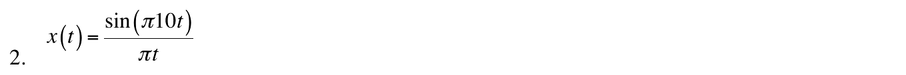{fig-alt="Exercice 1, q. 2 : x(t) = sin(10πt) / (πt)."}

:::: {.complement}
::: {.solution}
$\dfrac{\sin(2\pi B t)}{\pi t}$ est la transformée de Fourier inverse de la porte $\mathbb{1}_{[-B, B]}(f)$ : $\displaystyle\int_{-B}^{B} e^{j2\pi f t}\, df = \frac{\sin(2\pi B t)}{\pi t}$. Ici $2\pi B = 10\pi$, donc $B = 5$ Hz : $X(f) = 1$ pour $|f| < 5$ Hz, $0$ au-delà. Signal à bande limitée, $f_{\max} = 5$ Hz : $f_e > 10$ Hz, par exemple **$f_e = 20$ Hz**.
:::
::::

## Exercice 2 : produit de convolution discret (4 points) {#sec-ann16-ex2}

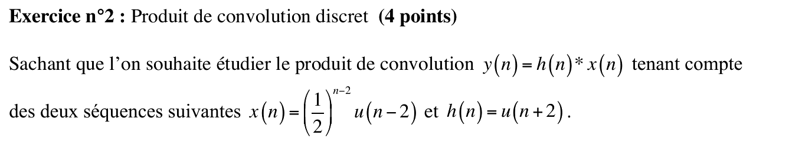{fig-alt="Exercice 2 : y(n) = h(n) * x(n) avec x(n) = (1/2)^(n-2) u(n-2) et h(n) = u(n+2)."}

Chapitre du cours : [Convolution discrète](../cours/02-systemes-discrets-convolution.qmd#sec-convolution-discrete)

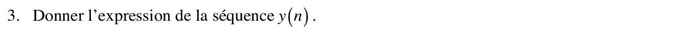{fig-alt="Exercice 2, q. 3 : donner l'expression de la séquence y(n)."}

::: {.a-verifier #av-ann16-ex2-numerotation}
**Source** [sujet-2016, p. 1] et [td, p. 16] : une seule question, numérotée « 3. Donner l'expression de la séquence $y(n)$. »

**Problème** : les questions 1 et 2 manquent (même numérotation dans les deux versions) ; sans doute des questions supprimées lors de l'écriture du sujet.

**Proposition** : traiter la question 3 comme l'unique question de l'exercice.
:::

:::: {.complement}
::: {.solution}
**Supports.** $x(k) \neq 0$ pour $k \geq 2$ ; $h(n - k) = u(n - k + 2) \neq 0$ pour $k \leq n + 2$. La somme porte sur $2 \leq k \leq n + 2$, non vide si $n \geq 0$.

**Calcul** (somme géométrique des rappels, $m = k - 2$) :
$$y(n) = \sum_{k=2}^{n+2} \left(\tfrac12\right)^{k-2} = \sum_{m=0}^{n} \left(\tfrac12\right)^{m} = \frac{1 - \left(\frac12\right)^{n+1}}{1 - \frac12}$$
$$\boxed{y(n) = \left[2 - \left(\tfrac12\right)^{n}\right] u(n)}$$

Contrôles : $y(0) = 1$ (seul terme $x(2)\,h(-2) = 1$), $y(1) = 1{,}5$, $y(n) \to 2 = \sum_n x(n)$ ; valeurs identiques à la convolution numérique pour $n = -3, \dots, 5$. Par la transformée en $z$ : les décalages $-2$ et $+2$ se compensent, $Y(z) = \dfrac{1}{(1 - \frac12 z^{-1})(1 - z^{-1})} = \dfrac{2}{1 - z^{-1}} - \dfrac{1}{1 - \frac12 z^{-1}}$, même résultat.
:::
::::

## Exercice 3 : filtre RIF et cascade (5 points) {#sec-ann16-ex3}

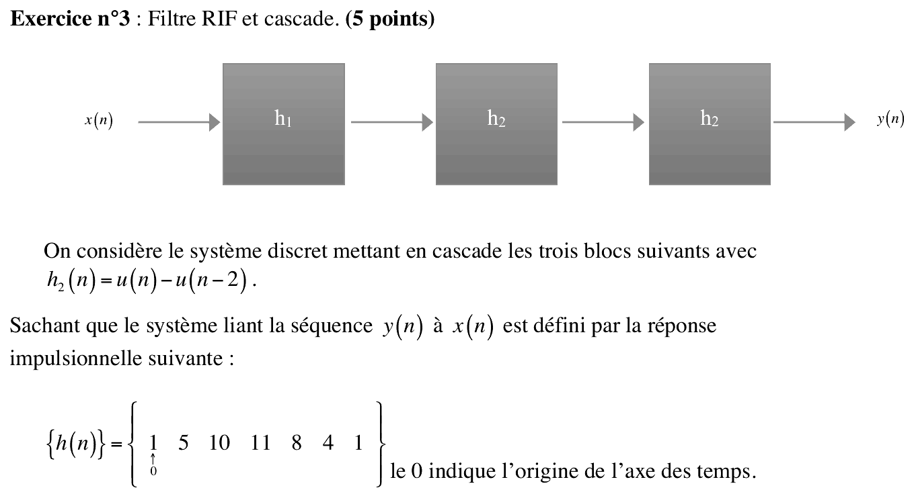{fig-alt="Exercice 3 : cascade h1, h2, h2 avec h2(n) = u(n) - u(n-2) ; réponse impulsionnelle globale h(n) = {1, 5, 10, 11, 8, 4, 1}, origine sur le premier 1."}

Chapitre du cours : [Association de systèmes discrets](../cours/02-systemes-discrets-convolution.qmd#sec-association-systemes)

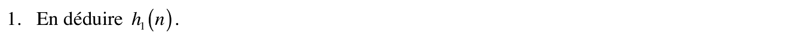{fig-alt="Exercice 3, q. 1 : en déduire h1(n)."}

:::: {.complement}
::: {.solution}
$h_2(n) = u(n) - u(n-2) = \delta(n) + \delta(n-1)$, donc $H_2(z) = 1 + z^{-1}$. La cascade donne $H(z) = H_1(z)\, H_2(z)^2$ avec $H_2(z)^2 = 1 + 2z^{-1} + z^{-2}$.

Division polynomiale de $1 + 5z^{-1} + 10z^{-2} + 11z^{-3} + 8z^{-4} + 4z^{-5} + z^{-6}$ par $1 + 2z^{-1} + z^{-2}$ (reste nul) :
$$H_1(z) = 1 + 3z^{-1} + 3z^{-2} + 2z^{-3} + z^{-4}, \qquad \boxed{h_1(n) = \{\underset{\uparrow}{1},\ 3,\ 3,\ 2,\ 1\}}$$

Contrôles : $\{1, 3, 3, 2, 1\} * \{1, 2, 1\} = \{1, 5, 10, 11, 8, 4, 1\}$ ✓ ; somme des valeurs $10 \times 4 = 40$ ✓.
:::
::::

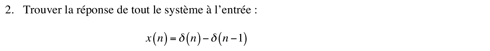{fig-alt="Exercice 3, q. 2 : réponse de tout le système à l'entrée x(n) = δ(n) - δ(n-1)."}

:::: {.complement}
::: {.solution}
Par linéarité et invariance, $y(n) = h(n) - h(n-1)$ :

| $n$ | 0 | 1 | 2 | 3 | 4 | 5 | 6 | 7 |
|---|---|---|---|---|---|---|---|---|
| $h(n)$ | 1 | 5 | 10 | 11 | 8 | 4 | 1 | 0 |
| $h(n-1)$ | 0 | 1 | 5 | 10 | 11 | 8 | 4 | 1 |
| $y(n)$ | **1** | **4** | **5** | **1** | **$-3$** | **$-4$** | **$-3$** | **$-1$** |

Contrôle : $\sum y = 0$, normal puisque $X(z) = 1 - z^{-1}$ s'annule en $z = 1$.
:::
::::

## Exercice 4 : filtre RII et cascade (7 points) {#sec-ann16-ex4}

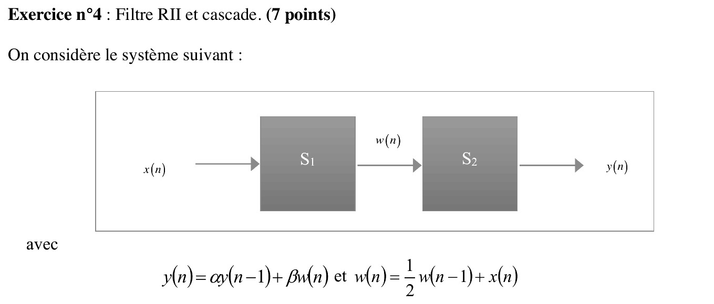{fig-alt="Exercice 4 : x(n) → S1 → w(n) → S2 → y(n) avec y(n) = α y(n-1) + β w(n) et w(n) = ½ w(n-1) + x(n)."}

Chapitre du cours : [Exemple complet](../cours/04-implementation-equations-differences.qmd#sec-exemple-complet-rii)

Exercice identique à celui du [partiel 2017-2018, exercice 4](2017-2018-partiel.qmd#sec-ann17-ex4) : même corrigé.

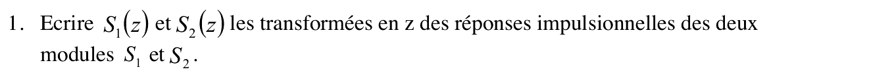{fig-alt="Exercice 4, q. 1 : écrire S1(z) et S2(z), transformées en z des réponses impulsionnelles des deux modules."}

:::: {.complement}
::: {.solution}
$W(z) = \frac12 z^{-1} W(z) + X(z)$ et $Y(z) = \alpha z^{-1} Y(z) + \beta W(z)$ :
$$S_1(z) = \frac{1}{1 - \frac12 z^{-1}}, \qquad S_2(z) = \frac{\beta}{1 - \alpha z^{-1}}$$
:::
::::

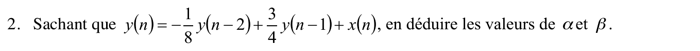{fig-alt="Exercice 4, q. 2 : sachant que y(n) = -1/8 y(n-2) + 3/4 y(n-1) + x(n), en déduire α et β."}

:::: {.complement}
::: {.solution}
$S = S_1 S_2 = \dfrac{\beta}{1 - \left(\alpha + \frac12\right) z^{-1} + \frac{\alpha}{2} z^{-2}}$. L'équation donnée correspond à $\dfrac{1}{1 - \frac34 z^{-1} + \frac18 z^{-2}}$. Par identification : $\beta = 1$, $\alpha + \frac12 = \frac34$ donc $\boxed{\alpha = \frac14}$, et $\frac{\alpha}{2} = \frac18$ ✓.
:::
::::

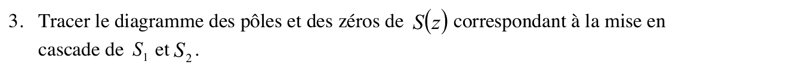{fig-alt="Exercice 4, q. 3 : tracer le diagramme des pôles et des zéros de S(z), cascade de S1 et S2."}

:::: {.complement}
::: {.solution}
$S(z) = \dfrac{z^2}{\left(z - \frac12\right)\left(z - \frac14\right)}$ : **pôles** $\frac12$ et $\frac14$ (sur l'axe réel, dans le cercle), **zéro double** en $z = 0$.

{#fig-ann16-poles-zeros}
:::
::::

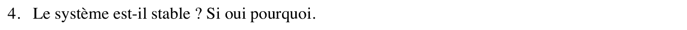{fig-alt="Exercice 4, q. 4 : le système est-il stable ? Si oui, pourquoi ?"}

:::: {.complement}
::: {.solution}
**Stable** : système causal et pôles de module $< 1$.
:::
::::

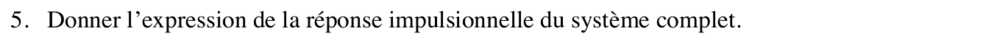{fig-alt="Exercice 4, q. 5 : donner l'expression de la réponse impulsionnelle du système complet."}

:::: {.complement}
::: {.solution}
Éléments simples : $S(z) = \dfrac{A}{1 - \frac12 z^{-1}} + \dfrac{B}{1 - \frac14 z^{-1}}$ avec
$A = \dfrac{1}{1 - \frac14 \cdot 2} = 2$ et $B = \dfrac{1}{1 - \frac12 \cdot 4} = -1$ :
$$h(n) = \left[2\left(\tfrac12\right)^n - \left(\tfrac14\right)^n\right] u(n)$$
Contrôle par la récurrence : $h(0) = 1$, $h(1) = \frac34$, $h(2) = \frac34 \cdot \frac34 - \frac18 = \frac{7}{16}$ ; la formule donne $2 \cdot \frac14 - \frac1{16} = \frac{7}{16}$ ✓.
:::
::::

## Exercice 5 : question de cours (2 points) {#sec-ann16-ex5}

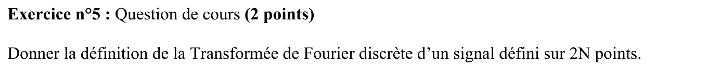{fig-alt="Exercice 5 : donner la définition de la transformée de Fourier discrète d'un signal défini sur 2N points."}

Chapitre du cours : [Transformée de Fourier discrète](../cours/03-tfd-interpretation-frequentielle.qmd#sec-echantillonnage-frequentiel)

:::: {.complement}
::: {.solution}
C'est la [TFD](../cours/03-tfd-interpretation-frequentielle.qmd#sec-echantillonnage-frequentiel) du cours avec $M = 2N$ points, pour $x[n]$, $n = 0, \dots, 2N-1$ :
$$X[k] = \sum_{n=0}^{2N-1} x[n]\, e^{-j2\pi \frac{kn}{2N}} = \sum_{n=0}^{2N-1} x[n]\, e^{-j\pi \frac{kn}{N}}, \qquad k = 0, \dots, 2N-1$$
Inverse : $x[n] = \dfrac{1}{2N} \displaystyle\sum_{k=0}^{2N-1} X[k]\, e^{j\pi \frac{kn}{N}}$. $X[k]$ échantillonne la TFTD $X(e^{j2\pi f})$ aux fréquences $f = \frac{k}{2N}$ (pas $\Delta f = \frac{f_e}{2N}$).
:::
::::
