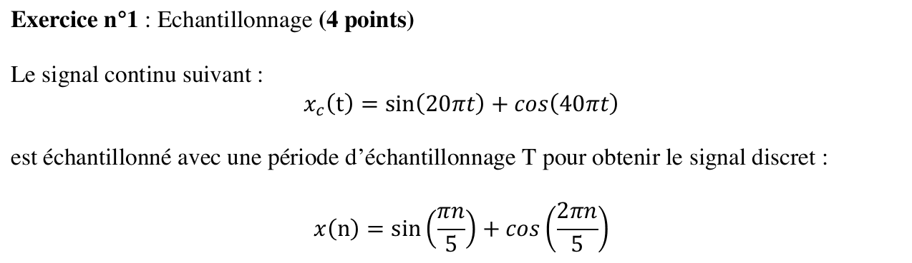
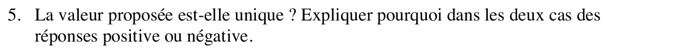
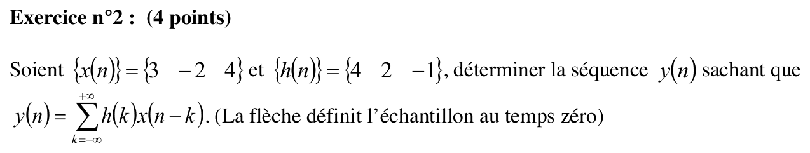
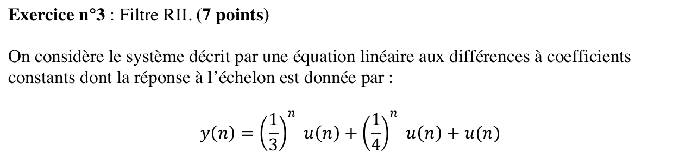
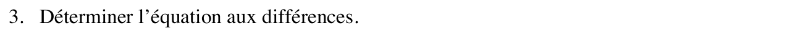
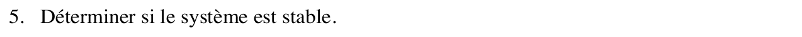
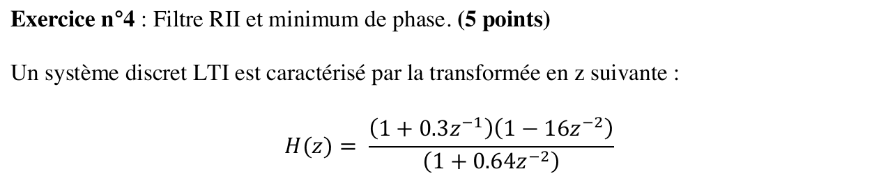
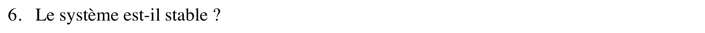
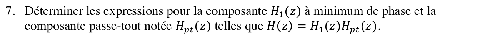



::: {.complement}
Aucun corrigé officiel : **toutes les solutions de cette page sont rédigées par Claude**. Le sujet vient de l'annexe du recueil de TD, où il est intitulé « SUJET 2017 » [sujet-2018-03, p. 19-20] ; c'est la **2^e^ session** de l'année 2017-2018, distincte du [partiel du 13 décembre 2017](2017-2018-partiel.qmd) (aucun exercice commun). Dans le recueil, la numérotation des questions ne repart pas à 1 : questions 4-5 (exercice 1), 3-5 (exercice 3) et 6-7 (exercice 4) ; cette page garde ces numéros. L'exercice 2 reprend **à l'identique** l'exercice 1 du partiel 2015-2016.
:::

Rappels fournis avec le sujet : échelon $u[n] = 0$ pour $n < 0$, $u[n] = 1$ pour $n \geq 0$ ; $\delta(n-k) \overset{z}{\longleftrightarrow} z^{-k}$ et $a^n u(n) \overset{z}{\longleftrightarrow} \dfrac{1}{1 - a z^{-1}}$ avec $|a| < 1$ ; $\sum_{n=N_1}^{N_2} \alpha^n = \dfrac{\alpha^{N_1} - \alpha^{N_2+1}}{1 - \alpha}$.

## Exercice 1 : échantillonnage (4 points) {#sec-ann18-ex1}

{fig-alt="Exercice 1 : x_c(t) = sin(20πt) + cos(40πt) est échantillonné avec une période T pour obtenir x(n) = sin(πn/5) + cos(2πn/5)."}

Chapitre du cours : [Théorème de Shannon-Nyquist](../cours/01-echantillonnage-signal-discret.qmd#sec-shannon)

{fig-alt="Exercice 1, q. 4 : déterminer un choix pour T consistant avec les informations disponibles."}

:::: {.complement}
::: {.solution}
$x(n) = x_c(nT) = \sin(20\pi T\, n) + \cos(40\pi T\, n)$. On identifie les pulsations normalisées : $20\pi T = \dfrac{\pi}{5}$, d'où
$$\boxed{T = \frac{1}{100}\ \mathrm{s} = 10\ \mathrm{ms}} \quad (f_e = 100\ \mathrm{Hz})$$
Contrôle : $40\pi T = \dfrac{2\pi}{5}$ ✓. Les fréquences du signal sont 10 Hz et 20 Hz ; $f_e = 100\ \mathrm{Hz} > 2 \times 20\ \mathrm{Hz}$ : pas de repliement.
:::
::::

{fig-alt="Exercice 1, q. 5 : la valeur proposée est-elle unique ? Expliquer dans les deux cas."}

:::: {.complement}
::: {.solution}
**Non, sans hypothèse supplémentaire.** Les sinusoïdes discrètes sont $2\pi$-périodiques en pulsation : il suffit que $20\pi T = \frac{\pi}{5} + 2k\pi$, soit
$$T = \frac{1 + 10k}{100}\ \mathrm{s}, \quad k \in \mathbb{N} \qquad (0{,}01\ \mathrm{s},\ 0{,}11\ \mathrm{s},\ 0{,}21\ \mathrm{s},\ \dots)$$
et alors $40\pi T = \frac{2\pi}{5} + 4k\pi$ convient aussi pour le cosinus. Le choix $20\pi T = -\frac{\pi}{5} + 2k\pi$ est exclu : il donnerait $-\sin(\pi n/5)$. Ces valeurs $k \geq 1$ correspondent à un **repliement** ([périodisation du spectre](../cours/01-echantillonnage-signal-discret.qmd#sec-interpretation-frequentielle-echantillonnage)) : pour $T = 0{,}11\ \mathrm{s}$ ($f_e \approx 9{,}09\ \mathrm{Hz}$), la raie à 10 Hz se replie en $10 - 9{,}09 = 0{,}91\ \mathrm{Hz} = f_e/10$, même fréquence normalisée $\frac{1}{10}$.

**Oui, si l'on impose Shannon** ($f_e > 40\ \mathrm{Hz}$, soit $T < 25\ \mathrm{ms}$) : seule $T = 10\ \mathrm{ms}$ reste.

Contrôle numérique : en balayant $T \in\ ]0, 1]\ \mathrm{s}$ au pas de $10^{-4}$ s, les seules valeurs qui redonnent $x(n)$ sont $0{,}01 ; 0{,}11 ; \dots ; 0{,}91$ s.
:::
::::

## Exercice 2 : convolution discrète (4 points) {#sec-ann18-ex2}

{fig-alt="Exercice 2 : x(n) = {3, −2, 4} et h(n) = {4, 2, −1} ; déterminer y(n) = somme sur k de h(k) x(n − k) ; la flèche définit l'échantillon au temps zéro."}

Chapitre du cours : [Convolution discrète](../cours/02-systemes-discrets-convolution.qmd#sec-convolution-discrete)

::: {.a-verifier #av-ann18-fleches-convolution}
**Source** [sujet-2018-03, p. 19] : « Soient $\{x(n)\} = \{3\ \ -2\ \ 4\}$ et $\{h(n)\} = \{4\ \ 2\ \ -1\}$ […] (La flèche définit l'échantillon au temps zéro) ».

**Problème** : aucune flèche n'apparaît dans le recueil (ni sur le rendu, ni dans le texte du PDF) : l'origine des temps des deux séquences n'est pas donnée.

**Proposition** : reprendre les flèches du même exercice dans le partiel 2015-2016 (exercice 1, sujet scanné) : flèche sous $-2$ pour $x$, soit $x(-1) = 3$, $x(0) = -2$, $x(1) = 4$, et sous $4$ pour $h$, soit $h(0) = 4$, $h(1) = 2$, $h(2) = -1$. Les valeurs de $y$ ne dépendent pas de ce choix ; seul son support se décale.
:::

:::: {.complement}
::: {.solution}
Avec l'origine de la proposition ci-dessus, $y$ commence en $n = -1 + 0 = -1$ et a $3 + 3 - 1 = 5$ échantillons. Méthode du tableau (chaque ligne : $h(k)\, x(n-k)$) :

| $n$ | $-1$ | $0$ | $1$ | $2$ | $3$ |
|---|---|---|---|---|---|
| $h(0)\,x(n) = 4\,x(n)$ | 12 | $-8$ | 16 | | |
| $h(1)\,x(n-1) = 2\,x(n-1)$ | | 6 | $-4$ | 8 | |
| $h(2)\,x(n-2) = -x(n-2)$ | | | $-3$ | 2 | $-4$ |
| $y(n)$ | **12** | **$-2$** | **9** | **10** | **$-4$** |

$$\boxed{y(n) = 12\,\delta(n+1) - 2\,\delta(n) + 9\,\delta(n-1) + 10\,\delta(n-2) - 4\,\delta(n-3)}$$

Contrôles : somme des valeurs $= (\sum x)(\sum h) = 5 \times 5 = 25$ ✓ ; premier terme $3 \times 4 = 12$, dernier $4 \times (-1) = -4$ ✓. Si les deux séquences commençaient en $n = 0$, on aurait les mêmes valeurs sur $n = 0, \dots, 4$.
:::
::::

## Exercice 3 : filtre RII (7 points) {#sec-ann18-ex3}

{fig-alt="Exercice 3 : système décrit par une équation aux différences, de réponse à l'échelon y(n) = (1/3)^n u(n) + (1/4)^n u(n) + u(n)."}

Chapitre du cours : [Décomposition en éléments simples](../cours/04-implementation-equations-differences.qmd#sec-generalisation-elements-simples)

::: {.complement}
Notation : on appelle $s(n) = \left(\frac13\right)^n u(n) + \left(\frac14\right)^n u(n) + u(n)$ la réponse indicielle donnée (le sujet la note $y(n)$), et $h(n)$ la réponse impulsionnelle. Le système est supposé causal et initialement au repos.
:::

{fig-alt="Exercice 3, q. 3 : déterminer l'équation aux différences."}

:::: {.complement}
::: {.solution}
L'échelon a pour transformée $\dfrac{1}{1 - z^{-1}}$, donc $S(z) = \dfrac{H(z)}{1 - z^{-1}}$ et
$$H(z) = (1 - z^{-1})\, S(z) = (1 - z^{-1})\left[\frac{1}{1 - \frac13 z^{-1}} + \frac{1}{1 - \frac14 z^{-1}}\right] + 1.$$
Au même dénominateur $\left(1 - \frac13 z^{-1}\right)\left(1 - \frac14 z^{-1}\right) = 1 - \frac{7}{12} z^{-1} + \frac{1}{12} z^{-2}$ :
$$H(z) = \frac{3 - \frac{19}{6} z^{-1} + \frac23 z^{-2}}{1 - \frac{7}{12} z^{-1} + \frac{1}{12} z^{-2}}$$
d'où, par le théorème du retard,
$$\boxed{y(n) = \frac{7}{12}\, y(n-1) - \frac{1}{12}\, y(n-2) + 3\, x(n) - \frac{19}{6}\, x(n-1) + \frac23\, x(n-2)}$$
(ou, multiplié par 12 : $12\,y(n) - 7\,y(n-1) + y(n-2) = 36\,x(n) - 38\,x(n-1) + 8\,x(n-2)$).

Contrôles : la récurrence avec $x = u$ redonne $s(0) = 3$, $s(1) = \frac{19}{12}$, $s(2) = \frac{169}{144}$ (valeurs de la formule de l'énoncé, vérifiées jusqu'à $n = 7$) ; gain statique $H(1) = \frac{1/2}{1/2} = 1 = \lim s(n)$ ✓.
:::
::::

{fig-alt="Exercice 3, q. 4 : déterminer la réponse impulsionnelle du système."}

:::: {.complement}
::: {.solution}
Division puis éléments simples (le numérateur et le dénominateur sont de même degré en $z^{-1}$) :
$$H(z) = 8 - \frac{2}{1 - \frac13 z^{-1}} - \frac{3}{1 - \frac14 z^{-1}}$$
$$\boxed{h(n) = 8\,\delta(n) - \left[2\left(\tfrac13\right)^n + 3\left(\tfrac14\right)^n\right] u(n)}$$
soit $h(0) = 3$, $h(1) = -\frac{17}{12}$, $h(2) = -\frac{59}{144}$…

Contrôle : $\delta(n) = u(n) - u(n-1)$, donc $h(n) = s(n) - s(n-1)$ : $s(0) = 3$, $s(1) - s(0) = \frac{19}{12} - 3 = -\frac{17}{12}$ ✓ (identique jusqu'à $n = 7$).
:::
::::

{fig-alt="Exercice 3, q. 5 : déterminer si le système est stable."}

:::: {.complement}
::: {.solution}
**Stable** : système causal, pôles $\frac13$ et $\frac14$ de module $< 1$ ([condition de stabilité](../cours/04-implementation-equations-differences.qmd#thm-stabilite-poles)). Directement : $\sum_n |h(n)| = 3 + 2 \cdot \frac{1/3}{1 - 1/3} + 3 \cdot \frac{1/4}{1 - 1/4} = 3 + 1 + 1 = 5 < \infty$. C'est cohérent avec la réponse indicielle, bornée et tendant vers 1.
:::
::::

## Exercice 4 : filtre RII et minimum de phase (5 points) {#sec-ann18-ex4}

{fig-alt="Exercice 4 : système LTI de transformée en z H(z) = (1 + 0,3 z^−1)(1 − 16 z^−2) / (1 + 0,64 z^−2)."}

Chapitre du cours : [Filtres à minimum de phase](../cours/05-representation-en-phase.qmd#sec-definition-minimum-phase)

::: {.a-verifier #av-ann18-causalite-ex4}
**Source** [sujet-2018-03, p. 20] : « Un système discret LTI est caractérisé par la transformée en z suivante » (question 6 : « Le système est-il stable ? »).

**Problème** : ni la causalité ni la zone de convergence ne sont données ; or la stabilité en dépend (zone $|z| > 0{,}8$ : causal et stable ; zone $|z| < 0{,}8$ : anticausal et instable).

**Proposition** : supposer le système **causal**, comme dans l'exercice du même type du partiel 2025-2026 (« Système SLI causal »).
:::

{fig-alt="Exercice 4, q. 6 : le système est-il stable ?"}

:::: {.complement}
::: {.solution}
Pôles : $1 + 0{,}64 z^{-2} = 0 \iff z^2 = -0{,}64$, soit $z = \pm j\,0{,}8$, de module $0{,}8 < 1$ (l'écriture en $z$ fait aussi apparaître un pôle en $z = 0$). Système causal : **stable** ([condition de stabilité](../cours/04-implementation-equations-differences.qmd#thm-stabilite-poles)).
:::
::::

{fig-alt="Exercice 4, q. 7 : déterminer la composante à minimum de phase H1(z) et la composante passe-tout Hpt(z) telles que H(z) = H1(z) Hpt(z)."}

:::: {.complement}
::: {.solution}
Zéros : $-0{,}3$ (dans le cercle) et $\pm 4$ (hors du cercle, car $1 - 16 z^{-2} = (1 - 4z^{-1})(1 + 4z^{-1})$). Le filtre n'est **pas** à minimum de phase.

On remplace les zéros $\pm 4$ par leurs inverses $\pm \frac14$, en gardant le même module sur le cercle unité : $1 - 16 z^{-2}$ devient $16 - z^{-2} = 16\left(1 - \frac{1}{16} z^{-2}\right)$ (même méthode qu'au [partiel 2025-2026, exercice 4](2025-2026-partiel.qmd#sec-ann25-ex4)).
$$\boxed{H_1(z) = \frac{(1 + 0{,}3 z^{-1})(16 - z^{-2})}{1 + 0{,}64 z^{-2}}, \qquad H_{pt}(z) = \frac{1 - 16 z^{-2}}{16 - z^{-2}}}$$

Vérifications :

- $H_1 H_{pt} = H$ (le facteur $16 - z^{-2}$ se simplifie) ;
- $H_1$ a ses zéros en $-0{,}3$ et $\pm\frac14$, ses pôles en $\pm j\,0{,}8$ : tous dans le cercle, **minimum de phase** ;
- passe-tout : en $z = e^{j\omega}$, $1 - 16e^{-2j\omega} = -e^{-2j\omega}\left(16 - e^{2j\omega}\right)$, de même module que $16 - e^{-2j\omega}$ (conjugué) : $|H_{pt}| = 1$ (vérifié numériquement de $\omega = 0$ à $\pi$). Ses pôles $\pm\frac14$ sont dans le cercle : il est stable. On peut aussi l'écrire $H_{pt}(z) = -\dfrac{z^{-2} - \frac{1}{16}}{1 - \frac{1}{16} z^{-2}}$, forme usuelle du [passe-tout](../cours/05-representation-en-phase.qmd#sec-passe-tout).
:::
::::
