

::: {.complement}
Aucun corrigé officiel : **toutes les solutions de cette page sont rédigées par Claude**. Les énoncés sont des extraits du scan du sujet [sujet-2017] (photo redressée et contrastée). L'exercice 4 (« Filtre RII et cascade ») est **tombé à l'identique en 2016-2017, 2017-2018 et 2022-2023**. Ce partiel de décembre n'est pas dans le recueil de TD ; la 2^e^ session de la même année est corrigée dans [Examen de mars 2018](2017-2018-examen.qmd) (autres exercices).
:::

Rappels fournis avec le sujet : échelon $u[n] = 0$ pour $n < 0$, $u[n] = 1$ pour $n \geq 0$ ; $\delta(n-k) \overset{z}{\longleftrightarrow} z^{-k}$ et $a^n u(n) \overset{z}{\longleftrightarrow} \dfrac{1}{1 - a z^{-1}}$ avec $|a| < 1$ ; $\sum_{n=N_1}^{N_2} \alpha^n = \dfrac{\alpha^{N_1} - \alpha^{N_2+1}}{1 - \alpha}$.

## Exercice 1 : échantillonnage (3 points) {#sec-ann17-ex1}

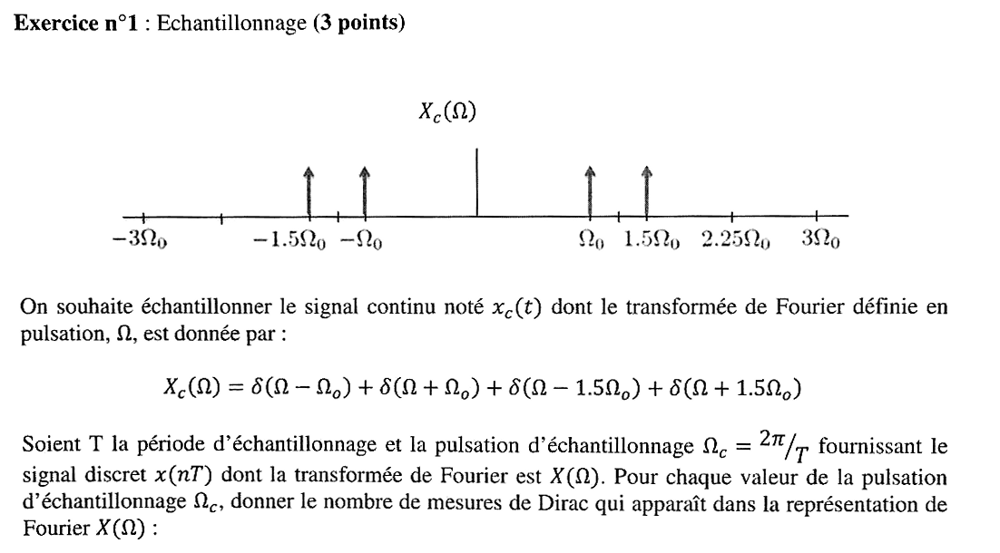{fig-alt="Exercice 1 : X_c(Ω) = δ(Ω − Ω0) + δ(Ω + Ω0) + δ(Ω − 1,5 Ω0) + δ(Ω + 1,5 Ω0) ; on échantillonne à Ω_c = 2π/T ; nombre de Diracs dans X(Ω) pour chaque Ω_c."}

Chapitre du cours : [Interprétation fréquentielle de l'échantillonnage](../cours/01-echantillonnage-signal-discret.qmd#sec-interpretation-frequentielle-echantillonnage)

::: {.complement}
$X(\Omega)$ est le spectre périodisé de période $\Omega_c$ : il contient une infinité de Diracs. On compte donc **dans une période** $\left[-\frac{\Omega_c}{2}, \frac{\Omega_c}{2}\right]$, en ramenant chaque raie $\pm\Omega_0$, $\pm 1{,}5\Omega_0$ dans cet intervalle (interprétation de Claude : l'énoncé ne précise pas l'intervalle). Rappel : [périodisation du spectre et théorème de Shannon](../cours/01-echantillonnage-signal-discret.qmd#sec-shannon).
:::

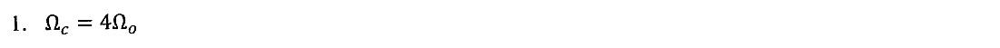{fig-alt="Exercice 1, q. 1 : Ω_c = 4 Ω0."}

:::: {.complement}
::: {.solution}
$\Omega_c = 4\Omega_0$, intervalle $[-2\Omega_0,\ 2\Omega_0]$ : les 4 raies y sont déjà, pas de repliement ($\Omega_c > 2 \times 1{,}5\Omega_0$). **4 Diracs**.
:::
::::

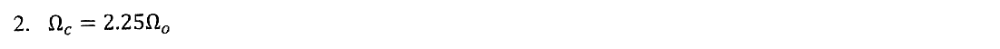{fig-alt="Exercice 1, q. 2 : Ω_c = 2,25 Ω0."}

:::: {.complement}
::: {.solution}
$\Omega_c = 2{,}25\Omega_0$, intervalle $[-1{,}125\Omega_0,\ 1{,}125\Omega_0]$ : $\pm\Omega_0$ restent ; $1{,}5\Omega_0 - 2{,}25\Omega_0 = -0{,}75\Omega_0$ et symétriquement $+0{,}75\Omega_0$. **4 Diracs** distincts ($\pm\Omega_0$, $\pm 0{,}75\Omega_0$), dont deux repliés.
:::
::::

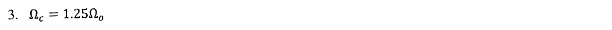{fig-alt="Exercice 1, q. 3 : Ω_c = 1,25 Ω0."}

:::: {.complement}
::: {.solution}
$\Omega_c = 1{,}25\Omega_0$, intervalle $[-0{,}625\Omega_0,\ 0{,}625\Omega_0]$ : $\Omega_0 \to -0{,}25\Omega_0$, $1{,}5\Omega_0 \to +0{,}25\Omega_0$, et symétriquement. Les raies se superposent deux à deux : **2 Diracs** (en $\pm 0{,}25\Omega_0$, de poids doublé).

Contrôle (calcul des positions modulo $\Omega_c$) : $\{\pm 1, \pm 1{,}5\}\,\Omega_0$ pour $4\Omega_0$ ; $\{\pm 0{,}75, \pm 1\}\,\Omega_0$ pour $2{,}25\Omega_0$ ; $\{\pm 0{,}25\}\,\Omega_0$ pour $1{,}25\Omega_0$.
:::
::::

## Exercice 2 : filtre sélectif ou *notch filter* (4 points) {#sec-ann17-ex2}

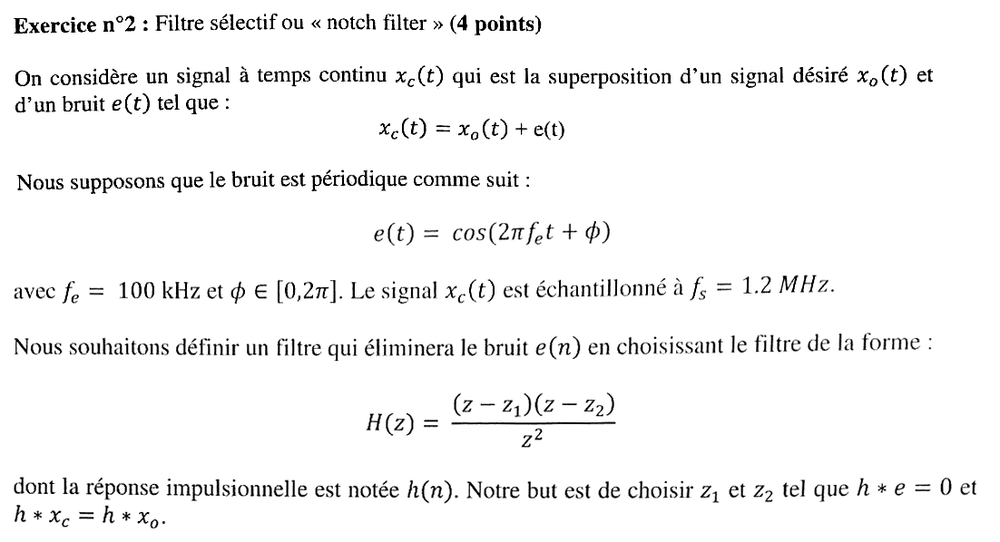{fig-alt="Exercice 2 : x_c(t) = x_o(t) + e(t), bruit e(t) = cos(2π f_e t + φ), f_e = 100 kHz, échantillonnage à f_s = 1,2 MHz ; filtre H(z) = (z − z1)(z − z2)/z² tel que h * e = 0 et h * x_c = h * x_o."}

Chapitre du cours : [Pôles et zéros](../cours/04-implementation-equations-differences.qmd#sec-poles-zeros)

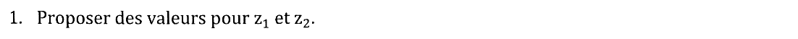{fig-alt="Exercice 2, q. 1 : proposer des valeurs pour z1 et z2."}

:::: {.complement}
::: {.solution}
Fréquence normalisée du bruit ([fréquence normalisée](../cours/03-tfd-interpretation-frequentielle.qmd#sec-frequence-normalisee)) : $f_0 = f_e/f_s = 1/12$, soit $\omega_0 = \pi/6$. Pour annuler cette sinusoïde, on place deux zéros conjugués **sur le cercle unité** à cet angle :
$$\boxed{z_1 = e^{j\pi/6}, \qquad z_2 = e^{-j\pi/6}}$$
:::
::::

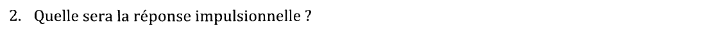{fig-alt="Exercice 2, q. 2 : quelle sera la réponse impulsionnelle ?"}

:::: {.complement}
::: {.solution}
$(z - z_1)(z - z_2) = z^2 - 2\cos(\pi/6)\, z + 1 = z^2 - \sqrt3\, z + 1$, donc $H(z) = 1 - \sqrt3\, z^{-1} + z^{-2}$ et
$$\boxed{h(n) = \delta(n) - \sqrt3\, \delta(n-1) + \delta(n-2)}$$
RIF, causal, de phase linéaire (coefficients symétriques).

Par linéarité, $h * x_c = h * x_o + h * e = h * x_o$ : c'est la seconde condition de l'énoncé. Le filtre modifie toutefois $x_o$ lui-même, surtout près de $f_0$ : $|H| = 2 - \sqrt3 \approx 0{,}27$ en $f = 0$ et $2 + \sqrt3 \approx 3{,}73$ en $f = \frac12$.

Contrôle numérique : $h * e$ calculé sur une sinusoïde $\cos(\pi n/6 + \phi)$ est nul à $10^{-14}$ près, quelle que soit la phase $\phi$ ; $|H(e^{j\pi/6})| = 0$.
:::
::::

## Exercice 3 : filtre RIF et cascade (6 points) {#sec-ann17-ex3}

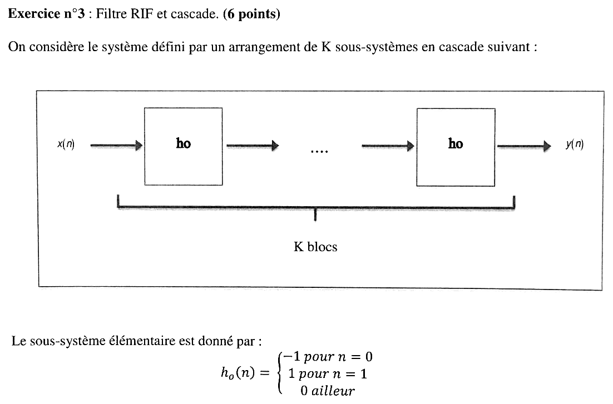{fig-alt="Exercice 3 : K sous-systèmes identiques h0 en cascade, h0(0) = −1, h0(1) = 1, h0(n) = 0 ailleurs."}

Chapitre du cours : [Association de systèmes discrets](../cours/02-systemes-discrets-convolution.qmd#sec-association-systemes)

{fig-alt="Exercice 3, q. 1 : le système complet est-il causal ?"}

:::: {.complement}
::: {.solution}
**Causal** : chaque $h_0$ est nulle pour $n < 0$, et la convolution de séquences causales est causale ([causalité](../cours/02-systemes-discrets-convolution.qmd#sec-causalite)).
:::
::::

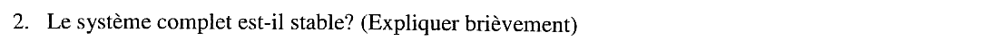{fig-alt="Exercice 3, q. 2 : le système complet est-il stable ?"}

:::: {.complement}
::: {.solution}
**Stable** : la cascade de $K$ RIF est un RIF (longueur $K + 1$), donc $\sum|h| < \infty$ ([stabilité](../cours/02-systemes-discrets-convolution.qmd#sec-stabilite-sli)).
:::
::::

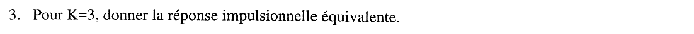{fig-alt="Exercice 3, q. 3 : pour K = 3, donner la réponse impulsionnelle équivalente."}

:::: {.complement}
::: {.solution}
$H_0(z) = -1 + z^{-1} = -(1 - z^{-1})$, donc $H(z) = H_0(z)^3 = -(1 - z^{-1})^3 = -1 + 3z^{-1} - 3z^{-2} + z^{-3}$ :
$$\boxed{h(n) = -\delta(n) + 3\delta(n-1) - 3\delta(n-2) + \delta(n-3)}$$
Contrôle : $h_0 * h_0 * h_0$ calculé directement donne $\{-1, 3, -3, 1\}$ ; somme des valeurs $= (\sum h_0)^3 = 0$ ✓.
:::
::::

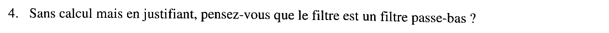{fig-alt="Exercice 3, q. 4 : sans calcul mais en justifiant, le filtre est-il un passe-bas ?"}

:::: {.complement}
::: {.solution}
**Non** : $H_0$ a un zéro en $z = 1$, soit $f = 0$, et $|H_0(e^{j2\pi f})| = 2|\sin(\pi f)|$ croît jusqu'à $f = \frac12$ (valeurs $0$, $\sqrt2$, $2$ en $f = 0, \frac14, \frac12$). C'est un passe-haut (différence première) ; la cascade a un zéro triple en $z = 1$ et reste passe-haut.
:::
::::

## Exercice 4 : filtre RII et cascade (7 points) {#sec-ann17-ex4}

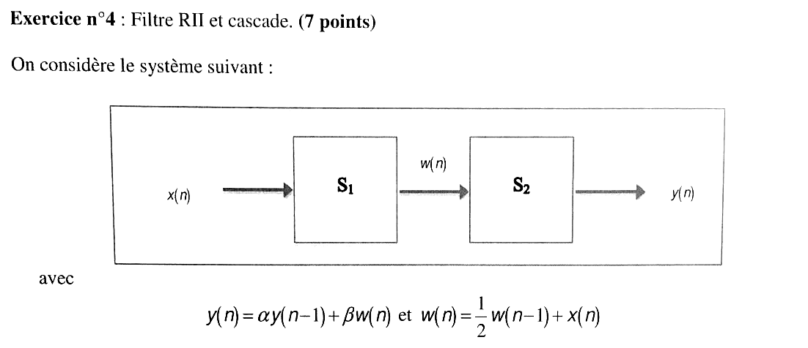{fig-alt="Exercice 4 : x(n) → S1 → w(n) → S2 → y(n), avec y(n) = α y(n−1) + β w(n) et w(n) = ½ w(n−1) + x(n)."}

Chapitre du cours : [Exemple complet de RII](../cours/04-implementation-equations-differences.qmd#sec-exemple-complet-rii)

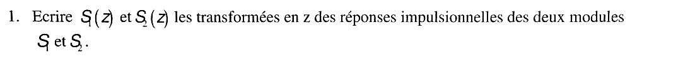{fig-alt="Exercice 4, q. 1 : écrire S1(z) et S2(z), transformées en z des réponses impulsionnelles des deux modules."}

:::: {.complement}
::: {.solution}
$W(z) = \frac12 z^{-1} W(z) + X(z)$ et $Y(z) = \alpha z^{-1} Y(z) + \beta W(z)$ :
$$\boxed{S_1(z) = \frac{1}{1 - \frac12 z^{-1}}, \qquad S_2(z) = \frac{\beta}{1 - \alpha z^{-1}}}$$
:::
::::

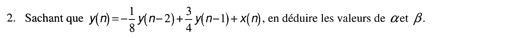{fig-alt="Exercice 4, q. 2 : sachant que y(n) = −1/8 y(n−2) + 3/4 y(n−1) + x(n), en déduire α et β."}

:::: {.complement}
::: {.solution}
$S = S_1 S_2 = \dfrac{\beta}{1 - \left(\alpha + \frac12\right) z^{-1} + \frac{\alpha}{2} z^{-2}}$. L'équation donnée correspond à $\dfrac{1}{1 - \frac34 z^{-1} + \frac18 z^{-2}}$. Par identification : $\beta = 1$, $\alpha + \frac12 = \frac34$ donc $\boxed{\alpha = \frac14,\ \beta = 1}$, et $\frac{\alpha}{2} = \frac18$ ✓.
:::
::::

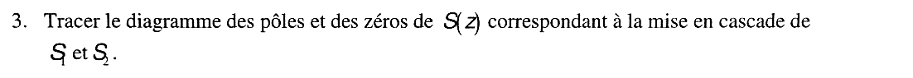{fig-alt="Exercice 4, q. 3 : tracer le diagramme des pôles et des zéros de S(z), cascade de S1 et S2."}

:::: {.complement}
::: {.solution}
$S(z) = \dfrac{z^2}{\left(z - \frac12\right)\left(z - \frac14\right)}$ : **pôles** $\frac12$ et $\frac14$ (sur l'axe réel, dans le cercle), **zéro double** en $z = 0$.

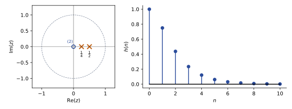{#fig-ann17-poles-zeros}
:::
::::

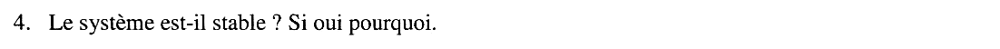{fig-alt="Exercice 4, q. 4 : le système est-il stable ? Si oui pourquoi."}

:::: {.complement}
::: {.solution}
**Stable** : système causal et pôles de module $< 1$ ([condition de stabilité](../cours/04-implementation-equations-differences.qmd#thm-stabilite-poles)).
:::
::::

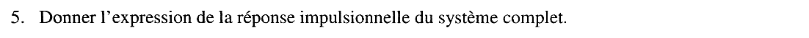{fig-alt="Exercice 4, q. 5 : donner l'expression de la réponse impulsionnelle du système complet."}

:::: {.complement}
::: {.solution}
Éléments simples : $S(z) = \dfrac{A}{1 - \frac12 z^{-1}} + \dfrac{B}{1 - \frac14 z^{-1}}$ avec
$A = \dfrac{1}{1 - \frac14 \cdot 2} = 2$ et $B = \dfrac{1}{1 - \frac12 \cdot 4} = -1$ :
$$\boxed{h(n) = \left[2\left(\tfrac12\right)^n - \left(\tfrac14\right)^n\right] u(n)}$$
Contrôle par la récurrence : $h(0) = 1$, $h(1) = \frac34$, $h(2) = \frac34 \cdot \frac34 - \frac18 = \frac{7}{16}$ ; la formule donne $2 \cdot \frac14 - \frac1{16} = \frac{7}{16}$ ✓ (identique aussi pour $h(3) = \frac{15}{64}$, $h(4) = \frac{31}{256}$, et en simulant la cascade $S_1$ puis $S_2$).
:::
::::
