

::: {.complement}
Aucun corrigé officiel : **toutes les solutions de cette page sont rédigées par Claude**. Le sujet vient de l'annexe du recueil de TD [sujet-2019, p. 21-23 du PDF] ; les figures de l'exercice 3 (page 23 du recueil) sont regroupées avec son énoncé. À relire avec un œil critique ; signaler toute erreur.

Aucun exercice n'est repris à l'identique d'une autre annale. Variantes proches : l'exercice 1 est la version **antisymétrique** de l'[exercice 3 du partiel 2015-2016](2015-2016-partiel.qmd#sec-ann15-ex3) (même méthode, autres valeurs) ; l'exercice 2 applique l'[exercice du TD sur le filtre à phase nulle](../cours/05-representation-en-phase.qmd#exr-td-filtre-phase-nulle) ; l'exercice 3 rappelle les lectures de diagrammes pôles/zéros de [2022-2023](2022-2023-partiel.qmd#sec-ann22-ex4) et [2025-2026](2025-2026-partiel.qmd#sec-ann25-ex5) ; la définition de la TFD (exercice 4) revient dans presque tous les sujets.
:::

Rappels fournis avec le sujet : échelon $u[n] = 0$ pour $n < 0$, $u[n] = 1$ pour $n \geq 0$ ; $\delta(n-k) \overset{z}{\longleftrightarrow} z^{-k}$ et $a^n u(n) \overset{z}{\longleftrightarrow} \dfrac{1}{1 - a z^{-1}}$ avec $|a| < 1$ ; $\sum_{n=N_1}^{N_2} \alpha^n = \dfrac{\alpha^{N_1} - \alpha^{N_2+1}}{1 - \alpha}$.

## Exercice 1 : filtre RIF et propriété de phase (6 points) {#sec-ann19-ex1}

{fig-alt="Exercice 1 : filtre RIF et propriété de phase (6 points)."}

Chapitre du cours : [Filtre à phase linéaire](../cours/05-representation-en-phase.qmd#sec-phase-lineaire)

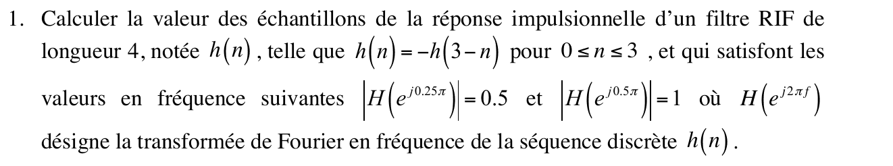{fig-alt="Exercice 1, q. 1 : RIF de longueur 4, h(n) = −h(3 − n) pour 0 ≤ n ≤ 3, avec |H(e^{j0,25π})| = 0,5 et |H(e^{j0,5π})| = 1 ; calculer les échantillons de h(n)."}

::: {.a-verifier #av-ann19-rif-deux-solutions}
**Source** [sujet-2019, p. 21] : « filtre RIF de longueur 4, notée $h(n)$, telle que $h(n) = -h(3-n)$ pour $0 \leq n \leq 3$, et qui satisfont les valeurs en fréquence suivantes $|H(e^{j0.25\pi})| = 0.5$ et $|H(e^{j0.5\pi})| = 1$ ».

**Problème** : seuls les **modules** sont imposés. L'amplitude réelle $A$ (voir la solution) peut valoir $\pm 0{,}5$ et $\pm 1$ : au signe global près, deux filtres différents vérifient l'énoncé, $(a, b) \approx (-0{,}0381 ;\ 0{,}7452)$ et $(a, b) \approx (-0{,}9619 ;\ 1{,}6690)$. Même situation qu'au [partiel 2015-2016](2015-2016-partiel.qmd#av-ann15-rif-deux-solutions).

**Proposition** : retenir la solution où $A$ est positive aux deux fréquences (gain croissant régulièrement, filtre passe-haut), et signaler l'autre.
:::

:::: {.complement}
::: {.solution}
**Forme de $h$.** $h(n) = -h(3-n)$ impose $h = \{a,\ b,\ -b,\ -a\}$ pour $n = 0, \dots, 3$. En factorisant le retard du centre $n = \frac32$ :
$$H(e^{j\omega}) = a\left(1 - e^{-3j\omega}\right) + b\left(e^{-j\omega} - e^{-2j\omega}\right) = j\,e^{-j\frac{3\omega}{2}} \underbrace{\left[2a\sin\tfrac{3\omega}{2} + 2b\sin\tfrac{\omega}{2}\right]}_{A(\omega)\ \text{réelle}}$$
d'où $|H| = |A(\omega)|$. Ici $\omega = 2\pi f$ : $\omega = 0{,}25\pi$ ($f = 0{,}125$) et $\omega = 0{,}5\pi$ ($f = 0{,}25$).

**Système.** Avec $A(0{,}25\pi) = 0{,}5$ et $A(0{,}5\pi) = 1$ :
$$\begin{cases} 2\sin(0{,}375\pi)\, a + 2\sin(0{,}125\pi)\, b = 0{,}5 \\ \sqrt2\,(a + b) = 1 \end{cases}$$
La seconde équation donne $b = \frac{1}{\sqrt2} - a$ ; en reportant, et avec $\sin\frac{3\pi}{8} - \sin\frac{\pi}{8} = \sqrt2 \sin\frac{\pi}{8}$ :
$$a = \frac{1}{4\sqrt2\,\sin(\pi/8)} - \frac12, \qquad b = \frac{1}{\sqrt2} - a$$

$$\boxed{h(0) = -h(3) = a \approx -0{,}0381, \qquad h(1) = -h(2) = b \approx 0{,}7452}$$

Contrôles : $|H|$ recalculé vaut $0{,}5000$ et $1{,}0000$ aux deux pulsations ✓ ; $\sum h = 0$, donc $H(e^{j0}) = 0$, comme pour tout RIF antisymétrique. L'autre choix de signe ($A(0{,}25\pi) = -0{,}5$) donne $a \approx -0{,}9619$, $b \approx 1{,}6690$ (voir le bloc *À vérifier*).
:::
::::

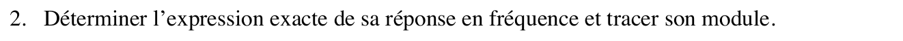{fig-alt="Exercice 1, q. 2 : déterminer l'expression exacte de la réponse en fréquence et tracer son module."}

:::: {.complement}
::: {.solution}
En fréquence normalisée ($\omega = 2\pi f$), avec $j = e^{j\pi/2}$ :
$$H(e^{j2\pi f}) = e^{j\left(\frac{\pi}{2} - 3\pi f\right)}\left[2a\sin(3\pi f) + 2b\sin(\pi f)\right] \approx e^{j\left(\frac{\pi}{2} - 3\pi f\right)}\left[-0{,}0761\sin(3\pi f) + 1{,}4903\sin(\pi f)\right]$$

Valeurs clés de $|H|$ : $0$ en $f = 0$, $0{,}5$ en $f = 0{,}125$, $1$ en $f = 0{,}25$, et $2(b - a) \approx 1{,}566$ en $f = \frac12$ (maximum). Le module est pair en $f$ et croît sur $[0, \frac12]$ : c'est un **passe-haut**.

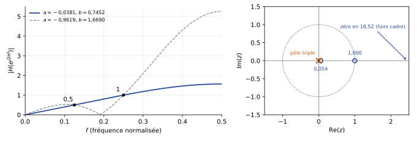{#fig-ann19-rif-antisymetrique}
:::
::::

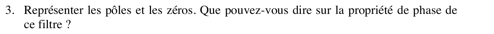{fig-alt="Exercice 1, q. 3 : représenter les pôles et les zéros ; que dire de la propriété de phase du filtre ?"}

:::: {.complement}
::: {.solution}
$H(z) = a + b z^{-1} - b z^{-2} - a z^{-3} = \dfrac{a z^3 + b z^2 - b z - a}{z^3}$.

- **Pôles** : triple en $z = 0$ (RIF causal, toujours stable).
- **Zéros** : $z = 1$ est racine ($a + b - b - a = 0$), et $a z^3 + b z^2 - b z - a = (z - 1)\left(a z^2 + (a + b) z + a\right)$. Le trinôme a deux racines réelles de produit $1$ : $z \approx 0{,}054$ et $z \approx 18{,}525$ (inverses l'une de l'autre).

Les zéros vont par **paires $\{z_l,\ 1/z_l\}$** ($1$ est son propre inverse) : c'est la signature d'un [RIF à phase linéaire](../cours/05-representation-en-phase.qmd#sec-phase-lineaire) (cas antisymétrique). Comme $A(f) \geq 0$ sur $[0, \frac12]$, $\arg H = \frac{\pi}{2} - 3\pi f$ : **phase linéaire** (à la constante $\frac{\pi}{2}$ près), retard de groupe constant de $\frac32$ échantillon. Le zéro $18{,}525$, hors du cercle unité, montre que le filtre n'est **pas à minimum de phase**.

(Avec l'autre solution, les zéros sont $1$ et $e^{\pm j\,1{,}194}$, tous sur le cercle unité : même conclusion pour la phase.)
:::
::::

## Exercice 2 : filtre en cascade (4 points) {#sec-ann19-ex2}

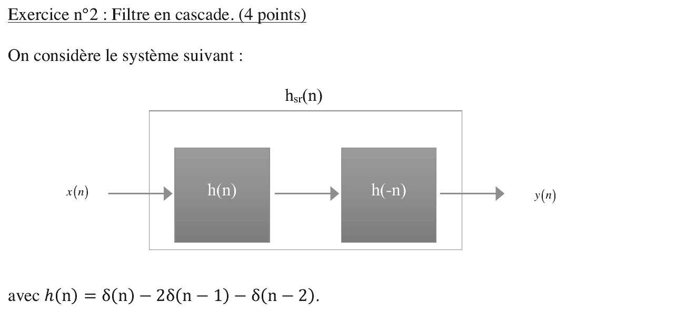{fig-alt="Exercice 2 : cascade de h(n) puis h(−n), formant h_sr(n), entre x(n) et y(n), avec h(n) = δ(n) − 2δ(n − 1) − δ(n − 2)."}

Chapitre du cours : [Association de systèmes discrets](../cours/02-systemes-discrets-convolution.qmd#sec-association-systemes)

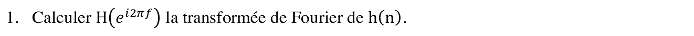{fig-alt="Exercice 2, q. 1 : calculer H(e^{i2πf}), la transformée de Fourier de h(n)."}

:::: {.complement}
::: {.solution}
(Le sujet note $i$ l'unité imaginaire ; on écrit $j$.) Par le [théorème du retard](../cours/03-tfd-interpretation-frequentielle.qmd#thm-retard-tfsd) :
$$H(e^{j2\pi f}) = 1 - 2e^{-j2\pi f} - e^{-j4\pi f} = -2\,e^{-j2\pi f}\left(1 - j\sin 2\pi f\right)$$
(factorisation : $e^{j2\pi f} - e^{-j2\pi f} = 2j\sin 2\pi f$). D'où $|H(e^{j2\pi f})|^2 = 4\left(1 + \sin^2 2\pi f\right)$.

Contrôle : $H(e^{j0}) = 1 - 2 - 1 = -2 = \sum h$ ✓.
:::
::::

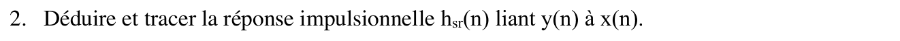{fig-alt="Exercice 2, q. 2 : déduire et tracer la réponse impulsionnelle h_sr(n) liant y(n) à x(n)."}

:::: {.complement}
::: {.solution}
[Cascade = convolution des réponses impulsionnelles](../cours/02-systemes-discrets-convolution.qmd#eq-association-serie) : $h_{sr}(n) = h(n) * h(-n) = \sum_k h(k)\, h(k - n)$, l'autocorrélation de $h$, donc **paire**. Avec $h = \{1, -2, -1\}$ sur $n = 0, 1, 2$ :

- $h_{sr}(0) = 1^2 + (-2)^2 + (-1)^2 = 6$ ;
- $h_{sr}(\pm 1) = 1 \cdot (-2) + (-2)(-1) = 0$ ;
- $h_{sr}(\pm 2) = 1 \cdot (-1) = -1$.

$$\boxed{h_{sr}(n) = -\delta(n+2) + 6\,\delta(n) - \delta(n-2)}$$

Filtre **non causal** (échantillon en $n = -2$), symétrique autour de $n = 0$. Contrôle : $\sum h_{sr} = 4 = \left(\sum h\right)^2 = (-2)^2$ ✓.

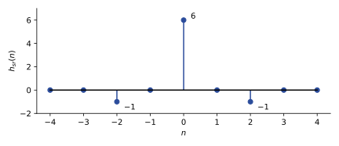{#fig-ann19-hsr}
:::
::::

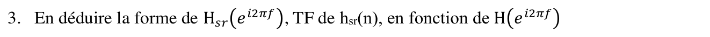{fig-alt="Exercice 2, q. 3 : en déduire la forme de H_sr(e^{i2πf}), TF de h_sr(n), en fonction de H(e^{i2πf})."}

:::: {.complement}
::: {.solution}
La TF de $h(-n)$ est $\sum_n h(-n)\, e^{-j2\pi f n} = H(e^{-j2\pi f}) = H^*(e^{j2\pi f})$ ($h$ réelle). Le produit des deux étages donne
$$\boxed{H_{sr}(e^{j2\pi f}) = H(e^{j2\pi f})\, H^*(e^{j2\pi f}) = \left|H(e^{j2\pi f})\right|^2}$$
réelle et positive : **phase nulle**, même raisonnement que la [méthode 1 du TD sur le filtre à phase nulle](../cours/05-representation-en-phase.qmd#exr-td-filtre-phase-nulle). Ici $H_{sr}(e^{j2\pi f}) = 6 - 2\cos(4\pi f)$, entre $4$ ($f = 0$, $\frac12$) et $8$ ($f = \pm\frac14$).

Contrôle : la TF directe de $h_{sr}$ donne $6 - e^{j4\pi f} - e^{-j4\pi f} = 6 - 2\cos 4\pi f$, égale à $4(1 + \sin^2 2\pi f)$ (vérifié numériquement en $f = 0$ ; $0{,}125$ ; $0{,}25$ ; $0{,}5$).
:::
::::

## Exercice 3 : trouver les triplets (6 points) {#sec-ann19-ex3}

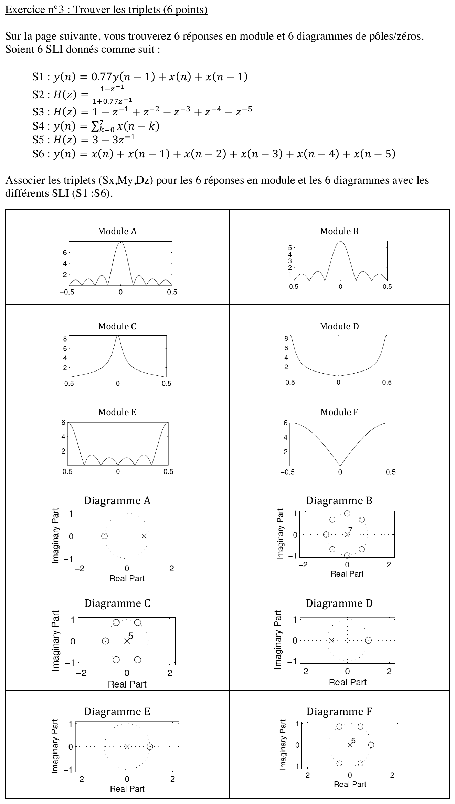{fig-alt="Exercice 3 : six SLI S1 à S6 (S1 : y(n) = 0,77 y(n−1) + x(n) + x(n−1) ; S2 : H(z) = (1 − z^−1)/(1 + 0,77 z^−1) ; S3 : H(z) = 1 − z^−1 + z^−2 − z^−3 + z^−4 − z^−5 ; S4 : somme de x(n−k) pour k = 0 à 7 ; S5 : H(z) = 3 − 3 z^−1 ; S6 : somme de x(n−k) pour k = 0 à 5), six modules A à F et six diagrammes pôles-zéros A à F à associer en triplets."}

Chapitre du cours : [Pôles et zéros](../cours/04-implementation-equations-differences.qmd#sec-poles-zeros)

:::: {.complement}
::: {.solution}
**Méthode.** Pour chaque système : $H(z)$, zéros et pôles, puis gain en $f = 0$ ($z = 1$) et en $f = \pm\frac12$ ($z = -1$). Un zéro sur le cercle annule $|H|$ à sa fréquence ; un pôle proche du cercle crée un pic.

- **S1** : $H(z) = \dfrac{1 + z^{-1}}{1 - 0{,}77 z^{-1}}$ : zéro $-1$, pôle $0{,}77$. $|H| = \frac{2}{0{,}23} \approx 8{,}7$ en $f = 0$, $0$ en $\pm\frac12$ : passe-bas à pic étroit.
- **S2** : zéro $1$, pôle $-0{,}77$ : symétrique de S1, $0$ en $f = 0$, $8{,}7$ en $\pm\frac12$ : passe-haut.
- **S3** : $H(z) = \dfrac{1 - z^{-6}}{1 + z^{-1}}$ : zéros = racines 6^e^ de l'unité sauf $-1$, soit $1$, $e^{\pm j\pi/3}$, $e^{\pm j2\pi/3}$ ; 5 pôles en $0$. $|H| = 0$ en $f = 0$, maximum $6$ en $\pm\frac12$, quatre lobes secondaires entre $-\frac13$ et $\frac13$.
- **S4** : moyenne glissante sur 8 points, $H(z) = \dfrac{1 - z^{-8}}{1 - z^{-1}}$ : 7 zéros (racines 8^e^ de l'unité sauf $1$), 7 pôles en $0$. $|H| = 8$ en $f = 0$, nul en $f = \pm\frac{k}{8}$ : trois lobes secondaires de chaque côté.
- **S5** : $H(z) = \dfrac{3(z - 1)}{z}$ : zéro $1$, pôle $0$. $|H| = 6|\sin \pi f|$ : $0$ en $f = 0$, $6$ en $\pm\frac12$, sans lobe.
- **S6** : somme sur 6 points, $H(z) = \dfrac{1 - z^{-6}}{1 - z^{-1}}$ : 5 zéros (racines 6^e^ de l'unité sauf $1$, donc $-1$ inclus), 5 pôles en $0$. $|H| = 6$ en $f = 0$, nul en $\pm\frac16$, $\pm\frac13$, $\pm\frac12$ : deux lobes secondaires de chaque côté.

| Système | Module | Diagramme | Indice décisif |
|---|---|---|---|
| S1 | **C** | **A** | pic $\approx 8{,}7$ en $f = 0$ ; zéro en $-1$, pôle en $0{,}77$ |
| S2 | **D** | **D** | pics $\approx 8{,}7$ en $\pm\frac12$ ; zéro en $1$, pôle en $-0{,}77$ |
| S3 | **E** | **F** | maxima $6$ en $\pm\frac12$ ; 5 zéros dont $1$, pôle d'ordre 5 |
| S4 | **A** | **B** | lobe principal $8$, 3 lobes de chaque côté ; 7 zéros, pôle d'ordre 7 |
| S5 | **F** | **E** | $6|\sin\pi f|$ ; un zéro en $1$, un pôle en $0$ |
| S6 | **B** | **C** | lobe principal $6$, 2 lobes de chaque côté ; 5 zéros dont $-1$, pôle d'ordre 5 |

$$\boxed{(S1, C, A),\ (S2, D, D),\ (S3, E, F),\ (S4, A, B),\ (S5, F, E),\ (S6, B, C)}$$

Contrôle numérique ($|H|$ calculé sur $[-\frac12, \frac12]$) : maxima $8{,}70$ (S1, en $f = 0$ ; S2, en $\pm\frac12$), $6$ (S3, S5 en $\pm\frac12$ ; S6 en $0$), $8$ (S4 en $0$) ; zéros et pôles conformes à la liste ci-dessus. Les graduations du sujet (pics au-dessus de 8 pour C et D, de 5 pour B, à 6 pour E et F) concordent.
:::
::::

## Exercice 4 : question de cours (4 points) {#sec-ann19-ex4}

{fig-alt="Exercice 4 : question de cours (4 points)."}

Chapitre du cours : [Transformée de Fourier discrète](../cours/03-tfd-interpretation-frequentielle.qmd#sec-echantillonnage-frequentiel)

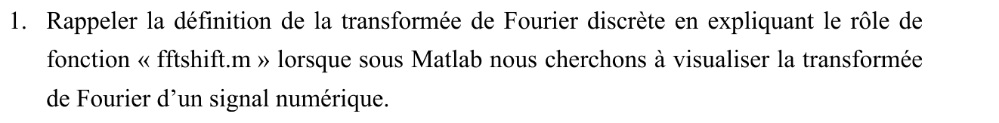{fig-alt="Exercice 4, q. 1 : rappeler la définition de la transformée de Fourier discrète en expliquant le rôle de la fonction fftshift.m de Matlab pour visualiser la transformée de Fourier d'un signal numérique."}

:::: {.complement}
::: {.solution}
**TFD** sur $N$ points ([définition du cours](../cours/03-tfd-interpretation-frequentielle.qmd#def-tfd), avec $M = N$) :
$$X[k] = \sum_{n=0}^{N-1} x[n]\, e^{-j2\pi \frac{kn}{N}}, \quad k = 0, \dots, N-1, \qquad x[n] = \frac1N \sum_{k=0}^{N-1} X[k]\, e^{j2\pi \frac{kn}{N}}$$
$X[k]$ échantillonne la TF de la séquence en $f = k\,\frac{f_e}{N}$.

**Rôle de `fftshift`.** `fft` renvoie $X[k]$ pour $k = 0, \dots, N-1$, soit des fréquences de $0$ à $f_e\left(1 - \frac1N\right)$. Le spectre étant périodique de période $f_e$, la seconde moitié ($k \geq \frac N2$) représente en fait les **fréquences négatives** $f = (k - N)\,\frac{f_e}{N}$. `fftshift` permute les deux moitiés du vecteur pour placer la fréquence nulle au **centre** : l'axe va de $-\frac{f_e}{2}$ à $\frac{f_e}{2} - \frac{f_e}{N}$, et l'on trace par exemple `plot(f, fftshift(abs(X)))` avec `f = (-N/2:N/2-1)*fe/N` ([exemple Matlab du cours](../cours/03-tfd-interpretation-frequentielle.qmd#sec-exemple-matlab-tfd)). Sans `fftshift`, un spectre de signal réel apparaît « coupé » en deux, avec ses fréquences négatives à droite.
:::
::::

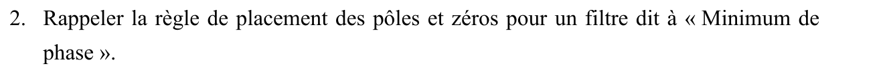{fig-alt="Exercice 4, q. 2 : rappeler la règle de placement des pôles et zéros pour un filtre dit à minimum de phase."}

:::: {.complement}
::: {.solution}
Un filtre à minimum de phase a **tous ses zéros à l'intérieur du cercle unité** ([définition du cours](../cours/05-representation-en-phase.qmd#def-minimum-phase)) ; causal et stable, il a aussi **tous ses pôles à l'intérieur** du cercle. Son inverse $1/H$ est alors lui aussi causal et stable, et il a le plus petit retard de groupe parmi les filtres de même module.

Pour rendre un filtre à minimum de phase sans changer son module, on remplace chaque zéro $z_0$ extérieur par $1/z_0^*$ ([méthode](../cours/05-representation-en-phase.qmd#sec-egalite-modules)) ; applications : [partiel 2015-2016, exercice 4](2015-2016-partiel.qmd#sec-ann15-ex4) et [partiel 2025-2026, exercice 4](2025-2026-partiel.qmd#sec-ann25-ex4).
:::
::::
