

::: {.complement}
Aucun corrigé officiel : **toutes les solutions de cette page sont rédigées par Claude**. Les énoncés sont des extraits de trois photos du sujet [sujet-2022] (redressées, contraste renforcé). La copie photographiée porte des annotations manuscrites de son propriétaire : elles sont écartées des images, sauf à l'exercice 3 où elles complètent des symboles absents de l'impression (voir le bloc *À vérifier* de cet exercice). L'exercice 3 (« Filtre RII et cascade ») est **tombé à l'identique en 2016-2017, 2017-2018 et 2022-2023** ; la question de cours sur la TFD revient aussi en 2016-2017 et 2025-2026.
:::

Rappels fournis avec le sujet : échelon $u[n] = 0$ pour $n < 0$, $u[n] = 1$ pour $n \geq 0$ ; $\delta(n-k) \overset{z}{\longleftrightarrow} z^{-k}$ et $a^n u(n) \overset{z}{\longleftrightarrow} \dfrac{1}{1 - a z^{-1}}$ avec $|a| < 1$ ; $\sum_{n=N_1}^{N_2} \alpha^n = \dfrac{\alpha^{N_1} - \alpha^{N_2+1}}{1 - \alpha}$.

::: {.a-verifier #av-ann22-numerotation}
**Source** [sujet-2022, p. 3] : après « Exercice n°4 », le sujet enchaîne « Exercice n°6 : Conception d'un filtre (2 points) » puis « Exercice n°6 : Cours (1 points) » ; il n'y a pas d'exercice n°5.

**Problème** : numérotation fautive (deux exercices n°6). Le barème total vaut bien $4 + 4 + 6 + 3 + 2 + 1 = 20$ points : aucun exercice ne manque.

**Proposition** : numéroter ici « Exercice 5 » la conception de filtre et « Exercice 6 » la question de cours.
:::

## Exercice 1 : échantillonnage (4 points) {#sec-ann22-ex1}

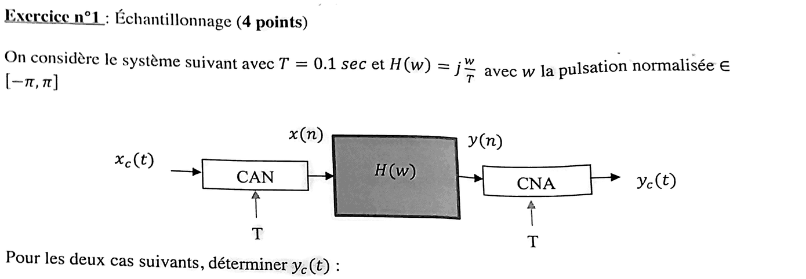{fig-alt="Exercice 1 : chaîne CAN, H(w), CNA avec T = 0,1 s et H(w) = j w/T, w pulsation normalisée dans [−π, π] ; déterminer y_c(t) dans les deux cas suivants."}

Chapitre du cours : [Interprétation fréquentielle de l'échantillonnage](../cours/01-echantillonnage-signal-discret.qmd#sec-interpretation-frequentielle-echantillonnage)

::: {.complement}
**Hypothèses** (non écrites dans le sujet) : CAN idéal, $x(n) = x_c(nT)$ ; CNA idéal, reconstruction par passe-bas idéal de bande $\left[-\frac{1}{2T}, \frac{1}{2T}\right]$. Ici $f_e = 1/T = 10\ \mathrm{Hz}$, donc pas de repliement tant que $f_0 < 5\ \mathrm{Hz}$ ([théorème de Shannon](../cours/01-echantillonnage-signal-discret.qmd#sec-shannon)).

Avec $w = \Omega T$, $H(w) = j\dfrac{w}{T} = j\Omega$ pour $|\Omega| < \pi/T$ : la chaîne complète est un **dérivateur** pour les signaux qui respectent Shannon. Pour une sinusoïde, $\cos(w_0 n) \to |H(w_0)| \cos\big(w_0 n + \arg H(w_0)\big)$ ([réponse à une sinusoïde](../cours/03-tfd-interpretation-frequentielle.qmd#sec-reponse-sinusoide)).
:::

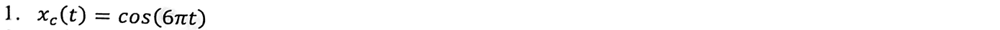{fig-alt="Exercice 1, q. 1 : x_c(t) = cos(6πt)."}

:::: {.complement}
::: {.solution}
1. $f_0 = 3\ \mathrm{Hz} < 5\ \mathrm{Hz}$ : pas de repliement. $x(n) = \cos(6\pi \cdot 0{,}1\, n) = \cos(0{,}6\pi n)$, soit $w_0 = 0{,}6\pi$.
2. $H(0{,}6\pi) = j\,\dfrac{0{,}6\pi}{0{,}1} = j\,6\pi = 6\pi\, e^{j\pi/2}$.
3. $y(n) = 6\pi \cos\left(0{,}6\pi n + \frac{\pi}{2}\right) = -6\pi \sin(0{,}6\pi n)$, puis reconstruction avec $n = t/T$ :
$$\boxed{y_c(t) = -6\pi \sin(6\pi t)}$$

Contrôle : c'est bien $\dfrac{\mathrm{d}x_c}{\mathrm{d}t}$ (dérivateur, pas de repliement).
:::
::::

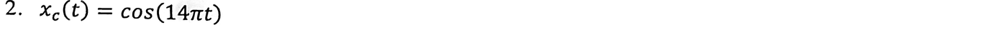{fig-alt="Exercice 1, q. 2 : x_c(t) = cos(14πt)."}

:::: {.complement}
::: {.solution}
1. $f_0 = 7\ \mathrm{Hz} > 5\ \mathrm{Hz}$ : **repliement**. $x(n) = \cos(1{,}4\pi n)$ ; ramenée dans $[-\pi, \pi]$, la pulsation vaut $1{,}4\pi - 2\pi = -0{,}6\pi$, et le cosinus est pair : $x(n) = \cos(0{,}6\pi n)$, **la même séquence qu'en question 1** (fréquence apparente $|7 - 10| = 3\ \mathrm{Hz}$).
2. Même entrée, même sortie :
$$\boxed{y_c(t) = -6\pi \sin(6\pi t)}$$

La chaîne ne dérive plus le signal d'entrée (on attendrait $-14\pi \sin(14\pi t)$) : le repliement a eu lieu avant le filtre. Contrôle numérique : $\cos(1{,}4\pi n) = \cos(0{,}6\pi n)$ pour tout $n$ entier.
:::
::::

## Exercice 2 : transformée de Fourier (4 points) {#sec-ann22-ex2}

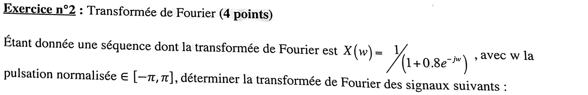{fig-alt="Exercice 2 : X(w) = 1/(1 + 0,8 e^(−jw)), w pulsation normalisée dans [−π, π] ; déterminer la transformée de Fourier des signaux suivants."}

Chapitre du cours : [Transformée de Fourier de la séquence discrète](../cours/03-tfd-interpretation-frequentielle.qmd#sec-tfsd)

::: {.complement}
D'après le rappel $a^n u(n) \leftrightarrow \frac{1}{1 - a e^{-jw}}$ avec $a = -0{,}8$ : $x(n) = (-0{,}8)^n u(n)$, séquence **réelle**. Propriétés utilisées ($X$ est $2\pi$-périodique) : décalage $x(n + k) \leftrightarrow e^{jwk} X(w)$ ([théorème du retard](../cours/03-tfd-interpretation-frequentielle.qmd#thm-retard-tfsd)) ; modulation $e^{jw_0 n} x(n) \leftrightarrow X(w - w_0)$ ; retournement $x(-n) \leftrightarrow X(-w)$ ; convolution $\leftrightarrow$ produit.
:::

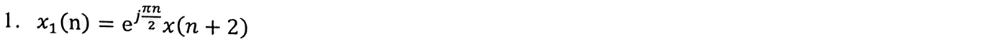{fig-alt="Exercice 2, q. 1 : x1(n) = e^(jπn/2) x(n + 2)."}

:::: {.complement}
::: {.solution}
Décalage puis modulation par $e^{j\pi n/2}$ (remplacer $w$ par $w - \frac{\pi}{2}$) :
$$X_1(w) = e^{j2(w - \pi/2)}\, X\!\left(w - \tfrac{\pi}{2}\right) = \frac{e^{j2w}\, e^{-j\pi}}{1 + 0{,}8\, e^{-jw} e^{j\pi/2}}, \qquad \boxed{X_1(w) = \frac{-\,e^{j2w}}{1 + 0{,}8\,j\, e^{-jw}}}$$

Contrôle numérique : la somme $\sum_n x_1(n)\, e^{-jwn}$ calculée directement redonne cette expression.
:::
::::

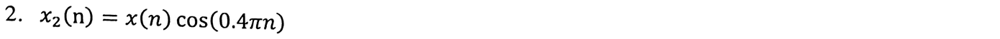{fig-alt="Exercice 2, q. 2 : x2(n) = x(n) cos(0,4πn)."}

:::: {.complement}
::: {.solution}
$\cos(0{,}4\pi n) = \frac12\left(e^{j0{,}4\pi n} + e^{-j0{,}4\pi n}\right)$ : deux modulations.
$$\boxed{X_2(w) = \frac12\left[\frac{1}{1 + 0{,}8\, e^{-j(w - 0{,}4\pi)}} + \frac{1}{1 + 0{,}8\, e^{-j(w + 0{,}4\pi)}}\right]}$$

Le spectre est translaté en $\pm 0{,}4\pi$ avec un poids $\frac12$ (contrôle numérique fait).
:::
::::

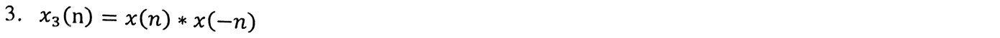{fig-alt="Exercice 2, q. 3 : x3(n) = x(n) * x(−n)."}

:::: {.complement}
::: {.solution}
$x(-n) \leftrightarrow X(-w) = X^*(w)$ car $x$ est réelle ; la convolution devient un produit :
$$X_3(w) = X(w)\, X^*(w) = |X(w)|^2 = \frac{1}{(1 + 0{,}8\, e^{-jw})(1 + 0{,}8\, e^{jw})}, \qquad \boxed{X_3(w) = \frac{1}{1{,}64 + 1{,}6 \cos w}}$$

$X_3$ est réelle, paire et positive ($x_3$ est l'autocorrélation de $x$). Contrôle : $x_3(0) = \sum_m x(m)^2 = \frac{1}{1 - 0{,}64} \approx 2{,}78$, et le calcul numérique direct de $x_3$ redonne $X_3$ ; $X_3(0) = \frac{1}{3{,}24} \approx 0{,}31$, $X_3(\pi) = \frac{1}{0{,}04} = 25$.
:::
::::

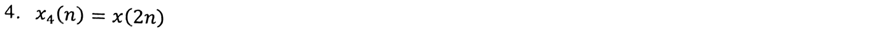{fig-alt="Exercice 2, q. 4 : x4(n) = x(2n)."}

:::: {.complement}
::: {.solution}
Ici le plus court est de revenir au temps : $x_4(n) = (-0{,}8)^{2n} u(2n) = (0{,}64)^n u(n)$, d'où
$$\boxed{X_4(w) = \frac{1}{1 - 0{,}64\, e^{-jw}}}$$

Contrôle par la formule générale de la décimation d'ordre 2, $X_4(w) = \frac12\left[X\!\left(\tfrac{w}{2}\right) + X\!\left(\tfrac{w}{2} - \pi\right)\right] = \frac12\left[\frac{1}{1 + 0{,}8\, e^{-jw/2}} + \frac{1}{1 - 0{,}8\, e^{-jw/2}}\right] = \frac{1}{1 - 0{,}64\, e^{-jw}}$ ✓ ; et $X_4(0) = \sum_n 0{,}64^n = \frac{1}{0{,}36}$ ✓.
:::
::::

## Exercice 3 : filtre RII et cascade (6 points) {#sec-ann22-ex3}

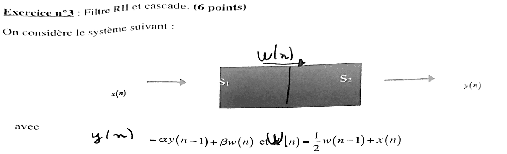{fig-alt="Exercice 3 : x(n) → S1 → w(n) → S2 → y(n), avec y(n) = α y(n−1) + β w(n) et w(n) = ½ w(n−1) + x(n)."}

Chapitre du cours : [Exemple complet de RII](../cours/04-implementation-equations-differences.qmd#sec-exemple-complet-rii)

::: {.complement}
Énoncé identique à celui de 2016-2017 et 2017-2018 (seul le barème change : 6 points au lieu de 7) : le corrigé ci-dessous reprend celui du [partiel 2017-2018, exercice 4](2017-2018-partiel.qmd#sec-ann17-ex4).
:::

::: {.a-verifier #av-ann22-symboles-manquants}
**Source** [sujet-2022, p. 2] : sur la copie photographiée, plusieurs symboles sont absents de l'impression (blancs) : « avec [ ] $= \alpha y(n-1) + \beta w(n)$ et [ ]$(n) = \frac12 w(n-1) + x(n)$ », « 1. Ecrire [ ] et [ ] les transformées en z des réponses impulsionnelles des deux modules [ ] et [ ] », « 2. Sachant que $y(n) = -\frac18 y(n-2) + \frac34 y(n-1) + x($[ ]$)$, en déduire les valeurs de [ ] et [ ] », « 3. Tracer le diagramme des pôles et des zéros de [ ] correspondant à la mise en cascade de [ ] et [ ] ». Dans le schéma, les blocs $S_1$ et $S_2$ sont imprimés comme un seul rectangle grisé. Les blancs sont en partie complétés à la main sur la copie ($y(n)$, $w(n)$, $S_1(z)$, $S_2(z)$, $S_1$, $S_2$, $\alpha$, $\beta$), mais pas celui de la question 3 avant « correspondant ».

**Problème** : défaut d'impression des formules ; les ajouts manuscrits ne font pas partie du sujet.

**Proposition** : lire l'énoncé comme celui, identique, de 2017-2018 [sujet-2017, p. 3] : $y(n)$, $w(n)$ ; $S_1(z)$ et $S_2(z)$ ; modules $S_1$ et $S_2$ ; $x(n)$ ; $\alpha$ et $\beta$ ; pôles et zéros de $S(z)$, cascade de $S_1$ et $S_2$.
:::

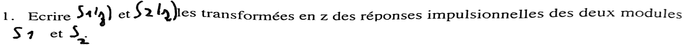{fig-alt="Exercice 3, q. 1 : écrire S1(z) et S2(z), transformées en z des réponses impulsionnelles des deux modules S1 et S2."}

:::: {.complement}
::: {.solution}
$W(z) = \frac12 z^{-1} W(z) + X(z)$ et $Y(z) = \alpha z^{-1} Y(z) + \beta W(z)$ ([théorème du retard](../cours/04-implementation-equations-differences.qmd#prp-retard-transformee-z)) :
$$\boxed{S_1(z) = \frac{1}{1 - \frac12 z^{-1}}, \qquad S_2(z) = \frac{\beta}{1 - \alpha z^{-1}}}$$
:::
::::

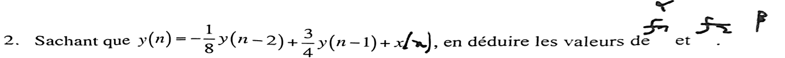{fig-alt="Exercice 3, q. 2 : sachant que y(n) = −1/8 y(n−2) + 3/4 y(n−1) + x(n), en déduire α et β."}

:::: {.complement}
::: {.solution}
$S = S_1 S_2 = \dfrac{\beta}{1 - \left(\alpha + \frac12\right) z^{-1} + \frac{\alpha}{2} z^{-2}}$. L'équation donnée correspond à $\dfrac{1}{1 - \frac34 z^{-1} + \frac18 z^{-2}}$. Par identification : $\beta = 1$, $\alpha + \frac12 = \frac34$ donc $\boxed{\alpha = \frac14,\ \beta = 1}$, et $\frac{\alpha}{2} = \frac18$ ✓.
:::
::::

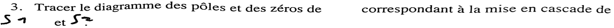{fig-alt="Exercice 3, q. 3 : tracer le diagramme des pôles et des zéros de S(z), mise en cascade de S1 et S2."}

:::: {.complement}
::: {.solution}
$S(z) = \dfrac{1}{\left(1 - \frac12 z^{-1}\right)\left(1 - \frac14 z^{-1}\right)} = \dfrac{z^2}{\left(z - \frac12\right)\left(z - \frac14\right)}$ : **pôles** $\frac12$ et $\frac14$ (sur l'axe réel, dans le cercle unité), **zéro double** en $z = 0$ (@fig-ann22-poles-zeros).

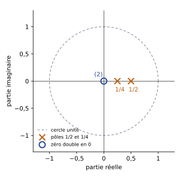{#fig-ann22-poles-zeros}
:::
::::

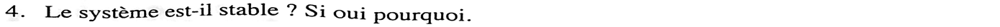{fig-alt="Exercice 3, q. 4 : le système est-il stable ? Si oui pourquoi."}

:::: {.complement}
::: {.solution}
**Stable** : système causal et pôles de module $< 1$ ([condition de stabilité](../cours/04-implementation-equations-differences.qmd#thm-stabilite-poles)).
:::
::::

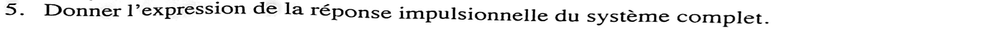{fig-alt="Exercice 3, q. 5 : donner l'expression de la réponse impulsionnelle du système complet."}

:::: {.complement}
::: {.solution}
Éléments simples : $S(z) = \dfrac{A}{1 - \frac12 z^{-1}} + \dfrac{B}{1 - \frac14 z^{-1}}$ avec
$A = \dfrac{1}{1 - \frac14 \cdot 2} = 2$ et $B = \dfrac{1}{1 - \frac12 \cdot 4} = -1$ :
$$\boxed{h(n) = \left[2\left(\tfrac12\right)^n - \left(\tfrac14\right)^n\right] u(n)}$$
Contrôle par la récurrence : $h(0) = 1$, $h(1) = \frac34$, $h(2) = \frac34 \cdot \frac34 - \frac18 = \frac{7}{16}$ ; la formule donne $2 \cdot \frac14 - \frac1{16} = \frac{7}{16}$ ✓ (identique sur les 20 premiers termes, calcul numérique).
:::
::::

## Exercice 4 : classes des systèmes LTI (3 points) {#sec-ann22-ex4}

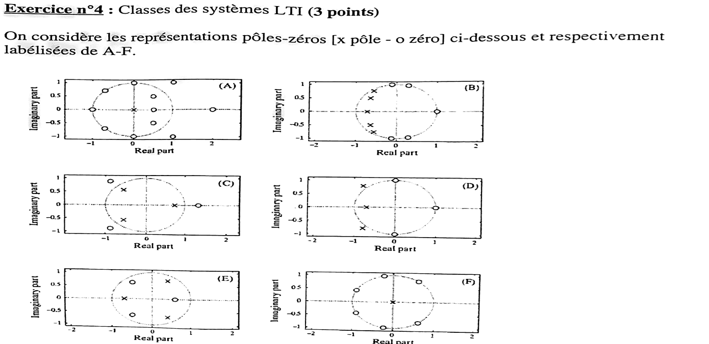{fig-alt="Exercice 4 : six diagrammes pôles-zéros (x pôle, o zéro) labellisés A à F."}

Chapitres du cours : [Pôles et zéros](../cours/04-implementation-equations-differences.qmd#sec-poles-zeros) ; [filtre à phase linéaire](../cours/05-representation-en-phase.qmd#sec-phase-lineaire) ; [filtres à minimum de phase](../cours/05-representation-en-phase.qmd#sec-minimum-phase)

::: {.complement}
**Lecture des diagrammes** (positions approchées, lues sur la photo ; systèmes supposés causaux) :

| Figure | Pôles (×) | Zéros (○) |
|---|---|---|
| A | en $0$ seulement | $-1$, $\pm j$, $-0{,}7 \pm 0{,}7j$ (sur le cercle) ; $0{,}5$ et $0{,}5 \pm 0{,}5j$ (dedans) ; $2$ et $1 \pm j$ (dehors) |
| B | 5 pôles dans le cercle, vers $-0{,}6$ (modules $0{,}7$ à $0{,}95$) | 5 zéros sur le cercle : $1$, $\approx -0{,}1 \pm j$, $\approx 0{,}3 \pm 0{,}95j$ |
| C | $\approx -0{,}6 \pm 0{,}55j$ et $\approx 0{,}75$ (dedans) | $\approx -0{,}9 \pm 0{,}85j$ et $\approx 1{,}3$ (dehors) |
| D | $\approx -0{,}7$ (dedans) ; $\approx -0{,}75 \pm 0{,}8j$, de module $\approx 1{,}1$ (**dehors**) | $\pm j$ et $1$ (sur le cercle) |
| E | $\approx 0{,}4 \pm 0{,}6j$ et $\approx -0{,}7$ (dedans) | $\approx -0{,}5 \pm 0{,}6j$ et $\approx 0{,}6$ (dedans) |
| F | en $0$ seulement | 6 zéros sur le cercle, en paires conjuguées |

Rappels : RIF $\Leftrightarrow$ tous les pôles en $0$ ; stable (causal) $\Leftrightarrow$ pôles dans le cercle ; minimum de phase $\Leftrightarrow$ zéros dans le cercle ([définition](../cours/05-representation-en-phase.qmd#def-minimum-phase)) ; RIF à phase linéaire $\Leftrightarrow$ zéros par couples $\{z_l, 1/z_l\}$ ([propriété](../cours/05-representation-en-phase.qmd#prp-rif-phase-lineaire-zeros)) ; passe-tout $\Leftrightarrow$ chaque zéro est l'inverse conjugué d'un pôle, $z_l = 1/p_l^*$.
:::

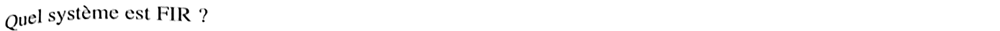{fig-alt="Exercice 4, q. 1 : quel système est FIR ?"}

:::: {.complement}
::: {.solution}
**A et F** : tous leurs pôles sont à l'origine, donc $H(z)$ est un polynôme en $z^{-1}$ (réponse impulsionnelle finie). Les autres ont des pôles hors de l'origine (RII).
:::
::::

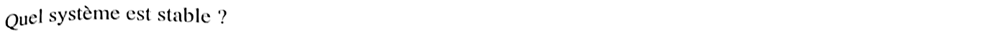{fig-alt="Exercice 4, q. 2 : quel système est stable ?"}

:::: {.complement}
::: {.solution}
**A, B, C, E et F** : A et F sont des RIF (toujours stables) ; B, C et E ont tous leurs pôles dans le cercle unité. **D n'est pas stable** : deux de ses pôles ($\approx -0{,}75 \pm 0{,}8j$, module $\approx 1{,}1$) sont hors du cercle.
:::
::::

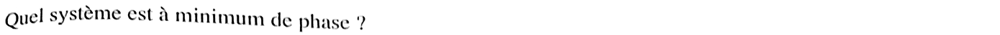{fig-alt="Exercice 4, q. 3 : quel système est à minimum de phase ?"}

:::: {.complement}
::: {.solution}
**E** : seul système dont tous les zéros (et tous les pôles) sont strictement dans le cercle unité. A, C (zéros dehors) ne le sont pas ; B, D et F ont des zéros **sur** le cercle : cas limite, exclu avec la définition stricte (l'inverse aurait des pôles sur le cercle).
:::
::::

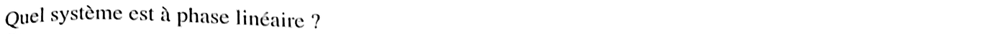{fig-alt="Exercice 4, q. 4 : quel système est à phase linéaire ?"}

:::: {.complement}
::: {.solution}
**A et F** : RIF dont les zéros vont par couples $\{z_l, 1/z_l^*\}$ (avec les conjugués). Pour A : $0{,}5 \leftrightarrow 2$, $0{,}5 \pm 0{,}5j \leftrightarrow 1 \pm j$ (car $\frac{1}{0{,}5 - 0{,}5j} = 1 + j$), les zéros du cercle étant leurs propres inverses conjugués. Pour F : zéros tous sur le cercle, en paires conjuguées. Contrôle : le polynôme formé avec les zéros lus a des coefficients symétriques ($h[n] = h[M-n]$) dans les deux cas.
:::
::::

{fig-alt="Exercice 4, q. 5 : quel système est dit passe-tout ?"}

:::: {.complement}
::: {.solution}
**C** : chaque zéro est l'inverse conjugué d'un pôle. $\frac{1}{0{,}75} \approx 1{,}33$ (zéro lu $\approx 1{,}3$) et $\frac{1}{(-0{,}6 - 0{,}55j)} = \frac{-0{,}6 + 0{,}55j}{0{,}66} \approx -0{,}91 + 0{,}83j$ (zéro lu $\approx -0{,}9 + 0{,}85j$). Contrôle numérique : avec ces valeurs, $|H|$ est constant sur tout l'axe des fréquences.
:::
::::

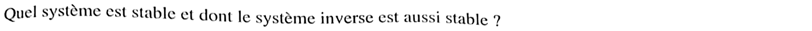{fig-alt="Exercice 4, q. 6 : quel système est stable et dont le système inverse est aussi stable ?"}

:::: {.complement}
::: {.solution}
**E** : l'inverse $1/H(z)$ échange pôles et zéros ; il faut donc pôles **et** zéros dans le cercle unité, ce qui est la définition (stricte) du minimum de phase (question 3).
:::
::::

## Exercice 5 : conception d'un filtre (2 points) {#sec-ann22-ex5}

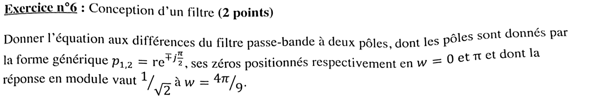{fig-alt="Exercice 5 (numéroté 6 dans le sujet) : équation aux différences du filtre passe-bande à deux pôles p1,2 = r e^(∓jπ/2), zéros en w = 0 et π, module 1/√2 à w = 4π/9."}

Chapitre du cours : [Pôles et zéros](../cours/04-implementation-equations-differences.qmd#sec-poles-zeros)

::: {.a-verifier #av-ann22-gain-conception}
**Source** [sujet-2022, p. 3] : « dont la réponse en module vaut $1/\sqrt2$ à $w = 4\pi/9$ ».

**Problème** : le gain de référence n'est pas précisé. Avec un gain de $1$ devant le numérateur, aucune valeur $r < 1$ ne convient : $|H(4\pi/9)| \geq 2\sin(4\pi/9) \approx 1{,}97$ pour tout $r$.

**Proposition** : comprendre « gain normalisé à $1$ au centre de la bande ($w = \pi/2$) et $1/\sqrt2$ (soit $-3$ dB) en $w = 4\pi/9$ ». C'est l'hypothèse de la solution ci-dessous.
:::

:::: {.complement}
::: {.solution}
**Forme du filtre.** Zéros en $w = 0$ et $w = \pi$, soit $z = 1$ et $z = -1$ ; pôles $\pm jr$ :
$$H(z) = G\, \frac{(1 - z^{-1})(1 + z^{-1})}{(1 - jr z^{-1})(1 + jr z^{-1})} = G\, \frac{1 - z^{-2}}{1 + r^2 z^{-2}}$$

**Normalisation.** En $w = \pi/2$, $z^{-2} = e^{-j\pi} = -1$ : $|H| = \dfrac{2G}{1 - r^2} = 1$, donc $G = \dfrac{1 - r^2}{2}$.

**Condition à $-3$ dB.** Avec $\theta = 2w = \frac{8\pi}{9}$ et $s = r^2$ :
$$|H|^2 = \frac{(1 - s)^2}{4} \cdot \frac{2 - 2\cos\theta}{1 + s^2 + 2s\cos\theta} = \frac12 \iff s^2 \cos\theta + 2s + \cos\theta = 0$$
d'où $s = \dfrac{-1 + \sin\theta}{\cos\theta} = \dfrac{1 - \sin 20°}{\cos 20°} = \tan 35° \approx 0{,}700$ (l'autre racine est $> 1$). Donc $r \approx 0{,}837$ et $G \approx 0{,}150$ :
$$\boxed{y(n) = -0{,}700\, y(n-2) + 0{,}150\, \big[x(n) - x(n-2)\big]}$$

Contrôle numérique : $|H| = 1$ en $w = \pi/2$ (maximum), $|H(4\pi/9)| = 0{,}7071$ ; par symétrie, la bande à $-3$ dB va de $\frac{4\pi}{9}$ à $\frac{5\pi}{9}$. Pôles de module $0{,}837 < 1$ : filtre stable.
:::
::::

## Exercice 6 : cours (1 point) {#sec-ann22-ex6}

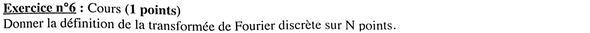{fig-alt="Exercice 6 (numéroté 6 dans le sujet, second du nom) : donner la définition de la transformée de Fourier discrète sur N points."}

Chapitre du cours : [Échantillonnage de l'axe fréquentiel](../cours/03-tfd-interpretation-frequentielle.qmd#sec-echantillonnage-frequentiel)

:::: {.complement}
::: {.solution}
Pour $N$ échantillons $x[0], \dots, x[N-1]$ :
$$X[k] = \sum_{n=0}^{N-1} x[n]\, e^{-j2\pi \frac{kn}{N}}, \quad k = 0, \dots, N-1$$
(inverse : $x[n] = \frac1N \sum_{k=0}^{N-1} X[k]\, e^{j2\pi kn/N}$). C'est la [définition du cours](../cours/03-tfd-interpretation-frequentielle.qmd#def-tfd) avec $M = N$ points en fréquence : $X[k]$ échantillonne la TFSD en $f = k/N$ (fréquence normalisée).
:::
::::
