

::: {.complement}
Aucun corrigé officiel : **toutes les solutions de cette page sont rédigées par Claude**, d'après les notes de 2023 (`notes-2023`) et les définitions usuelles. Les énoncés sont des extraits du scan du sujet [sujet-2025] (contraste renforcé) ; les traits manuscrits visibles sur le scan (accolade de l'exercice 1, ellipse de l'exercice 2, soulignement de l'exercice 4) ne font pas partie du sujet. À relire avec un œil critique ; signaler toute erreur.
:::

Rappels fournis avec le sujet : $\delta(n-k) \overset{z}{\longleftrightarrow} z^{-k}$ et $a^n u(n) \overset{z}{\longleftrightarrow} \dfrac{1}{1 - a z^{-1}}$ avec $|a| < 1$.

## Exercice 1 : SLI, convolution (1,5 point) {#sec-ann25-ex1}

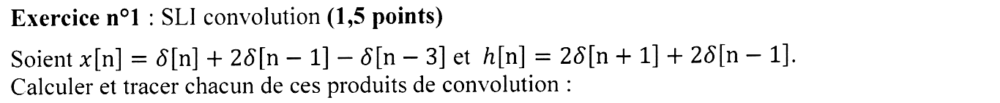{fig-alt="Exercice 1 : x[n] = δ[n] + 2δ[n−1] − δ[n−3] et h[n] = 2δ[n+1] + 2δ[n−1] ; calculer et tracer chacun des produits de convolution suivants."}

Chapitre du cours : [Convolution discrète](../cours/02-systemes-discrets-convolution.qmd#sec-convolution-discrete)

::: {.complement}
**Idée.** Convoluer avec $\delta[n-k]$ revient à retarder de $k$. Les trois résultats sont tracés sur @fig-ann25-convolution (question 3).
:::

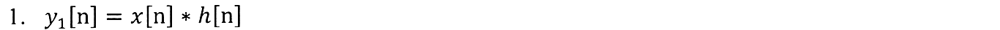{fig-alt="Exercice 1, q. 1 : y1[n] = x[n] * h[n]."}

:::: {.complement}
::: {.solution}
$$y_1[n] = 2\,x[n+1] + 2\,x[n-1].$$

Avec $x = \{1,\ 2,\ 0,\ -1\}$ pour $n = 0, \dots, 3$ :

| $n$ | $-1$ | $0$ | $1$ | $2$ | $3$ | $4$ |
|---|---|---|---|---|---|---|
| $2x[n+1]$ | 2 | 4 | 0 | $-2$ | 0 | 0 |
| $2x[n-1]$ | 0 | 0 | 2 | 4 | 0 | $-2$ |
| $y_1[n]$ | **2** | **4** | **2** | **2** | **0** | **$-2$** |

Contrôle : support $[0 + (-1),\ 3 + 1] = [-1, 4]$ ; somme des valeurs $= (\sum x)(\sum h) = 2 \times 4 = 8$ ✓.
:::
::::

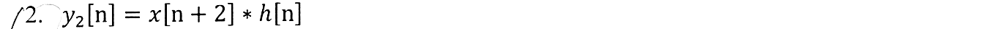{fig-alt="Exercice 1, q. 2 : y2[n] = x[n+2] * h[n]."}

:::: {.complement}
::: {.solution}
Avancer l'entrée de 2 avance la sortie de 2 (invariance) : $y_2[n] = y_1[n+2]$, soit les mêmes valeurs $\{2, 4, 2, 2, 0, -2\}$ sur $n = -3, \dots, 2$.
:::
::::

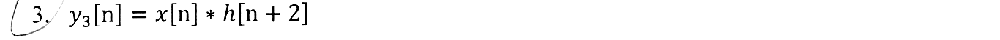{fig-alt="Exercice 1, q. 3 : y3[n] = x[n] * h[n+2]."}

:::: {.complement}
::: {.solution}
La convolution est commutative : avancer $h$ de 2 avance aussi la sortie de 2. $y_3[n] = y_1[n+2] = y_2[n]$, mêmes valeurs sur $n = -3, \dots, 2$ (vérifié par le calcul direct des trois convolutions).

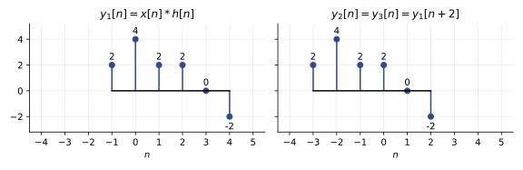{#fig-ann25-convolution}
:::
::::

## Exercice 2 : entrée périodique (3 points) {#sec-ann25-ex2}

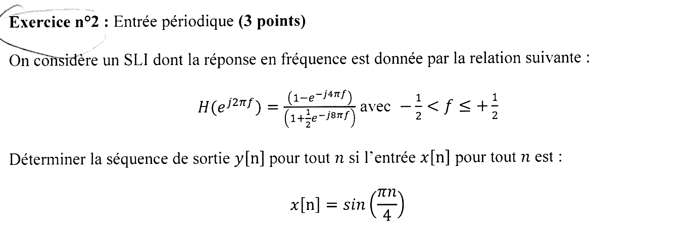{fig-alt="Exercice 2 : H(e^(j2πf)) = (1 − e^(−j4πf)) / (1 + ½ e^(−j8πf)) pour −½ < f ≤ ½ ; déterminer y[n] pour tout n si x[n] = sin(πn/4)."}

Chapitre du cours : [Réponse à une sinusoïde](../cours/03-tfd-interpretation-frequentielle.qmd#sec-reponse-sinusoide)

:::: {.complement}
::: {.solution}
**Méthode.** Pour un SLI réel, $\sin(2\pi f_0 n) \to |H(f_0)|\, \sin\big(2\pi f_0 n + \arg H(f_0)\big)$.

1. Fréquence : $2\pi f_0 = \pi/4$, donc $f_0 = 1/8$.
2. Numérateur : $e^{-j4\pi/8} = e^{-j\pi/2} = -j$, donc $1 - (-j) = 1 + j$.
3. Dénominateur : $e^{-j8\pi/8} = e^{-j\pi} = -1$, donc $1 - \frac12 = \frac12$.
4. $H(f_0) = 2(1 + j) = 2\sqrt2\, e^{j\pi/4}$.

$$y[n] = 2\sqrt2\, \sin\left(\frac{\pi n}{4} + \frac{\pi}{4}\right)$$

Contrôle numérique : en simulant l'équation $y[n] + \frac12 y[n-4] = x[n] - x[n-2]$ jusqu'au régime permanent, on retrouve exactement cette sinusoïde.
:::
::::

## Exercice 3 : équation récurrente (4,5 points) {#sec-ann25-ex3}

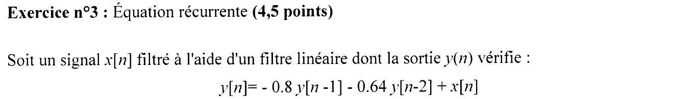{fig-alt="Exercice 3 : filtre linéaire de sortie y[n] = −0,8 y[n−1] − 0,64 y[n−2] + x[n]."}

Chapitre du cours : [Exemple complet de RII](../cours/04-implementation-equations-differences.qmd#sec-exemple-complet-rii)

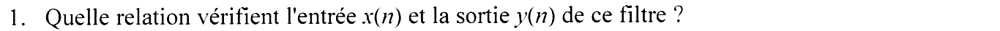{fig-alt="Exercice 3, q. 1 : quelle relation vérifient l'entrée x(n) et la sortie y(n) de ce filtre ?"}

:::: {.complement}
::: {.solution}
**Équation aux différences** : $y[n] + 0{,}8\, y[n-1] + 0{,}64\, y[n-2] = x[n]$.
:::
::::

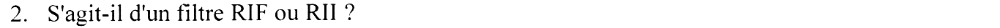{fig-alt="Exercice 3, q. 2 : s'agit-il d'un filtre RIF ou RII ?"}

:::: {.complement}
::: {.solution}
**RII** : la sortie dépend des sorties passées (filtre récursif) ; la réponse impulsionnelle ne s'annule jamais.
:::
::::

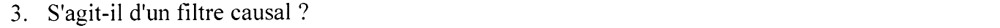{fig-alt="Exercice 3, q. 3 : s'agit-il d'un filtre causal ?"}

:::: {.complement}
::: {.solution}
**Causal** : $y[n]$ n'utilise que l'entrée présente et des sorties passées.
:::
::::

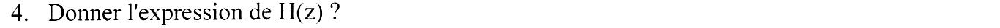{fig-alt="Exercice 3, q. 4 : donner l'expression de H(z)."}

:::: {.complement}
::: {.solution}
Transformée en $z$ (théorème du retard) :
$$H(z) = \frac{1}{1 + 0{,}8 z^{-1} + 0{,}64 z^{-2}} = \frac{z^2}{z^2 + 0{,}8 z + 0{,}64}$$
:::
::::

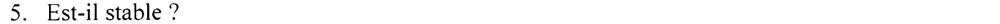{fig-alt="Exercice 3, q. 5 : est-il stable ?"}

:::: {.complement}
::: {.solution}
**Stable** : pôles de module $0{,}8 < 1$ (question 6) et système causal.
:::
::::

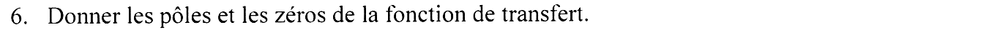{fig-alt="Exercice 3, q. 6 : donner les pôles et les zéros de la fonction de transfert."}

:::: {.complement}
::: {.solution}
$\Delta = 0{,}64 - 2{,}56 = -1{,}92$ : pôles $p_{1,2} = -0{,}4 \pm j\,0{,}693 = 0{,}8\, e^{\pm j 2\pi/3}$ (car $\cos\theta = -0{,}4/0{,}8 = -\frac12$). Zéro **double en $z = 0$**.
:::
::::

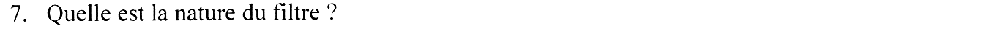{fig-alt="Exercice 3, q. 7 : quelle est la nature du filtre ?"}

:::: {.complement}
::: {.solution}
**Passe-bande** centré sur l'argument des pôles : $\omega = 2\pi/3$, soit $f = 1/3$. Contrôle numérique : $|H| = 0{,}41$ en $f = 0$, $\approx 3{,}2$ en $f = 1/3$, $1{,}19$ en $f = 1/2$.
:::
::::

## Exercice 4 : filtre à minimum de phase (4 points) {#sec-ann25-ex4}

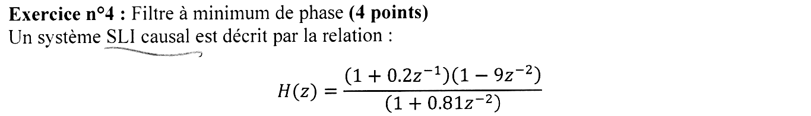{fig-alt="Exercice 4 : système SLI causal H(z) = (1 + 0,2 z^−1)(1 − 9 z^−2) / (1 + 0,81 z^−2)."}

Chapitre du cours : [Filtres à minimum de phase](../cours/05-representation-en-phase.qmd#sec-minimum-phase)

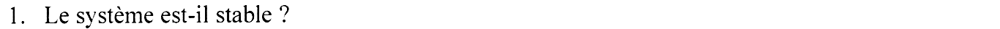{fig-alt="Exercice 4, q. 1 : le système est-il stable ?"}

:::: {.complement}
::: {.solution}
Pôles : $z^2 = -0{,}81$, soit $z = \pm j\,0{,}9$, de module $0{,}9 < 1$ : **stable** (système causal).
:::
::::

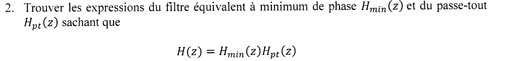{fig-alt="Exercice 4, q. 2 : trouver le filtre équivalent à minimum de phase H_min(z) et le passe-tout H_pt(z) tels que H(z) = H_min(z) H_pt(z)."}

:::: {.complement}
::: {.solution}
Zéros : $-0{,}2$ (dans le cercle) et $\pm 3$ (hors du cercle, car $1 - 9z^{-2} = (1 - 3z^{-1})(1 + 3z^{-1})$). Le filtre n'est **pas** à minimum de phase.

On remplace les zéros $\pm 3$ par leurs inverses $\pm \frac13$, en gardant le même module sur le cercle unité : $1 - 9 z^{-2}$ devient $9 - z^{-2} = 9\left(1 - \frac19 z^{-2}\right)$.
$$H_{min}(z) = \frac{(1 + 0{,}2 z^{-1})(9 - z^{-2})}{1 + 0{,}81 z^{-2}}, \qquad H_{pt}(z) = \frac{1 - 9 z^{-2}}{9 - z^{-2}}$$

Vérification du passe-tout : en $z = e^{j\omega}$, $1 - 9e^{-2j\omega} = -e^{-2j\omega}\left(9 - e^{2j\omega}\right)$, de même module que $9 - e^{-2j\omega}$ (conjugué) : $|H_{pt}| = 1$. Ses pôles $\pm\frac13$ sont dans le cercle : il est stable. Contrôle numérique : $|H_{pt}| = 1$ sur tout l'axe des fréquences, $H_{min} H_{pt} = H$, zéros de $H_{min}$ : $-0{,}2$ et $\pm\frac13$.
:::
::::

## Exercice 5 : représentation pôles/zéros (4 points) {#sec-ann25-ex5}

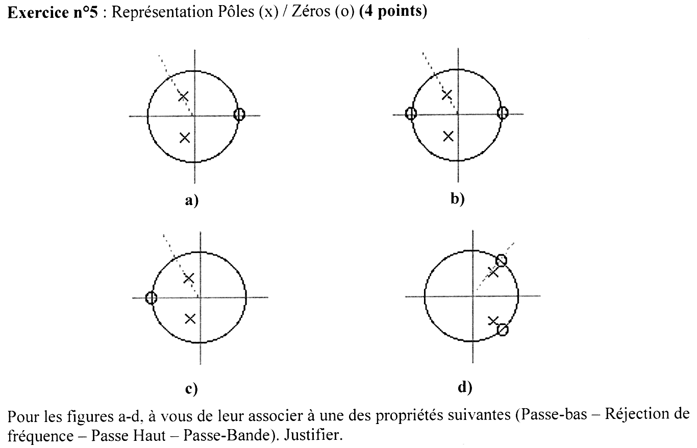{fig-alt="Exercice 5 : quatre diagrammes pôles (x) / zéros (o) a à d ; associer à chacun passe-bas, réjection de fréquence, passe-haut ou passe-bande, en justifiant."}

Chapitre du cours : [Pôles et zéros](../cours/04-implementation-equations-differences.qmd#sec-poles-zeros)

:::: {.complement}
::: {.solution}
Règle : sur le cercle unité, $z = 1$ correspond à $f = 0$ et $z = -1$ à $f = \frac12$ ; un zéro sur le cercle annule le gain, un pôle proche du cercle le fait monter.

| Figure | Zéros (sujet) | Nature |
|---|---|---|
| a | un zéro en $z = 1$ | **passe-haut** : gain nul en $f = 0$, pas de zéro en $f = \frac12$ |
| b | zéros en $z = 1$ et $z = -1$ | **passe-bande** : gain nul aux deux extrémités, pôles entre les deux |
| c | un zéro en $z = -1$ | **passe-bas** : gain nul en $f = \frac12$ |
| d | zéros conjugués sur le cercle, pôles juste à côté | **réjection** (*notch*) : creux étroit à la fréquence des zéros |

Lecture faite sur la figure du sujet (position des zéros) ; à vérifier sur l'original si une position paraît douteuse. Contrôle numérique avec les positions lues (pôles de a, b, c vers $-0{,}2 \pm 0{,}47j$ ; pour d, zéros $e^{\pm j0{,}27\pi}$ et pôles de module $\approx 0{,}7$ au même angle) : $|H|$ normalisé à son maximum vaut, en $f = 0$ puis $f = \frac12$ : $0$ puis $0{,}9$ pour a (maximum vers $f \approx 0{,}35$) ; $0$ puis $0$ pour b (maximum vers $f \approx 0{,}3$) ; $0{,}72$ puis $0$ pour c (maximum vers $f \approx 0{,}25$, bosse due aux pôles) ; pour d, il s'annule à la fréquence des zéros ($f \approx 0{,}14$) et reste entre $0{,}8$ et $1$ loin de ce creux.
:::
::::

## Exercice 6 : question de cours (3 points) {#sec-ann25-ex6}

{fig-alt="Exercice 6 : question de cours (3 points)."}

Chapitre du cours : [Transformée de Fourier discrète](../cours/03-tfd-interpretation-frequentielle.qmd#sec-tfd)

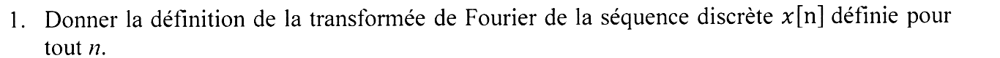{fig-alt="Exercice 6, q. 1 : donner la définition de la transformée de Fourier de la séquence discrète x[n] définie pour tout n."}

:::: {.complement}
::: {.solution}
Transformée de Fourier à temps discret, en fréquence normalisée :
$$X(e^{j2\pi f}) = \sum_{n=-\infty}^{+\infty} x[n]\, e^{-j2\pi f n}, \quad \text{périodique de période } 1,\ f \in \left[-\tfrac12, \tfrac12\right]$$
:::
::::

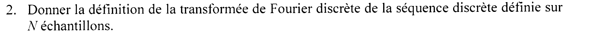{fig-alt="Exercice 6, q. 2 : donner la définition de la transformée de Fourier discrète de la séquence discrète définie sur N échantillons."}

:::: {.complement}
::: {.solution}
Transformée de Fourier discrète sur $N$ points :
$$X[k] = \sum_{n=0}^{N-1} x[n]\, e^{-j2\pi \frac{kn}{N}}, \quad k = 0, \dots, N-1$$
(inverse : $x[n] = \frac1N \sum_{k=0}^{N-1} X[k]\, e^{j2\pi kn/N}$).
:::
::::
