

::: {.complement}
Énoncé découpé question par question [td, p. 3-6] ; sous chaque question, dans cet ordre : le corrigé manuscrit d'un ancien élève (*Notes externes*, [corrige-2023-td01]), puis les explications et contrôles ajoutés par Claude (*Complément*). Il n'y a pas de notes d'Armand sur ce TD. Les blocs *À vérifier* signalent des erreurs du corrigé de 2023 : ils restent **ouverts** tant qu'Armand ne les a pas tranchés.

Les exercices sont numérotés dans l'ordre du recueil ; la partie II-1 (filtre RIF) est scindée en deux exercices (5 et 6), un par question. Le recueil numérote « II » deux parties successives. Les corrections étaient auparavant dans les chapitres [2](../cours/02-systemes-discrets-convolution.qmd#sec-exercices-td-ch02), [3](../cours/03-tfd-interpretation-frequentielle.qmd#sec-exercices-td-ch03) et [5](../cours/05-representation-en-phase.qmd#sec-exercices-td-ch05) ; les sujets d'examen reproduits en fin de recueil sont corrigés dans les [annales](../index.qmd#sec-partiel).
:::

## Exercice 1 : convolution de deux séquences finies {#sec-td01-ex1}

::: {#exr-td-convolution-graphique}
## Convolution de deux séquences finies

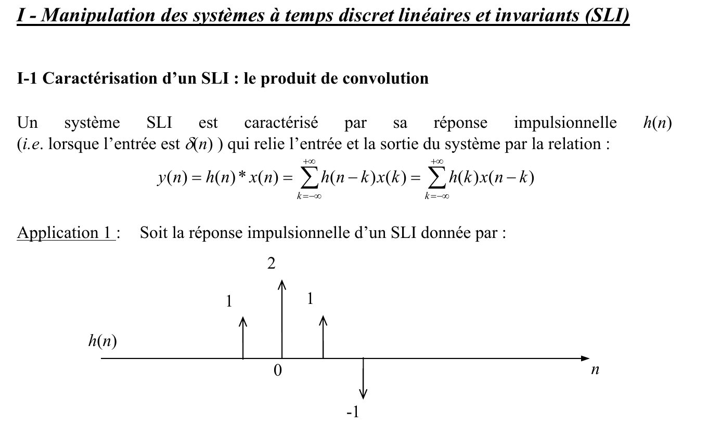{fig-alt="I - Manipulation des systèmes à temps discret linéaires et invariants (SLI). I-1 Caractérisation d'un SLI : le produit de convolution. Un système SLI est caractérisé par sa réponse impulsionnelle h(n) (i.e. lorsque l'entrée est δ(n)) qui relie l'entrée et la sortie du système par la relation y(n) = h(n) * x(n) = Σ h(n − k) x(k) = Σ h(k) x(n − k), sommes de k = −∞ à +∞. Application 1 : soit la réponse impulsionnelle d'un SLI donnée par le graphe de h(n) : h(−1) = 1, h(0) = 2, h(1) = 1, h(2) = −1, nulle ailleurs."}
:::

Cours associé : [convolution discrète](../cours/02-systemes-discrets-convolution.qmd#sec-convolution-discrete)

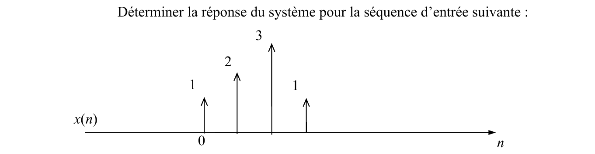{fig-alt="Déterminer la réponse du système pour la séquence d'entrée donnée par le graphe de x(n) : x(0) = 1, x(1) = 2, x(2) = 3, x(3) = 1, nulle ailleurs."}

:::: {.notes-externes}
::: {.solution}
On applique [la formule de convolution](../cours/02-systemes-discrets-convolution.qmd#eq-convolution-discrete), $y[n] = \sum_k h[k]\,x[n-k]$ : pour chaque $n$, on retourne $x$ (séquence $x[-k]$), on la décale de $n$ et on somme les produits terme à terme avec $h[k]$. Le corrigé dispose les deux séquences en tableau, $x$ retournée glissant d'un cran à chaque ligne sous $h$ : « on représente à chaque fois pour effectuer la convolution ».

Par exemple $y[0] = h[-1]\,x[1] + h[0]\,x[0] = 1 \times 2 + 2 \times 1 = 4$. On obtient :

| $n$ | $-1$ | $0$ | $1$ | $2$ | $3$ | $4$ | $5$ |
|---|---|---|---|---|---|---|---|
| $y[n]$ | $1$ | $4$ | $8$ | $8$ | $3$ | $-2$ | $-1$ |

et $y[n] = 0$ ailleurs [corrige-2023-td01, p. 1-2].
:::
::::

::: {.complement}
Contrôles rapides : le support de $y$ va de $-1 + 0 = -1$ à $2 + 3 = 5$, soit $4 + 4 - 1 = 7$ échantillons ; la somme des $y[n]$ vaut $\bigl(\sum_n h[n]\bigr)\bigl(\sum_n x[n]\bigr) = 3 \times 7 = 21$, et l'on a bien $1 + 4 + 8 + 8 + 3 - 2 - 1 = 21$.
:::

## Exercice 2 : convolution de deux portes {#sec-td01-ex2}

::: {#exr-td-convolution-portes}
## Convolution de deux portes

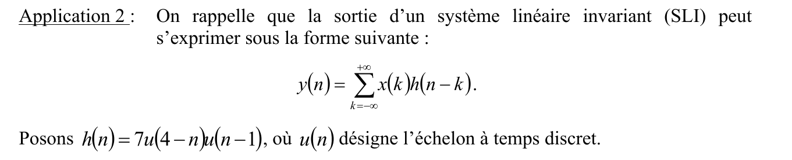{fig-alt="Application 2 : on rappelle que la sortie d'un système linéaire invariant (SLI) peut s'exprimer sous la forme y(n) = Σ x(k) h(n − k), somme de k = −∞ à +∞. Posons h(n) = 7u(4 − n)u(n − 1), où u(n) désigne l'échelon à temps discret."}
:::

Cours associé : [convolution discrète](../cours/02-systemes-discrets-convolution.qmd#sec-convolution-discrete)

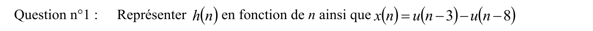{fig-alt="Question n°1 : représenter h(n) en fonction de n ainsi que x(n) = u(n − 3) − u(n − 8)."}

:::: {.notes-externes}
::: {.solution}
1. $u[4-n] = 1$ pour $n \leq 4$ et $u[n-1] = 1$ pour $n \geq 1$ : $h[n] = 7$ pour $1 \leq n \leq 4$, $0$ ailleurs. De même $x[n] = 1$ pour $3 \leq n \leq 7$, $0$ ailleurs (cinq échantillons).

[corrige-2023-td01, p. 3-4]
:::
::::

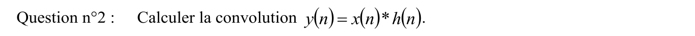{fig-alt="Question n°2 : calculer la convolution y(n) = x(n) * h(n)."}

:::: {.notes-externes}
::: {.solution}
2. En faisant glisser $x[-k]$ (non nul pour $-7 \leq k \leq -3$) :

| $n$ | $4$ | $5$ | $6$ | $7$ | $8$ | $9$ | $10$ | $11$ |
|---|---|---|---|---|---|---|---|---|
| $y[n]$ | $7$ | $14$ | $21$ | $28$ | $28$ | $21$ | $14$ | $7$ |

et $y[n] = 0$ ailleurs [corrige-2023-td01, p. 3-4].
:::
::::

::: {.complement}
$y[n] = 7 \times \operatorname{card}\{k \in [\![1, 4]\!] : n - k \in [\![3, 7]\!]\}$ : la convolution de deux portes de longueurs 4 et 5 est un **trapèze** de longueur $4 + 5 - 1 = 8$, de plateau $7 \times \min(4, 5) = 28$.
:::

## Exercice 3 : association de deux SLI en série {#sec-td01-ex3}

::: {#exr-td-cascade-exponentielles}
## Association de deux SLI en série

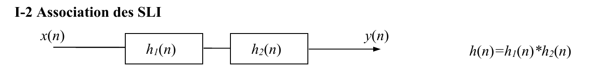{fig-alt="I-2 Association des SLI : schéma x(n) → h1(n) → h2(n) → y(n), avec h(n) = h1(n) * h2(n)."}
:::

Cours associé : [association de systèmes discrets](../cours/02-systemes-discrets-convolution.qmd#sec-association-systemes)

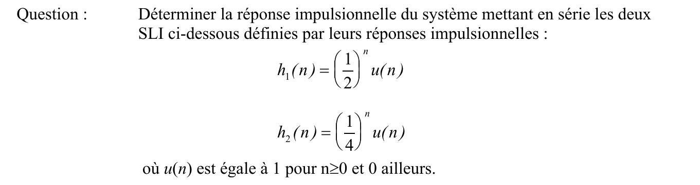{fig-alt="Question : déterminer la réponse impulsionnelle du système mettant en série les deux SLI définis par leurs réponses impulsionnelles h1(n) = (1/2)^n u(n) et h2(n) = (1/4)^n u(n), où u(n) est égale à 1 pour n ≥ 0 et 0 ailleurs."}

:::: {.notes-externes}
::: {.solution}
En série, $Y(f) = H_2(f)\,H_1(f)\,X(f)$ : $H_\mathrm{eq} = H_1 H_2$ et $h_\mathrm{eq} = h_1 \star h_2$ ([association en série](../cours/02-systemes-discrets-convolution.qmd#eq-association-serie)).

**Méthode 1 (transformée en $z$).**
$H_1(z) = \sum_{n \geq 0} \bigl(\frac12 z^{-1}\bigr)^n = \dfrac{1}{1 - \frac12 z^{-1}}$ si $\bigl|\frac12 z^{-1}\bigr| < 1$, et de même $H_2(z) = \dfrac{1}{1 - \frac14 z^{-1}}$ si $\bigl|\frac14 z^{-1}\bigr| < 1$. On décompose

$$
H_\mathrm{eq}(z) = \frac{1}{\bigl(1 - \frac12 z^{-1}\bigr)\bigl(1 - \frac14 z^{-1}\bigr)} = \frac{\alpha}{1 - \frac12 z^{-1}} + \frac{\beta}{1 - \frac14 z^{-1}},
$$

avec $\alpha + \beta = 1$ et $-\frac{\alpha}{4} - \frac{\beta}{2} = 0$, soit $\alpha = 2$, $\beta = -1$. D'où

$$
h_\mathrm{eq}[n] = 2\Bigl(\frac12\Bigr)^n u[n] - \Bigl(\frac14\Bigr)^n u[n].
$$

**Méthode 2 (somme directe).** Pour $n \geq 0$ :

$$
(h_1 \star h_2)[n] = \sum_{k=0}^{n} \Bigl(\frac12\Bigr)^k \Bigl(\frac14\Bigr)^{n-k} = \Bigl(\frac14\Bigr)^n \sum_{k=0}^{n} 2^k = \Bigl(\frac14\Bigr)^n \frac{1 - 2^{n+1}}{1 - 2} = \Bigl(\frac14\Bigr)^n \bigl(2^{n+1} - 1\bigr).
$$

[corrige-2023-td01, p. 4-6]
:::
::::

::: {.complement}
- Les bornes $0 \leq k \leq n$ viennent de $u[k]\,u[n-k]$ ; pour $n < 0$, la somme est vide et $h_\mathrm{eq}[n] = 0$ (cascade de deux systèmes causaux : causale).
- Les deux résultats coïncident : $\bigl(\frac14\bigr)^n 2^{n+1} = 2\bigl(\frac12\bigr)^n$. Contrôle : $h_\mathrm{eq}[0] = 1$ et $h_\mathrm{eq}[1] = h_1[1] + h_2[1] = \frac12 + \frac14 = \frac34 = 2 \times \frac12 - \frac14$.
- La méthode 1 utilise la transformée en $z$ et la décomposition en éléments simples du [chapitre 4](../cours/04-implementation-equations-differences.qmd#sec-generalisation-elements-simples).
:::

## Exercice 4 : causalité et filtre à phase nulle {#sec-td01-ex4}

::: {#exr-td-filtre-phase-nulle}
## Causalité et filtre à phase nulle

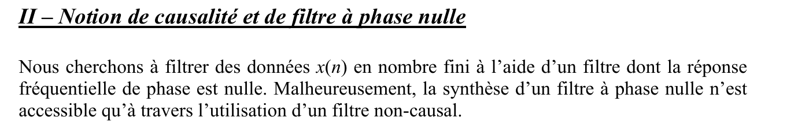{fig-alt="II – Notion de causalité et de filtre à phase nulle. Nous cherchons à filtrer des données x(n) en nombre fini à l'aide d'un filtre dont la réponse fréquentielle de phase est nulle. Malheureusement, la synthèse d'un filtre à phase nulle n'est accessible qu'à travers l'utilisation d'un filtre non-causal."}
:::

Cours associé : [causalité](../cours/02-systemes-discrets-convolution.qmd#sec-causalite), [filtre à phase linéaire](../cours/05-representation-en-phase.qmd#sec-phase-lineaire)

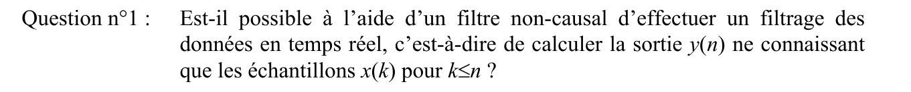{fig-alt="Question n°1 : est-il possible à l'aide d'un filtre non-causal d'effectuer un filtrage des données en temps réel, c'est-à-dire de calculer la sortie y(n) ne connaissant que les échantillons x(k) pour k ≤ n ?"}

:::: {.notes-externes}
::: {.solution}
1. Un filtre non causal calcule $y[n] = T\bigl[x[n+P], \dots, x[n-K]\bigr]$ : il utilise des échantillons **futurs** ($x[n+1], x[n+2], \dots$) en plus du présent et du passé. Le corrigé rappelle à côté la condition de temps réel : latence inférieure à $T_e$.

[corrige-2023-td01, p. 6-8]
:::
::::

::: {.complement}
- **Question 1 : non.** Si $h[k] \neq 0$ pour un $k < 0$, le calcul de $y[n] = \sum_k h[k]\, x[n-k]$ demande $x[n-k]$ avec $n - k > n$, échantillon pas encore acquis à l'instant $n$. Si $h[k] = 0$ pour $k < -D$, on peut calculer $y[n-D]$ à l'instant $n$ : traitement avec un retard de $D$ échantillons, mais pas en temps réel au sens strict. D'où le traitement **hors ligne**, sur des données stockées. Voir la [causalité au chapitre 2](../cours/02-systemes-discrets-convolution.qmd#sec-causalite).
:::

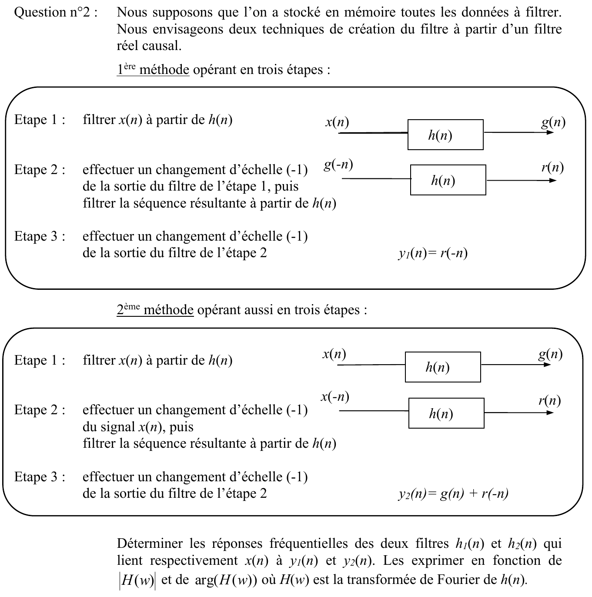{fig-alt="Question n°2 : nous supposons que l'on a stocké en mémoire toutes les données à filtrer. Nous envisageons deux techniques de création du filtre à partir d'un filtre réel causal. 1re méthode opérant en trois étapes : étape 1, filtrer x(n) à partir de h(n) (x(n) → h(n) → g(n)) ; étape 2, effectuer un changement d'échelle (−1) g(−n) de la sortie du filtre de l'étape 1, puis filtrer la séquence résultante à partir de h(n) (g(−n) → h(n) → r(n)) ; étape 3, effectuer un changement d'échelle (−1) de la sortie du filtre de l'étape 2 : y1(n) = r(−n). 2e méthode opérant aussi en trois étapes : étape 1, filtrer x(n) à partir de h(n) (x(n) → h(n) → g(n)) ; étape 2, effectuer un changement d'échelle (−1) du signal x(n), puis filtrer la séquence résultante à partir de h(n) (x(−n) → h(n) → r(n)) ; étape 3, effectuer un changement d'échelle (−1) de la sortie du filtre de l'étape 2 : y2(n) = g(n) + r(−n). Déterminer les réponses fréquentielles des deux filtres h1(n) et h2(n) qui lient respectivement x(n) à y1(n) et y2(n). Les exprimer en fonction de |H(w)| et de arg(H(w)) où H(w) est la transformée de Fourier de h(n)."}

:::: {.notes-externes}
::: {.solution}
Contexte : $H(f) = \sum_n h[n]\, e^{-j2\pi f n} = |H(f)|\, e^{j\operatorname{Arg}(H(f))}$.

2. **Méthode 1.** $y_1[n] = r[-n] = h[-n] \star g[n] = h[-n] \star \bigl(h[n] \star x[n]\bigr) = \bigl(h[-n] \star h[n]\bigr) \star x[n]$, donc
$$
h_1[n] = h[-n] \star h[n] \quad \text{(non causal)}.
$$
Or $\sum_n h[-n]\, e^{-j2\pi f n} = \sum_n h[n]\, e^{j2\pi f n} = H(-f) = H^*(f)$ puisque $h$ est réelle, d'où
$$
H_1(f) = H^*(f)\, H(f) = |H(f)|^2.
$$
**Méthode 2.** $y_2[n] = h[n] \star x[n] + h[-n] \star x[n] = \bigl(h[n] + h[-n]\bigr) \star x[n]$ : $h_2[n] = h[n] + h[-n]$, non causal (association en parallèle), et
$$
H_2(f) = H(f) + H^*(f) = 2\,|H(f)| \cos\bigl(\operatorname{Arg}(H(f))\bigr) :
$$
il ne conserve pas le même profil que le filtre initial.

[corrige-2023-td01, p. 6-8]
:::
::::

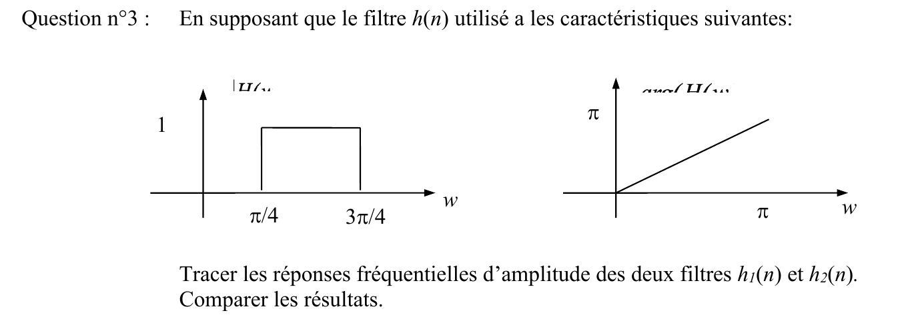{fig-alt="Question n°3 : en supposant que le filtre h(n) utilisé a les caractéristiques suivantes (deux graphes ; les étiquettes des axes verticaux, |H(w)| et arg(H(w)), sont tronquées dans le recueil) : module égal à 1 pour π/4 ≤ w ≤ 3π/4 et nul ailleurs ; phase en droite, de 0 en w = 0 à π en w = π. Tracer les réponses fréquentielles d'amplitude des deux filtres h1(n) et h2(n). Comparer les résultats."}

:::: {.notes-externes}
::: {.solution}
3. $\omega = 2\pi f$ : pour $f \in [-\frac{f_e}{2}, \frac{f_e}{2}]$, $\omega \in [-\pi, \pi]$ (fréquence normalisée $[-\frac12, \frac12]$). $|H_1(\omega)|$ est le même rectangle que $|H(\omega)|$ entre $\frac{\pi}{4}$ et $\frac{3\pi}{4}$ : « rien ne change pour $H_1$ ». $|H_2(\omega)|$ est nul hors de $[\frac{\pi}{4}, \frac{3\pi}{4}]$ et, dans cette bande, part de sa valeur maximale en $\frac{\pi}{4}$, s'annule en $\frac{\pi}{2}$ et remonte en $\frac{3\pi}{4}$.

[corrige-2023-td01, p. 6-8]
:::
::::

::: {.complement}
- **Question 3, valeurs.** $\operatorname{Arg}(H(\omega)) = \omega$, donc $|H_2(\omega)| = 2\,|\cos\omega|$ dans la bande : $\sqrt2 \approx 1{,}41$ en $\frac{\pi}{4}$ et $\frac{3\pi}{4}$, $0$ en $\frac{\pi}{2}$. $H_2$ est réelle mais change de signe en $\frac{\pi}{2}$ : phase $0$ sur $[\frac{\pi}{4}, \frac{\pi}{2}[$ et $\pi$ sur $]\frac{\pi}{2}, \frac{3\pi}{4}]$. $H_1 = |H|^2 \geq 0$ est réelle positive : **phase rigoureusement nulle**, et module identique ici ($|H|^2 = |H|$ puisque $|H|$ vaut 0 ou 1).
- **Comparaison.** La méthode 1 (filtrer, retourner, refiltrer, retourner) donne un vrai filtre à phase nulle de module $|H|^2$ ; la méthode 2 ne donne la bonne amplitude que là où la phase de $h$ est proche de 0 ($\cos \approx 1$), et déforme fortement la bande passante dès que la phase tourne.
:::

## Exercice 5 : propriétés d'un filtre RIF {#sec-td01-ex5}

::: {#exr-td-rif-proprietes}
## Propriétés d'un filtre RIF

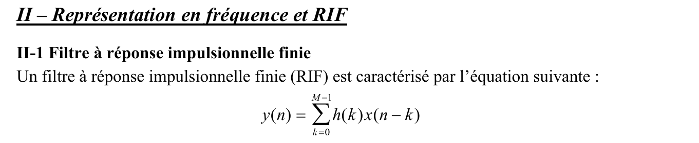{fig-alt="II – Représentation en fréquence et RIF. II-1 Filtre à réponse impulsionnelle finie : un filtre à réponse impulsionnelle finie (RIF) est caractérisé par l'équation suivante : y(n) = Σ h(k) x(n − k), somme de k = 0 à M − 1."}
:::

Cours associé : [stabilité](../cours/02-systemes-discrets-convolution.qmd#sec-stabilite-sli), [causalité](../cours/02-systemes-discrets-convolution.qmd#sec-causalite)

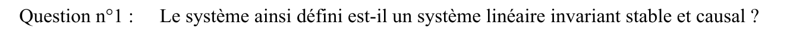{fig-alt="Question n°1 : le système ainsi défini est-il un système linéaire invariant stable et causal ?"}

:::: {.notes-externes}
::: {.solution}
Oui pour les quatre propriétés [corrige-2023-td01, p. 8-9] :

- **linéarité** : $\sum_k h[k]\,\bigl(a_1 x_1[n-k] + a_2 x_2[n-k]\bigr) = a_1 T[x_1] + a_2 T[x_2]$ ;
- **invariance** : $y[n] = h[0]\,x[n] + h[1]\,x[n-1] + \dots$ se réalise par une chaîne de retards $z^{-1}$ et de coefficients $h[k]$ fixes, qui ne dépendent pas de $n$ ;
- **stabilité** : $h[n] = h[0]\,\delta[n] + h[1]\,\delta[n-1] + \dots + h[M-1]\,\delta[n-M+1]$ est finie, donc $\sum_n |h[n]| \leq M_h < \infty$ ([condition de stabilité](../cours/02-systemes-discrets-convolution.qmd#eq-cns-stabilite)) ;
- **causalité** : $k$ va de $0$ à $M-1$, la sortie n'utilise que les entrées présente et passées.
:::
::::

## Exercice 6 : réponse en fréquence de $y[n] = x[n] - x[n-4]$ {#sec-td01-ex6}

::: {#exr-td-rif-retard-quatre}
## Réponse en fréquence de $y[n] = x[n] - x[n-4]$

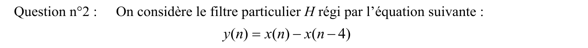{fig-alt="Question n°2 (partie II-1) : on considère le filtre particulier H régi par l'équation suivante : y(n) = x(n) − x(n − 4)."}
:::

Cours associé : [réponse en fréquence](../cours/03-tfd-interpretation-frequentielle.qmd#sec-reponse-frequence), [réponse à une sinusoïde](../cours/03-tfd-interpretation-frequentielle.qmd#sec-reponse-sinusoide)

{fig-alt="❷-a : calculer et tracer la réponse fréquentielle (module et phase) de la réponse impulsionnelle dans la gamme de fréquence −fe/2 ≤ f ≤ fe/2."}

:::: {.notes-externes}
::: {.solution}
On travaille en fréquence normalisée ($f \in [-\frac12, \frac12]$).

a. Par le théorème du retard ([cours](../cours/03-tfd-interpretation-frequentielle.qmd#eq-retard-tfsd)), $Y(f) = X(f) - e^{-j8\pi f} X(f)$, d'où

$$
H(f) = 1 - e^{-j8\pi f} = e^{-j4\pi f}\bigl(e^{j4\pi f} - e^{-j4\pi f}\bigr) = 2j\, e^{-j4\pi f} \sin(4\pi f),
\qquad |H(f)| = 2\,|\sin(4\pi f)|.
$$

Le module, tracé sur $[-\frac12, \frac12]$, est formé de quatre arches de hauteur 2.

[corrige-2023-td01, p. 9-11]
:::
::::

::: {.a-verifier #av-td-retard-quatre-ecriture}
**Source** [corrige-2023-td01, p. 9] : « $Y(f) = X(f) - e^{-8j\pi f} X(f)$ », puis à la ligne suivante « $X(f) = X(f)\,(1 - e^{-j8\pi f})$ ».

**Problème** : le premier membre de la seconde ligne est $Y(f)$ ; telle qu'écrite, l'égalité imposerait $X(f) = 0$ là où $e^{-j8\pi f} \neq 1$.

**Proposition** : $Y(f) = X(f)\,(1 - e^{-j8\pi f})$, d'où $H(f) = 1 - e^{-j8\pi f}$ (forme retenue dans la solution ci-dessus).
:::

::: {.complement}
- **Zéros et maxima** : $|H(f)|$ s'annule en $f = 0, \pm\frac14, \pm\frac12$ et vaut 2 en $f = \pm\frac18, \pm\frac38$ (filtre « en peigne »).
- **Phase** (non tracée dans le corrigé) : $\operatorname{Arg}(H(f)) = \frac{\pi}{2} - 4\pi f$ là où $\sin(4\pi f) > 0$, et $-\frac{\pi}{2} - 4\pi f$ là où $\sin(4\pi f) < 0$ (modulo $2\pi$). Elle est linéaire par morceaux, de pente $-4\pi$ (retard de 2 échantillons, voir le [chapitre 5](../cours/05-representation-en-phase.qmd#sec-phase-lineaire)), avec des sauts de $\pi$ aux zéros de $|H|$.
:::

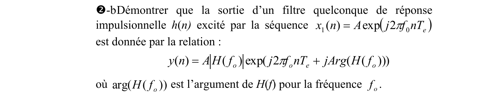{fig-alt="❷-b : démontrer que la sortie d'un filtre quelconque de réponse impulsionnelle h(n) excité par la séquence x1(n) = A exp(j2πf0nTe) est donnée par la relation y(n) = A|H(f0)| exp(j2πf0nTe + jArg(H(f0))), où arg(H(f0)) est l'argument de H(f) pour la fréquence f0."}

:::: {.notes-externes}
::: {.solution}
b. $y[n] = \sum_{k=0}^{M-1} h[k]\, A\, e^{j2\pi f_0 (n-k)} = A\, e^{j2\pi f_0 n} \sum_{k} h[k]\, e^{-j2\pi f_0 k} = A\, e^{j2\pi f_0 n}\, H(f_0)$ : la somme est l'expression de la TF évaluée en $f_0$. D'où $y[n] = A\,|H(f_0)|\, e^{j2\pi f_0 n + j\operatorname{Arg}(H(f_0))}$. Pour $x[n] = A\cos(2\pi f_0 n)$, on prend la partie réelle : $y[n] = A\,|H(f_0)|\cos\bigl(2\pi f_0 n + \operatorname{Arg}(H(f_0))\bigr)$ ; pour une somme $\sum_i a_i \cos(2\pi f_i n)$, $y[n] = \sum_i a_i\,|H(f_i)|\cos\bigl(2\pi f_i n + \operatorname{Arg}(H(f_i))\bigr)$.

[corrige-2023-td01, p. 9-11]
:::
::::

::: {.complement}
- Le passage à la partie réelle en b suppose $h[n]$ **réelle** : alors $H(-f_0) = H^*(f_0)$ et les deux exponentielles de $\cos$ donnent des sorties conjuguées.
:::

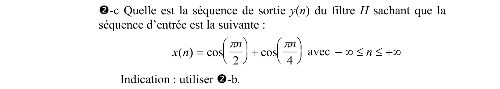{fig-alt="❷-c : quelle est la séquence de sortie y(n) du filtre H sachant que la séquence d'entrée est la suivante : x(n) = cos(πn/2) + cos(πn/4) avec −∞ ≤ n ≤ +∞ ? Indication : utiliser ❷-b."}

:::: {.notes-externes}
::: {.solution}
c. $2\pi f_0 n = \frac{\pi n}{2}$ donne $f_0 = \frac14$ et $2\pi f_1 n = \frac{\pi n}{4}$ donne $f_1 = \frac18$. $H(f_0) = 2j\,e^{-j\pi}\sin(\pi) = 0$ ; $H(f_1) = 2j\,e^{-j\pi/2}\sin(\frac{\pi}{2}) = 2$, soit $|H(f_1)| = 2$ et $\operatorname{Arg}(H(f_1)) = 0$. Finalement

$$
y[n] = 2\cos\Bigl(\frac{\pi n}{4}\Bigr).
$$

[corrige-2023-td01, p. 9-11]
:::
::::

::: {.complement}
- **Contrôle direct de c** : $\cos\bigl(\frac{\pi(n-4)}{2}\bigr) = \cos\bigl(\frac{\pi n}{2} - 2\pi\bigr) = \cos\bigl(\frac{\pi n}{2}\bigr)$ et $\cos\bigl(\frac{\pi(n-4)}{4}\bigr) = -\cos\bigl(\frac{\pi n}{4}\bigr)$ ; donc $y[n] = 2\cos\bigl(\frac{\pi n}{4}\bigr)$.
:::

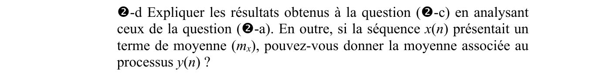{fig-alt="❷-d : expliquer les résultats obtenus à la question (❷-c) en analysant ceux de la question (❷-a). En outre, si la séquence x(n) présentait un terme de moyenne (mx), pouvez-vous donner la moyenne associée au processus y(n) ?"}

:::: {.notes-externes}
::: {.solution}
d. $f_0 = \frac14$ tombe sur un zéro de $|H|$ : la composante est éliminée ; $f_1 = \frac18$ tombe sur un maximum (gain 2, phase nulle). La moyenne est la composante à $f = 0$, où $H(0) = 0$ : $m_y = 0$.

[corrige-2023-td01, p. 9-11]
:::
::::

::: {.complement}
- Moyenne : directement, $\E\{y[n]\} = m_x - m_x = 0$.
:::

## Exercice 7 : filtres en quadrature {#sec-td01-ex7}

::: {#exr-td-filtres-quadrature}
## Filtres en quadrature

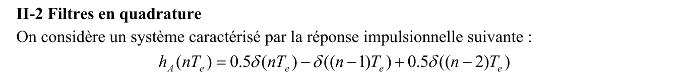{fig-alt="II-2 Filtres en quadrature : on considère un système caractérisé par la réponse impulsionnelle suivante : hA(nTe) = 0.5δ(nTe) − δ((n − 1)Te) + 0.5δ((n − 2)Te)."}
:::

Cours associé : [réponse en fréquence](../cours/03-tfd-interpretation-frequentielle.qmd#sec-reponse-frequence), [fréquence normalisée](../cours/03-tfd-interpretation-frequentielle.qmd#sec-frequence-normalisee)

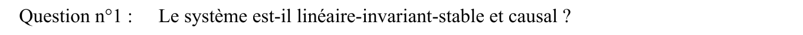{fig-alt="Question n°1 : le système est-il linéaire-invariant-stable et causal ?"}

:::: {.notes-externes}
::: {.solution}
1. Causal : n'utilise que des éléments du passé et du présent ; stable : réponse impulsionnelle finie.

[corrige-2023-td01, p. 11-12]
:::
::::

::: {.complement}
- Linéarité et invariance (question 1) : c'est un RIF, voir l'[exercice 5](#exr-td-rif-proprietes).
:::

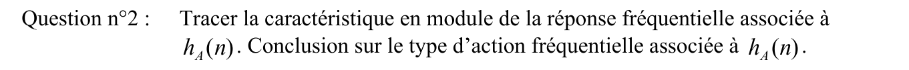{fig-alt="Question n°2 : tracer la caractéristique en module de la réponse fréquentielle associée à hA(n). Conclusion sur le type d'action fréquentielle associée à hA(n)."}

:::: {.notes-externes}
::: {.solution}
2. $$
H_A(f) = 0{,}5 - e^{-j2\pi f} + 0{,}5\, e^{-j4\pi f} = e^{-j2\pi f}\bigl(0{,}5\, e^{j2\pi f} - 1 + 0{,}5\, e^{-j2\pi f}\bigr) = e^{-j2\pi f}\bigl(\cos(2\pi f) - 1\bigr).
$$
Le module est maximal en $f = \pm\frac12$ : **passe-haut** (courbe « PH » du corrigé, tracée avec la courbe « PB » de $H_C$).

[corrige-2023-td01, p. 11-12]
:::
::::

::: {.a-verifier #av-td-quadrature-minimum}
**Source** [corrige-2023-td01, p. 12] : graphe de $|H_A(f)|$ (courbe noire « PH ») dont le minimum, en $f = 0$, est nettement au-dessus de l'axe.

**Problème** : $|H_A(0)| = |0{,}5 - 1 + 0{,}5| = 0$ ; le croquis laisse croire qu'un filtre passe-haut laisse passer une part de la composante continue.

**Proposition** : $|H_A(f)| = 1 - \cos(2\pi f) = 2\sin^2(\pi f)$, nul en $f = 0$, égal à 2 en $f = \pm\frac12$.
:::

::: {.complement}
- $H_A(f) = -2\sin^2(\pi f)\, e^{-j2\pi f}$ : phase linéaire $\pi - 2\pi f$ (réponse impulsionnelle symétrique, retard d'un échantillon).
:::

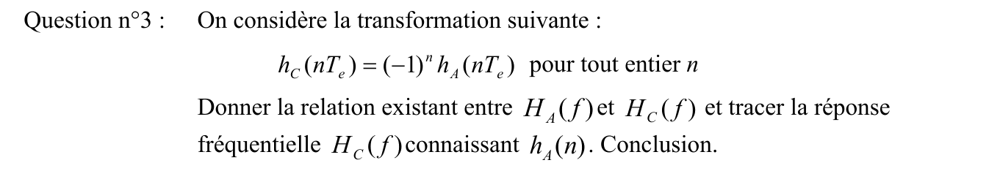{fig-alt="Question n°3 : on considère la transformation suivante : hC(nTe) = (−1)^n hA(nTe) pour tout entier n. Donner la relation existant entre HA(f) et HC(f) et tracer la réponse fréquentielle HC(f) connaissant hA(n). Conclusion."}

:::: {.notes-externes}
::: {.solution}
3. $$
H_C(f) = \sum_n h_A[n]\,(-1)^n e^{-j2\pi f n} = \sum_n h_A[n]\, e^{j\pi n}\, e^{-j2\pi f n} = \sum_n h_A[n]\, e^{-j2\pi (f - \frac12) n} = H_A\Bigl(f - \frac12\Bigr).
$$
$H_C$ est le **passe-bas** obtenu en décalant $H_A$ de $\frac12$. Les deux branches se calculent avec les mêmes coefficients : $x_\mathrm{PH}[n] = h_A[0]\,x[n] + h_A[1]\,x[n-1] + \dots$ et $x_\mathrm{PB}[n] = h_A[0]\,x[n] - h_A[1]\,x[n-1] + \dots$

[corrige-2023-td01, p. 11-12]
:::
::::

::: {.complement}
- $h_C[n] = 0{,}5\,\delta[n] + \delta[n-1] + 0{,}5\,\delta[n-2]$ et $|H_C(f)| = 1 + \cos(2\pi f) = 2\cos^2(\pi f)$ : 2 en $f = 0$, nul en $f = \pm\frac12$ ($\pm f_e/2$).
- Conclusion : multiplier $h[n]$ par $(-1)^n = e^{j\pi n}$ décale la réponse en fréquence de $\frac12$ ($f_e/2$) et transforme un passe-bas en passe-haut et inversement. Les deux modules sont symétriques par rapport à $f = \frac14$ et $|H_A(f)| + |H_C(f)| = 2$ : ils se partagent la bande en deux moitiés complémentaires, d'où le nom de filtres en quadrature (filtres miroirs).
:::

## Exercice 8 : identification des coefficients d'un RIF symétrique {#sec-td01-ex8}

::: {#exr-td-gabarit-rif-symetrique}
## Identification des coefficients d'un RIF symétrique

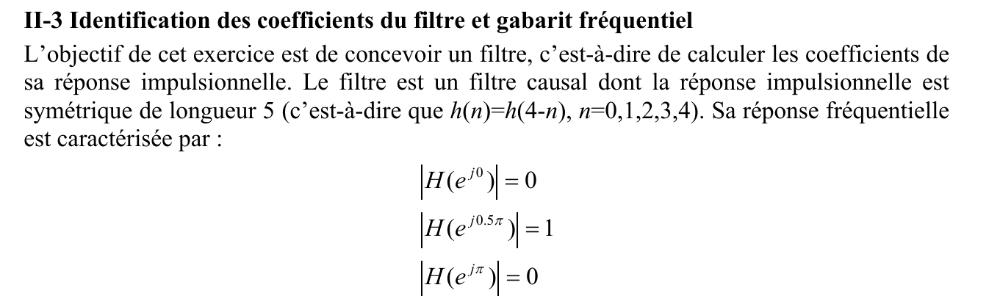{fig-alt="II-3 Identification des coefficients du filtre et gabarit fréquentiel. L'objectif de cet exercice est de concevoir un filtre, c'est-à-dire de calculer les coefficients de sa réponse impulsionnelle. Le filtre est un filtre causal dont la réponse impulsionnelle est symétrique de longueur 5 (c'est-à-dire que h(n) = h(4 − n), n = 0, 1, 2, 3, 4). Sa réponse fréquentielle est caractérisée par : |H(e^j0)| = 0, |H(e^j0.5π)| = 1, |H(e^jπ)| = 0 (conditions écrites avec des barres de module)."}
:::

Cours associé : [filtre à phase linéaire](../cours/05-representation-en-phase.qmd#sec-phase-lineaire)

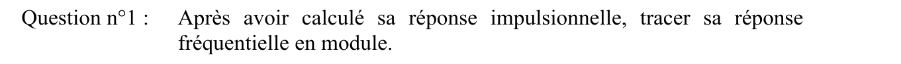{fig-alt="Question n°1 : après avoir calculé sa réponse impulsionnelle, tracer sa réponse fréquentielle en module."}

:::: {.notes-externes}
::: {.solution}
Le gabarit fréquentiel permet de déduire la forme de $h[n]$ ; $h[n] = h[4-n]$ fixe la profondeur du filtre, $M = 5$. Le corrigé écrit les conditions sur le module : $|H(e^{j0})| = 0$, $|H(e^{j0{,}5\pi})| = 1$, $|H(e^{j\pi})| = 0$.

En pulsation normalisée, $H(\omega) = \sum_{n=0}^{4} h[n]\, e^{-j\omega n}$, avec $h[0] = h[4]$ et $h[1] = h[3]$ :
$$
H(\omega) = h[0]\bigl[1 + e^{-j4\omega}\bigr] + h[1]\bigl[e^{-j\omega} + e^{-j3\omega}\bigr] + h[2]\, e^{-j2\omega}
= e^{-j2\omega}\bigl[2h[0]\cos(2\omega) + 2h[1]\cos(\omega) + h[2]\bigr].
$$
D'où le système
$$
\begin{aligned}
\omega = 0 &: \quad 2h[0] + 2h[1] + h[2] = 0 \quad (1)\\
\omega = \tfrac{\pi}{2} &: \quad -2h[0] + h[2] = \pm 1 \quad (2)\\
\omega = \pi &: \quad 2h[0] - 2h[1] + h[2] = 0 \quad (3)
\end{aligned}
$$
(1) $-$ (3) donne $h[1] = 0$ ; puis le corrigé conclut $h[2] = \pm\frac12$ et $h[0] = \pm\frac14$.

[corrige-2023-td01, p. 13]
:::
::::

::: {.a-verifier #av-td-gabarit-signes}
**Source** [corrige-2023-td01, p. 13] : « $h(1) = 0$, $h(2) = \pm\frac12$, $h(0) = \pm\frac14$ » ; plus haut, « $H(\omega) = h(0)[1 + e^{-j4\omega}] + h(1)[-e^{-j\omega} + e^{-j3\omega}] + h(2)e^{-j2\omega}$ » (signe moins devant $e^{-j\omega}$, lecture probable), suivi de « $= e^{-j2\omega}[2h(0)\cos(2\omega) + h(1)2\cos(\omega) + h(2)]$ ».

**Problème** : (a) avec $h[1] = h[3]$, le terme est $h[1]\bigl[e^{-j\omega} + e^{-j3\omega}\bigr]$ ; le signe moins est incompatible avec la ligne suivante, qui est juste (la solution ci-dessus écrit le signe $+$). (b) Les deux signes sont liés. (1) $+$ (3) donne $h[2] = -2h[0]$ : $h[0]$ et $h[2]$ sont de **signes opposés**. Avec $h[0] = \frac14$ et $h[2] = \frac12$ (mêmes signes), on aurait $H(e^{j0}) = 1 \neq 0$. De plus, l'énoncé impose $H(e^{j0{,}5\pi}) = 1$ (valeur complexe, sans module) : $e^{-j\pi}\bigl(-2h[0] + h[2]\bigr) = 1$, soit $-2h[0] + h[2] = -1$, ce qui lève l'ambiguïté.

**Proposition** : $h[1]\bigl[e^{-j\omega} + e^{-j3\omega}\bigr]$ ; $h[0] = h[4] = \frac14$, $h[1] = h[3] = 0$, $h[2] = -\frac12$ (solution unique de l'énoncé, vérifiée par calcul symbolique) ; si l'on n'impose que le module, la solution opposée $\bigl(-\frac14, 0, \frac12, 0, -\frac14\bigr)$ convient aussi.
:::

::: {.complement}
Avec $h = \bigl(\frac14, 0, -\frac12, 0, \frac14\bigr)$ : $2h[0]\cos(2\omega) + h[2] = \frac12\cos(2\omega) - \frac12 = -\sin^2\omega$, d'où
$$
H(\omega) = -\sin^2(\omega)\, e^{-j2\omega}, \qquad |H(\omega)| = \sin^2\omega = \sin^2(2\pi f).
$$
Le module vaut 0 en $f = 0$ et $f = \pm\frac12$, et 1 en $f = \pm\frac14$ ($\pm\frac{f_e}{4}$) : **passe-bande** centré sur $\frac{f_e}{4}$, peu sélectif. La symétrie $h[n] = h[4-n]$ donne une phase linéaire ([RIF symétrique](../cours/05-representation-en-phase.qmd#eq-rif-symetrique)) : retard de groupe de 2 échantillons ($D = M/2$ avec ici $M = 4$ au sens de [RIF symétrique](../cours/05-representation-en-phase.qmd#eq-rif-symetrique)).
:::

::: {.complement}
Remarque ajoutée au découpage de l'énoncé (31 octobre 2026) : dans le recueil, les trois conditions sont écrites **avec des barres de module**, $|H(e^{j0})| = 0$, $|H(e^{j0{,}5\pi})| = 1$, $|H(e^{j\pi})| = 0$ (image ci-dessus) ; la transcription en texte du recueil les avait perdues. Le point (b) du [bloc sur les signes](#av-td-gabarit-signes), qui s'appuie sur une condition sans module pour lever l'ambiguïté, est donc à relire : si seul le module est imposé, les deux solutions opposées $\bigl(\frac14, 0, -\frac12, 0, \frac14\bigr)$ et $\bigl(-\frac14, 0, \frac12, 0, -\frac14\bigr)$ conviennent, comme l'indique la fin de ce bloc.
:::
