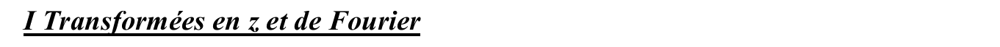
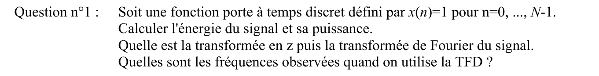
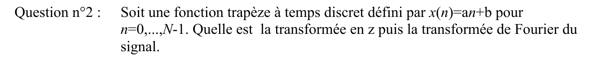
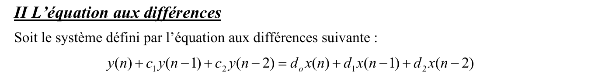
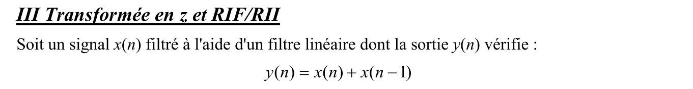
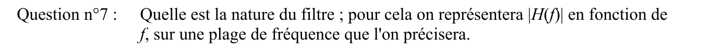
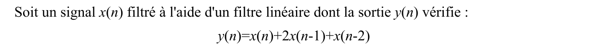
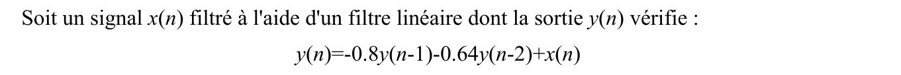



::: {.complement}
Énoncé découpé question par question [td, p. 7-8] ; sous chaque question, dans cet ordre : le corrigé manuscrit d'un ancien élève (*Notes externes*, [corrige-2023-td02]), puis les explications et contrôles ajoutés par Claude (*Complément*). Il n'y a pas de notes d'Armand sur ce TD. Les blocs *À vérifier* signalent des erreurs du corrigé de 2023 : ils restent **ouverts** tant qu'Armand ne les a pas tranchés.

La partie III du recueil enchaîne quatre filtres : ici un exercice par filtre (exercices 3 à 6 ; questions 1 à 7, puis 8, 9 et 10 du recueil). Le tableau de définitions et le formulaire de l'annexe du recueil sont repris dans la [page du TD 3](td03-placement-poles-zeros-rii.qmd#sec-td03-annexe). Les corrections étaient auparavant dans le [chapitre 4](../cours/04-implementation-equations-differences.qmd#sec-exercices-td-ch04).
:::

## Exercice 1 : porte et trapèze, transformées en $z$ et de Fourier {#sec-td02-ex1}

::: {#exr-td-porte-trapeze}
## Porte et trapèze : énergie, transformées en $z$ et de Fourier

{fig-alt="I Transformées en z et de Fourier."}
:::

Cours associé : [transformée en $z$](../cours/04-implementation-equations-differences.qmd#sec-transformee-z), [TFD](../cours/03-tfd-interpretation-frequentielle.qmd#sec-tfd)

{fig-alt="Question n°1 : soit une fonction porte à temps discret défini par x(n) = 1 pour n = 0, ..., N − 1. Calculer l'énergie du signal et sa puissance. Quelle est la transformée en z puis la transformée de Fourier du signal. Quelles sont les fréquences observées quand on utilise la TFD ?"}

:::: {.notes-externes}
::: {.solution}
1. Énergie et puissance :
$$
E = \sum_{n=-\infty}^{+\infty} x^2[n] = N, \qquad P = \lim_{M \to \infty} \frac{1}{2M+1} \sum_{n=-M}^{M} x^2[n] = 0.
$$
Transformée en $z$ :
$$
X(z) = \sum_{n=0}^{N-1} z^{-n} = \frac{1 - z^{-N}}{1 - z^{-1}}.
$$
Transformée de Fourier ($f$ variable continue, fréquence normalisée, $f \in [-\frac12, \frac12]$), avec $z = e^{j2\pi f}$ :
$$
X(f) = \frac{1 - e^{-j2\pi f N}}{1 - e^{-j2\pi f}}.
$$
La TFD (« algorithme ») calcule cette TF en des fréquences $f = k\,\Delta f$ ; le corrigé trace des échantillons sur la courbe de $|X(f)|$ (voir le bloc *À vérifier* ci-dessous).

[corrige-2023-td02, p. 1-2]
:::
::::

::: {.a-verifier #av-td-tfd-porte}
**Source** [corrige-2023-td02, p. 2] : « $X(k) = \sum_{n=0}^{M-1} x(n)\, e^{-j2\pi\frac{kn}{N}}$ », « $f = k\,\Delta f$ », « $\Delta f = \frac{1}{M}$ », puis un tracé de la TFSD de la porte où les échantillons de la TFD (en rouge) tombent sur des valeurs **non nulles** du lobe principal et des lobes secondaires.

**Problème** : $M$ et $N$ sont intervertis entre la borne de la somme et l'exposant, et le pas $\Delta f = \frac1M$ ne correspond pas à l'exposant $\frac{kn}{N}$. Surtout, avec une TFD sur $N$ points d'une porte de $N$ échantillons, les fréquences observées $f_k = \frac{k}{N}$ tombent **exactement sur les zéros** de $X(f)$ (sauf $k = 0$) : $X[k] = N$ si $k = 0$, $0$ sinon. Les échantillons dessinés ne correspondent qu'à une TFD sur $M > N$ points (complément par des zéros).

**Proposition** : avec les notations du [chapitre 3](../cours/03-tfd-interpretation-frequentielle.qmd#eq-tfd), $X[k] = \sum_{n=0}^{N-1} x[n]\, e^{-j2\pi kn/M}$, fréquences observées $f_k = \frac{k}{M}$ ($k f_e/M$ en hertz). Pour $M = N$ : $X[k] = N\,\delta[k]$ ; pour $M > N$ : échantillons de la courbe $|X(f)|$, comme sur le tracé.
:::

::: {.complement}
**Question 1.**

- TF sous forme réelle : $X(f) = \dfrac{e^{-j\pi f N}\,(e^{j\pi f N} - e^{-j\pi f N})}{e^{-j\pi f}\,(e^{j\pi f} - e^{-j\pi f})} = e^{-j\pi f (N-1)}\, \dfrac{\sin(\pi N f)}{\sin(\pi f)}$. Module $N$ en $f = 0$, zéros en $f = \frac{k}{N}$, $k \neq 0$ (modulo 1) ; phase linéaire (retard $\frac{N-1}{2}$).
- Puissance nulle : signal d'énergie finie, $\frac{N}{2M+1} \to 0$.
:::

{fig-alt="Question n°2 : soit une fonction trapèze à temps discret défini par x(n) = an + b pour n = 0, ..., N − 1. Quelle est la transformée en z puis la transformée de Fourier du signal."}

:::: {.notes-externes}
::: {.solution}
2. et 3. Le corrigé dessine un trapèze symétrique $y_1[n] = (x_1 \star x_2)[n]$, convolution de deux portes $x_1$ et $x_2$ de largeurs différentes, et en déduit $Y_1(z) = X_1(z)\,X_2(z)$ (voir le second bloc *À vérifier*).

[corrige-2023-td02, p. 1-2]
:::
::::

::: {.a-verifier #av-td-trapeze-interpretation}
**Source** [corrige-2023-td02, p. 2] : pour les questions 2 et 3, tracé d'un trapèze symétrique « $y_1(n) = x_1(n) \star x_2(n) \Rightarrow Y_1(z) = X_1(z) \times X_2(z)$ ».

**Problème** : l'énoncé [td, p. 7] définit le « trapèze » par $x[n] = an + b$ pour $n = 0, \dots, N-1$ (une rampe posée sur un palier), et non par la convolution de deux portes. Le corrigé traite un autre signal ; il ne donne ni la transformée en $z$ ni la TF de $an + b$.

**Proposition** : solution pour $x[n] = an + b$ dans le complément ci-dessous ; la lecture du corrigé (trapèze symétrique) y est traitée aussi.
:::

::: {.complement}
**Question 2** ($x[n] = an + b$, $0 \leq n \leq N-1$). Avec $\sum_{n=0}^{N-1} n\, z^{-n} = -z\, \dfrac{\mathrm{d}}{\mathrm{d}z} \sum_{n=0}^{N-1} z^{-n}$ :

$$
X(z) = b\, \frac{1 - z^{-N}}{1 - z^{-1}} + a\, \frac{z^{-1}\bigl(1 - N z^{-(N-1)} + (N-1)\, z^{-N}\bigr)}{(1 - z^{-1})^2},
$$

et la TF s'obtient en posant $z = e^{j2\pi f}$ (le cercle unité appartient à la zone de convergence : signal de durée finie). Formule vérifiée par calcul symbolique pour $N = 3, 5, 7$.
:::

{fig-alt="Question n°3 : y a-t-il un lien entre les deux transformées en z obtenues ?"}

::: {.complement}
**Question 3.** En notant $X_\Pi(z) = \dfrac{1 - z^{-N}}{1 - z^{-1}}$ la transformée de la porte :

$$
X_\mathrm{trap}(z) = b\, X_\Pi(z) - a\, z\, \frac{\mathrm{d}X_\Pi(z)}{\mathrm{d}z},
$$

par la propriété $n\,x[n] \longleftrightarrow -z\, \dfrac{\mathrm{d}X(z)}{\mathrm{d}z}$. Avec la lecture du corrigé (trapèze symétrique, convolution de deux portes de longueurs $N_1$ et $N_2$), le lien est un produit : $Y_1(z) = \dfrac{(1 - z^{-N_1})(1 - z^{-N_2})}{(1 - z^{-1})^2}$.
:::

## Exercice 2 : équation aux différences d'ordre 2 {#sec-td02-ex2}

::: {#exr-td-equation-differences-ordre-2}
## Équation aux différences d'ordre 2

{fig-alt="II L'équation aux différences : soit le système défini par l'équation aux différences suivante : y(n) + c1 y(n − 1) + c2 y(n − 2) = d0 x(n) + d1 x(n − 1) + d2 x(n − 2)."}
:::

Cours associé : [équations aux différences](../cours/04-implementation-equations-differences.qmd#sec-equations-differences), [pôles et zéros](../cours/04-implementation-equations-differences.qmd#sec-poles-zeros)

{fig-alt="Question : étudier les fonctions de transfert obtenues pour : c1 = c2 = 0, d0 = 1, d1 = −0.5, d2 = 0.125 ; c1 = −0.94, c2 = 0.5, d0 = 1, d1 = d2 = 0."}

:::: {.notes-externes}
::: {.solution}
Rappel du corrigé : l'équation $\sum_{k=0}^{K-1} c_k\, y[n-k] = \sum_{l=0}^{L-1} d_l\, x[n-l]$ décrit un RII causal, de fonction de transfert $H(z) = \dfrac{\sum_l d_l z^{-l}}{\sum_k c_k z^{-k}} = \dfrac{N(z)}{D(z)}$ (zéros : racines de $N$ ; pôles : racines de $D$) ; stabilité : pôles dans le disque unité.

- **Premier cas** : $y[n] = x[n] - 0{,}5\,x[n-1] + 0{,}125\,x[n-2]$ ne dépend que de $x$ : RIF, stable, causal.
- **Second cas** : $y[n] = 0{,}94\,y[n-1] - 0{,}5\,y[n-2] + x[n]$ : RII, causal. Par transformée en $z$,
$$
Y(z) - 0{,}94\, z^{-1}\, Y(z) + 0{,}5\, z^{-2}\, Y(z) = X(z), \qquad H(z) = \frac{1}{1 - 0{,}94\, z^{-1} + 0{,}5\, z^{-2}} = \frac{z^2}{z^2 - 0{,}94\, z + 0{,}5}.
$$
Pôles $p_{1,2} = 0{,}47 \pm j\,0{,}53$, à l'intérieur du cercle unité (diagramme) : stable.

[corrige-2023-td02, p. 1-3]
:::
::::

::: {.a-verifier #av-td-discriminant-stabilite}
**Source** [corrige-2023-td02, p. 3] : « $\Delta = -1{,}1 < 0$ donc instable », puis, après le calcul des pôles $0{,}47 \pm j\,0{,}53$ et le diagramme, « $\Rightarrow$ stable ».

**Problème** : le signe du discriminant indique seulement que les pôles sont complexes conjugués ; il ne dit rien de la stabilité. Les deux conclusions se contredisent ; la bonne est la seconde, $|p_{1,2}| = \sqrt{0{,}5} \approx 0{,}707 < 1$.

**Proposition** : « $\Delta = 0{,}94^2 - 4 \times 0{,}5 \approx -1{,}12 < 0$ donc pôles complexes conjugués ; $|p_{1,2}|^2 = 0{,}5 < 1$ donc stable ».
:::

::: {.complement}
**Premier cas.** $H(z) = 1 - 0{,}5\,z^{-1} + 0{,}125\,z^{-2} = \dfrac{z^2 - 0{,}5\,z + 0{,}125}{z^2}$ : zéros $0{,}25 \pm j\,0{,}25$ (module $\approx 0{,}354$, dans le cercle unité : filtre à minimum de phase, voir le [chapitre 5](../cours/05-representation-en-phase.qmd#def-minimum-phase)), pôle double en $z = 0$. $|H(f)|$ croît de $0{,}625$ en $f = 0$ à $1{,}625$ en $f = \frac12$ : passe-haut peu sélectif.

**Second cas.** $|p_{1,2}| = \sqrt{c_2} = \sqrt{0{,}5}$ (produit des racines) ; arguments $\pm 0{,}268\pi$, soit $f \approx \pm 0{,}134$. Zéro double en $z = 0$. $|H(f)|$ vaut $\approx 1{,}79$ en $f = 0$, passe par un maximum $\approx 2{,}68$ ($\approx 8{,}6$ dB) vers $f \approx 0{,}125$, près de l'argument des pôles, et vaut $\approx 0{,}41$ en $f = \frac12$ : passe-bas avec une résonance.
:::

## Exercice 3 : RIF $y[n] = x[n] + x[n-1]$ {#sec-td02-ex3}

::: {#exr-td-rif-somme-deux}
## RIF $y[n] = x[n] + x[n-1]$

{fig-alt="III Transformée en z et RIF/RII : soit un signal x(n) filtré à l'aide d'un filtre linéaire dont la sortie y(n) vérifie : y(n) = x(n) + x(n − 1)."}
:::

Cours associé : [contexte : filtres RIF et RII](../cours/04-implementation-equations-differences.qmd#sec-contexte-rif-rii), [stabilité et transformée en $z$](../cours/04-implementation-equations-differences.qmd#sec-stabilite-transformee-z)

{fig-alt="Question n°1 : quelle relation vérifient l'entrée x(n) et la sortie y(n) de ce filtre ?"}

:::: {.notes-externes}
::: {.solution}
1. Une équation aux différences linéaire.

[corrige-2023-td02, p. 3]
:::
::::

{fig-alt="Question n°2 : s'agit-il d'un filtre RIF ou RII ?"}

:::: {.notes-externes}
::: {.solution}
2. RIF : dépendance en $x$ seulement ; réponse impulsionnelle $h[n] = \delta[n] + \delta[n-1]$.

[corrige-2023-td02, p. 3]
:::
::::

{fig-alt="Question n°3 : s'agit-il d'un filtre causal ?"}

:::: {.notes-externes}
::: {.solution}
3. Causal.

[corrige-2023-td02, p. 3]
:::
::::

{fig-alt="Question n°4 : donner l'expression de H(z) ?"}

:::: {.notes-externes}
::: {.solution}
4. $H(z) = 1 + z^{-1}$.

[corrige-2023-td02, p. 3]
:::
::::

{fig-alt="Question n°5 : est-il stable ?"}

:::: {.notes-externes}
::: {.solution}
5. Stable, car RIF (toujours).

[corrige-2023-td02, p. 3]
:::
::::

{fig-alt="Question n°6 : donner les pôles et les zéros de la fonction de transfert."}

:::: {.notes-externes}
::: {.solution}
6. Pas de pôles ; zéro en $z = -1 = e^{j\pi}$.

[corrige-2023-td02, p. 3]
:::
::::

::: {.a-verifier #av-td-rif-poles-origine}
**Source** [corrige-2023-td02, p. 3 et p. 4] : « Pas de pôles » pour $H(z) = 1 + z^{-1}$ ; « Pas de pôles » et « Pôles : inexistant » pour $H(z) = 1 + 2z^{-1} + z^{-2}$.

**Problème** : en puissances positives de $z$, $1 + z^{-1} = \dfrac{z + 1}{z}$ a un **pôle simple en $z = 0$**, et $(1 + z^{-1})^2 = \dfrac{(z+1)^2}{z^2}$ un **pôle double en $z = 0$**. Le cours compte ces pôles et zéros à l'origine (zéro double en 0 de l'[exemple complet](../cours/04-implementation-equations-differences.qmd#sec-exemple-complet-rii)). Ils n'influent ni sur la stabilité ni sur $|H(f)|$ (puisque $|e^{j2\pi f}| = 1$), mais ils figurent dans un diagramme pôles-zéros.

**Proposition** : « aucun pôle hors de l'origine ; pôle simple (respectivement double) en $z = 0$ ».
:::

{fig-alt="Question n°7 : quelle est la nature du filtre ; pour cela on représentera |H(f)| en fonction de f, sur une plage de fréquence que l'on précisera."}

:::: {.notes-externes}
::: {.solution}
7. Passe-bas : $z = e^{j2\pi f} = e^{j\pi}$ pour $f = \frac12$, annulation en haute fréquence. On est en fréquence normalisée, donc $f \in [-\frac12, \frac12]$ (Shannon).

[corrige-2023-td02, p. 3]
:::
::::

::: {.complement}
$H(f) = 1 + e^{-j2\pi f} = 2\cos(\pi f)\, e^{-j\pi f}$, d'où $|H(f)| = 2\,|\cos(\pi f)|$ sur $[-\frac12, \frac12]$ : 2 en $f = 0$, nul en $f = \pm\frac12$. C'est deux fois la moyenne de deux échantillons du [chapitre 3](../cours/03-tfd-interpretation-frequentielle.qmd#eq-h-moyenne-normalisee) : passe-bas non idéal, phase linéaire $-\pi f$ (retard d'un demi-échantillon).
:::

## Exercice 4 : RIF $y[n] = x[n] + 2x[n-1] + x[n-2]$ {#sec-td02-ex4}

::: {#exr-td-rif-binomial-ordre-2}
## RIF $y[n] = x[n] + 2x[n-1] + x[n-2]$

{fig-alt="Soit un signal x(n) filtré à l'aide d'un filtre linéaire dont la sortie y(n) vérifie : y(n) = x(n) + 2x(n − 1) + x(n − 2)."}
:::

Questions 1 à 7 : voir @exr-td-rif-somme-deux.

{fig-alt="Question n°8 : reprendre les questions n°1 à n°7."}

:::: {.notes-externes}
::: {.solution}
1. Idem : équation aux différences linéaire ; $h[n] = \delta[n] + 2\,\delta[n-1] + \delta[n-2]$, soit $h[0] = 1$, $h[1] = 2$, $h[2] = 1$, $h[n] = 0$ ailleurs.
2. RIF.
3. Causal.
4. $H(z) = 1 + 2z^{-1} + z^{-2} = (1 + z^{-1})^2$.
5. Stable : entrée bornée $\Rightarrow$ sortie bornée.
6. Pas de pôles ; zéro $z = -1 = e^{\pm j\pi}$ : annulation.
7. Sur le cercle unité, $z = e^{j2\pi f/f_e}$ :
$$
H(f) = \bigl(1 + e^{-j2\pi f/f_e}\bigr)^2 = 4\cos^2\Bigl(\frac{\pi f}{f_e}\Bigr)\, e^{j\frac{2\pi f}{f_e}} \quad [\text{sic}],
$$
module tracé sur $[-\frac{f_e}{2}, \frac{f_e}{2}]$, maximum 4 en $f = 0$, nul en $\pm\frac{f_e}{2}$ : filtre passe-bas d'ordre 2.

[corrige-2023-td02, p. 3-4]
:::
::::

::: {.a-verifier #av-td-phase-binomial-signe}
**Source** [corrige-2023-td02, p. 4] : « $H(f) = \bigl(1 + e^{-j\frac{2\pi f}{f_\mathrm{ech}}}\bigr)^2 = 4\cos^2\bigl(\frac{\pi f}{f_\mathrm{ech}}\bigr)\, e^{j\frac{2\pi f}{f_\mathrm{ech}}}$ », et le graphe du module est légendé « $4\cos\,2\pi f/f_\mathrm{ech}$ » (exposant 2 peu lisible).

**Problème** : $\bigl(1 + e^{-j\theta}\bigr)^2 = \bigl(2\cos\frac{\theta}{2}\, e^{-j\theta/2}\bigr)^2 = 4\cos^2\frac{\theta}{2}\, e^{-j\theta}$ : l'exponentielle est $e^{-j2\pi f/f_e}$ (signe moins, retard d'un échantillon), et l'argument du cosinus du graphe doit être $\pi f/f_e$ (sinon le module s'annulerait en $\pm f_e/4$, alors que le tracé s'annule en $\pm f_e/2$).

**Proposition** : $H(f) = 4\cos^2\bigl(\frac{\pi f}{f_e}\bigr)\, e^{-j2\pi f/f_e}$, module $4\cos^2\bigl(\frac{\pi f}{f_e}\bigr)$.
:::

::: {.complement}
- Le zéro $z = -1$ est **double** ($H(z) = (1 + z^{-1})^2$) ; pôle double en $z = 0$ (voir [le bloc sur les pôles à l'origine](#av-td-rif-poles-origine)).
- C'est la mise en cascade de deux filtres $1 + z^{-1}$ : $|H| = 4\cos^2(\pi f)$ (fréquence normalisée) décroît plus vite que $2|\cos(\pi f)|$, d'où une sélectivité un peu meilleure. Phase linéaire $-2\pi f$ : retard d'un échantillon ($h$ symétrique autour de $n = 1$).
:::

## Exercice 5 : RIF $y[n] = x[n] - 3x[n-1] + 3x[n-2] - x[n-3]$ {#sec-td02-ex5}

::: {#exr-td-rif-difference-ordre-3}
## RIF $y[n] = x[n] - 3x[n-1] + 3x[n-2] - x[n-3]$

{fig-alt="Soit un signal x(n) filtré à l'aide d'un filtre linéaire dont la sortie y(n) vérifie : y(n) = x(n) − 3x(n − 1) + 3x(n − 2) − x(n − 3)."}
:::

Questions 1 à 7 : voir @exr-td-rif-somme-deux.

{fig-alt="Question n°9 : reprendre les questions 1 à 7."}

:::: {.complement}
::: {.solution}
Le corrigé de 2023 ne traite pas cette question.

1. Équation aux différences linéaire, soit $y = h \star x$ avec $h[n] = \delta[n] - 3\,\delta[n-1] + 3\,\delta[n-2] - \delta[n-3]$.
2. RIF (quatre coefficients non nuls).
3. Causal : $h[n] = 0$ pour $n < 0$.
4. $H(z) = 1 - 3z^{-1} + 3z^{-2} - z^{-3} = (1 - z^{-1})^3$.
5. Stable : $\sum_n |h[n]| = 8 < \infty$.
6. $H(z) = \dfrac{(z - 1)^3}{z^3}$ : zéro triple en $z = 1$, pôle triple en $z = 0$.
7. $1 - e^{-j2\pi f} = 2j\sin(\pi f)\, e^{-j\pi f}$, d'où
$$
H(f) = \bigl(1 - e^{-j2\pi f}\bigr)^3 = -8j \sin^3(\pi f)\, e^{-j3\pi f}, \qquad |H(f)| = 8\,|\sin(\pi f)|^3, \quad f \in \Bigl[-\frac12, \frac12\Bigr].
$$
Nul en $f = 0$ (zéro triple en $z = 1$), maximal ($8$) en $f = \pm\frac12$ : **passe-haut** (triple différence première). $h[n] = -h[3-n]$ (antisymétrique) : phase linéaire par morceaux, $-3\pi f - \frac{\pi}{2}$ pour $0 < f \leq \frac12$, retard de groupe $\frac32$ échantillon.
:::
::::

## Exercice 6 : RII $y[n] = -0{,}8\,y[n-1] - 0{,}64\,y[n-2] + x[n]$ {#sec-td02-ex6}

::: {#exr-td-rii-poles-complexes}
## RII $y[n] = -0{,}8\,y[n-1] - 0{,}64\,y[n-2] + x[n]$

{fig-alt="Soit un signal x(n) filtré à l'aide d'un filtre linéaire dont la sortie y(n) vérifie : y(n) = −0.8y(n − 1) − 0.64y(n − 2) + x(n)."}
:::

Questions 1 à 6 : voir @exr-td-rif-somme-deux.

{fig-alt="Question n°10 : reprendre les questions 1 à 6."}

:::: {.notes-externes}
::: {.solution}
1. Équation aux différences linéaire.
2. RII.
3. Causal : ne dépend que du présent ou du passé, donc $h[n] = 0$ pour $n < 0$. Avec $x = \delta$ : $h[n] = -0{,}8\,h[n-1] - 0{,}64\,h[n-2] + \delta[n]$, d'où $h[0] = 1$, $h[1] = -0{,}8$.
4. $Y(z) = -0{,}8\,z^{-1}\,Y(z) - 0{,}64\,z^{-2}\,Y(z) + X(z)$ :
$$
H(z) = \frac{1}{1 + 0{,}8\,z^{-1} + 0{,}64\,z^{-2}} = \frac{1}{(1 - p_1 z^{-1})(1 - p_2 z^{-1})} = \frac{\alpha}{1 - p_1 z^{-1}} + \frac{\beta}{1 - p_2 z^{-1}}.
$$
5. et 6. $\Delta = 0{,}64 - 4 \times 0{,}64 = -3 \times 0{,}8^2$, d'où
$$
p_{1,2} = \frac{-0{,}8 \pm j\,0{,}8\sqrt3}{2} = 0{,}8\, e^{\pm j\frac{2\pi}{3}}, \qquad |p_{1,2}| < 1 :
$$
stable (diagramme : deux pôles dans le disque unité). Rappel : $a^n u[n] \longleftrightarrow \dfrac{1}{1 - a z^{-1}}$ dans le domaine de convergence. Pour obtenir $h[n]$, le corrigé commence la division de $1$ par $1 + 0{,}8\,z^{-1} + 0{,}64\,z^{-2}$ selon les puissances croissantes de $z^{-1}$ : $1 - 0{,}8\,z^{-1} + \dots = \sum_n h[n]\, z^{-n}$.

[corrige-2023-td02, p. 4-5]
:::
::::

::: {.complement}
- **Zéros** (question 6) : $H(z) = \dfrac{z^2}{z^2 + 0{,}8\,z + 0{,}64}$ a un zéro double en $z = 0$.
- **Réponse impulsionnelle explicite.** Avec $p_{1,2} = \rho\, e^{\pm j\theta}$, $\rho = 0{,}8$, $\theta = \frac{2\pi}{3}$, les éléments simples donnent $\alpha = \frac{p_1}{p_1 - p_2}$, $\beta = -\frac{p_2}{p_1 - p_2}$ et
$$
h[n] = \frac{p_1^{n+1} - p_2^{n+1}}{p_1 - p_2}\, u[n] = 0{,}8^n\, \frac{\sin\bigl(\frac{2\pi (n+1)}{3}\bigr)}{\sin\bigl(\frac{2\pi}{3}\bigr)}\, u[n].
$$
Premières valeurs : $1$ ; $-0{,}8$ ; $0$ ; $0{,}512$ ; $-0{,}4096$ ; $0$ ; $0{,}262$… (identiques à la récurrence).
- **Autre écriture** : $(1 - 0{,}8\,z^{-1})(1 + 0{,}8\,z^{-1} + 0{,}64\,z^{-2}) = 1 - 0{,}512\,z^{-3}$, donc $H(z) = \dfrac{1 - 0{,}8\,z^{-1}}{1 - 0{,}512\,z^{-3}}$ : $h[3m] = 0{,}512^m$, $h[3m+1] = -0{,}8 \times 0{,}512^m$, $h[3m+2] = 0$.
- Pour information (question 7 non demandée) : $|H(f)|$ passe par un maximum $\approx 3{,}2$ vers $f \approx 0{,}34$, près de l'argument des pôles ($\frac13$).
:::
