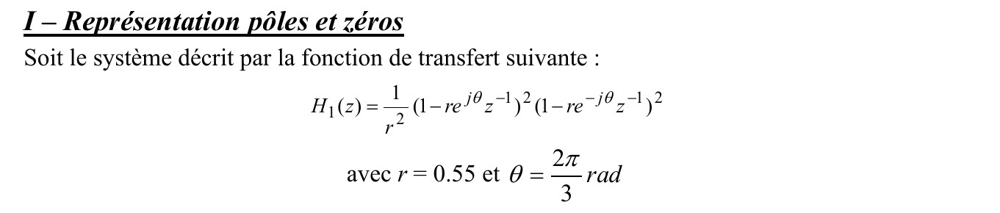
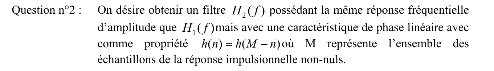
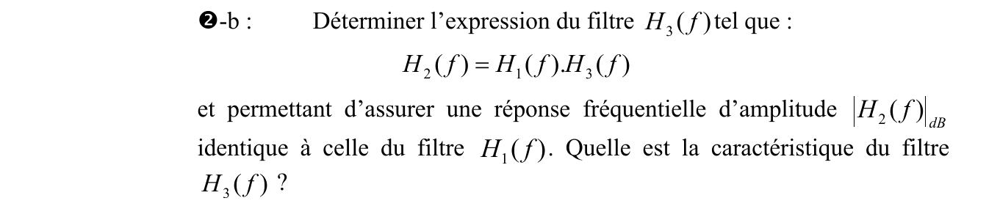
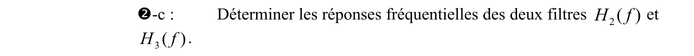
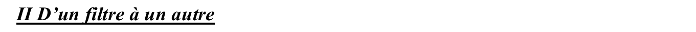
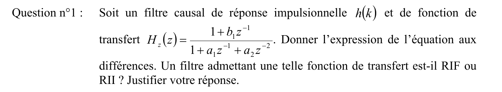
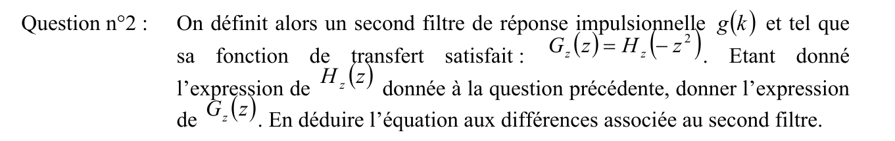
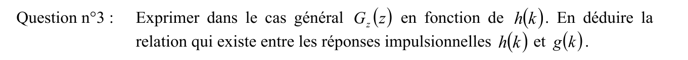
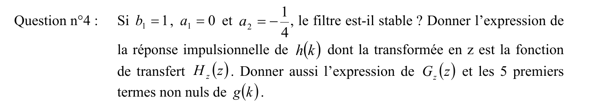
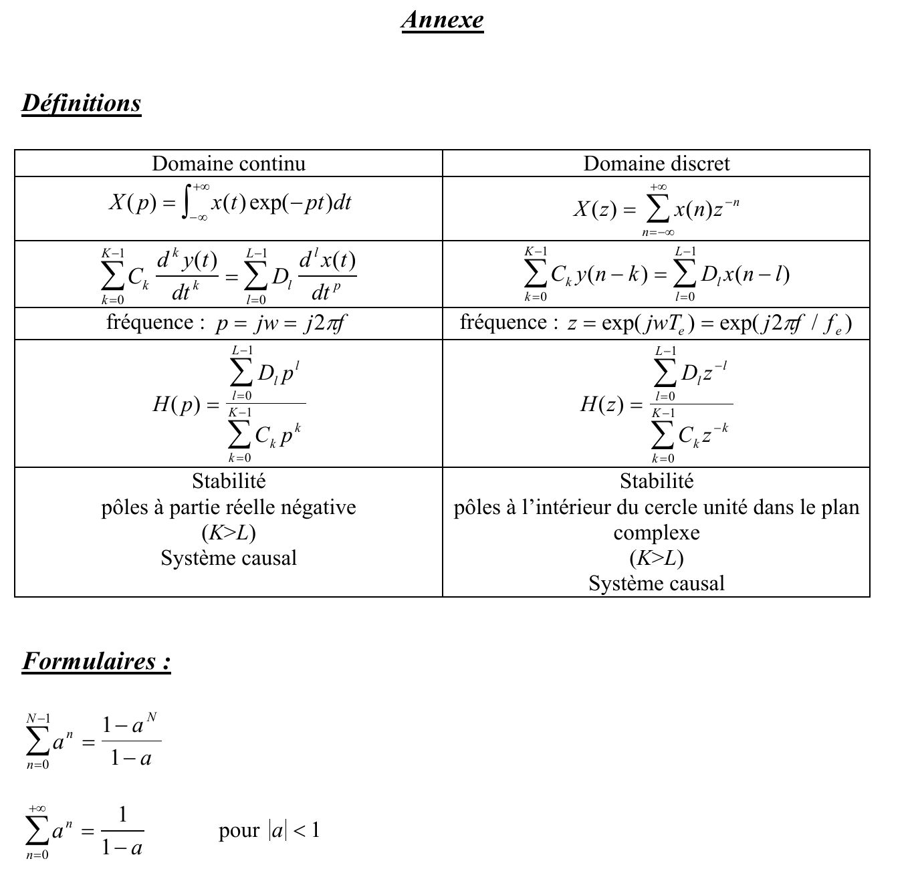



::: {.complement}
Énoncé découpé question par question [td, p. 9-10] ; sous chaque question, dans cet ordre : le corrigé manuscrit d'un ancien élève (*Notes externes*, [corrige-2023-td03]), puis les explications et contrôles ajoutés par Claude (*Complément*). Il n'y a pas de notes d'Armand sur ce TD. Les blocs *À vérifier* signalent des erreurs du corrigé de 2023 : ils restent **ouverts** tant qu'Armand ne les a pas tranchés.

Dans l'exercice 1, la troisième sous-question de la question 1 est numérotée « -a » une seconde fois dans le recueil : elle est notée 1-c ici. L'annexe du recueil (définitions et formulaire, p. 11) est reprise en [fin de page](#sec-td03-annexe), suivie des renvois vers les sujets d'examen du recueil. Les corrections étaient auparavant dans les chapitres [4](../cours/04-implementation-equations-differences.qmd#sec-exercices-td-ch04) et [5](../cours/05-representation-en-phase.qmd#sec-exercices-td-ch05).
:::

## Exercice 1 : pôles, zéros, phase linéaire et passe-tout {#sec-td03-ex1}

::: {#exr-td-poles-zeros-phase-lineaire}
## Pôles, zéros, phase linéaire et passe-tout

{fig-alt="I – Représentation pôles et zéros : soit le système décrit par la fonction de transfert suivante : H1(z) = (1/r²) (1 − r e^(jθ) z^−1)² (1 − r e^(−jθ) z^−1)², avec r = 0.55 et θ = 2π/3 rad."}
:::

Cours associé : [pôles et zéros](../cours/04-implementation-equations-differences.qmd#sec-poles-zeros), [filtre à phase linéaire](../cours/05-representation-en-phase.qmd#sec-phase-lineaire), [minimum de phase et passe-tout](../cours/05-representation-en-phase.qmd#sec-passe-tout)

{fig-alt="Question n°1 : déterminer la réponse impulsionnelle du système."}

:::: {.notes-externes}
::: {.solution}
$H_1$ est un filtre RIF ; ses zéros $z_1 = r e^{j\theta}$ et $z_2 = r e^{-j\theta}$ sont complexes conjugués, donc la réponse impulsionnelle est réelle (signal réel en entrée, signal réel en sortie).

[corrige-2023-td03, p. 1-2 et p. 4]
:::
::::

::: {.complement}
**Réponse impulsionnelle de $H_1$** (question 1, non donnée dans le corrigé). $(1 - r e^{j\theta} z^{-1})(1 - r e^{-j\theta} z^{-1}) = 1 - 2r\cos\theta\, z^{-1} + r^2 z^{-2} = 1 + r z^{-1} + r^2 z^{-2}$ puisque $\cos\frac{2\pi}{3} = -\frac12$. D'où
$$
H_1(z) = \frac{1}{r^2}\bigl(1 + r z^{-1} + r^2 z^{-2}\bigr)^2 = \frac{1}{r^2} + \frac{2}{r} z^{-1} + 3 z^{-2} + 2r\, z^{-3} + r^2 z^{-4},
$$
soit $h_1[n] \approx 3{,}306$ ; $3{,}636$ ; $3$ ; $1{,}1$ ; $0{,}3025$ pour $n = 0, \dots, 4$.
:::

{fig-alt="❶-a : tracer le diagramme des pôles et des zéros."}

:::: {.notes-externes}
::: {.solution}
**1-a.** Zéros doubles en $0{,}55\, e^{\pm j\frac{2\pi}{3}}$ (diagramme des zéros). Quand $z = e^{j2\pi f/f_e}$ parcourt le cercle unité, l'argument $\frac{2\pi}{3}$ correspond à $f = \frac{f_e}{3}$ : réjection autour de $\frac{f_e}{3}$.

[corrige-2023-td03, p. 1-2 et p. 4]
:::
::::

::: {.complement}
**1. a.** $H_1(z) = \dfrac{(z^2 + r z + r^2)^2}{r^2 z^4}$ : en plus des zéros doubles, **pôle quadruple en $z = 0$**.
:::

{fig-alt="❶-b : tracer la réponse fréquentielles d'amplitude (en dB)."}

:::: {.notes-externes}
::: {.solution}
**1-b.** Avec $z = e^{j2\pi f/f_e}$ :
$$
|H_1(f)| = \frac{1}{r^2}\, |1 - z_1 z^{-1}|^2\, |1 - z_1^* z^{-1}|^2 = \frac{1}{r^2}\, |z - z_1|^2\, |z - z_1^*|^2 :
$$
un calcul de module en fréquence revient à regarder les **distances** entre le point du cercle unité et les zéros.

[corrige-2023-td03, p. 1-2 et p. 4]
:::
::::

::: {.complement}
**1. b.** En fréquence normalisée : $20\log_{10}|H_1| \approx 21{,}1$ dB en $f = 0$, minimum $\approx 1{,}6$ dB vers $f \approx 0{,}35$ (proche de l'argument des zéros, $f = \frac13$, où l'on a $\approx 1{,}9$ dB), $\approx 5{,}4$ dB en $f = \frac12$. Les zéros étant loin du cercle ($r = 0{,}55$), la réjection reste modérée (environ 19,5 dB sous le maximum).
:::

{fig-alt="❶-a (numérotée « a » une seconde fois dans le recueil) : quelle est la caractéristique du système ?"}

:::: {.notes-externes}
::: {.solution}
**1-c.** RIF, car pas de polynôme au dénominateur.

[corrige-2023-td03, p. 1-2 et p. 4]
:::
::::

::: {.complement}
**1. c.** Caractéristique attendue, au vu de la question 2 : tous les zéros sont dans le cercle unité, $H_1$ est **à minimum de phase** ([définition du minimum de phase](../cours/05-representation-en-phase.qmd#def-minimum-phase)), en plus d'être RIF (donc stable).
:::

{fig-alt="Question n°2 : on désire obtenir un filtre H2(f) possédant la même réponse fréquentielle d'amplitude que H1(f) mais avec une caractéristique de phase linéaire avec comme propriété h(n) = h(M − n) où M représente l'ensemble des échantillons de la réponse impulsionnelle non-nuls."}

{fig-alt="❷-a : déterminer le diagramme des pôles et des zéros de H2(f)."}

:::: {.notes-externes}
::: {.solution}
**2-a.** $|H_2(f)| = |H_1(f)|$ et $h_2[n] = h_2[M-n]$ : phase linéaire, les zéros de $H_2$ vont par paires $\{z_i, z_i^{-1}\}$. On déplace un zéro de chaque paire double en son inverse, $\frac{1}{z_1} = \frac1r e^{-j\theta}$ et $\frac{1}{z_2} = \frac1r e^{j\theta}$ :
$$
H_2(z) = C\bigl(1 - r e^{j\theta} z^{-1}\bigr)\bigl(1 - r e^{-j\theta} z^{-1}\bigr)\Bigl(1 - \frac1r e^{j\theta} z^{-1}\Bigr)\Bigl(1 - \frac1r e^{-j\theta} z^{-1}\Bigr).
$$
Avec $|1 - r e^{j\theta} e^{-j\omega}|^2 = 1 - 2r\cos(\theta - \omega) + r^2$ et $\bigl|1 - \frac1r e^{j\theta} e^{-j\omega}\bigr|^2 = \frac{1}{r^2}\bigl(1 - 2r\cos(\theta - \omega) + r^2\bigr)$, l'égalité $|H_2(\omega)| = |H_1(\omega)|$ donne $|C| = \frac{r^2}{r^2} = 1$.

[corrige-2023-td03, p. 1-2 et p. 4]
:::
::::

::: {.complement}
**2. a.** Zéros de $H_2$ : $0{,}55\, e^{\pm j\frac{2\pi}{3}}$ et $\frac{1}{0{,}55}\, e^{\pm j\frac{2\pi}{3}} \approx 1{,}82\, e^{\pm j\frac{2\pi}{3}}$ (simples) ; pôle quadruple en 0. En développant avec $C = 1$ :
$$
h_2[n] = \Bigl(1,\ r + \tfrac1r,\ r^2 + 1 + \tfrac{1}{r^2},\ r + \tfrac1r,\ 1\Bigr) \approx (1 ;\ 2{,}368 ;\ 4{,}608 ;\ 2{,}368 ;\ 1),
$$
symétrique : $h_2[n] = h_2[4-n]$, $M = 4$.
:::

{fig-alt="❷-b : déterminer l'expression du filtre H3(f) tel que H2(f) = H1(f).H3(f) et permettant d'assurer une réponse fréquentielle d'amplitude |H2(f)|dB identique à celle du filtre H1(f). Quelle est la caractéristique du filtre H3(f) ?"}

:::: {.notes-externes}
::: {.solution}
**2-b.** Le corrigé écrit $H_1(z) = H_2(z)\, H_3(z)$, $H_2$ étant annoté « minimum de phase » (voir le bloc *À vérifier* ci-dessous) ; sachant que $|H_1(f)| = |H_2(f)|$, il conclut $|H_3(f)| = 1$ pour tout $f$, et ajoute en condition générale : « RII jamais à phase linéaire, linéarité de phase dédiée au RIF ».

Rappel de cours du corrigé : pôles dans le disque unité $\mathcal{C}_1$ : stabilité ; zéros dans $\mathcal{C}_1$ : filtre à minimum de phase ; zéros par paires $(z_i, z_i^{-1})$ : filtre à phase linéaire, car si $h[n] = h[M-n]$, $H(z) = \sum_n h[M-n]\, z^{-n} = z^{-M} \sum_n h[n]\, z^{n} = z^{-M} H(z^{-1})$, qui a les zéros $\{z_i, z_i^{-1}\}$.

[corrige-2023-td03, p. 1-2 et p. 4]
:::
::::

::: {.a-verifier #av-td-minimum-phase-decomposition}
**Source** [corrige-2023-td03, p. 2] : « $H_1(z) = H_2(z)\, H_3(z)$ », avec $H_2(z)$ souligné et annoté « minimum de phase ».

**Problème** : l'énoncé [td, p. 9] pose $H_2(f) = H_1(f)\, H_3(f)$. Le filtre à minimum de phase est $H_1$ (tous ses zéros, de module $0{,}55$, sont dans le cercle unité, [définition du minimum de phase](../cours/05-representation-en-phase.qmd#def-minimum-phase)) ; $H_2$ a deux zéros hors du cercle (module $\frac{1}{0{,}55} \approx 1{,}82$). Le corrigé intervertit les rôles, ce qui contredit [la décomposition du cours](../cours/05-representation-en-phase.qmd#eq-decomposition-min-passe-tout) ($H = H_\mathrm{min}\, A$). La conclusion $|H_3| = 1$ reste juste.

**Proposition** : « $H_2(z) = H_1(z)\, H_3(z)$, avec $H_1$ à minimum de phase et $H_3$ passe-tout ».
:::

::: {.complement}
**2. b.**
$$
H_3(z) = \frac{H_2(z)}{H_1(z)} = \frac{r^2 + r z^{-1} + z^{-2}}{1 + r z^{-1} + r^2 z^{-2}} :
$$
filtre **passe-tout** ($|H_3| = 1$), RII, causal et stable (pôles $0{,}55\, e^{\pm j\frac{2\pi}{3}}$), zéros aux inverses des pôles. C'est la décomposition [la décomposition du cours](../cours/05-representation-en-phase.qmd#eq-decomposition-min-passe-tout) : $H_2 = H_1 \cdot H_3$, $H_1$ à minimum de phase.
:::

{fig-alt="❷-c : déterminer les réponses fréquentielles des deux filtres H2(f) et H3(f)."}

::: {.complement}
**2. c.** Par symétrie de $h_2$ autour de $n = 2$ :
$$
H_2(f) = e^{-j4\pi f}\Bigl[r^2 + 1 + \frac{1}{r^2} + 2\Bigl(r + \frac1r\Bigr)\cos(2\pi f) + 2\cos(4\pi f)\Bigr].
$$
Le crochet reste positif (minimum $\approx 1{,}21$) : $|H_2(f)|$ égale ce crochet, qui coïncide avec $|H_1(f)|$, et $\operatorname{Arg}(H_2(f)) = -4\pi f$, phase linéaire de retard de groupe 2 échantillons. Pour $H_3$ : $|H_3(f)| = 1$ et $\operatorname{Arg}(H_3(f)) = -4\pi f - \operatorname{Arg}(H_1(f))$ ; son retard de groupe, positif, est l'excès de retard de $H_2$ sur $H_1$ ([retards additifs](../cours/05-representation-en-phase.qmd#eq-retards-additifs), [retard de groupe minimum](../cours/05-representation-en-phase.qmd#prp-retard-minimum)). Toutes ces valeurs ont été vérifiées numériquement.
:::

## Exercice 2 : d'un filtre à un autre, $G(z) = H(-z^2)$ {#sec-td03-ex2}

::: {#exr-td-filtre-transforme-moins-z2}
## D'un filtre à un autre : $G(z) = H(-z^2)$

{fig-alt="II D'un filtre à un autre."}
:::

Cours associé : [équations aux différences](../cours/04-implementation-equations-differences.qmd#sec-equations-differences), [décomposition en éléments simples](../cours/04-implementation-equations-differences.qmd#sec-generalisation-elements-simples)

{fig-alt="Question n°1 : soit un filtre causal de réponse impulsionnelle h(k) et de fonction de transfert Hz(z) = (1 + b1 z^−1) / (1 + a1 z^−1 + a2 z^−2). Donner l'expression de l'équation aux différences. Un filtre admettant une telle fonction de transfert est-il RIF ou RII ? Justifier votre réponse."}

:::: {.notes-externes}
::: {.solution}
1. $y[n] = x[n] + b_1\, x[n-1] - a_1\, y[n-1] - a_2\, y[n-2]$ (voir le bloc *À vérifier* ci-dessous pour la nature du filtre).

[corrige-2023-td03, p. 2-3]
:::
::::

::: {.a-verifier #av-td-rii-ou-rif}
**Source** [corrige-2023-td03, p. 2] : après l'équation $y(n) = x(n) + b_1 x(n-1) - a_1 y(n-1) - a_2 y(n-2)$, « $\Rightarrow$ RIF : ne dépend que du présent et du passé ».

**Problème** : dépendre seulement du présent et du passé caractérise un filtre **causal**. La sortie dépend des sorties passées $y[n-1]$, $y[n-2]$ (dénominateur non constant) : le filtre est **récursif**, à réponse impulsionnelle infinie dès que $(a_1, a_2) \neq (0, 0)$ et que le dénominateur ne se simplifie pas avec le numérateur.

**Proposition** : « RII : la récursion sur $y[n-1]$, $y[n-2]$ (pôles non nuls) donne une réponse impulsionnelle infinie ; filtre causal ».
:::

{fig-alt="Question n°2 : on définit alors un second filtre de réponse impulsionnelle g(k) et tel que sa fonction de transfert satisfait Gz(z) = Hz(−z²). Étant donné l'expression de Hz(z) donnée à la question précédente, donner l'expression de Gz(z). En déduire l'équation aux différences associée au second filtre."}

:::: {.notes-externes}
::: {.solution}
2. $z^{-1} \to (-z^2)^{-1} = -z^{-2}$ et $z^{-2} \to z^{-4}$ :
$$
G(z) = \frac{1 - b_1 z^{-2}}{1 - a_1 z^{-2} + a_2 z^{-4}}, \qquad y[n] = x[n] - b_1\, x[n-2] + a_1\, y[n-2] - a_2\, y[n-4].
$$

[corrige-2023-td03, p. 2-3]
:::
::::

{fig-alt="Question n°3 : exprimer dans le cas général Gz(z) en fonction de h(k). En déduire la relation qui existe entre les réponses impulsionnelles h(k) et g(k)."}

:::: {.notes-externes}
::: {.solution}
3. $$
G(z) = \sum_k g[k]\, z^{-k} = \sum_k h[k]\, (-z^2)^{-k} = \sum_k (-1)^k\, h[k]\, z^{-2k},
$$
à identifier avec $\sum_k g[2k]\, z^{-2k} + \sum_k g[2k+1]\, z^{-2k-1}$ :
$$
g[2k] = (-1)^k\, h[k], \qquad g[2k+1] = 0.
$$

[corrige-2023-td03, p. 2-3]
:::
::::

{fig-alt="Question n°4 : si b1 = 1, a1 = 0 et a2 = −1/4, le filtre est-il stable ? Donner l'expression de la réponse impulsionnelle de h(k) dont la transformée en z est la fonction de transfert Hz(z). Donner aussi l'expression de Gz(z) et les 5 premiers termes non nuls de g(k)."}

::: {.complement}
**Question 4** (non traitée dans le corrigé).

- $H(z) = \dfrac{1 + z^{-1}}{1 - \frac14 z^{-2}} = \dfrac{1 + z^{-1}}{\bigl(1 - \frac12 z^{-1}\bigr)\bigl(1 + \frac12 z^{-1}\bigr)}$ : pôles $\pm\frac12$, dans le disque unité, filtre causal : **stable** ([stabilité et pôles](../cours/04-implementation-equations-differences.qmd#thm-stabilite-poles)).
- Éléments simples : $H(z) = \dfrac{3/2}{1 - \frac12 z^{-1}} - \dfrac{1/2}{1 + \frac12 z^{-1}}$ (évaluation en $z^{-1} = 2$ et $z^{-1} = -2$), d'où
$$
h[k] = \Bigl[\frac32 \Bigl(\frac12\Bigr)^k - \frac12 \Bigl(-\frac12\Bigr)^k\Bigr] u[k] : \quad 1,\ 1,\ \tfrac14,\ \tfrac14,\ \tfrac{1}{16},\ \tfrac{1}{16}, \dots
$$
soit $h[k] = \bigl(\frac14\bigr)^{\lfloor k/2 \rfloor}$ pour $k \geq 0$ (vérifié par la récurrence $h[k] = \delta[k] + \delta[k-1] + \frac14 h[k-2]$).
- $G(z) = \dfrac{1 - z^{-2}}{1 - \frac14 z^{-4}}$ ; ses pôles vérifient $z^4 = \frac14$, $|z| = \frac{1}{\sqrt2} < 1$ : stable.
- Avec la question 3, les 5 premiers termes non nuls sont
$$
g[0] = 1, \quad g[2] = -1, \quad g[4] = \frac14, \quad g[6] = -\frac14, \quad g[8] = \frac{1}{16},
$$
les termes d'indice impair étant nuls (vérifié par la récurrence $g[k] = \delta[k] - \delta[k-2] + \frac14 g[k-4]$).
- Interprétation : sur le cercle unité, $-z^2 = e^{j(4\pi f + \pi)}$, donc $G(f) = H\bigl(2f + \frac12\bigr)$ : la réponse de $H$ est comprimée d'un facteur 2 et décalée.
:::

## Annexe du recueil : définitions et formulaire {#sec-td03-annexe}

{fig-alt="Annexe. Définitions, tableau domaine continu / domaine discret : X(p) = ∫ x(t) exp(−pt) dt et X(z) = Σ x(n) z^−n (de −∞ à +∞) ; Σ Ck d^k y(t)/dt^k = Σ Dl d^l x(t)/dt^p et Σ Ck y(n − k) = Σ Dl x(n − l) (k de 0 à K − 1, l de 0 à L − 1) ; fréquence : p = jw = j2πf et z = exp(jwTe) = exp(j2πf/fe) ; H(p) = Σ Dl p^l / Σ Ck p^k et H(z) = Σ Dl z^−l / Σ Ck z^−k ; stabilité (K > L, système causal) : pôles à partie réelle négative, pôles à l'intérieur du cercle unité dans le plan complexe. Formulaires : somme de a^n pour n = 0 à N − 1 = (1 − a^N)/(1 − a) ; somme de a^n pour n = 0 à +∞ = 1/(1 − a) pour |a| < 1."}

::: {.remark}
**Annexe du recueil de TD** [td, p. 11]. Définitions, en parallèle du domaine continu :

| | Domaine continu | Domaine discret |
|---|---|---|
| Transformée | $X(p) = \int_{-\infty}^{+\infty} x(t)\, e^{-pt}\,\mathrm{d}t$ | $X(z) = \sum_{n=-\infty}^{+\infty} x[n]\, z^{-n}$ |
| Équation | $\sum_{k=0}^{K-1} C_k \dfrac{\mathrm{d}^k y(t)}{\mathrm{d}t^k} = \sum_{l=0}^{L-1} D_l \dfrac{\mathrm{d}^l x(t)}{\mathrm{d}t^l}$ | $\sum_{k=0}^{K-1} C_k\, y[n-k] = \sum_{l=0}^{L-1} D_l\, x[n-l]$ |
| Fréquence | $p = j\omega = j2\pi f$ | $z = e^{j\omega T_e} = e^{j2\pi f/f_e}$ |
| Fonction de transfert | $H(p) = \dfrac{\sum_{l=0}^{L-1} D_l\, p^l}{\sum_{k=0}^{K-1} C_k\, p^k}$ | $H(z) = \dfrac{\sum_{l=0}^{L-1} D_l\, z^{-l}}{\sum_{k=0}^{K-1} C_k\, z^{-k}}$ |
| Stabilité ($K > L$, système causal) | pôles à partie réelle négative | pôles à l'intérieur du cercle unité dans le plan complexe |

Formulaire :

$$
\sum_{n=0}^{N-1} a^n = \frac{1 - a^N}{1 - a}, \qquad \sum_{n=0}^{+\infty} a^n = \frac{1}{1 - a} \quad \text{pour } |a| < 1.
$$
:::

::: {.a-verifier #av-td-annexe-derivee}
**Source** [td, p. 11] : « $\sum_{k=0}^{K-1} C_k \dfrac{d^k y(t)}{dt^k} = \sum_{l=0}^{L-1} D_l \dfrac{d^l x(t)}{dt^p}$ ».

**Problème** : l'ordre de dérivation du second membre doit être le même au numérateur et au dénominateur ; $p$ désigne ailleurs dans le tableau la variable de Laplace.

**Proposition** : $\dfrac{\mathrm{d}^l x(t)}{\mathrm{d}t^l}$ (forme retenue dans le tableau ci-dessus).
:::

::: {.complement}
La première somme suppose $a \neq 1$ (pour $a = 1$, elle vaut $N$). Dans l'annexe, $\omega$ est une pulsation en rad/s ($z = e^{j\omega T_e}$) ; dans les énoncés du TD, $H(\omega)$ désigne la réponse en pulsation **normalisée**, $\omega = 2\pi f/f_e \in [-\pi, \pi]$. Les coefficients $C_k$, $D_l$ de l'annexe sont les $c_k$, $d_l$ de [l'équation aux différences du cours](../cours/04-implementation-equations-differences.qmd#eq-equation-differences).
:::

## Sujets d'examen du recueil {#sec-td03-sujets-examen}

Les anciens sujets reproduits à la suite de l'annexe [td, p. 12-23] sont corrigés dans les annales :

- « Sujet 2013 » (p. 12-13) : [examen de mars 2014](../annales/2013-2014-examen.qmd) ;
- « Sujet 2014 » (p. 14-15) : [partiel 2014-2015](../annales/2014-2015-partiel.qmd) ;
- « Sujet 2016 » (p. 16-18) : [partiel 2016-2017](../annales/2016-2017-partiel.qmd) ;
- « Sujet 2017 » (p. 19-20) : [examen de mars 2018](../annales/2017-2018-examen.qmd) ;
- p. 21-23 : [partiel 2019-2020](../annales/2019-2020-partiel.qmd).
