

::: {.complement}
Aucun corrigé officiel ni corrigé d'élève pour ce sujet : **toutes les solutions de cette page sont rédigées par Claude**. Le code Matlab a été testé sous GNU Octave et les calculs vérifiés numériquement. À relire avec un œil critique ; signaler toute erreur.

Les énoncés sont des extraits de la photo du sujet [sujet-2014] ; les coches manuscrites d'un étudiant devant les questions de la page 2 ont été effacées des images. L'en-tête du sujet (adresse de téléchargement, identifiant, mots de passe et adresse d'envoi des fichiers) n'est volontairement pas reproduit. Les questions de l'énoncé sont des tirets non numérotés : elles sont numérotées ici dans l'ordre (q. 1 à 6 pour l'exercice 1, q. 1 à 7 pour l'exercice 2).

**Les trois fichiers sonores du sujet** (`signalexam1GB2.wav`, `signalexam2GB2.wav`, `filtrageexamGB2.wav`) **ne font pas partie des sources** : les questions qui portent sur eux sont corrigées par la méthode et le code, sans valeur numérique.

Correspondances : la partie « TFD et fenêtrage » reprend la séance 2 du poly de TP [tp, p. 9] ; la partie 2 du filtrage (musique bruitée par des sinusoïdes) est reprise en 2016-2017 ([partiel 2016-2017, partie 2](2016-2017-partiel.qmd#sec-ann1617-ex2)) et, sous forme de parole bruitée, en 2017-2018 ([partiel 2017-2018](2017-2018-partiel-groupes-5-7.qmd#sec-ann1718-ex2)) et dans le poly [tp, p. 15-16].
:::

## Exercice 1 : transformée de Fourier (barème non indiqué) {#sec-ann1415-ex1}

{fig-alt="Section 1 : Transformée de Fourier."}

Cours TSIG1 : [interprétation fréquentielle de l'échantillonnage](../../tsig1-traitement-numerique-signal/cours/01-echantillonnage-signal-discret.qmd#sec-interpretation-frequentielle-echantillonnage), [TFD](../../tsig1-traitement-numerique-signal/cours/03-tfd-interpretation-frequentielle.qmd#sec-tfd), [fenêtre d'observation](../../tsig1-traitement-numerique-signal/cours/03-tfd-interpretation-frequentielle.qmd#sec-fenetre-observation).

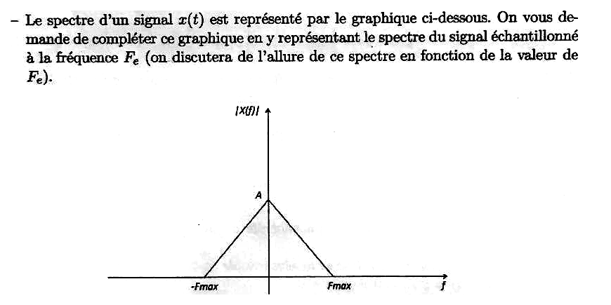{fig-alt="Q1 : le spectre |X(f)| d'un signal x(t) est un triangle de hauteur A en f = 0, nul en -Fmax et Fmax ; compléter le graphique avec le spectre du signal échantillonné à la fréquence Fe, en discutant son allure selon la valeur de Fe."}

:::: {.complement}
::: {.solution}
**Résultat de cours.** Échantillonner à $F_e = 1/T_e$ **périodise** le spectre ([formule de périodisation](../../tsig1-traitement-numerique-signal/cours/01-echantillonnage-signal-discret.qmd#eq-periodisation)) :
$$X_e(f) = \frac{1}{T_e}\sum_{k=-\infty}^{+\infty} X(f - kF_e).$$
Le triangle d'origine (hauteur $A$, support $[-F_{max}, F_{max}]$) est recopié autour de chaque multiple $kF_e$, avec la hauteur $A/T_e = A F_e$.

**Discussion selon $F_e$** (@fig-ann1415-spectre-echantillonne) :

- $F_e > 2F_{max}$ : les copies sont disjointes, séparées par une bande vide de largeur $F_e - 2F_{max}$. Le motif central est intact : un filtre passe-bas idéal de fréquence de coupure entre $F_{max}$ et $F_e - F_{max}$ restitue $x(t)$ ([théorème de Shannon](../../tsig1-traitement-numerique-signal/cours/01-echantillonnage-signal-discret.qmd#sec-shannon)).
- $F_e = 2F_{max}$ : les copies se touchent en $\pm F_{max}$, $\pm 3F_{max}$… ; pas de recouvrement, mais il faudrait un filtre de reconstruction idéal (raide) pour isoler le motif central. Cas limite.
- $F_e < 2F_{max}$ : les copies **se recouvrent** et s'additionnent (repliement, *aliasing*) ; dans la zone de recouvrement, le spectre n'est plus le triangle d'origine et $x(t)$ ne peut plus être reconstruit.

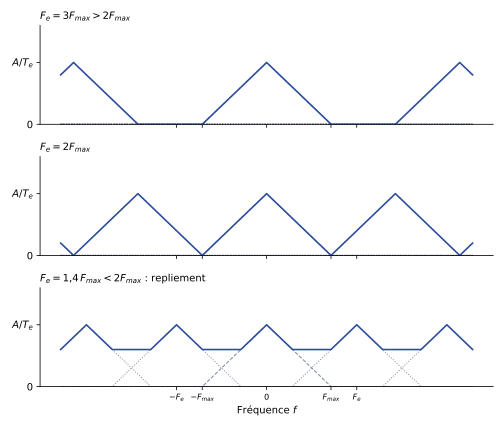{#fig-ann1415-spectre-echantillonne}
:::
::::

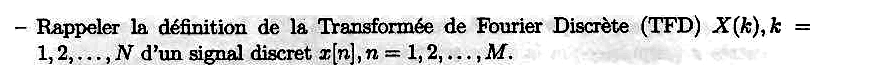{fig-alt="Q2 : rappeler la définition de la transformée de Fourier discrète X(k), k = 1, 2, ..., N d'un signal discret x[n], n = 1, 2, ..., M."}

:::: {.complement}
::: {.solution}
Avec les indices de Matlab (de 1 à $M$ et de 1 à $N$), la TFD sur $N$ points de $M$ échantillons est
$$X(k) = \sum_{n=1}^{M} x[n]\, e^{-j2\pi\frac{(k-1)(n-1)}{N}}, \qquad k = 1, \dots, N.$$
C'est la [définition du cours](../../tsig1-traitement-numerique-signal/cours/03-tfd-interpretation-frequentielle.qmd#def-tfd) avec les indices décalés de 1. Conditions et interprétation :

- si $N > M$, on complète $x$ par des zéros (*zero padding*) ; si $N < M$, `fft(x, N)` tronque $x$ à ses $N$ premiers échantillons ;
- $X(k)$ échantillonne la TFSD $X(f)$ en $f_k = (k-1)\dfrac{F_e}{N}$ : pas fréquentiel $\Delta f = F_e/N$ ;
- $X$ est périodique de période $N$ ; pour un signal réel, $X(N + 2 - k) = \overline{X(k)}$ : seule la moitié $k \leq N/2 + 1$ est utile.
:::
::::

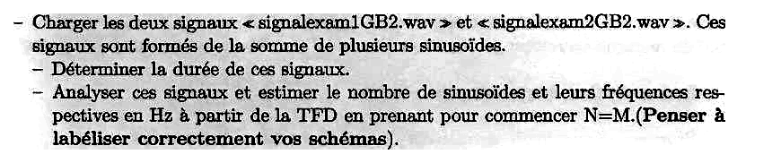{fig-alt="Q3 : charger signalexam1GB2.wav et signalexam2GB2.wav, signaux formés d'une somme de sinusoïdes ; déterminer leur durée ; estimer le nombre de sinusoïdes et leurs fréquences en Hz à partir de la TFD, en prenant d'abord N = M (labelliser correctement les schémas)."}

:::: {.complement}
::: {.solution}
**Méthode.** `audioread` renvoie les échantillons et la fréquence d'échantillonnage $F_e$ ; la durée est $M/F_e$ (ou $M T_e$). Chaque sinusoïde réelle de fréquence $f_i$ donne un pic en $f_i$ (et son symétrique en $F_e - f_i$) : on compte les pics dans $[0, F_e/2]$ et on lit leur abscisse sur un axe gradué en hertz, $f_k = (k-1)F_e/N$.

```matlab
[x, Fe] = audioread('signalexam1GB2.wav');   % idem avec signalexam2GB2.wav
x = x(:, 1);  M = length(x);
duree = M/Fe                                  % durée en secondes
N = M;
X = abs(fft(x, N));
f = (0:N-1)*Fe/N;                             % axe des fréquences en Hz
plot(f(1:floor(N/2)), X(1:floor(N/2)));
xlabel('Fréquence (Hz)'); ylabel('|X(k)|'); title('TFD sur N = M points');
[pks, locs] = findpeaks(X(1:floor(N/2)), 'MinPeakHeight', 0.1*max(X));
f(locs)                                       % fréquences estimées
```

Le seuil `0.1*max(X)` écarte les lobes secondaires de la fenêtre rectangulaire (au plus $-13$ dB, soit $0{,}22$ fois le pic) ; une sinusoïde d'amplitude beaucoup plus faible que les autres demanderait un seuil plus bas.

**Résultat** : non calculable ici, les fichiers ne sont pas dans les sources. Avec un signal test (deux cosinus à $440{,}3$ Hz et $1203{,}7$ Hz, $F_e = 8$ kHz, 2 s), ce code trouve $440{,}5$ Hz et $1203{,}5$ Hz : la précision est limitée au pas $F_e/N = 0{,}5$ Hz (question suivante).
:::
::::

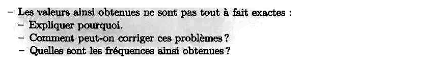{fig-alt="Q4 : les valeurs obtenues ne sont pas tout à fait exactes ; expliquer pourquoi, comment corriger ces problèmes et quelles fréquences on obtient alors."}

:::: {.complement}
::: {.solution}
**Pourquoi.** Deux effets se combinent.

1. **Grille fréquentielle.** La TFD ne calcule $X(f)$ qu'aux fréquences $(k-1)F_e/N$. Si $f_i$ ne tombe pas sur la grille, le pic est lu sur la case la plus proche : erreur jusqu'à $\pm\frac{F_e}{2N}$ (avec $N = M$ : $\pm\frac{1}{2\,\text{durée}}$).
2. **Fenêtrage implicite.** Observer $M$ échantillons revient à multiplier par une fenêtre rectangulaire : le spectre est la convolution des raies par un sinus cardinal ([fenêtre d'observation](../../tsig1-traitement-numerique-signal/cours/03-tfd-interpretation-frequentielle.qmd#eq-fenetrage)). Chaque raie s'étale (lobe principal de largeur $2F_e/M$) et fuit dans les cases voisines par ses lobes secondaires (*fuite spectrale*) ; les lobes d'une sinusoïde forte peuvent déplacer ou masquer le pic d'une sinusoïde faible ou proche.

**Comment corriger.**

- Calculer la TFD sur $N \gg M$ points (*zero padding*, par exemple `fft(x, 8*M)`) : on échantillonne plus finement la même TFSD, l'erreur de grille devient $\pm F_e/(2N)$. Cela **n'améliore pas la résolution** (aptitude à séparer deux raies proches), fixée par la durée d'observation : $\approx F_e/M$.
- Pondérer par une fenêtre à lobes secondaires plus faibles (questions suivantes) pour réduire la fuite.
- Observer plus longtemps (plus d'échantillons), si possible.

**Fréquences obtenues** : non calculables sans les fichiers. Sur le signal test de la question 3, la TFD sur $8M$ points avec une fenêtre de Hann donne $440{,}31$ Hz et $1203{,}69$ Hz (valeurs vraies : $440{,}3$ et $1203{,}7$ Hz).
:::
::::

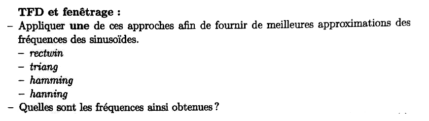{fig-alt="Q5 : TFD et fenêtrage ; appliquer une des fenêtres rectwin, triang, hamming ou hanning pour mieux approcher les fréquences des sinusoïdes ; quelles fréquences obtient-on ?"}

:::: {.complement}
::: {.solution}
On multiplie le signal par la fenêtre **avant** la TFD, et on garde un $N \gg M$ :

```matlab
w  = hann(M);                      % ou rectwin(M), triang(M), hamming(M), hanning(M)
Nz = 8*M;
Xw = abs(fft(x.*w, Nz));
fz = (0:Nz-1)*Fe/Nz;
plot(fz(1:Nz/2), 20*log10(Xw(1:Nz/2)/max(Xw)));
xlabel('Fréquence (Hz)'); ylabel('|X_w| (dB)'); title('TFD fenêtrée (Hann)');
[pks, locs] = findpeaks(Xw(1:Nz/2), 'MinPeakHeight', 0.1*max(Xw));
fz(locs)
```

Propriétés des quatre fenêtres (calculées pour $M = 256$ ; elles varient très peu avec $M$) :

| Fenêtre | Lobe principal (demi-largeur) | Premier lobe secondaire | Perte maximale entre deux cases |
|---|---|---|---|
| `rectwin` | $F_e/M$ | $-13{,}3$ dB | $3{,}92$ dB |
| `triang` | $2F_e/M$ | $-26{,}5$ dB | $1{,}82$ dB |
| `hamming` | $2F_e/M$ | $-42{,}7$ dB | $1{,}74$ dB |
| `hann` (`hanning`) | $2F_e/M$ | $-31{,}5$ dB | $1{,}41$ dB |

La fenêtre rectangulaire a le lobe principal le plus étroit (meilleure résolution) mais la plus forte fuite ; Hamming et Hann divisent la fuite par 10 à 40 au prix d'un lobe principal deux fois plus large. Pour estimer les fréquences de sinusoïdes bien séparées et d'amplitudes différentes, **Hann ou Hamming** sont le bon choix.

**Fréquences obtenues** : non calculables sans les fichiers (signal test : voir la question 4).
:::
::::

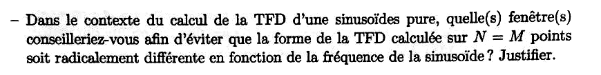{fig-alt="Q6 : pour la TFD d'une sinusoïde pure, quelle(s) fenêtre(s) conseiller pour éviter que la forme de la TFD calculée sur N = M points soit radicalement différente selon la fréquence de la sinusoïde ? Justifier."}

:::: {.complement}
::: {.solution}
**Le problème avec la fenêtre rectangulaire.** Avec $N = M$, les cases de la TFD tombent exactement sur les **zéros** du sinus cardinal de la fenêtre rectangulaire, sauf la case centrale. Donc :

- si $f_0$ est sur la grille ($f_0 = k_0 F_e/M$) : une seule case non nulle, de hauteur $M/2$ ; les autres valent 0 ;
- si $f_0$ est au milieu de deux cases : deux cases de hauteur $\approx 0{,}64 \times M/2$ ($-3{,}9$ dB) et des valeurs non nulles qui décroissent lentement sur tout le spectre (fuite).

La forme de la TFD change donc radicalement avec $f_0$.

**Fenêtres conseillées : Hann (ou Hamming).** Leur lobe principal couvre **deux cases** de part et d'autre de la raie et leurs lobes secondaires sont faibles : quelle que soit la position de $f_0$ sur la grille, la TFD montre 2 ou 3 cases significatives, la hauteur du pic ne varie que de $1{,}4$ dB (Hann) ou $1{,}7$ dB (Hamming) contre $3{,}9$ dB, et la fuite lointaine est négligeable. La forme est quasi indépendante de la fréquence. (La fenêtre triangulaire va dans le même sens mais avec des lobes secondaires plus forts ; une fenêtre à sommet plat, *flat top*, réduit encore la variation d'amplitude au prix d'un lobe très large.)
:::
::::

## Exercice 2 : filtrage (barème non indiqué) {#sec-ann1415-ex2}

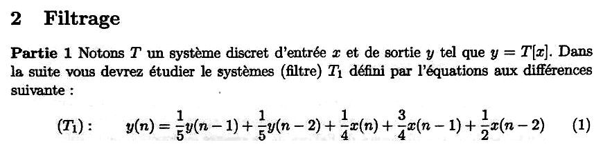{fig-alt="Section 2 Filtrage, partie 1 : système discret T d'entrée x et de sortie y = T[x] ; filtre T1 défini par y(n) = 1/5 y(n-1) + 1/5 y(n-2) + 1/4 x(n) + 3/4 x(n-1) + 1/2 x(n-2)."}

Cours TSIG1 : [équations aux différences](../../tsig1-traitement-numerique-signal/cours/04-implementation-equations-differences.qmd#sec-equations-differences), [pôles et zéros](../../tsig1-traitement-numerique-signal/cours/04-implementation-equations-differences.qmd#sec-poles-zeros), [stabilité](../../tsig1-traitement-numerique-signal/cours/04-implementation-equations-differences.qmd#thm-stabilite-poles).

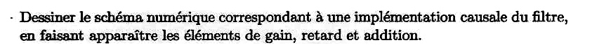{fig-alt="Q1 : dessiner le schéma numérique d'une implémentation causale du filtre, avec les éléments de gain, retard et addition."}

:::: {.complement}
::: {.solution}
L'équation (1) se lit directement comme une **forme directe I** : deux lignes à retard (une sur l'entrée, une sur la sortie), cinq gains et des additionneurs. La sortie $y(n)$ ne dépend que de $x(n)$, $x(n-1)$, $x(n-2)$, $y(n-1)$, $y(n-2)$ : la réalisation est causale.

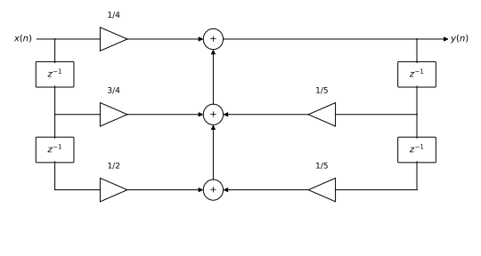{#fig-ann1415-schema-t1}

Variante équivalente : la forme directe II (canonique) n'utilise que deux retards au lieu de quatre, en plaçant la partie récursive avant la partie non récursive.
:::
::::

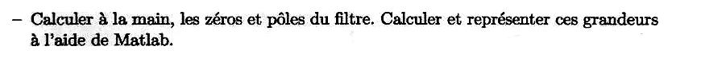{fig-alt="Q2 : calculer à la main les zéros et les pôles du filtre ; les calculer et les représenter avec Matlab."}

:::: {.complement}
::: {.solution}
**Fonction de transfert.** Transformée en $z$ de (1), avec $x(n-k) \to z^{-k}X(z)$ :
$$H(z) = \frac{Y(z)}{X(z)} = \frac{\frac14 + \frac34 z^{-1} + \frac12 z^{-2}}{1 - \frac15 z^{-1} - \frac15 z^{-2}} = \frac{\frac14\,(z^2 + 3z + 2)}{z^2 - \frac15 z - \frac15}.$$

**Zéros** : $z^2 + 3z + 2 = (z + 1)(z + 2)$, d'où
$$\boxed{z_1 = -1, \qquad z_2 = -2}$$

**Pôles** : $z^2 - 0{,}2\,z - 0{,}2 = 0$, discriminant $0{,}04 + 0{,}8 = 0{,}84$ :
$$\boxed{p_{1,2} = \frac{1 \pm \sqrt{21}}{10} \approx 0{,}558 \ \text{et}\ -0{,}358}$$

```matlab
b = [1/4 3/4 1/2];  a = [1 -1/5 -1/5];
zer = roots(b)          % -2 ; -1
pol = roots(a)          % 0.5583 ; -0.3583
zplane(b, a); title('Pôles (x) et zéros (o) de T_1');
```

Le zéro $-1$ est **sur** le cercle unité : $H(-1) = 0$, la fréquence $F_e/2$ est totalement éliminée ; avec $H(1) = \frac{3/2}{3/5} = 2{,}5$, le filtre est un **passe-bas** (@fig-ann1415-filtre-t1, à droite).
:::
::::

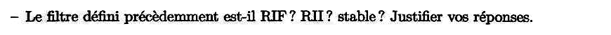{fig-alt="Q3 : le filtre est-il RIF ? RII ? stable ? Justifier."}

:::: {.complement}
::: {.solution}
- **RII** : l'équation est récursive (la sortie dépend des sorties passées, $a_1, a_2 \neq 0$) ; $H(z)$ a des pôles non nuls qui ne sont pas compensés par des zéros, donc $h(n)$ est une somme d'exponentielles $p_i^n$ non nulles pour tout $n$ : réponse impulsionnelle **infinie**. Ce n'est pas un RIF.
- **Stable** : réalisé de façon causale, le filtre est stable si et seulement si tous ses pôles sont dans le cercle unité ([théorème](../../tsig1-traitement-numerique-signal/cours/04-implementation-equations-differences.qmd#thm-stabilite-poles)). Ici $|p_1| \approx 0{,}558 < 1$ et $|p_2| \approx 0{,}358 < 1$ : **stable**. (Les zéros, dont $-2$ hors du cercle, n'interviennent pas dans la stabilité ; ils indiquent seulement que le filtre n'est pas à minimum de phase.)
:::
::::

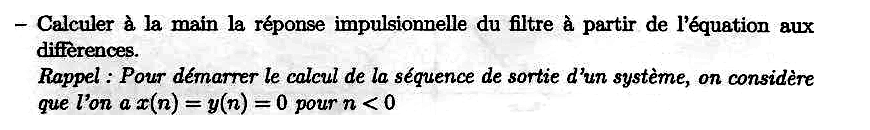{fig-alt="Q4 : calculer à la main la réponse impulsionnelle du filtre à partir de l'équation aux différences ; rappel : on considère x(n) = y(n) = 0 pour n < 0."}

:::: {.complement}
::: {.solution}
On pose $x(n) = \delta(n)$ et $h(n) = y(n)$, nuls pour $n < 0$ :
$$h(n) = \tfrac15 h(n-1) + \tfrac15 h(n-2) + \tfrac14\delta(n) + \tfrac34\delta(n-1) + \tfrac12\delta(n-2).$$

| $n$ | calcul | $h(n)$ |
|---|---|---|
| 0 | $\frac14$ | $0{,}25$ |
| 1 | $\frac15 \cdot \frac14 + \frac34$ | $0{,}8$ |
| 2 | $\frac15 \cdot 0{,}8 + \frac15 \cdot \frac14 + \frac12$ | $0{,}71$ |
| 3 | $\frac15 \cdot 0{,}71 + \frac15 \cdot 0{,}8$ | $0{,}302$ |
| 4 | $\frac15 \cdot 0{,}302 + \frac15 \cdot 0{,}71$ | $0{,}2024$ |
| 5 | $\frac15 \cdot 0{,}2024 + \frac15 \cdot 0{,}302$ | $0{,}10088$ |
| $n \geq 3$ | $\frac15\,[h(n-1) + h(n-2)]$ | décroissance vers 0 |

**Forme close** (décomposition en éléments simples de $H(z)$, partie entière $-2{,}5$ car numérateur et dénominateur sont de même degré) :
$$h(n) = -2{,}5\,\delta(n) + \bigl[1{,}948\,(0{,}558)^n + 0{,}802\,(-0{,}358)^n\bigr]\,u(n).$$
Contrôle : $h(0) = -2{,}5 + 1{,}948 + 0{,}802 = 0{,}25$ ✓ ; les valeurs du tableau sont retrouvées par le calcul exact en fractions ($h(3) = \frac{151}{500}$, $h(4) = \frac{253}{1250}$).
:::
::::

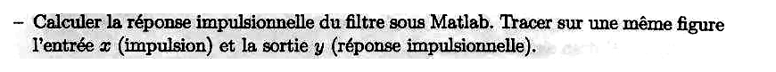{fig-alt="Q5 : calculer la réponse impulsionnelle sous Matlab ; tracer sur une même figure l'entrée x (impulsion) et la sortie y (réponse impulsionnelle)."}

:::: {.complement}
::: {.solution}
```matlab
b = [1/4 3/4 1/2];  a = [1 -1/5 -1/5];
L = 20;  n = 0:L-1;
d = [1 zeros(1, L-1)];               % impulsion
h = filter(b, a, d);                 % ou : h = impz(b, a, L);
stem(n, d); hold on; stem(n, h, 'filled'); hold off
xlabel('n'); legend('entrée \delta(n)', 'sortie h(n)');
title('Réponse impulsionnelle de T_1');
h(1:6)                               % 0.25  0.8  0.71  0.302  0.2024  0.1009
```
Les valeurs coïncident avec le calcul à la main (exécuté sous Octave).

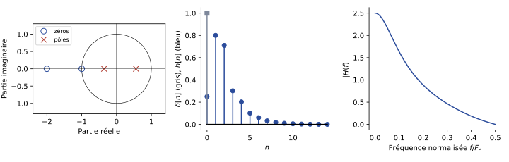{#fig-ann1415-filtre-t1}
:::
::::

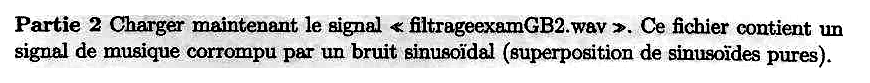{fig-alt="Partie 2 : charger filtrageexamGB2.wav, signal de musique corrompu par un bruit sinusoïdal (superposition de sinusoïdes pures)."}

{fig-alt="Q6 : estimer la ou les fréquences de ce bruit."}

:::: {.complement}
::: {.solution}
Une sinusoïde pure se reconnaît à une **raie très fine et très haute** dans la TFD, et à une **ligne horizontale continue** dans le spectrogramme (présente pendant tout le morceau), alors que la musique donne des composantes qui varient dans le temps.

```matlab
[x, Fe] = audioread('filtrageexamGB2.wav');  x = x(:, 1);
L = length(x);
X = abs(fft(x));  f = (0:L-1)*Fe/L;
plot(f(1:floor(L/2)), 20*log10(X(1:floor(L/2))));
xlabel('Fréquence (Hz)'); ylabel('|X| (dB)');
figure; spectrogram(x, 1024, 512, 1024, Fe, 'yaxis');
[pks, locs] = findpeaks(X(1:floor(L/2)), 'MinPeakProminence', 0.3*max(X));
fbruit = f(locs)                              % fréquence(s) du bruit en Hz
```

La TFD sur toute la durée $L$ donne une précision $F_e/L$, très fine pour un enregistrement de plusieurs secondes. **Valeurs** : non calculables, le fichier n'est pas dans les sources.
:::
::::

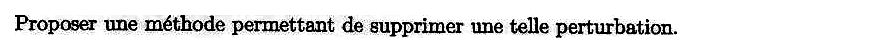{fig-alt="Q7 : proposer une méthode permettant de supprimer une telle perturbation."}

:::: {.complement}
::: {.solution}
**Filtre réjecteur (coupe-bande étroit) par fréquence de bruit.** Pour chaque fréquence $f_b$, on place deux zéros sur le cercle unité en $e^{\pm j\theta_b}$, $\theta_b = 2\pi f_b/F_e$ (atténuation totale de $f_b$), et deux pôles juste à l'intérieur, en $\rho\, e^{\pm j\theta_b}$ avec $\rho$ proche de 1, qui rendent l'encoche étroite en compensant l'effet des zéros dès qu'on s'éloigne de $f_b$ :
$$H_b(z) = \frac{1 - 2\cos\theta_b\, z^{-1} + z^{-2}}{1 - 2\rho\cos\theta_b\, z^{-1} + \rho^2 z^{-2}}, \qquad 0 < \rho < 1.$$
Stable (pôles de module $\rho < 1$) ; largeur de l'encoche $\approx (1 - \rho)\dfrac{F_e}{\pi}$ ; gain proche de 1 loin de $f_b$. On met en cascade un filtre par fréquence de bruit :

```matlab
y = x;  rho = 0.99;
for fb = fbruit
  th = 2*pi*fb/Fe;
  b = [1 -2*cos(th) 1];
  a = [1 -2*rho*cos(th) rho^2];
  y = filter(b, a, y);
end
spectrogram(y, 1024, 512, 1024, Fe, 'yaxis');   % les lignes horizontales ont disparu
```

Le simple RIF à deux zéros (numérateur seul) supprimerait aussi $f_b$, mais avec une encoche très large qui déforme la musique (voir le [partiel 2016-2017, q. 4](2016-2017-partiel.qmd#sec-ann1617-ex2)). **Autre méthode** : annuler directement les cases de la TFD correspondant au bruit, puis reconstruire par TFD inverse [tp, p. 16].
:::
::::
