

::: {.complement}
Aucun corrigé officiel ni corrigé d'élève pour ce sujet : **toutes les solutions de cette page sont rédigées par Claude**. Le code Matlab a été testé sous GNU Octave et les calculs vérifiés numériquement. À relire avec un œil critique ; signaler toute erreur.

Le sujet est un PDF composé en LaTeX (sans annotation) ; les images sont extraites telles quelles. Le fichier `mozart.wav` de la partie 2 **ne fait pas partie des sources** : ces questions sont corrigées par la méthode et le code, sans valeur numérique.

Correspondances : la partie 2 reprend le débruitage d'une musique par suppression de sinusoïdes du [partiel 2014-2015](2014-2015-partiel.qmd#sec-ann1415-ex2) ; le filtre (3) est le filtre $H_1$ du [partiel 2017-2018](2017-2018-partiel-groupes-5-7.qmd#sec-ann1718-ex2) et du poly de TP [tp, p. 15] ; la « deuxième méthode » de la question 7 est traitée dans le poly [tp, p. 16].
:::

## Exercice 1 : transformée de Fourier (barème non indiqué) {#sec-ann1617-ex1}

{fig-alt="Section 1 : Transformée de Fourier."}

Cours TSIG1 : [TFSD](../../tsig1-traitement-numerique-signal/cours/03-tfd-interpretation-frequentielle.qmd#def-tfsd), [TFD](../../tsig1-traitement-numerique-signal/cours/03-tfd-interpretation-frequentielle.qmd#def-tfd), [fenêtre d'observation](../../tsig1-traitement-numerique-signal/cours/03-tfd-interpretation-frequentielle.qmd#sec-fenetre-observation).

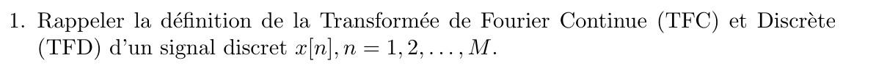{fig-alt="Q1 : rappeler la définition de la transformée de Fourier continue (TFC) et discrète (TFD) d'un signal discret x[n], n = 1, 2, ..., M."}

:::: {.complement}
::: {.solution}
La « TFC » d'un signal discret est la transformée de Fourier **continue en fréquence** de la séquence, appelée TFSD dans le cours TSIG1 ([définition](../../tsig1-traitement-numerique-signal/cours/03-tfd-interpretation-frequentielle.qmd#eq-tfsd)). Pour $M$ échantillons pris à $T_e = 1/F_e$, avec les indices de l'énoncé :
$$X(f) = \sum_{n=1}^{M} x[n]\, e^{-j2\pi f (n-1) T_e}, \qquad f \in \mathbb{R},$$
fonction continue de $f$, périodique de période $F_e$. La **TFD** sur $N$ points l'échantillonne aux fréquences $f_k = (k-1)F_e/N$ :
$$X[k] = X\!\left(\tfrac{(k-1)F_e}{N}\right) = \sum_{n=1}^{M} x[n]\, e^{-j2\pi\frac{(k-1)(n-1)}{N}}, \qquad k = 1, \dots, N.$$
La TFC est la grandeur théorique (non calculable en machine, $f$ continu) ; la TFD est ce que calcule `fft(x, N)`. Avec $N \geq M$, la TFD contient toute l'information de $x$ (elle est inversible).
:::
::::

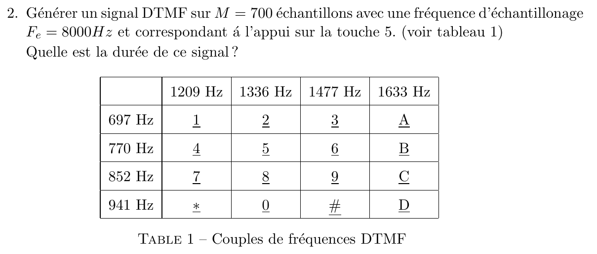{fig-alt="Q2 : générer un signal DTMF sur M = 700 échantillons, Fe = 8000 Hz, correspondant à la touche 5 (tableau 1 : lignes 697, 770, 852, 941 Hz ; colonnes 1209, 1336, 1477, 1633 Hz ; touches 1 2 3 A / 4 5 6 B / 7 8 9 C / * 0 # D) ; quelle est la durée de ce signal ?"}

:::: {.complement}
::: {.solution}
Un signal DTMF (*Dual-Tone Multi-Frequency*) est la **somme de deux sinusoïdes** : la fréquence de la ligne et celle de la colonne de la touche. Touche 5 : ligne 770 Hz, colonne 1336 Hz.
$$x_5[n] = \cos\!\left(2\pi\,\frac{770}{F_e}\,n\right) + \cos\!\left(2\pi\,\frac{1336}{F_e}\,n\right), \qquad n = 0, \dots, M-1.$$

```matlab
Fe = 8000;  M = 700;  n = 0:M-1;
x5 = cos(2*pi*770*n/Fe) + cos(2*pi*1336*n/Fe);
duree = M/Fe                         % 0.0875 s
```

$$\boxed{\text{durée} = \frac{M}{F_e} = \frac{700}{8000} = 87{,}5\ \text{ms}}$$

Les deux fréquences sont inférieures à $F_e/2 = 4$ kHz : pas de repliement.
:::
::::

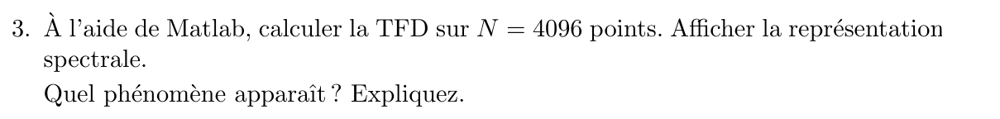{fig-alt="Q3 : à l'aide de Matlab, calculer la TFD sur N = 4096 points ; afficher la représentation spectrale ; quel phénomène apparaît ? Expliquer."}

:::: {.complement}
::: {.solution}
```matlab
N = 4096;
X = abs(fft(x5, N));
f = (0:N-1)*Fe/N;
plot(f(1:N/2), X(1:N/2));
xlabel('Fréquence (Hz)'); ylabel('|X[k]|'); title('Touche 5, TFD sur 4096 points');
```

**Observation** (@fig-ann1617-dtmf, à gauche) : deux pics, à $769{,}5$ Hz et $1335{,}9$ Hz (cases les plus proches de 770 et 1336 Hz, pas $F_e/N \approx 1{,}95$ Hz), de hauteur $\approx 350 = M/2$, **entourés d'oscillations** (lobes secondaires) qui décroissent lentement.

**Phénomène : fenêtrage (fuite spectrale).** Le signal n'est observé que sur $M = 700$ échantillons : c'est le produit des cosinus infinis par une fenêtre rectangulaire. Le spectre est donc la convolution des raies $\pm 770$, $\pm 1336$ Hz par la TF de la fenêtre, un sinus cardinal (noyau de Dirichlet) ([fenêtrage d'un cosinus](../../tsig1-traitement-numerique-signal/cours/03-tfd-interpretation-frequentielle.qmd#eq-cosinus-fenetre)) :

- lobe principal de largeur $2F_e/M \approx 22{,}9$ Hz autour de chaque raie ;
- lobes secondaires espacés de $F_e/M \approx 11{,}4$ Hz, le premier à $-13$ dB.

Avec $N = 4096 \gg M$ (*zero padding*), la TFD échantillonne finement ce sinus cardinal (un point tous les $1{,}95$ Hz) : on **voit** les lobes. Avec $N = M = 700$, on n'aurait qu'un point tous les $11{,}4$ Hz, à peu près un par lobe : mêmes raies, mais allure mal échantillonnée. Les deux fréquences restent bien séparées ($566$ Hz $\gg F_e/M$).
:::
::::

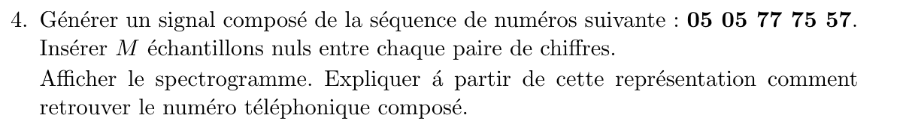{fig-alt="Q4 : générer un signal composé de la séquence 05 05 77 75 57, en insérant M échantillons nuls entre chaque paire de chiffres ; afficher le spectrogramme et expliquer comment retrouver le numéro composé."}

::: {.a-verifier #av-ann1617-silences}
**Source** [sujet-2016, p. 1] : « Générer un signal composé de la séquence de numéros suivante : 05 05 77 75 57. Insérer M échantillons nuls entre chaque paire de chiffres. »

**Problème** : à la lettre, les deux chiffres d'une même paire sont collés sans silence. Pour « 77 », on obtient alors un seul son de 7 de durée $2M$, qu'on ne distingue d'un « 7 » simple que par sa durée. Il est possible que l'auteur ait voulu un silence entre chaque chiffre (pratique habituelle de la numérotation DTMF).

**Proposition** : suivre la lettre de l'énoncé (silences entre les paires seulement, choix retenu ci-dessous) et signaler que, avec un silence entre chaque chiffre, la lecture du spectrogramme serait immédiate.
:::

:::: {.complement}
::: {.solution}
**Construction.** Chaque chiffre donne $M$ échantillons de son couple de fréquences ; $M$ zéros séparent les paires.

```matlab
touches = '123A456B789C*0#D';                 % tableau 1, ligne par ligne
fL = [697 770 852 941];  fH = [1209 1336 1477 1633];
ton = @(c) cos(2*pi*fL(ceil(find(touches == c)/4))*n/Fe) ...
         + cos(2*pi*fH(mod(find(touches == c) - 1, 4) + 1)*n/Fe);
seq = {'05', '05', '77', '75', '57'};
s = [];
for i = 1:numel(seq)
  for c = seq{i}
    s = [s ton(c)];                           % deux chiffres collés
  end
  if i < numel(seq)
    s = [s zeros(1, M)];                      % M zéros entre les paires
  end
end
spectrogram(s, 256, 192, 256, Fe, 'yaxis');   % fenêtres de 32 ms
```
Longueur : $10 \times 700 + 4 \times 700 = 9800$ échantillons, soit $1{,}225$ s.

**Lecture du spectrogramme** (@fig-ann1617-dtmf, à droite). Le spectrogramme découpe le signal en trames courtes et affiche le module de la TFD de chaque trame en fonction du temps. Chaque chiffre apparaît comme **deux traits horizontaux simultanés**, l'un parmi les fréquences basses (697, 770, 852, 941 Hz : la ligne du clavier), l'autre parmi les hautes (1209, 1336, 1477, 1633 Hz : la colonne). On lit pour chaque segment le couple (ligne, colonne) et on retrouve la touche dans le tableau 1 :

- $(941, 1336)$ Hz → 0 ; $(770, 1336)$ Hz → 5 ; $(852, 1209)$ Hz → 7.

Les silences (zones vides) séparent les paires ; à l'intérieur d'une paire, le changement de couple de fréquences marque le passage au chiffre suivant, et un segment deux fois plus long (« 77 ») signale un chiffre répété.

La durée d'une trame règle le compromis : assez longue pour séparer 697 et 770 Hz (écart 73 Hz, il faut une trame $\gtrsim 2F_e/73 \approx 220$ échantillons avec une fenêtre de Hann), assez courte devant la durée d'un chiffre (700 échantillons).

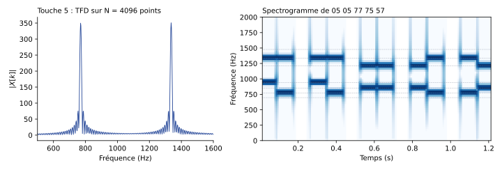{#fig-ann1617-dtmf}
:::
::::

## Exercice 2 : filtrage (barème non indiqué) {#sec-ann1617-ex2}

{fig-alt="Section 2 : Filtrage."}

Cours TSIG1 : [association de systèmes](../../tsig1-traitement-numerique-signal/cours/02-systemes-discrets-convolution.qmd#sec-association-systemes), [transformée en z](../../tsig1-traitement-numerique-signal/cours/04-implementation-equations-differences.qmd#sec-transformee-z), [pôles et zéros](../../tsig1-traitement-numerique-signal/cours/04-implementation-equations-differences.qmd#sec-poles-zeros), [phase linéaire](../../tsig1-traitement-numerique-signal/cours/05-representation-en-phase.qmd#sec-phase-lineaire).

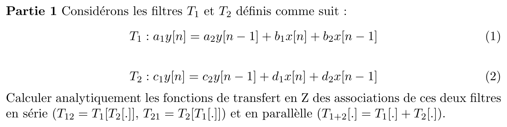{fig-alt="Partie 1 : filtres T1 : a1 y[n] = a2 y[n-1] + b1 x[n] + b2 x[n-1] et T2 : c1 y[n] = c2 y[n-1] + d1 x[n] + d2 x[n-1] ; calculer analytiquement les fonctions de transfert en Z des associations en série (T12 = T1[T2[.]], T21 = T2[T1[.]]) et en parallèle (T1+2[.] = T1[.] + T2[.])."}

:::: {.complement}
::: {.solution}
**Fonctions de transfert de chaque filtre** (transformée en $z$, conditions initiales nulles) :
$$a_1 Y = a_2 z^{-1} Y + b_1 X + b_2 z^{-1} X \;\Longrightarrow\; T_1(z) = \frac{b_1 + b_2 z^{-1}}{a_1 - a_2 z^{-1}}, \qquad T_2(z) = \frac{d_1 + d_2 z^{-1}}{c_1 - c_2 z^{-1}}.$$

**Série.** La sortie de l'un est l'entrée de l'autre : les fonctions de transfert se **multiplient** ([association série](../../tsig1-traitement-numerique-signal/cours/02-systemes-discrets-convolution.qmd#eq-association-serie) : convolution des réponses impulsionnelles, donc produit en $z$). Le produit étant commutatif :
$$\boxed{T_{12}(z) = T_{21}(z) = \frac{b_1 d_1 + (b_1 d_2 + b_2 d_1)\, z^{-1} + b_2 d_2\, z^{-2}}{a_1 c_1 - (a_1 c_2 + a_2 c_1)\, z^{-1} + a_2 c_2\, z^{-2}}}$$
L'ordre des deux filtres ne change pas le résultat (systèmes linéaires invariants, conditions initiales nulles ; en arithmétique finie, l'ordre peut en revanche jouer sur les erreurs d'arrondi).

**Parallèle.** Même entrée, sorties additionnées : les fonctions de transfert **s'additionnent** ([association parallèle](../../tsig1-traitement-numerique-signal/cours/02-systemes-discrets-convolution.qmd#eq-association-parallele)). Au même dénominateur :
$$\boxed{T_{1+2}(z) = \frac{(a_1 d_1 + b_1 c_1) + (a_1 d_2 - a_2 d_1 + b_2 c_1 - b_1 c_2)\, z^{-1} - (a_2 d_2 + b_2 c_2)\, z^{-2}}{a_1 c_1 - (a_1 c_2 + a_2 c_1)\, z^{-1} + a_2 c_2\, z^{-2}}}$$

Les deux associations ont les **mêmes pôles** $a_2/a_1$ et $c_2/c_1$ (sauf simplification) ; seuls les zéros diffèrent. Conditions : $a_1, c_1 \neq 0$ (réalisation causale) ; l'association est stable si $|a_2/a_1| < 1$ et $|c_2/c_1| < 1$. Résultats vérifiés par calcul symbolique.
:::
::::

{fig-alt="Partie 2 : charger le signal mozart.wav."}

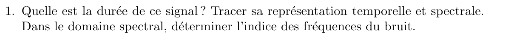{fig-alt="Q1 : quelle est la durée de ce signal ? Tracer ses représentations temporelle et spectrale ; dans le domaine spectral, déterminer l'indice des fréquences du bruit."}

:::: {.complement}
::: {.solution}
```matlab
[x, Fe] = audioread('mozart.wav');  x = x(:, 1);
L = length(x);
duree = L/Fe                                   % durée en secondes
t = (0:L-1)/Fe;
subplot(2,1,1); plot(t, x); xlabel('t (s)'); ylabel('x');
X = fft(x);
subplot(2,1,2); plot(1:L, abs(X)); xlabel('indice k (Matlab)'); ylabel('|X[k]|');
[~, kb] = max(abs(X(2:floor(L/2)))); kb = kb + 1   % indice du pic de bruit
kb2 = L + 2 - kb                               % indice symétrique (fréquence négative)
```

Le bruit sinusoïdal apparaît comme une raie isolée, beaucoup plus haute et plus fine que le spectre de la musique ; on lit son indice $k_b$ (et le symétrique $L + 2 - k_b$, puisque $X$ est à symétrie hermitienne). S'il y a plusieurs sinusoïdes, on relève tous les pics isolés (`findpeaks`). **Valeurs** : non calculables, `mozart.wav` n'est pas dans les sources.
:::
::::

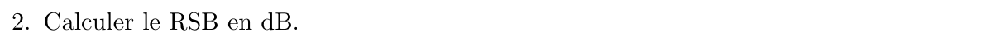{fig-alt="Q2 : calculer le RSB en dB."}

::: {.a-verifier #av-ann1617-rsb}
**Source** [sujet-2016, p. 2] : « 2. Calculer le RSB en dB. »

**Problème** : le RSB est le rapport des puissances du signal utile et du bruit ; or seul le signal bruité `mozart.wav` est fourni (ni la musique propre ni le bruit séparément). Le RSB ne peut être qu'**estimé**.

**Proposition** : estimer la puissance du bruit à partir des cases de la TFD occupées par les raies de bruit (Parseval), comme ci-dessous.
:::

:::: {.complement}
::: {.solution}
**Définition** : $\text{RSB}_\text{dB} = 10\log_{10}\dfrac{\sum_n s[n]^2}{\sum_n e[n]^2}$.

**Estimation.** Par l'égalité de Parseval pour la TFD, $\sum_n e[n]^2 = \frac{1}{L}\sum_k |E[k]|^2$. Le bruit étant concentré dans quelques cases autour de $k_b$ et de son symétrique, où la musique est négligeable, on y lit $E[k] \approx X[k]$ :

```matlab
B = [kb-2:kb+2, kb2-2:kb2+2];                 % cases du bruit (lobe principal)
Pe = sum(abs(X(B)).^2)/L;                     % énergie du bruit
Ptot = sum(x.^2);                             % = sum(abs(X).^2)/L
Ps = Ptot - Pe;                               % énergie de la musique
RSBdB = 10*log10(Ps/Pe)
```
Le nombre de cases retenues (ici 5 de chaque côté) doit couvrir le lobe principal de la raie ; si la fréquence du bruit tombe pile sur la grille, une case suffit. **Valeur** : non calculable sans le fichier.
:::
::::

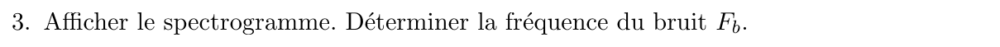{fig-alt="Q3 : afficher le spectrogramme ; déterminer la fréquence du bruit Fb."}

:::: {.complement}
::: {.solution}
```matlab
spectrogram(x, 1024, 512, 1024, Fe, 'yaxis');
Fb = (kb - 1)*Fe/L                             % fréquence du bruit en Hz
```
Le bruit est une **ligne horizontale** qui traverse tout le spectrogramme à hauteur $F_b$ (sinusoïde de fréquence constante, présente en permanence), alors que les notes de musique sont des traits courts qui changent de hauteur. L'indice $k_b$ de la question 1 donne la fréquence à $\pm F_e/(2L)$ près : $F_b = (k_b - 1)F_e/L$ (le $-1$ vient de l'indexation de Matlab à partir de 1).
:::
::::

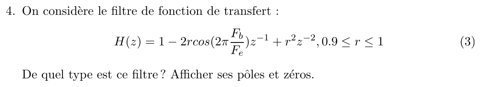{fig-alt="Q4 : filtre H(z) = 1 - 2r cos(2π Fb/Fe) z^-1 + r² z^-2, 0,9 ≤ r ≤ 1 ; de quel type est ce filtre ? Afficher ses pôles et zéros."}

:::: {.complement}
::: {.solution}
On note $\theta_b = 2\pi F_b/F_e$.

**RIF.** $H$ n'a pas de dénominateur : $h = \{1,\ -2r\cos\theta_b,\ r^2\}$, réponse impulsionnelle de 3 échantillons, toujours stable.

**Zéros et pôles.** $H(z) = \dfrac{z^2 - 2r\cos\theta_b\, z + r^2}{z^2}$ ; discriminant réduit $r^2\cos^2\theta_b - r^2 = -r^2\sin^2\theta_b$ :
$$z_{1,2} = r\, e^{\pm j\theta_b}, \qquad \text{pôle double en } z = 0.$$

**Type : réjecteur (coupe-bande) centré sur $F_b$.** Les zéros sont à l'angle $\pm\theta_b$, c'est-à-dire en face de la fréquence du bruit sur le cercle unité. En $f = F_b$ :
$$|H(e^{j\theta_b})| = |1 - r e^{j\theta_b}e^{-j\theta_b}|\;|1 - r e^{-j\theta_b}e^{-j\theta_b}| = (1 - r)\,|1 - r e^{-2j\theta_b}|,$$
nul pour $r = 1$ (zéros **sur** le cercle : réjection totale) et d'autant plus faible que $r$ est proche de 1.

```matlab
r = 1;  th = 2*pi*Fb/Fe;
b = [1 -2*r*cos(th) r^2];
zplane(b, 1);  figure;  freqz(b, 1, 2048, Fe);
```

Limite : ce réjecteur RIF est **peu sélectif**. Le gain vaut $1 - 2r\cos\theta_b + r^2$ en $f = 0$ et $1 + 2r\cos\theta_b + r^2$ en $F_e/2$ ; il varie fortement sur toute la bande (exemple $F_b/F_e = 0{,}3$ sur la @fig-ann1617-rejecteur : $+8{,}4$ dB à $f = 0$, $+2{,}8$ dB à $F_e/2$, encoche très évasée autour de $F_b$), donc la musique est aussi déformée.

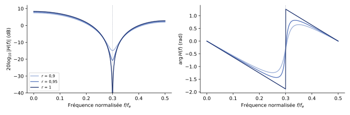{#fig-ann1617-rejecteur}
:::
::::

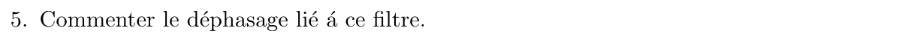{fig-alt="Q5 : commenter le déphasage lié à ce filtre."}

:::: {.complement}
::: {.solution}
**Cas $r = 1$** : les coefficients $\{1, -2\cos\theta_b, 1\}$ sont **symétriques**, le filtre est à [phase linéaire](../../tsig1-traitement-numerique-signal/cours/05-representation-en-phase.qmd#sec-phase-lineaire). En factorisant $e^{-j\omega}$ ($\omega = 2\pi f/F_e$) :
$$H(e^{j\omega}) = e^{-j\omega}\bigl(e^{j\omega} + e^{-j\omega} - 2\cos\theta_b\bigr) = 2\,(\cos\omega - \cos\theta_b)\; e^{-j\omega}.$$
La phase vaut $-\omega$ pour $\omega < \theta_b$ (le facteur réel est positif) et $-\omega + \pi$ au-delà (il change de signe) : droite de pente $-1$ avec un **saut de $\pi$** en $F_b$, là où le module s'annule. Le retard de groupe est constant, égal à **un échantillon** ($1/F_e$) : toutes les fréquences sont retardées de la même durée, la forme du signal n'est pas déformée par la phase. Déphasage négligeable à l'oreille.

**Cas $0{,}9 \leq r < 1$** : coefficients non symétriques, phase **non linéaire** ; elle varie rapidement au voisinage de $F_b$ (d'autant plus que $r$ est proche de 1), sans saut. Les zéros $r e^{\pm j\theta_b}$ sont dans le cercle unité : filtre à [minimum de phase](../../tsig1-traitement-numerique-signal/cours/05-representation-en-phase.qmd#sec-minimum-phase). Loin de $F_b$, la phase reste proche de celle du cas $r = 1$ (@fig-ann1617-rejecteur, à droite).
:::
::::

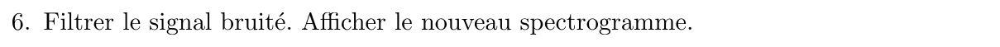{fig-alt="Q6 : filtrer le signal bruité ; afficher le nouveau spectrogramme."}

:::: {.complement}
::: {.solution}
```matlab
r = 1;  th = 2*pi*Fb/Fe;
b = [1 -2*r*cos(th) r^2];
y = filter(b, 1, x);
y = y/max(abs(y));                            % renormalisation (gain jusqu'à ~2,6)
spectrogram(y, 1024, 512, 1024, Fe, 'yaxis');
soundsc(y, Fe);
```
Sur le nouveau spectrogramme, la ligne horizontale à $F_b$ a disparu (pour $r = 1$, un cosinus de fréquence exactement $F_b$ est annulé dès le troisième échantillon). Mais le timbre de la musique est modifié : les composantes proches de $F_b$ sont fortement atténuées et le reste du spectre est pondéré par $|H|$ (question 4). S'il y a plusieurs fréquences de bruit, on met un réjecteur par fréquence en cascade. Si $F_b$ n'est connue qu'à $\pm F_e/(2L)$ près, l'atténuation reste très forte car l'encoche est large.
:::
::::

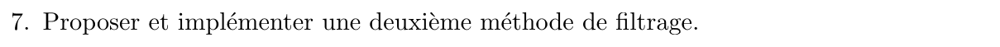{fig-alt="Q7 : proposer et implémenter une deuxième méthode de filtrage."}

:::: {.complement}
::: {.solution}
**Méthode A : réjecteur sélectif RII** (le poly l'appelle $H_2$ [tp, p. 16]). On garde les zéros sur le cercle et on ajoute deux pôles $\rho\, e^{\pm j\theta_b}$ juste à l'intérieur ; près de $F_b$ les zéros dominent, ailleurs pôles et zéros se compensent et le gain revient à $\approx 1$ :
```matlab
rho = 0.98;
b = [1 -2*cos(th) 1];
a = [1 -2*rho*cos(th) rho^2];                 % = poly(rho*roots(b)) ; stable car rho < 1
y2 = filter(b, a, x);
spectrogram(y2, 1024, 512, 1024, Fe, 'yaxis');
```
L'encoche a une largeur $\approx (1 - \rho)F_e/\pi$ et la musique est préservée en dehors.

**Méthode B : suppression dans le domaine de la TFD** [tp, p. 16]. On annule les cases du bruit (et leurs symétriques, pour que le signal reste réel) puis on reconstruit par TFD inverse ; la TFD doit être calculée sur au moins $L$ points pour être inversible.
```matlab
Y = fft(x);  bande = 2;
Y([kb-bande:kb+bande, kb2-bande:kb2+bande]) = 0;
y3 = real(ifft(Y));
```
Très sélective (quelques cases de largeur $F_e/L$), mais traitement en bloc sur tout le signal ; si le bruit ne tombe pas sur la grille, sa fuite spectrale n'est pas entièrement supprimée (élargir `bande`).
:::
::::
