

::: {.complement}
Aucun corrigé officiel ni corrigé d'élève pour ce sujet : **toutes les solutions de cette page sont rédigées par Claude**. Le code Matlab a été testé sous GNU Octave et les calculs vérifiés numériquement. À relire avec un œil critique ; signaler toute erreur.

Le PDF réunit **deux sujets** de la même année : groupe 7 (pages 1-2, exercices 1 et 2 ci-dessous) et groupe 5 (pages 3-4, exercices 3 et 4). Les énoncés sont des extraits des photos du sujet [sujet-2017] ; les annotations manuscrites d'un étudiant (formules au crayon et à l'encre bleue, soulignements) ont été effacées des images. Le fichier `parole1.wav` **ne fait pas partie des sources** (le poly fournit un autre fichier, `parole.wav`, échantillonné à 16 kHz) : les résultats sur la parole sont donnés par la méthode et le code, sans valeur numérique.

Correspondances :

- l'exercice 1 (groupe 7) reprend le poly de TP, « Effet du fenêtrage » [tp, p. 9], avec une période de 30,5 échantillons au lieu de 32 ;
- l'exercice 3 (groupe 5) reprend « Effet fréquentiel du filtrage » [tp, p. 14], avec un autre filtre $T_1$ et les fréquences 4, 64, 128/256 au lieu de 4, 32, 124/256 ;
- les exercices 2 et 4 sont le même exercice « Synthèse bruitée et débruitage » (RSB de 20 dB pour le groupe 7, 15 dB pour le groupe 5), repris du poly [tp, p. 15] ($f_e = 16$ kHz et $f_b = 0{,}2 f_e$ dans le poly) ; le filtre $H_1$ est le filtre (3) du [partiel 2016-2017](2016-2017-partiel.qmd#sec-ann1617-ex2).
:::

## Exercice 1 (groupe 7) : TFD et fenêtrage (8 points) {#sec-ann1718-ex1}

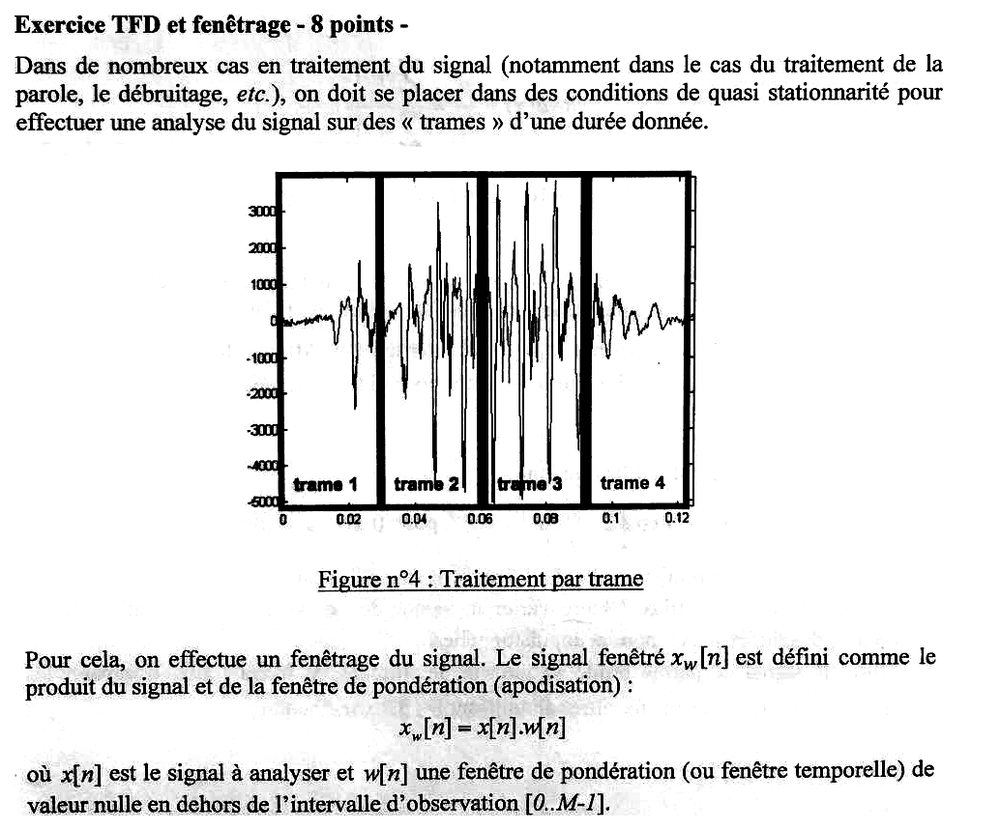{fig-alt="Exercice TFD et fenêtrage (8 points) : analyse par trames d'un signal quasi stationnaire (figure 4 : signal découpé en quatre trames sur 0,12 s) ; signal fenêtré xw[n] = x[n].w[n], w[n] fenêtre nulle hors de l'intervalle d'observation [0..M-1]."}

Cours TSIG1 : [fenêtre d'observation](../../tsig1-traitement-numerique-signal/cours/03-tfd-interpretation-frequentielle.qmd#sec-fenetre-observation), [TFD](../../tsig1-traitement-numerique-signal/cours/03-tfd-interpretation-frequentielle.qmd#def-tfd).

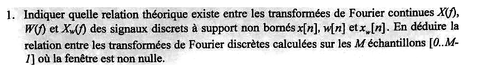{fig-alt="Q1 : relation théorique entre les transformées de Fourier continues X(f), W(f) et Xw(f) des signaux discrets à support non borné x[n], w[n], xw[n] ; en déduire la relation entre les TFD calculées sur les M échantillons [0..M-1] où la fenêtre est non nulle."}

:::: {.complement}
::: {.solution}
**TF continues (TFSD).** Un produit dans le temps devient une convolution en fréquence. Pour des signaux discrets, les TFSD sont périodiques (période $f_e$, ici $f_e = 1$) et la convolution est **périodique**, sur une période :
$$x_w[n] = x[n]\,w[n] \;\Longrightarrow\; \boxed{X_w(f) = (X \circledast W)(f) = \int_{-1/2}^{1/2} X(\nu)\, W(f - \nu)\,\mathrm{d}\nu}$$
(avec $f_e$ quelconque : $\frac{1}{f_e}\int_{-f_e/2}^{f_e/2}$). C'est la version discrète de la [formule du cours](../../tsig1-traitement-numerique-signal/cours/03-tfd-interpretation-frequentielle.qmd#eq-fenetrage).

**TFD sur $M$ points.** $x_w$ est nul hors de $[0, M-1]$, donc sa TFD sur $M$ points échantillonne exactement sa TFSD :
$$X_w[k] = X_w\!\left(\tfrac{k}{M}\right) = (X \circledast W)\!\left(\tfrac{k}{M}\right), \qquad k = 0, \dots, M-1.$$
De façon équivalente, si $X[k]$ et $W[k]$ sont les TFD sur $M$ points des restrictions de $x$ et $w$ à $[0, M-1]$, la TFD d'un produit est la **convolution circulaire** des TFD divisée par $M$ :
$$X_w[k] = \frac{1}{M}\sum_{l=0}^{M-1} X[l]\; W\bigl[(k - l) \bmod M\bigr].$$
Conséquence pratique : ce que montre la TFD n'est pas le spectre de $x$ mais celui de $x$ « vu à travers » la fenêtre ; chaque raie de $X$ est remplacée par une copie de $W$.
:::
::::

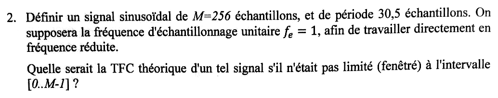{fig-alt="Q2 : définir un signal sinusoïdal de M = 256 échantillons et de période 30,5 échantillons, avec fe = 1 (fréquence réduite) ; quelle serait la TFC théorique de ce signal s'il n'était pas limité à l'intervalle [0..M-1] ?"}

:::: {.complement}
::: {.solution}
Période $30{,}5$ échantillons, donc fréquence réduite
$$f_0 = \frac{1}{30{,}5} \approx 0{,}03279 = \frac{8{,}39}{256}.$$
On prend un cosinus d'amplitude 1 et de phase nulle (l'énoncé ne les fixe pas) :
```matlab
M = 256;  n = 0:M-1;  f0 = 1/30.5;
x = cos(2*pi*f0*n);
```

**TFC théorique du signal non limité** : deux raies (impulsions de Dirac) en $\pm f_0$, de poids $\frac12$, répétées avec la période $f_e = 1$ :
$$X(f) = \frac12 \sum_{m=-\infty}^{+\infty}\bigl[\delta(f - f_0 - m) + \delta(f + f_0 - m)\bigr].$$
Sur $[0, 1[$ : raies en $f_0 \approx 0{,}0328$ et $1 - f_0 \approx 0{,}9672$.

Remarque : $256/30{,}5 \approx 8{,}39$ ; la fenêtre ne contient **pas un nombre entier de périodes**, contrairement au cas du poly (période 32, soit exactement 8 périodes) [tp, p. 9]. C'est ce qui rend la question suivante intéressante.
:::
::::

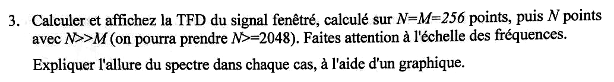{fig-alt="Q3 : calculer et afficher la TFD du signal fenêtré sur N = M = 256 points, puis sur N >> M points (N ≥ 2048), attention à l'échelle des fréquences ; expliquer l'allure du spectre dans chaque cas à l'aide d'un graphique."}

:::: {.complement}
::: {.solution}
Attention aux notations : ici $M$ est le nombre d'échantillons et $N$ le nombre de points de la TFD (inverse de la question 1, où la TFD est « calculée sur les $M$ échantillons »).

```matlab
X1 = abs(fft(x));            % N = M = 256
X2 = abs(fft(x, 2048));      % N = 2048 (zero padding)
plot((0:2047)/2048, X2); hold on
stem((0:M-1)/M, X1, 'r'); hold off
xlim([0 0.08]); xlabel('Fréquence réduite f/f_e'); ylabel('|X[k]|');
legend('N = 2048', 'N = M = 256');
```
L'échelle des abscisses est la fréquence réduite $k/N$ : elle dépend de $N$, d'où la mise en garde de l'énoncé.

**Allure théorique.** D'après la question 1 avec une fenêtre rectangulaire, $X_w(f) = \frac12\bigl[W(f - f_0) + W(f + f_0)\bigr]$ avec
$$|W(f)| = \left|\frac{\sin(\pi f M)}{\sin(\pi f)}\right|,$$
lobe principal de hauteur $M$ et de demi-largeur $1/M$, zéros tous les $1/M$. Autour de $f_0$ on voit donc un noyau de Dirichlet de hauteur $\approx M/2 = 128$.

**$N = 2048$** (@fig-ann1718-tfd-fenetrage, trait) : la TFD échantillonne finement $X_w(f)$ (pas $1/2048$) ; on voit le lobe principal centré sur $f_0$ (maximum lu en $k = 67$, $f = 0{,}03271$, hauteur $126{,}9$) et les lobes secondaires, de plus en plus faibles, espacés de $1/256$. Le *zero padding* améliore la **lecture** du spectre, pas la résolution, fixée par $M$.

**$N = M = 256$** (points) : la TFD prend un point tous les $1/256$. Comme $f_0 = 8{,}39/256$ n'est pas sur cette grille, aucun point ne tombe sur le sommet ni sur les zéros du noyau : le pic est partagé entre $k = 8$ ($96{,}3$) et $k = 9$ ($64{,}9$), et **toutes** les autres cases sont non nulles ($26{,}1$ en $k = 7$, $25{,}4$ en $k = 10$…) : c'est la **fuite spectrale**. Si la période avait été 32 échantillons ($f_0 = 8/256$, sur la grille), les points seraient tombés sur le sommet et sur tous les zéros : une seule raie, $X[8] = 128$, et des zéros ailleurs.

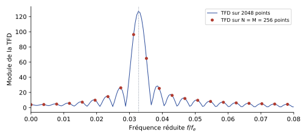{#fig-ann1718-tfd-fenetrage}
:::
::::

## Exercice 2 (groupe 7) : synthèse bruitée et débruitage (12 points) {#sec-ann1718-ex2}

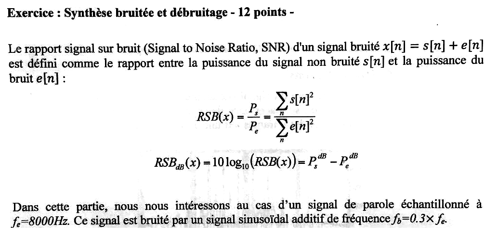{fig-alt="Exercice synthèse bruitée et débruitage (12 points) : RSB(x) = Ps/Pe = somme s[n]² / somme e[n]², RSB_dB = 10 log10(RSB) = Ps_dB - Pe_dB ; signal de parole échantillonné à fe = 8000 Hz, bruité par une sinusoïde additive de fréquence fb = 0,3 fe."}

Cours TSIG1 : [transformée en z](../../tsig1-traitement-numerique-signal/cours/04-implementation-equations-differences.qmd#sec-transformee-z), [pôles et zéros](../../tsig1-traitement-numerique-signal/cours/04-implementation-equations-differences.qmd#sec-poles-zeros), [minimum de phase](../../tsig1-traitement-numerique-signal/cours/05-representation-en-phase.qmd#sec-minimum-phase).

{fig-alt="Q1 : charger le signal parole1.wav noté s[n] et rajouter le bruit ; afficher le signal et sa TFD."}

:::: {.complement}
::: {.solution}
$f_b = 0{,}3 \times 8000 = 2400$ Hz, soit la fréquence réduite $0{,}3$ (inférieure à $\frac12$ : pas de repliement). Bruit $e[n] = G\cos(2\pi f_b n/f_e)$, avec $G = 1$ en attendant la question 2.

```matlab
[s, fe] = audioread('parole1.wav');  s = s(:, 1).';   % fe = 8000 Hz attendu
L = length(s);  n = 0:L-1;  fb = 0.3*fe;
c = cos(2*pi*fb*n/fe);                    % bruit d'amplitude 1
x = s + c;
subplot(2,1,1); plot(n/fe, x); xlabel('t (s)'); title('Parole bruitée');
X = abs(fft(x));  f = (0:L-1)*fe/L;
subplot(2,1,2); plot(f(1:floor(L/2)), X(1:floor(L/2)));
xlabel('Fréquence (Hz)'); ylabel('|X|');
```
Sur la TFD, le bruit est une raie très étroite et haute en 2400 Hz (et en $f_e - f_b = 5600$ Hz sur l'axe complet), au-dessus du spectre étalé de la parole, concentré surtout sous 1 à 2 kHz.
:::
::::

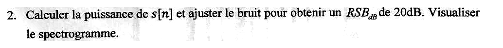{fig-alt="Q2 : calculer la puissance de s[n] et ajuster le bruit pour obtenir un RSB de 20 dB ; visualiser le spectrogramme."}

:::: {.complement}
::: {.solution}
**Calcul de l'amplitude.** Avec $e = G\,c$ :
$$\text{RSB}_\text{dB} = 10\log_{10}\frac{\sum s^2}{G^2\sum c^2} \;\Longrightarrow\; \boxed{G = \sqrt{\frac{\sum_n s[n]^2}{10^{\text{RSB}_\text{dB}/10}\,\sum_n c[n]^2}}}$$
Comme $\sum c^2 \approx L/2$ (puissance moyenne d'un cosinus d'amplitude 1 : $\frac12$), on retrouve $G \approx \sqrt{2P_s/10^{\text{RSB}_\text{dB}/10}}$ où $P_s$ est la puissance moyenne de la parole. Pour 20 dB : $G = \sqrt{2P_s/100} = 0{,}14\sqrt{P_s}$.

```matlab
RSBdB = 20;
Ps = sum(s.^2);
G = sqrt(Ps/(10^(RSBdB/10)*sum(c.^2)));
e = G*c;  x = s + e;
10*log10(sum(s.^2)/sum(e.^2))             % contrôle : 20
spectrogram(x, 256, 128, 256, fe, 'yaxis');
```
Sur le spectrogramme, le bruit est une **ligne horizontale** à 2400 Hz sur toute la durée, la parole des taches (formants, harmoniques) qui varient dans le temps. **Valeurs de $P_s$ et $G$** : non calculables, `parole1.wav` n'est pas dans les sources (le code a été vérifié sur un signal test : RSB obtenu $20{,}000$ dB).
:::
::::

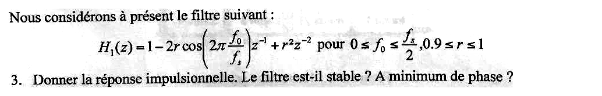{fig-alt="Q3 : filtre H1(z) = 1 - 2r cos(2π f0/fs) z^-1 + r² z^-2 pour 0 ≤ f0 ≤ fs/2, 0,9 ≤ r ≤ 1 ; donner la réponse impulsionnelle ; le filtre est-il stable ? à minimum de phase ?"}

:::: {.complement}
::: {.solution}
**Notations.** L'énoncé de $H_1$ emploie $f_0$ et $f_s$ alors que le texte parle de $f_b$ et $f_e$ : on lit $f_s = f_e$ (fréquence d'échantillonnage) et on choisit $f_0 = f_b$ pour supprimer le bruit. On note $\theta = 2\pi f_0/f_s$ ; ici $\theta = 0{,}6\pi$ et $\cos\theta = -\frac{\sqrt5 - 1}{4} \approx -0{,}309$.

**Réponse impulsionnelle.** $H_1$ est un polynôme en $z^{-1}$ : ses coefficients sont directement les échantillons de $h$ :
$$h[n] = \delta[n] - 2r\cos\theta\;\delta[n-1] + r^2\,\delta[n-2] \quad\Longrightarrow\quad h = \{1,\ -2r\cos\theta,\ r^2\}.$$
Pour $f_0 = 0{,}3 f_s$ : $h = \{1,\ 0{,}618\,r,\ r^2\}$ ; avec $r = 1$, $h = \{1,\ 0{,}618,\ 1\}$.

**Stabilité : oui, toujours.** Filtre RIF : $\sum |h[n]| = 1 + 2r|\cos\theta| + r^2 < \infty$ ; ses seuls pôles sont en $z = 0$ (double).

**Minimum de phase.** Zéros : $z^2 - 2r\cos\theta\, z + r^2 = 0 \Rightarrow z = r\,e^{\pm j\theta}$, de module $r$.

- $0{,}9 \leq r < 1$ : zéros (et pôles) strictement dans le cercle unité : **à minimum de phase**.
- $r = 1$ : zéros **sur** le cercle unité : cas limite, le filtre n'est pas à minimum de phase au sens strict (pas d'inverse stable : $1/H_1$ aurait des pôles sur le cercle). C'est justement ce cas qui annule totalement $f_0$.
:::
::::

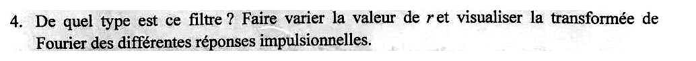{fig-alt="Q4 : de quel type est ce filtre ? Faire varier la valeur de r et visualiser la transformée de Fourier des différentes réponses impulsionnelles."}

:::: {.complement}
::: {.solution}
**Type : RIF réjecteur (coupe-bande) centré sur $f_0$.** Les zéros $r e^{\pm j\theta}$ sont placés en face de la fréquence $f_0$ sur le cercle unité ; le gain y vaut
$$|H_1(f_0)| = (1 - r)\,\bigl|1 - r e^{-2j\theta}\bigr|,$$
d'où, pour $f_0 = 0{,}3 f_s$ : $0{,}181$ ($-14{,}9$ dB) pour $r = 0{,}9$, $0{,}093$ ($-20{,}7$ dB) pour $r = 0{,}95$, et $0$ pour $r = 1$.

```matlab
th = 2*pi*0.3;
for r = [0.9 0.95 0.99 1]
  h = [1 -2*r*cos(th) r^2];
  H = fft(h, 1024);                       % TF de la réponse impulsionnelle
  plot((0:511)/1024, 20*log10(abs(H(1:512)))); hold on
end
hold off; xlabel('f/f_e'); ylabel('|H_1| (dB)'); legend('r = 0,9', '0,95', '0,99', '1');
```

**Effet de $r$** (@fig-ann1718-rejecteur) : plus $r$ est proche de 1, plus l'encoche en $f_0$ est profonde ; à $r = 1$ elle devient infinie (réjection totale). Le reste de la courbe change peu : gain $1 - 2r\cos\theta + r^2$ en $f = 0$ ($2{,}62$, soit $+8{,}4$ dB, pour $r = 1$) et $1 + 2r\cos\theta + r^2$ en $f_e/2$ ($1{,}38$). Le filtre est **peu sélectif** : l'encoche est très large et la bande utile est déformée, d'où l'intérêt de la version à pôles (question 5).

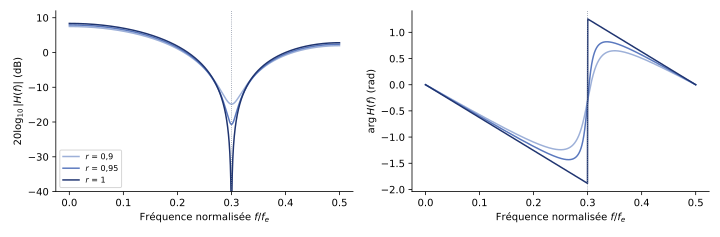{#fig-ann1718-rejecteur}
:::
::::

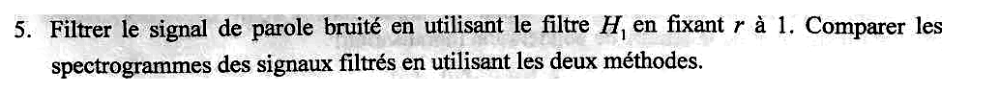{fig-alt="Q5 : filtrer le signal de parole bruité avec H1 en fixant r à 1 ; comparer les spectrogrammes des signaux filtrés en utilisant les deux méthodes."}

::: {.a-verifier #av-ann1718-deux-methodes}
**Source** [sujet-2017, p. 2] : « Filtrer le signal de parole bruité en utilisant le filtre $H_1$ en fixant $r$ à 1. Comparer les spectrogrammes des signaux filtrés en utilisant les deux méthodes. »

**Problème** : le sujet ne décrit qu'**une** méthode de filtrage ($H_1$). La phrase vient du poly de TP 2022-2023, où elle suit (dans la numérotation des questions) un débruitage par annulation des raies du bruit sur la TFD et reconstruction par TFD inverse [tp-2022, p. 17-18, q. 7 à 11] ; dans le sujet d'examen, cette première méthode n'est pas demandée.

**Proposition** : comparer le filtrage par $H_1$ ($r = 1$) au débruitage par annulation des cases de la TFD ; ci-dessous on donne aussi le réjecteur à pôles $H_2$ du poly [tp, p. 16], plus sélectif.
:::

:::: {.complement}
::: {.solution}
**Méthode 1 : $H_1$ avec $r = 1$.**
```matlab
th = 2*pi*fb/fe;
y1 = filter([1 -2*cos(th) 1], 1, x);
```
Le cosinus à $f_b$ est annulé exactement dès le troisième échantillon (vérifié numériquement : résidu de l'ordre de $10^{-13}$). Sur le spectrogramme, la ligne à 2400 Hz disparaît, mais toute la zone autour de 2400 Hz est fortement atténuée et les basses fréquences sont amplifiées ($+8{,}4$ dB) : la parole est colorée.

**Méthode 2 : suppression sur la TFD** (voir la variante plus bas). **Autre possibilité : réjecteur sélectif $H_2$** [tp, p. 16] (zéros de $H_1$ avec $r = 1$, pôles $\rho e^{\pm j\theta}$) :
```matlab
rho = 0.98;
y2 = filter([1 -2*cos(th) 1], [1 -2*rho*cos(th) rho^2], x);
```
Même suppression de la raie, mais l'encoche n'a qu'une largeur $\approx (1 - \rho) f_e/\pi \approx 50$ Hz et le gain reste $\approx 1$ ailleurs : spectrogramme de la parole quasi intact.

**Code de la suppression sur la TFD.**
```matlab
Xf = fft(x);  kb = round(fb*L/fe) + 1;  bande = 2;
Xf([kb-bande:kb+bande, L+2-kb-bande:L+2-kb+bande]) = 0;
y3 = real(ifft(Xf));
```

**Comparaison.**
```matlab
subplot(2,2,1); spectrogram(x,  256, 128, 256, fe, 'yaxis'); title('bruité');
subplot(2,2,2); spectrogram(y1, 256, 128, 256, fe, 'yaxis'); title('H_1, r = 1');
subplot(2,2,3); spectrogram(y3, 256, 128, 256, fe, 'yaxis'); title('cases TFD annulées');
subplot(2,2,4); spectrogram(y2, 256, 128, 256, fe, 'yaxis'); title('H_2, \rho = 0,98');
```
Toutes suppriment la ligne horizontale à 2400 Hz. La suppression sur la TFD et $H_2$ préservent beaucoup mieux le reste du spectre que le RIF $H_1$ ; la première traite tout le signal d'un bloc (pas de temps réel), $H_2$ a un transitoire un peu plus long (réponse impulsionnelle infinie, décroissance en $\rho^n$).
:::
::::

## Exercice 3 (groupe 5) : équation aux différences (10 points) {#sec-ann1718-ex3}

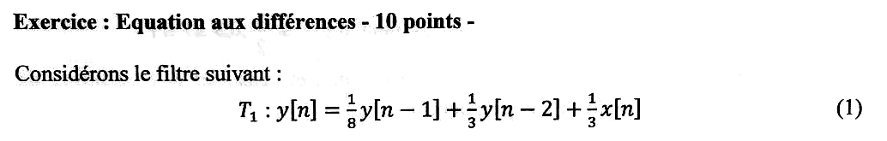{fig-alt="Exercice équation aux différences (10 points) : filtre T1 : y[n] = 1/8 y[n-1] + 1/3 y[n-2] + 1/3 x[n]."}

Cours TSIG1 : [équations aux différences](../../tsig1-traitement-numerique-signal/cours/04-implementation-equations-differences.qmd#sec-equations-differences), [réponse à une sinusoïde](../../tsig1-traitement-numerique-signal/cours/03-tfd-interpretation-frequentielle.qmd#sec-reponse-sinusoide), [Y = HX](../../tsig1-traitement-numerique-signal/cours/03-tfd-interpretation-frequentielle.qmd#eq-y-egal-hx).

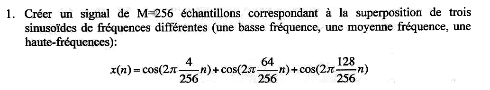{fig-alt="Q1 : créer un signal de M = 256 échantillons, somme de trois sinusoïdes (basse, moyenne et haute fréquence) : x(n) = cos(2π 4/256 n) + cos(2π 64/256 n) + cos(2π 128/256 n)."}

:::: {.complement}
::: {.solution}
```matlab
M = 256;  n = 0:M-1;
x = cos(2*pi*4/256*n) + cos(2*pi*64/256*n) + cos(2*pi*128/256*n);
```
Fréquences réduites $\frac{4}{256} \approx 0{,}0156$, $\frac{64}{256} = \frac14$ et $\frac{128}{256} = \frac12$. La troisième est la fréquence de Nyquist : $\cos(\pi n) = (-1)^n$, une alternance $+1, -1$. Les trois fréquences sont des multiples de $1/256$ : il y a un nombre entier de périodes dans les 256 échantillons, donc **pas de fuite** dans la TFD à 256 points.
:::
::::

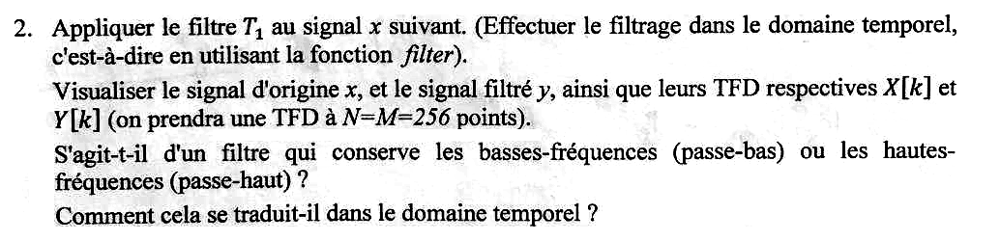{fig-alt="Q2 : appliquer le filtre T1 au signal x dans le domaine temporel (fonction filter) ; visualiser x, le signal filtré y et leurs TFD X[k], Y[k] sur N = M = 256 points ; s'agit-il d'un filtre passe-bas ou passe-haut ? Comment cela se traduit-il dans le domaine temporel ?"}

::: {.a-verifier #av-ann1718-t1-type}
**Source** [sujet-2017, p. 3] : « S'agit-t-il d'un filtre qui conserve les basses-fréquences (passe-bas) ou les hautes-fréquences (passe-haut) ? »

**Problème** : le filtre $T_1$ du sujet n'est ni l'un ni l'autre au sens strict : son gain vaut $0{,}615$ en $f = 0$, passe par un minimum $0{,}249$ vers $f \approx 0{,}26$ et remonte à $0{,}421$ en $f = \frac12$ (calcul ci-dessous). La question semble reprise du poly de TP, où le filtre $T_1$ est différent [tp, p. 14].

**Proposition** : répondre « à dominante passe-bas » (gain maximal en $f = 0$, pôle dominant positif), en signalant l'atténuation plus forte de la fréquence moyenne et la remontée en haute fréquence.
:::

:::: {.complement}
::: {.solution}
```matlab
b = 1/3;  a = [1 -1/8 -1/3];
y = filter(b, a, x);
X = fft(x);  Y = fft(y);  k = 0:M-1;
subplot(2,2,1); plot(n, x); title('x[n]');
subplot(2,2,2); plot(n, y); title('y[n]');
subplot(2,2,3); stem(k, abs(X)); title('|X[k]|');
subplot(2,2,4); stem(k, abs(Y)); title('|Y[k]|');
```

**Fonction de transfert et réponse en fréquence.**
$$H(z) = \frac{\frac13}{1 - \frac18 z^{-1} - \frac13 z^{-2}}, \qquad \text{pôles } z = \frac{1}{16} \pm \sqrt{\frac{1}{256} + \frac13} \approx 0{,}643 \ \text{et}\ -0{,}518.$$
Pôles dans le cercle unité : filtre RII **stable**. Gains aux fréquences de $x$ :

| $f$ | $0$ | $4/256$ | $64/256$ | $128/256$ |
|---|---|---|---|---|
| $\lvert H(f)\rvert$ | $0{,}615$ | $0{,}602$ | $0{,}249$ | $0{,}421$ |
| $\lvert Y[k]\rvert$ mesuré | — | $76{,}4$ | $31{,}7$ | $107{,}5$ |
| $\lvert X[k]\rvert$ | — | $128$ | $128$ | $256$ |

($H(1) = \frac{1/3}{1 - 1/8 - 1/3} = \frac{8}{13}$, $H(-1) = \frac{1/3}{1 + 1/8 - 1/3} = \frac{8}{19}$.) La raie en $\frac12$ vaut 256 et non 128 dans $X$ : à la fréquence de Nyquist, les raies $+\frac12$ et $-\frac12$ tombent sur la même case.

**Interprétation.** Le pôle positif $0{,}643$ (proche de $z = 1$, donc de $f = 0$) relève les basses fréquences, le pôle négatif $-0{,}518$ (proche de $z = -1$) relève un peu les hautes : la composante lente est la mieux conservée, la composante moyenne la plus atténuée ; filtre **à dominante passe-bas**, mais pas un passe-bas franc (voir le bloc *À vérifier*). Le gain est inférieur à 1 partout : $y$ est globalement plus faible que $x$.

**Dans le domaine temporel** : $y$ est une moyenne pondérée de l'entrée et des sorties passées (coefficients positifs pour $y[n-1]$ et $y[n-2]$) : il **lisse** le signal. Sur la courbe, la sinusoïde lente (période 64 échantillons) domine davantage $y$ que $x$ ; l'oscillation de période 4 est fortement atténuée (gain $0{,}25$) ; l'alternance $(-1)^n$ reste visible (gain $0{,}42$). Les premiers échantillons montrent un court régime transitoire (le filtre part du repos).
:::
::::

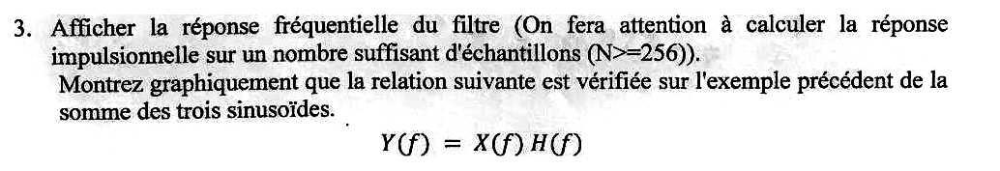{fig-alt="Q3 : afficher la réponse fréquentielle du filtre (réponse impulsionnelle calculée sur un nombre suffisant d'échantillons, N ≥ 256) ; montrer graphiquement que Y(f) = X(f) H(f) sur l'exemple de la somme des trois sinusoïdes."}

:::: {.complement}
::: {.solution}
```matlab
h = filter(b, a, [1 zeros(1, M-1)]);     % réponse impulsionnelle sur 256 échantillons
H = fft(h);                              % H[k] = H(k/256), aux arrondis près
figure; plot(k/M, abs(H)); xlabel('f/f_e'); ylabel('|H|'); xlim([0 0.5]);
figure; stem(k, abs(Y)); hold on
plot(k, abs(X.*H), 'rx'); hold off
legend('|Y[k]| (filter)', '|X[k] H[k]|');
```

**Pourquoi un nombre suffisant d'échantillons.** $h$ est infinie mais décroît comme $0{,}643^n$ : à $n = 255$ elle vaut $\approx 10^{-50}$. Tronquée à 256 échantillons, sa TFD donne $H(k/256)$ sans erreur visible ; avec trop peu d'échantillons (par exemple 8), on calculerait la TF d'une version tronquée et le module serait faux.

**Vérification de $Y = XH$** (@fig-ann1718-filtre-t1) : aux trois fréquences, $|Y[k]|$ vaut $76{,}4$ ; $31{,}7$ ; $107{,}5$ et $|X[k]H[k]|$ vaut $77{,}0$ ; $31{,}9$ ; $107{,}8$. L'accord est très bon mais pas exact (écart maximal $0{,}57$ sur un pic de $107$, soit $0{,}5$ %). Raison : la relation $Y(f) = H(f)X(f)$ est exacte pour les TF de signaux infinis ; la TFD, elle, correspond à une convolution **circulaire**, alors que `filter` fait une convolution linéaire qui démarre du repos (régime transitoire au début de $y$). L'écart vient de ce transitoire et diminuerait avec un signal plus long.

![Module de la réponse en fréquence de $T_1$ (trait) et rapports $|Y[k]|/|X[k]|$ mesurés aux trois fréquences de $x$ sur les TFD à 256 points (points). Figure calculée.](../figures/ann-2017-filtre-t1.svg){#fig-ann1718-filtre-t1}
:::
::::

## Exercice 4 (groupe 5) : synthèse bruitée et débruitage (10 points) {#sec-ann1718-ex4}

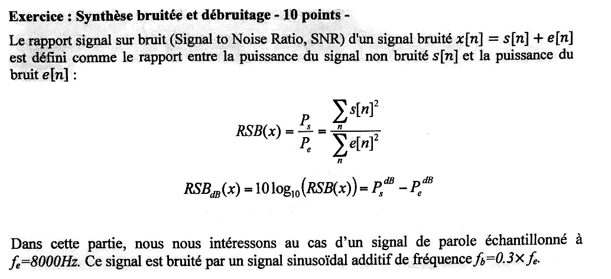{fig-alt="Exercice synthèse bruitée et débruitage (10 points) : mêmes définitions du RSB ; signal de parole échantillonné à fe = 8000 Hz, bruité par une sinusoïde additive de fréquence fb = 0,3 fe."}

Même exercice que l'[exercice 2](#sec-ann1718-ex2) (groupe 7), avec un RSB de 15 dB et sans la question sur la réponse impulsionnelle.

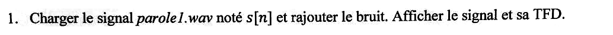{fig-alt="Q1 : charger le signal parole1.wav noté s[n] et rajouter le bruit ; afficher le signal et sa TFD."}

:::: {.complement}
::: {.solution}
Identique à l'[exercice 2, question 1](#sec-ann1718-ex2) : $f_b = 2400$ Hz, bruit $c[n] = \cos(2\pi f_b n/f_e)$ ajouté à $s$, raie isolée en 2400 Hz sur la TFD.
:::
::::

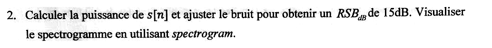{fig-alt="Q2 : calculer la puissance de s[n] et ajuster le bruit pour obtenir un RSB de 15 dB ; visualiser le spectrogramme avec spectrogram."}

:::: {.complement}
::: {.solution}
Même calcul qu'à l'exercice 2 avec $\text{RSB}_\text{dB} = 15$ :
$$G = \sqrt{\frac{\sum s^2}{10^{1{,}5}\sum c^2}} \approx \sqrt{\frac{2P_s}{31{,}6}} = 0{,}25\sqrt{P_s},$$
soit une amplitude de bruit $10^{0{,}25} \approx 1{,}78$ fois plus grande qu'à 20 dB.
```matlab
RSBdB = 15;
G = sqrt(sum(s.^2)/(10^(RSBdB/10)*sum(c.^2)));
e = G*c;  x = s + e;
spectrogram(x, 256, 128, 256, fe, 'yaxis');
```
La ligne à 2400 Hz est plus marquée que pour le groupe 7.
:::
::::

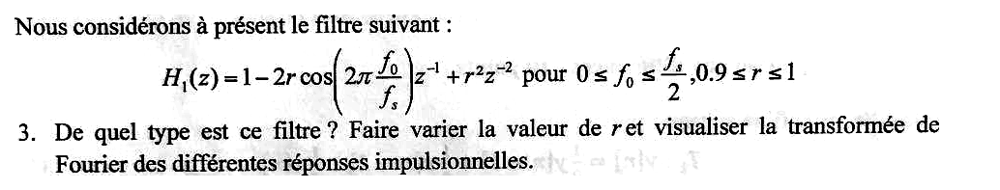{fig-alt="Q3 : filtre H1(z) = 1 - 2r cos(2π f0/fs) z^-1 + r² z^-2, 0 ≤ f0 ≤ fs/2, 0,9 ≤ r ≤ 1 ; de quel type est ce filtre ? Faire varier r et visualiser la transformée de Fourier des différentes réponses impulsionnelles."}

:::: {.complement}
::: {.solution}
Voir l'[exercice 2, questions 3 et 4](#sec-ann1718-ex2) : RIF réjecteur (coupe-bande) de réponse impulsionnelle $\{1, -2r\cos\theta, r^2\}$, zéros $r e^{\pm j\theta}$ en face de $f_0$, encoche d'autant plus profonde que $r$ est proche de 1 (gain $(1 - r)\,|1 - r e^{-2j\theta}|$ en $f_0$, nul pour $r = 1$), peu sélectif (@fig-ann1718-rejecteur).
:::
::::

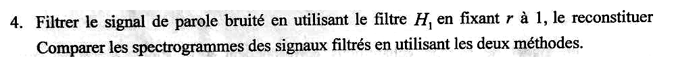{fig-alt="Q4 : filtrer le signal de parole bruité avec H1 en fixant r à 1, le reconstituer ; comparer les spectrogrammes des signaux filtrés en utilisant les deux méthodes."}

::: {.a-verifier #av-ann1718-g5-reconstituer}
**Source** [sujet-2017, p. 4] : « Filtrer le signal de parole bruité en utilisant le filtre $H_1$ en fixant $r$ à 1, le reconstituer Comparer les spectrogrammes des signaux filtrés en utilisant les deux méthodes. »

**Problème** : la phrase est incomplète (ponctuation manquante après « reconstituer ») ; « le reconstituer » n'est pas défini (reconstruction par TFD inverse ?) ; comme au groupe 7, une seule méthode est décrite (voir `av-ann1718-deux-methodes`). Le poly de TP 2022-2023 contient la même phrase (« le reconstituer puis écouter le résultat ») à la suite d'un débruitage par annulation des raies de la TFD et reconstruction par TFD inverse [tp-2022, p. 17-18, q. 7 à 11].

**Proposition** : comprendre « filtrer avec $H_1$ ($r = 1$), puis comparer au signal débruité sur la TFD et reconstitué par TFD inverse ».
:::

:::: {.complement}
::: {.solution}
**Méthode 1** (filtrage temporel par $H_1$, $r = 1$) et **méthode 2** (annulation des cases du bruit dans la TFD et reconstitution par `real(ifft(...))`) : codes de l'[exercice 2, question 5](#sec-ann1718-ex2).

**Comparaison des spectrogrammes.** Les deux suppriment la ligne à 2400 Hz. $H_1$ atténue aussi largement la bande autour de 2400 Hz et amplifie les basses fréquences (gain $2{,}6$ en $f = 0$, à renormaliser) ; la méthode par TFD n'enlève que quelques cases de largeur $f_e/L$ autour de $f_b$ et laisse la parole quasi intacte, mais elle traite tout le signal d'un bloc (non utilisable en temps réel) et, si $f_b$ ne tombe pas sur la grille, une partie de la fuite du bruit subsiste (élargir la bande annulée).
:::
::::
